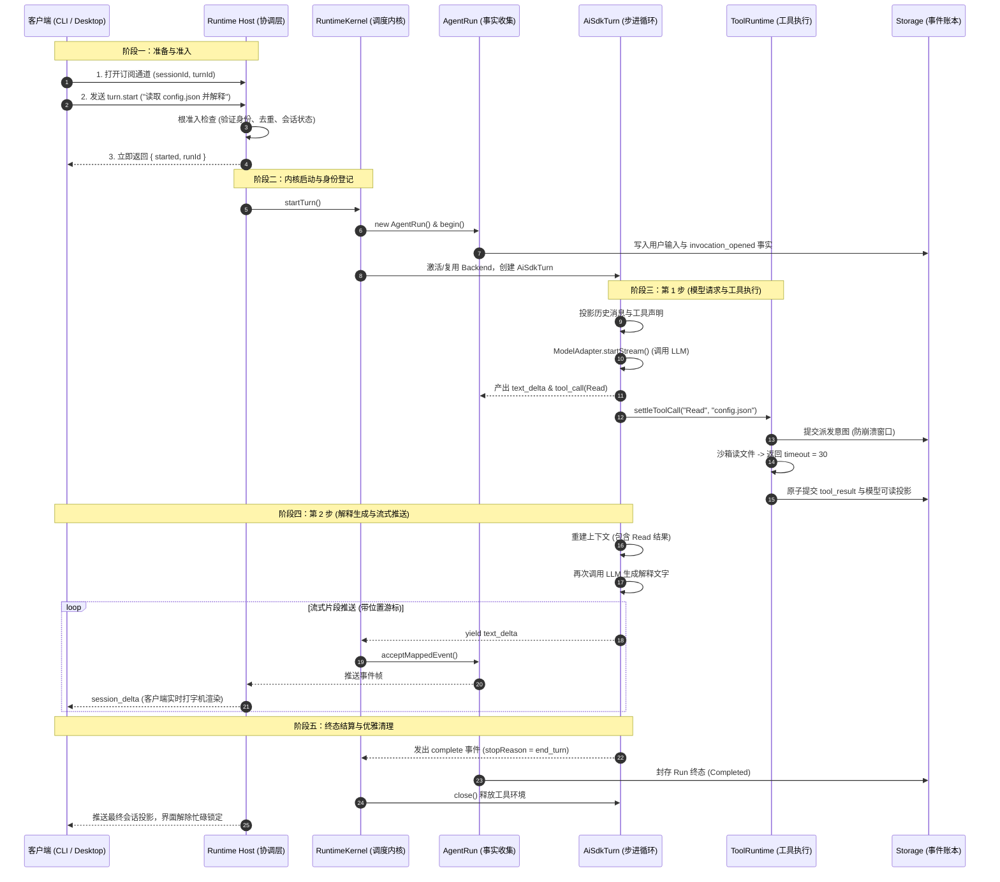

# 从输入到回答：端到端请求与响应链路

[返回手册目录](../README.md)

当用户在终端（CLI）或桌面应用（Desktop）中按下回车键，发送一句“读取 `config.json`，解释其中的超时设置”时，系统内部究竟发生了什么？在直观的“发请求 → 等回复”表象背后，Agent 基础设施必须同步解决三个核心问题：**如何保证实时界面不丢帧、如何保证中途断线能恢复现场、以及如何让模型与本地工具安全地接力协作。**

本章以这条具体指令为主线，端到端拆解一次用户请求在 Maka 中的完整生命周期，剖析 Host 准入、内核调度、工具结算与流式回传之间的精密协作。

---

## 1. 概念先行：为什么必须“先建订阅，再发请求”？

在传统的 HTTP 接口调用中，客户端发送 `POST /chat`，并在同一个连接中等待响应流返回。但在多端托管架构（Runtime Host）中，这种做法会遇到致命缺陷：**如果网络闪断，连接断开，客户端就彻底丢失了正在生成的半截回答与工具执行进度。**

Maka 采用的是**指令提交与事件订阅分离**的异步模型：
1. **先订阅（Subscribe First）**：客户端在提交消息前，先向 Host 针对目标 `sessionId` 和 `turnId` 打开一条事件订阅通道。
2. **再触发（Dispatch Command）**：客户端发送 `turn.start` 命令。Host 在准入校验通过后，立即返回 `{ status: "started", runId }` 确认应答，真正的模型推理在 Host 后台异步推进。
3. **带位置拉流（Cursor-based Streaming）**：Host 一边将产生的真实事件落盘，一边通过订阅通道将增量帧推送给所有已订阅该会话的客户端（包括发起请求的 CLI，以及旁边同时打开的桌面端窗口）。

这种设计保证了**指令发出者的网络连接状态与后台任务的生命周期彻底解耦**。即使 CLI 终端意外闪退，后台正在执行的构建命令或模型推导依然安全推进；重新打开终端后，客户端只需从上次确认的游标位置继续订阅，即可无缝续接画面。

---

## 2. 端到端全链路时序图

以下时序图展示了“读取 `config.json` 并解释超时设置”从用户输入到最终渲染的全过程：



---

## 3. 核心阶段拆解：请求如何在各层间交接？

### 阶段一：Host 启动时的依赖装配
在接收任何请求前，Runtime Host 启动装配中心就已经把所有依赖接通：
- 打开底层 SQLite 存储，初始化 `SessionStore`、`AgentRunStore` 与 `RuntimeEventStore`。
- 注册后端工厂（如 `AiSdkBackend` 工厂），并将事件存储实例注入 Runtime。
- **关键意义**：`Runtime` 与 `ToolRuntime` 共享同一个持久化提交接口（Commit Sink）。这确保了“模型说的话”和“工具干的事”能够按严格的因果顺序落入同一份账本。

### 阶段二：CLI 提交与 Host 根准入
当用户在 CLI 输入提示词时，CLI 的驱动层会预先在本地生成一个客户端侧的 `turnId`，打开订阅通道监听该会话的变化，随后发送 `turn.start` 操作。
Host 收到操作后，由交互轮次协调器（`RootTurnCoordinator`）在会话准入锁内完成：
1. **幂等去重**：检查该 `turnId` 是否已经处理过，防止网络重传导致重复扣费。
2. **并发保护**：判断当前会话是否空闲。若繁忙，根据输入类型决定是打断引导（Steering）、排队等待（Follow-up），还是拒绝。
3. **后台抽水（Drain）**：准入通过后，Host 在后台启动一个异步消费者任务（`drainTurn()`），主动从 RuntimeKernel 返回的异步生成器中不断拉取事件。

### 阶段三：Kernel 调度、Run 建档与 Turn 步进
请求进入 `SessionManager.sendMessage()` 后，直接交给核心调度器 `RuntimeKernel`：
1. Kernel 实例化 `AgentRun`，把用户输入和开篇事件（`invocation_opened`）记录下来。
2. Kernel 向 `BackendGeneration` 申请一个可用的后端实例（已有则复用，配置变更则重建）。
3. 后端为本次请求创建一个作用域完全隔离的 `AiSdkTurn`，开启内部的模型与工具循环。
   - **Step 1**：模型返回 `Read("config.json")`。`ToolRuntime` 先向存储提交“即将执行工具”的记录，再进入沙箱读出 `timeout = 30`，最后提交结果。
   - **Step 2**：Turn 读取最新事实并投影为包含工具结果的新上下文，再次发往模型，获得最终文本解释。

### 阶段四：带确认机制的事件回传（Delivery Ack）
在传统流式处理中，如果生产端（Turn）跑得太快，或者在消费者（Host/Storage）还没来得及把“工具结果”写进数据库时就发出了下一个模型请求，就会导致上下文缺失或状态错乱。

Maka 在 Kernel 与 Turn 之间引入了 **带确认的交付队列（`DeliveryAckQueue`）**：
- 每当 Turn 产生一个核心事件（如工具结算结果、终态完成信号），它通过 `yield` 交给 Kernel。
- Kernel 将其映射并交由 `AgentRun.acceptMappedEvent()` 持久化落盘，再转发给 Host 广播给客户端。
- 只有当消费者真正处理完当前事件并推进迭代器（`ackConsumed()`）后，队列才放行生产端继续往下走（例如进入下一步模型请求）。

**这种“背压确认”机制以极小的同步等待代价，换取了绝对的因果顺序一致性**：界面显示“执行完成”时，数据库里一定已经安全落盘。

---

## 4. 教学伪代码：异步提交与流式消费模型

以下伪代码展示了客户端驱动与 Host 协调器是如何通过异步生成器与订阅通道解耦的：

```text
// === 客户端侧 (CLI / Desktop) ===
function submitUserPrompt(sessionId, promptText):
    turnId = generateUUID()
    
    // 1. 必须先建立订阅，确保不会漏掉启动瞬间的早期事件
    subscription = hostClient.subscribeSession(sessionId, { sinceLatest: true })
    
    // 2. 异步提交执行命令，立即拿到 runId 确认
    ack = await hostClient.dispatch("turn.start", { sessionId, turnId, text: promptText })
    ui.markTurnStarted(turnId, ack.runId)

    // 3. 在独立循环中持续渲染 Host 推来的投影帧
    for await frame in subscription:
        if frame.type == "session_delta":
            ui.appendStreamingText(frame.delta)
        else if frame.type == "session_event":
            ui.renderToolCard(frame.event)
        else if frame.type == "terminal_projection" and frame.turnId == turnId:
            ui.finalizeTurn(frame.finalState)
            break

// === 宿主协调层 (Runtime Host) ===
function handleTurnStartCommand(cmd):
    // 1. 准入核验与登记
    admission = admissionOwner.admitRootTurn(cmd.sessionId, cmd.turnId, cmd.text)
    if admission.isDuplicate:
        return { status: "already_admitted", runId: admission.existingRunId }

    // 2. 后台启动异步执行与抽水，不阻塞当前 RPC 响应
    spawnBackgroundTask(async () => {
        eventStream = sessionManager.sendMessage(cmd.sessionId, cmd.text, admission.runId)
        try:
            for await event in eventStream:
                // 3. 转发实时增量与事实给所有在线订阅者
                continuityCoordinator.publishEvent(cmd.sessionId, event)
        finally:
            // 4. 确保结清后向所有订阅者推送权威终态投影
            continuityCoordinator.publishTerminalProjection(cmd.sessionId, cmd.turnId)
    })

    return { status: "started", runId: admission.runId }
```

---

## 5. 对照 Pi：嵌入式调用 vs 托管协议订阅

在理解了 Maka 的完整调用链后，对照参考实现 Pi 可以更清晰地看出两种架构的取舍：

| 对比维度 | Maka（托管服务流式链路） | Pi（嵌入式本地循环链路） |
| :--- | :--- | :--- |
| **调用起点** | 客户端发送 RPC 命令 `turn.start`，Host 异步准入并返回 `runId` | 应用程序直接调用内存方法 `agent.prompt(text)` |
| **事件分发** | 通过带确认的异步生成器（Kernel）→ 协调器（Host）→ 跨进程订阅帧（Client） | 通过内存中的观察者监听器（EventListener）同步/异步回调 UI |
| **并发与断连** | 支持多客户端同时订阅同一会话；客户端断连不影响后台 Turn 推进 | 单进程绑定；CLI 进程一旦退出，内存中的 `runLoop()` 即刻终止 |
| **适用场景** | 需要 Desktop + CLI 协同、远程托管执行、后台任务持续运行的复杂平台 | 轻量级本地工具、单进程独占终端、无跨端同步需求的嵌入式场景 |

---

## 6. 延伸阅读

- 想要深入了解调用链中各个对象的创建与销毁时机，阅读 [01.2 会话与执行对象的生命周期](session-lifecycle.md)。
- 想要放大查看 `AiSdkTurn` 内部是如何循环请求模型并结算本地工具的，阅读 [01.3 模型步进与循环](model-step.md)。
- 想要了解多个客户端同时连接时 Host 如何保障单写入权威，阅读 [04.2 Host 所有权与多端同步](../04-state/host-ownership-and-sync.md)。
