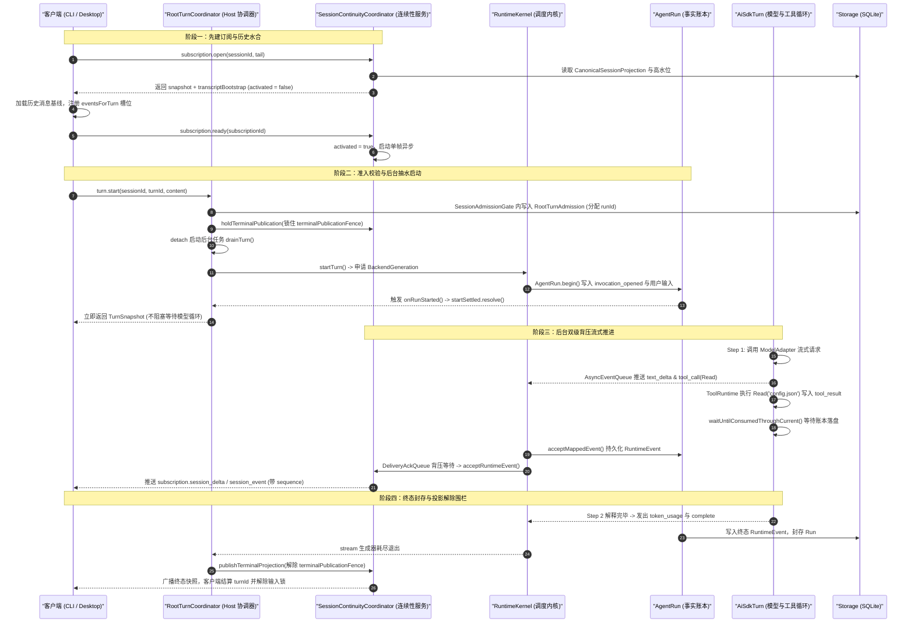

# 从输入到回答：端到端请求与响应链路

[返回手册目录](../README.md)

当用户在终端（CLI）或桌面应用（Desktop）中按下回车键，发送一句“读取 `config.json`，解释其中的超时设置”时，系统内部究竟发生了什么？在直观的“发请求 → 等回复”表象背后，Agent 基础设施必须同时解决四个系统级难题：**如何保证客户端在切换界面或网络闪断时不丢帧、如何避免前端慢渲染拖垮后台模型循环、如何保证工具执行与账本落盘的绝对因果顺序、以及如何在后台无缝推进任务直至物理结清。**

本章以这条指令为主线，端到端拆解一次用户请求从接入层到内核执行层、再经由背压通道回传客户端的完整链路。

---

## 1. 概念先行：为什么必须“先建订阅，再发请求”？

在传统的同步 HTTP 接口设计中，客户端发送一次 `POST /chat`，然后在同一条连接里等待服务端把流式响应吐完。一旦这条连接因为 Wi-Fi 切换、笔记本休眠、或是终端窗口刷新而中断，正在生成中的推理过程与工具进度就会彻底蒸发，客户端也无从得知后台的 Bash 命令到底执行完了没有。

Maka 将“**读取状态流**”与“**提交控制指令**”彻底劈成两条解耦的通道，并强制执行**先建订阅，再发请求（Subscribe First, Dispatch Second）**的通信铁律：

1. **先建订阅（`subscription.open` → 补齐历史 → `subscription.ready`）**：客户端先针对目标 `sessionId` 打开持续订阅通道。Host 在会话准入锁内读取当前权威投影快照与历史转录高水位（`throughSequence`），为连接生成唯一 `subscriptionId`。注意此时订阅处于**挂起未激活（`activated = false`）**状态：Host 只在内部排队并跟踪游标，绝不提前发流式帧，直到客户端拉取并合并完历史快照、发出 `subscription.ready` 信号后，才真正开闸放流。
2. **再发指令（`turn.start`）**：客户端在本地预生成幂等 `turnId`，预先打开对应 `turnId` 的本地事件队列，再发送 `turn.start` RPC 命令。Host 的根轮次协调器（`RootTurnCoordinator`）在会话准入锁内落盘 `RootTurnAdmission` 并开启 `AgentRun` 后，仅等待 `startSettled` 就绪便立刻返回 `{ turnSnapshot }`，真正的推理与工具循环由后台协程推进。
3. **带位置游标的增量推流（Cursor-based Streaming）**：Host 协调器一边推进后台任务，一边为每个在线订阅者派发带单调递增序号 `sequence` 与服务端纪元 `hostEpoch` 的增量帧。即使终端断连重开，只要重新 `subscription.open`，就能直接拉取最新投影、分页补齐未读历史，并通过 `assistantBacklog` 机制无损追平仍在吐字中的文本流。

这一设计的本质在于：**让指令发起者的网络寿命与后台 Agent 任务的执行寿命完全正交**。CLI 可以随时退出重连，Desktop 和手机端可以同时旁观同一个会话，后台任务的推进纹丝不动。

---

## 2. 端到端全链路时序图

下面的时序图完整还原了从客户端订阅初始化到后台 `drainTurn` 抽水、两级队列背压确认，直到终态投影广播的全过程：



---

## 3. 核心机制拆解

### 3.1 宿主的根准入与后台 `drainTurn` 架构

在 Runtime Host 层，`RootTurnCoordinator` 是所有交互式轮次、重生成、压缩与恢复续接的唯一入口。它绝不允许“一个请求对应一个同步等待到底的处理器”，否则多个客户端并发重传或页面刷新会瞬间把连接池和准入锁卡死。

当 `turn.start` 或 `admit()` 到达时，协调器执行如下精密交接：

1. **双重占位保护（`HostedExecutionAdmissionRegistry` + `SessionAdmissionGate`）**：
   在进入耗时的数据库操作前，先尝试在内存态抢占一个 `RootTurnReservation` 槽位。如果当前会话已有正在运行或正在准入中的 `ActiveRootTurn`，直接抛出冲突错误（`session_busy`）或转由消息队列排队；若已存在同一 `turnId` 的持久化 `RootTurnAdmission`，则严格比对 `runId`、`userMessageId` 与标准化内容摘要是否完全一致，实现网络重传下的**幂等重入**。
2. **终态发布围栏（`holdTerminalPublication`）**：
   在创建 `ActiveRootTurn`、准备启动后台执行之前，协调器必须先通知 `SessionContinuityCoordinator` 竖起 `terminalPublicationFence`（绑定该 `turnId` 与 `runId`）。这道围栏保证了在本次后台执行期间，任何旁路的 `transcript_advanced` 或普通快照刷新都不能抢跑发布“提前结束”或错乱的 Turn 状态，直到 `drainTurn` 完成最终核验并亲自调用 `publishTerminalProjection()` 解除围栏。
3. **准入锁脱离与双等待句柄（`detach` + `startSettled`）**：
   `SessionAdmissionGate` 是保护单个会话状态原子性的互斥通道，绝对不能被长达数分钟的模型推理占用！因此协调器通过 `sessionAdmission.detach(() => this.drainTurn(...))` 将 `drainTurn` 剥离到锁外运行，只让 `admit()` 短暂等待 `startSettled.promise`——也就是等 `AgentRun.begin()` 把开篇事件和用户输入安全写入 SQLite 并刷新初始投影后，准入锁立即释放，客户端立刻拿到响应。
4. **后台循环与合作式交接（Cooperative Handoff）**：
   `drainTurn` 内部用一个 `for (;;)` 循环驱动当前物理 `stream`：
   - 对内核产出的事件进行分类转发：只有属于这 12 类实时转发集合的事件（`text_delta`、`text_complete`、`thinking_delta`、`thinking_complete`、`tool_start`、`tool_output_delta`、`tool_progress`、`tool_result_preview`、`tool_result`、`steering_message`、`context_compaction_applied`、`provider_retry`）才送入 `continuity.acceptRuntimeEvent()`。
   - 若遇到人机交互的回答确认帧（`sandbox_boundary_decision_ack` 等），同步调用 `continuity.refreshCanonical()`；遇到新弹出的交互请求帧则异步入队刷新。
   - 当一次 `stream` 自然退尽时，`drainTurn` 会检查物理运行链是否处于 `pendingHandoff` 状态（例如 Host 正在进行版本热切换，在安全步进边界将任务暂停交接给后继 `Run`）。若是本地继续，它就在同一个 `ActiveRootTurn` 作用域内平滑规划并续接下一个物理 `stream`，客户端甚至感知不到底层执行实例已经切换。
   - 只有当真正到达终态时，`drainTurn` 才会校验规范终态快照（`isTerminalSnapshot`），触发 `completionObserver`、结清计划状态（`settlePlanAfterTerminalTurn`）、物化入队源消息（`materializeAdmittedMessageSources`），最后调用 `completeTerminalTransition()` 解锁并广播终态投影。

### 3.2 两级背压确认协议：`AsyncEventQueue` 与 `DeliveryAckQueue`

在流式架构中，生产端（LLM 响应流 / 工具并发执行）与消费端（SQLite 持久化 / 多客户端广播）的速度往往严重失配。如果没有背压协议，可能会引发两类灾难：**内存爆仓**，或者**上下文缺失导致的幻觉死循环**（例如工具刚跑完，结果还没落盘，下一步模型循环就已经从数据库读出残缺历史发出请求）。

Maka 在执行引擎内部与内核交付边界设计了**两级结构互补的背压确认队列**：

```mermaid
flowchart LR
    subgraph TurnLayer["AiSdkTurn / PluginExecutorBackend 内部"]
        Prod["流式泵 & 工具并发结算"] -->|"push() / pushAndWaitUntilConsumed()"| AQ["AsyncEventQueue<br/>(pushedCount vs consumedCount)"]
        AQ -->|"yield ev 后 ackConsumed()"| Drain["Turn.drain() 生成器"]
        Prod -.->|"waitUntilConsumedThroughCurrent()"| AQ
    end

    subgraph KernelLayer["RuntimeKernel.streamAgentRun() 边界"]
        Drain -->|"for await 消费并映射"| Map["mapSessionEventToRuntimeEvent()"]
        Map -->|"1. 持久化落盘"| Ledger["AgentRun.acceptMappedEvent()"]
        Ledger -->|"2. 背压入队 await push()"| DQ["DeliveryAckQueue<br/>(单帧交付确认 Promise)"]
        DQ -->|"try { yield } finally { delivered() }"| HostDrain["RootTurnCoordinator.drainTurn()"]
    end

    HostDrain -->|"acceptRuntimeEvent()"| Cont["SessionContinuityCoordinator"]
```



1. **第一级：`AsyncEventQueue`（Turn 内部序列号屏障）**
   `AiSdkTurn`（以及 `PluginExecutorBackend`）内部存在多路并发生产者：主模型文本流、Thinking 流、多个并发执行的本地工具进度输出、以及 Steering 引导消息的注入。它们统一向 `AsyncEventQueue` 推送事件，队列内部维护单调递增的 `pushedCount` 和 `consumedCount`：
   - **生产者非阻塞路径**：高频的 `text_delta`、`thinking_delta` 直接调用 `push()` 无阻塞入队，避免卡住模型网络流读取。
   - **生产端同步屏障**：当 `AiSdkTurn` 完成一批工具执行、注入一条 `steering_message` 或触发 `context_compaction_applied` 时，它调用 `waitUntilConsumedThroughCurrent()` 或 `pushAndWaitUntilConsumed()`。队列记录下当时的目标序号，挂起等待。
   - **消费端隐式确认**：外层 `Turn.drain()` 每次 `yield ev` 并在调用方（`RuntimeKernel`）完成本次循环体、再次拉取下一条事件时，才执行 `queue.ackConsumed()` 推进 `consumedCount` 并唤醒等待者。如果上层消费者提前中断退出，`finally` 块会触发 `noteConsumerDetached()` 立即唤醒并拒绝所有挂起中的屏障，彻底杜绝死锁。

2. **第二级：`DeliveryAckQueue`（Kernel 与 Host 之间的逐帧交付确认）**
   在 `RuntimeKernel.streamAgentRun()` 中，`runBackendEventStream` 负责把后端产出的 `SessionEvent` 映射为 `RuntimeEvent`，并依次送往账本和上层协调器：
   - 每收到一个后端事件，内核先调用 `await input.run.acceptMappedEvent()`。其中终态事件、`steering_message` 和交互确认事件要求强制同步写库（`requireDurableWrite: true`）；而高频文本/思考增量事件则会先进入 `AgentRun` 内部的 `runtimePartialBuffer`（每 **80ms** 或累积满 **8KB** 批量追加一次，`flushRuntimePartialBuffer`），遇到非增量事件时立刻冲刷合并缓冲，保证绝对先后顺序。
   - 账本写入完成后，内核执行 **`await sessionEvents.push(sessionEvent)`**。
   - `DeliveryAckQueue` 与 `AsyncEventQueue` 的本质区别在于：**`DeliveryAckQueue.push()` 本身返回一个 `Promise<void>`，这个 Promise 只有当消费者（即 `RootTurnCoordinator.drainTurn` 中的 `for await` 循环）真正消费完当前事件、并且其内部生成器 `consume()` 执行完 `try { yield entry.value } finally { entry.delivered() }` 之后才会 resolve！**
   - 换句话说，只有当 `Host` 的 `drainTurn` 完成 `await continuity.acceptRuntimeEvent()`（把实时增量更新进连续性状态并交给订阅泵）并准备拉取下一帧时，`onSessionEvent` 才算完成，Backend 才能继续往前推进。这种设计用轻量级的 Promise 挂起，把“账本落盘 → Host 状态投影更新 → 订阅帧入队”严密地串成一条无竞态的因果链。

### 3.3 断连无损性、延迟追帧与慢消费者隔离

客户端可能随时断网、重连，或者因为前端卡顿消费不过来海量的日志输出。`SessionContinuityCoordinator` 通过三道机制确保多端实时推送既不丢状态，也不会拖垮 Host：

1. **订阅防漏与 `assistantBacklog` 断线追帧**：
   当新订阅者或重连订阅者调用 `subscription.open` 时，如果当前会话正处于模型高速吐字中（`state.assistantStreams` 非空）：
   - Host 记录下此刻已在飞的流键值，并在该 `Subscriber` 上初始化 `assistantBacklog`（`sent: 0`）。
   - Host 从已累积的完整 `stream.text` 中，以每次最多 `ASSISTANT_BACKLOG_CHUNK_CHARACTERS`（8,192 字符）的块大小向该订阅者逐帧“补账”（`#payAssistantBacklog`）。
   - **严格防乱序**：只要某条流的 `assistantBacklog` 尚未追平，Host 随后收到的实时 `text_delta` 若属于该流则直接依赖累加的 `stream.text` 自然带出，而属于其他流或后续工具事件则会放进该订阅者专属的 `deferred` 等待区排队（消耗队列字节配额），**绝不允许后期事件插队超车到未追平的文本前面**！即使该流在追平前就已经结束，Host 也会将流快照保留在 `backlog.completion` 中直至全部发完后再紧跟终态帧。
2. **邻接文本增量合并与帧大小硬限**：
   为了防止极快的高并发 token 瞬间打爆待发队列，在队列尾部尚未发送时（`!subscriber.pumping || subscriber.queue.length > 1`），Host 会尝试把属于同一个 `runId`/`turnId`/`messageId`/`kind` 的新文本增量**直接折叠进队尾现有帧中**。这既不消耗新的 `sequence` 号，又显著降低了协议序列化开销；同时严格校验合并后的正文与整帧字节数不得超过 `SESSION_LIVE_DELTA_MAX_BYTES` 与 `SESSION_SUBSCRIPTION_FRAME_MAX_BYTES`，避免突破传输帧硬限。
3. **慢消费者隔离熔断（Slow Consumer Eviction）**：
   每个订阅者独享有限的内存发送缓冲：**最多 32 帧（`MAX_SUBSCRIBER_QUEUED_FRAMES = 32`）或 256 KB（`MAX_SUBSCRIBER_QUEUED_BYTES = 256 * 1024`）**，并且每次计算容量时都会预先扣减末尾 `subscription.closed` 终止帧的字节余量。一旦某个客户端窗口假死或网络黑洞导致队列触顶，协调器立即调用 `#evictSlowSubscriber()`：清空其待发队列、保留断口序号发出 `subscription.closed(reason: 'slow_consumer')` 并摘除该订阅者。被踢出的客户端只需随后自动走重建订阅恢复链路，**核心 Host 与其他健康客户端的运行完全不受毫秒级波动影响**。

> [!NOTE]
> **PTY 终端流量的旁路隔离**：交互式命令行终端（PTY）的实时输出走独立的 `ptyQueue`（上限 8 帧或 128 KB）与 `ptyInterests` 按需订阅过滤。即使某个 PTY 输出刷屏触发溢出，也只会下发轻量的 `{ data: '', reset: true }` 重置提示，**绝不消耗主会话的 `sequence` 序号或 256 KB 队列预算**。

---

## 4. 教学伪代码：先订阅再发包与两级背压确认

以下教学伪代码浓缩了客户端先订阅协议、Host `drainTurn` 后台抽水以及 `DeliveryAckQueue` 背压确认的核心逻辑：

```text
// === 1. 客户端：先建订阅并水合历史，再发执行指令 ===
async function preparePrompt(hostConn, sessionId, promptText):
    // 1. 若尚无会话通道，先打开订阅（此时 activated = false）
    if not activeChannel:
        sub = await hostConn.openSessionSubscription({
            sessionId,
            transcript: { kind: "tail", maxBytes: BOOTSTRAP_LIMIT }
        })
        // 2. 拉取并合并快照历史，构建投影器后才激活实时推流
        history = await sub.loadTranscript()
        projector.hydrate(sub.snapshot, history)
        await sub.ready() // 触发服务端 activated = true，开始推流
        activeChannel = sub

    // 3. 在本地预先分配 turnId 并挂好流消费槽位
    turnId = generateUUID()
    turnEventStream = activeChannel.eventsForTurn(turnId)

    // 4. 最后才发出 RPC 执行命令（此时无论快慢都不会漏掉首帧）
    ack = await hostConn.request("turn.start", {
        sessionId,
        turnId,
        content: { text: promptText }
    })
    return { turnId, runId: ack.turn.runId, events: turnEventStream }


// === 2. 服务端：DeliveryAckQueue 单帧交付确认队列 ===
class DeliveryAckQueue<T>:
    values = []   // { value, delivered(), rejected() }
    waiters = []

    // 生产端调用：直到消费端处理完该帧并拉取下一帧时才 resolve
    function push(value: T): Promise<void>:
        return new Promise((resolve, reject) => {
            entry = { value, delivered: resolve, rejected: reject }
            if waiters.length > 0:
                waiters.shift().resolve(entry)
            else:
                values.push(entry)
        })

    async function *consume():
        while true:
            entry = await this.nextEntry()
            if entry == undefined: return
            try:
                yield entry.value // 挂起直到消费者循环体处理完成并拉取下一次 next()
            finally:
                // 消费者处理完毕并进入下一轮迭代，放行生产端！
                entry.delivered()


// === 3. 协调层：RootTurnCoordinator 准入后脱离锁后台抽水 ===
async function admitAndDrain(input):
    residency = acquireRecoveryResidency()
    active = await sessionAdmission.run(input.sessionId, (lease) => {
        admission = rootAdmissionOwner.admitRootTurn(input)
        // 竖起终态发布围栏，防止后台完成前状态提前泄露
        await continuity.holdTerminalPublication(input.sessionId, input.turnId, admission.runId, lease)
        entry = createActiveRootTurn(admission, residency)
        // 脱离会话锁，启动后台异步抽水
        entry.done = sessionAdmission.detach(() => drainTurn(input, entry))
        return entry
    })
    // 仅等待 AgentRun.begin() 落盘开篇事实即返回，绝不等待整个对话结束
    await active.startSettled.promise
    return {
        snapshot: await readCanonicalSnapshot(input.sessionId, input.turnId, active.runId),
        completion: active.completion.promise,
        settled: active.done
    }

async function drainTurn(input, active):
    try:
        stream = manager.sendMessage(input.sessionId, input.content, {
            runId: active.runId,
            onRunStarted: async () => {
                await continuity.refreshCanonical(input.sessionId)
                active.startSettled.resolve()
            }
        })
        for (;;):
            // 每次循环迭代都会驱动 Kernel 侧 DeliveryAckQueue 的 entry.delivered()
            for await event in stream:
                if isRuntimeSessionForwardedEvent(event):
                    await continuity.acceptRuntimeEvent(input.sessionId, active.runId, event)
            // 若发生合作式交接（Handoff），在同一 Turn 作用域内无缝切换下一段流
            logical = await readLogicalRuntimeExecution(runtimeEventStore, active)
            if not logical?.pendingHandoff: break
            stream = resumeHandoffStream(logical)

        // 核验规范终态 -> 结算计划与来源消息 -> 解除围栏并广播终态快照
        snapshot = await readCanonicalSnapshot(input.sessionId, input.turnId, active.runId)
        assert isTerminalSnapshot(snapshot)
        observeExecutionCompletion(active, { kind: "terminal", snapshot })
        await completeTerminalTransition(input.sessionId, active) // 调用 publishTerminalProjection
    finally:
        active.residency.release()
        active.completion.resolve(active.observedCompletion)
```

---

## 5. 多维对比

### 5.1 两级背压队列对比

| 对比维度 | `AsyncEventQueue`（Turn 内部） | `DeliveryAckQueue`（Kernel → Host） |
| :--- | :--- | :--- |
| **所在边界** | `AiSdkTurn` / `PluginExecutorBackend` → `RuntimeKernel` | `RuntimeKernel.streamAgentRun` → `RootTurnCoordinator.drainTurn` |
| **`push()` 行为** | 同步无阻塞入队，递增 `pushedCount` | 返回 `Promise<void>`，按单帧提供背压阻塞 |
| **确认触发点** | `Turn.drain()` 每次 `yield ev` 后的 `ackConsumed()` | `DeliveryAckQueue.consume()` 的 `finally { entry.delivered() }` |
| **进度屏障原语** | 支持 `waitUntilConsumedThroughCurrent()` 与 `pushAndWaitUntilConsumed()` | 无累积计数器，天然以单帧 `await push()` 串行确保因果落地 |
| **异常退场保护** | `noteConsumerDetached()` 唤醒阻塞中的生产者防死锁 | `fail(error)` / `close()` 拒绝所有在途 `values` 与 `waiters` |

### 5.2 对照 Pi：嵌入式调用 vs 托管协议订阅

| 对比维度 | Maka（托管服务订阅链路） | Pi（嵌入式本地循环链路） |
| :--- | :--- | :--- |
| **调用与订阅模型** | 先建游标订阅（`open → hydrate → ready`），再发 `turn.start` 异步指令 | 直接在同进程内调用 `session.subscribe()` 注册内存回调，随后执行 `session.prompt()` |
| **背压与持久顺序** | 双级背压确认 + `AgentRun` 账本入库门控，确保工具/引导事件落盘后才进下一步 | 纯内存顺序驱动 `runLoop()`，每次模型响应与工具结果直接推入内存数组，无 IPC 队列背压 |
| **断连与多端同步** | 客户端掉线或重开不受影响；重连依托快照、`transcriptBootstrap` 与 `assistantBacklog` 无损追帧 | 单进程内存绑定，进程退出则运行中 `runLoop()` 即刻中止 |
| **慢消费者防护** | 每个订阅者强制 32 帧 / 256KB 配额与邻接增量折叠，超限以 `slow_consumer` 安全熔断踢出 | 无跨端连接缓冲概念，回调直接同步/微任务派发至本地 UI 组件 |

---

## 6. 延伸阅读

- 深入了解调用链路背后五层对象的创建时机、`BackendGeneration` 隔离与 `completion` / `settled` 双契约，阅读 [01.2 会话与执行对象的生命周期](session-lifecycle.md)。
- 深入了解 `AiSdkTurn` 内部的双层步进循环、`StreamWatchdog` 与工具结算细节，阅读 [01.3 模型步进与循环](model-step.md)。
- 了解多客户端接入下 Host 租约锁与多端状态同步的全局机制，阅读 [04.2 Host 所有权与多端同步](../04-state/host-ownership-and-sync.md)。
