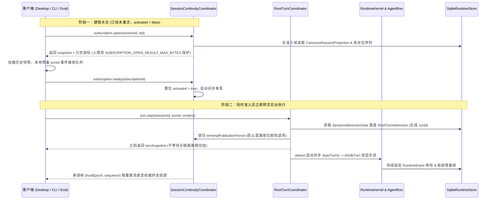

# 订阅优先与控制解耦：断连不丢帧的端到端信令流水线

## 1. 为什么传统 HTTP 长连接推流扛不住真实的终端与桌面并发？

原型期 Agent 后端通常采用最直觉的一体化通信：客户端发出一条 `POST /chat`，再在同一条 TCP / SSE 连接上原地吐完模型字流和工具结果。但在生产桌面端、集成终端和移动并发访问场景下，这种“指令与推流绑在同一根网线”的模型会在三个节点立刻崩溃：

1. **网络闪断导致进程记忆与视图蒸发**：笔记本盖上休眠 5 秒或者咖啡厅 Wi-Fi 切换，HTTP 响应连接直接断开；客户端既不知道后台工具修改是否还在运行，重连之后也追不回刚刚失联期间流出的推理文字与命令日志。
2. **前后端消费速率不匹配引发背压雪崩**：模型生成并发十条海量文件检索结果时，若前端慢渲染直接反向塞满传输缓冲区而不做帧限幅与按需裁剪，内存瞬间膨胀或引发客户端界面卡死。
3. **订阅历史与实时增量混行竞态**：当客户端刚连上会话拉取历史记录快照的半途，后台正好并发落盘一条新工具结果；如果没有精确单调的序列锚点把历史补齐和实时放闸切开，前端必然出现“漏掉中间一帧”或“同一句话插两次”的错乱。

Maka TypeScript 版在 `packages/runtime-host`（`RootTurnCoordinator` 与 `SessionContinuityCoordinator`）中通过**订阅与控制信令物理双通道隔离**、**先订阅补齐后开闸放流（`subscription.open → subscription.ready`）**以及**帧字节强封顶保护**，把连接寿命与后台执行寿命彻底脱钩。

---

## 2. 双通道交互骨架：`open → ready` 与后台 `drainTurn`

在 Maka 中，客户端从发起交互到观察结束的整条物理通信被严格划分为互不阻塞的阶段：**客户端先抢占安全观察座位，再签发幂等执行请求；Host 接单入库即快速释放接口，真正计算交由后台抽水协程持续推送**。



这套交互把整条流水线锁进了四条冷峻的协议不变量：
1. **未 Ready 不开闸（`activated = false`）**：`subscription.open` 仅发放基线历史水合信息并在内存中锁定游标边界，此时服务端积压的新增量只在队列内缓存而不允许抢先发给客户端；必须等客户端吃下基线快照后显式回发 `subscription.ready`，异步单泵推送机才正式打开阀门，一劳永逸消灭历史和实时流重合撕裂的空窗。
2. **指令响应不绑定推理完结**：`turn.start` 携带客户端本地预生成好的幂等 `turnId`，在获取短时 `SessionAdmissionGate` 完成准入校验并将 `RootTurnAdmission` 写入 SQLite 后，随即返回前端确认；哪怕客户端下一秒崩溃关闭，后台的 `drainTurn()` 依然不受任何影响地继续推进至安全边界。
3. **绝对禁止凭增量猜终态（`terminalPublicationFence`）**：客户端哪怕收到了代表最终文字生成结束的普通 Delta 碎片，也不得在本地直接判定该轮任务大功告成；`SessionContinuity` 在触发执行前锁住终态发布围栏，保证先将所有附属用量、历史投影归约彻底提交到规范账本，再投出携权威游标的终态信号。

---

## 3. 断线无缝追平与实时游标坐标：`(hostEpoch, sequence)`

当移动终端或桌面端发生断连重启后，服务端可能早已切换到了全新的进程实例（或者在失联 20 秒期间后台工具吐出了数十轮输出）。只靠一个纯递增序列号 `seq = 1, 2, 3...` 根本不足以防重放与防漂移。

Maka 的每帧持续订阅推送（`OrderedSubscriptionFrame`）均强制绑定双维度坐标：
- **`hostEpoch`**：标识本次在线宿主进程的唯一进程纪元；只要宿主经历进程级重启，该字段必定跳变，明确告知所有连上来的客户端“内存级临时流游标已清零，请回退至最新持久规范快照重新对齐”。
- **`sequence`**：在同一 `hostEpoch` 内的严格单调自增通道序列号，精准定格每一条增量文字块（`SessionAssistantDelta`）、工具动态意图（`SessionDeltaFrame`）、交互式终端 PTY 帧（`SessionRuntimeResourcePtyDataFrame`）以及协同图刷新通知（`AgentGraphChangedFrame`）。

即便在重连瞬间，后台恰好正在流畅输出某段长回复，系统借助 **`assistantBacklog`** 补偿序列把尚停留在内存缓冲、未来得及定稿入主表的新鲜字符无损拼接回来，让用户感受到的是一条从未撕裂过的连续思考流。

---

## 4. 帧封顶与背压节流：不让慢前端或巨型工具流拖死整个 Host

如果不对跨通道推送的数据载荷做严厉尺码限制，只要某次 `Read` 或 `Bash` 命令一口气吐出 80 MB 二进制或超深层嵌套 JSON 参数，序列化编码器就会瞬间把 WebSocket/IPC 内存队列撑爆，连累同一个 Host 下所有其它会话卡死。

观察 `packages/runtime-host/src/server/session-continuity-coordinator.ts` 中的协议封顶常量矩阵可以看到极其周全的字节防御：

| 协议防护常量 | 受控消息边界 | 核心防爆机制 |
| :--- | :--- | :--- |
| **`SUBSCRIPTION_OPEN_RESULT_MAX_BYTES`** | `subscription.open` 初始返包总量上限 | 超长历史会话强制截断并配合分页游标（`SessionTranscriptPageInput`）按页懒加载，绝不在首包拖垮 IPC |
| **`RUNTIME_HOST_MAX_MESSAGE_BYTES` & `SESSION_SUBSCRIPTION_FRAME_MAX_BYTES`** | Host 单消息及单推流帧硬尺寸天花板 | 确保每一次 JSON 编解码不会击穿事件循环或阻塞 Node 主线程 |
| **`SESSION_LIVE_DELTA_MAX_BYTES` & `SESSION_RUNTIME_RESOURCE_PTY_DATA_MAX_BYTES`** | 模型流式打字增量块与后台 PTY 屏幕碎片包容量上限 | 与单泵 `#pump` 循环协同背压合并（Coalescing），消化高频高刷终端文字流不引发前端帧拥塞 |
| **`SESSION_TOOL_ARGS_PREVIEW_MAX_BYTES` & `SESSION_TOOL_INTENT_MAX_BYTES`** | 推送给前端预览卡片的实时工具参数切片与工具名长度限额 | 配合 `projectToolArgsPreview` 在边界侧无害裁剪，哪怕工具入参含几百 KB 文本补丁也只传干净精炼的预览头 |

注意这一系列预览降载仅作用于“传给界面看的通知帧”；真实完整的巨量原始输入和返回载荷，一律通过结构化卸载与 `maka://` URI 在存储层保持 100% 原始可检索性。

### 4.1 协议方案对照：同步流直连 vs 解耦游标推流

| 设计方案 | 断连/切网恢复 | 多端同屏能力 | 慢渲染背压处理 |
| :--- | :--- | :--- | :--- |
| **传统做法（`POST /chat` 同连接吐流）** | 连接断即任务进度失明，客户端不知道后台是否仍在跑 | 第二窗口只能盲等数据库事后静态轮询 | 前端卡顿时直接倒灌拖死模型读取循环 |
| **Maka 方案（`open → ready` + 双通道推流）** | 基于 `(hostEpoch, sequence)` 与 `assistantBacklog` 无缝追平 | 桌面/TUI/Eval 同享单一 `SessionContinuity` 源 | 分帧截断封顶 + 单泵 `#pump` 队列合并 |

---

## 5. 双级抽水泵模型：把异步执行流与存储事件彻底对齐

从 `RuntimeKernel` 下钻到底层 `AiSdkTurn` 时，后台任务驱动并非毫无章法的散乱 `EventEmitter` 广播：
1. **单回合隔离异步队列（`AsyncEventQueue`）**：`AiSdkTurn` 内部将发向界面投影层的所有瞬时事件先推入局部队列，再由 `drainTurn()` 作为唯一消费者循序泵入 `SessionContinuity`；
2. **规范事实先落盘，投影后外发**：所有具有不可逆业务意义的状态转移（如回合启动、模型步进计费、工具 T1/T2 结算与回合终态），先原子进入 `SqliteRuntimeStore` 确立规范事实位置，再顺手推动关联投影通知放行，彻底杜绝“前台收到报错通知，翻回数据库发现根本没有记录”的灵异错位。

```typescript
// 教学级协议骨架：客户端“先建订阅水合、后发指令执行”与终态围栏闭环
async function dispatchWithGaplessStreaming(client: HostRpcClient, sessionId: string, prompt: string) {
  // 1. 先建订阅拿基线，此时 Host 侧处于 activated = false（只排队缓冲不抢发流）
  const { subscriptionId, snapshot, highWaterSequence } = await client.openSubscription(sessionId);
  mountProjectionBaseline(snapshot, highWaterSequence);

  // 2. 构造本地幂等 turnId 并开启事件槽后，再正式通知服务端开闸推流
  const turnId = randomUUID();
  registerTurnBuffer(turnId);
  await client.readySubscription(subscriptionId);

  // 3. 发起转异步运行的 turn.start（仅等 RootTurnAdmission 落盘准入即返回，不阻塞推理完成）
  const { runId } = await client.startTurn({ sessionId, turnId, content: prompt });

  // 4. 单调消费双坐标流；遇到断网只需带最后 (hostEpoch, sequence) 重开 open → ready 对齐即可
  for await (const frame of client.streamFrames(subscriptionId)) {
    if (frame.hostEpoch !== currentEpoch) {
      return reconnectAndHydrateSnapshot(sessionId); // 宿主重启过纪元，回退快照重建基线
    }
    if (frame.sequence <= lastAppliedSeq) continue; // 幂等防重放
    applyOrderedFrame(frame); // 仅当 terminalPublicationFence 释放的终态投影到达才算真正结清 runId
  }
  return runId;
}
```

---

## 6. 总结

Maka TypeScript 版通过“先订阅、再准入、后台异步推、游标防重放、帧上限熔断”五大信令规则，使前端连接彻底脱离后台重计算寿命的绑架：
- **`subscription.open → ready` 两步握手** 以零竞态方式咬合静态历史账本与动态实时流；
- **`(hostEpoch, sequence)` 双坐标加上 `terminalPublicationFence`** 把多客户端协同和弱网断连拉齐到同一条绝对客观的时间线上；
- **全协议硬封顶常量网** 将巨大工具入参和暴风式 PTY 输出挡在传输总线外，保住多会话并行的绝对流畅。

请求与信令通道已经顺畅打通，但如果用户就在模型正在执行第 3 轮工具时，点击切换了另一个供应商模型、或者刚刚重启完毕正处于历史恢复窗口，同一条会话上出现新旧两套执行代次撞车怎么办？下一篇揭开 `RuntimeKernel` 如何用单调代次锁精准化解并发交接风险——[并发代次与停止围栏：RuntimeKernel 如何隔离热切换与冷启动竞态？](./session-lifecycle.md)。
