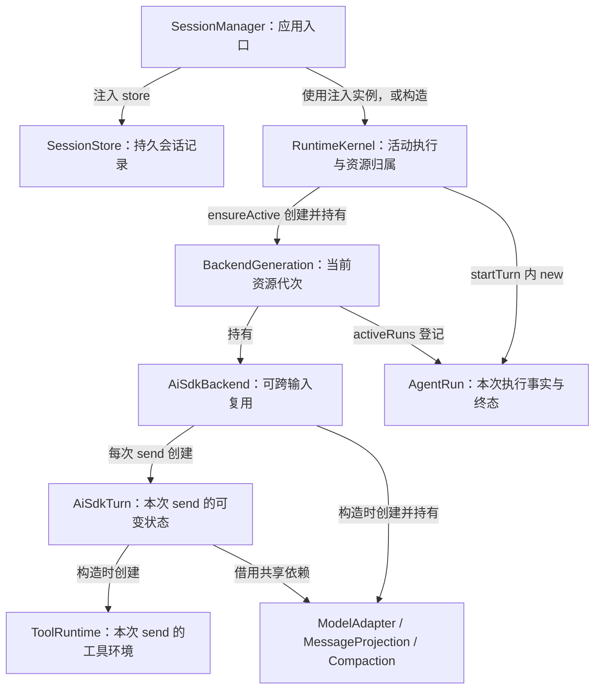
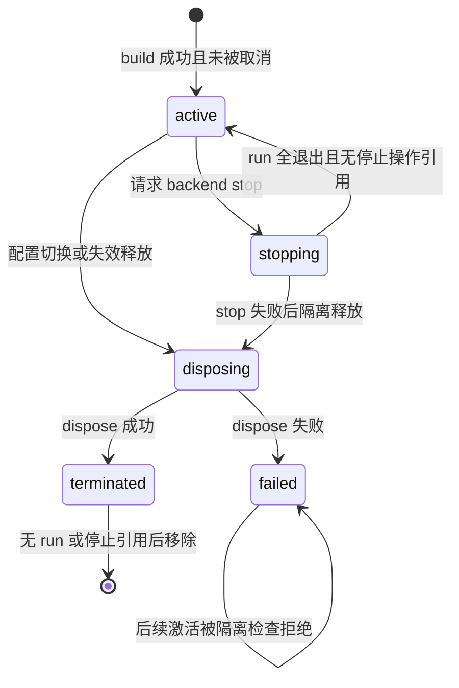
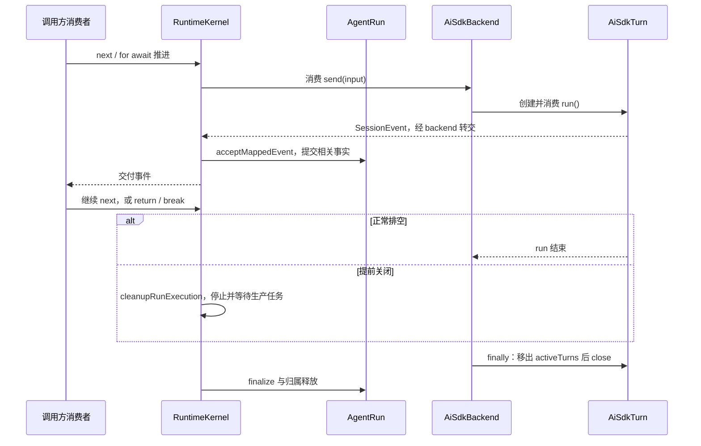

# 会话与执行对象的生命周期

[手册目录](../README.md)

设向同一个会话连续发送两条输入：先“读一下项目”，再“解释这个函数”。
需要回答的问题是：第二次发送是重新创建整个 Agent，还是沿用第一次的对象；
若两次之间更换了模型，或第一条输入尚未结束即请求停止，结论也随之不同。

Maka 的结构不能用“一个会话对应一个 Agent 实例”概括。
会话记录可以长期存在；backend 可以跨输入复用；一次执行拥有自己的 `AgentRun`；每次进入 `AiSdkBackend.send()` 又会产生新的 `AiSdkTurn`。
这些对象的结束条件各不相同，历史记录得以保存也不等于旧对象仍然存活。

本文只研究这些对象的创建、持有、推进和释放，不展开整个请求协议或模型单步算法。
依据为 Maka 固定提交 `15d0a0dd19d39e2bc09ae35940e432c636982315`、Pi 固定 HEAD `482c1381a00d8d00bc81697e4a980c593db6803e` 的源码与现有测试。
核对日期为 2026-10-24；结论来自静态阅读，未运行测试、应用或真实模型。

## 1. “执行一次”的对象构成

以下三个术语容易混用。

- **会话**：由 `sessionId` 标识的持久记录及其历史，不是某个 JavaScript 对象。
- **执行**：由运行时登记和收尾的一次工作，本文普通输入路径中的对应对象是 `AgentRun`。
- **backend generation**：Kernel 为一批 backend 资源分配的代号，用于判断资源是否仍属当前批次。

generation 不是模型重试次数，也不是会话历史版本。
同一个 generation 可以先后承接多个输入；旧 generation 失效后，迟到的执行不能凭同一个 `sessionId` 获得新 backend 的使用权。[generation 结构与登记][generation]

还需区分两个名称相近的对象：
`packages/runtime/src/agent-run.ts` 中的 `AgentRun` 是具有行为和私有状态的类；
`packages/core/src/agent-run.ts` 中的 `AgentRunEvent` 是记录事件形状的接口，包含 `id`、`runId`、`sessionId`、`turnId`、`ts` 等字段。
后者不是运行时对象，也没有 `begin()`、`finalize()` 或 backend 所有权。[运行时类][run-fields] [记录接口][run-event]

### 对象图：创建关系



图中的“持有”仅指保存引用，不表示对象会自行运行。
`AgentRun` 通过注入的 hook 请求登记资源；真正调用和消费 `backend.send()` 的是 Kernel。
backend 随后推进 `AiSdkTurn.run()`，Turn 由此进入模型与工具循环。[启动执行][run-agent-turn] [backend 作用域][backend-scope]

由此可读出一个重要分工：`AgentRun` 负责“这次工作留下哪些事实”，`AiSdkTurn` 负责“本次发送的执行过程”。
二者不是两个同义的 Agent，也不是父类与子类。

## 2. 初始化：依赖装配与推理启动的分界

### SessionManager 构造职责

`new SessionManager(deps)` 首先检查依赖组合：例如提供 `runStore` 时必须同时提供 `runtimeEventStore`。
满足条件时构造账本修复对象，随后使用 `deps.runtimeKernel`，仅在其不存在时才执行 `new RuntimeKernel(...)`。
因此“SessionManager 一定亲自创建 Kernel”不成立，测试或 Host 可以注入另一个实现。[构造与 createSession][manager-constructor]

以下为该类真实私有字段的相关子集，并非由接口推断出的成员表。

| 私有字段 | 保存内容 | 对生命周期的影响 |
| --- | --- | --- |
| `deps` | 构造参数依赖 | 使 store、backend registry、Host 能力进入管理层 |
| `runtimeKernel` | `RuntimeKernelLike` 实例 | 多次发送均经由同一管理入口持有的 Kernel |
| `runtimeLedgerRepair` | 可选账本修复器 | 恢复历史事实，不复活以前的内存对象 |
| `preparedTranscriptLedgers` | 已准备的会话 ID 集合 | 避免对同一账本重复准备 |
| `childSessionSpawns` | 指纹及创建中的 Promise | 保存子会话创建的并发状态，不是 backend 缓存 |
| `claimedAgentGraphSessionTails` | 每个会话的一条 Promise 尾链 | 协调 graph 工作，不能据此推断所有发送都串行 |

`createSession()` 的关键动作是 `store.create(input, initialBoundary)`，随后返回摘要。
它既未调用 `ensureActive()`，也未创建 `AiSdkTurn`。
因此“会话出现在列表中”并不意味着模型连接、工具环境与本次执行均已启动。[构造与 createSession][manager-constructor]

### 工厂、准备结果与 backend 实例的区分

`BackendRegistry` 持有 `registrations`。
`prepare(kind, ctx)` 查找注册项；普通工厂被包装为 `{ build: registration }`，准备型工厂可以先异步算出 `providerStateIdentity` 等结果。
真正获得 backend 需要执行准备结果中的 `build(ctx)`。[BackendRegistry][registry]

对 Java 读者，可将其理解为：先注入“如何创建服务”的工厂，再在需要时构造服务实例。
区别在于该工厂可能返回 `Promise`：一个代表未来成功值或失败原因的对象，`await` 等待其完成，期间不阻塞整个 JavaScript 线程。

初始化注入回答“此后使用哪个 store、工厂、时钟和能力”；每次调用回答“本次是哪条输入、哪个 runId、使用哪个当前配置”。
将 `runId` 放在长寿命 backend 的全局 `currentRunId` 字段中，会使重叠发送互相覆盖；当前实现以独立 Turn 作用域规避此问题。[作用域创建][backend-scope] [重叠发送测试][test-overlap]

## 3. 第一次输入：从构造到获得执行权

### startTurn 的异步语义

`SessionManager.sendMessage()` 转交给 `runtimeKernel.startTurn()`，必要时在 admission 回调中先准备账本。
二者均为 `async *` 方法，即**异步生成器**：调用返回一个可逐项读取事件的对象，而非最终回答。[发送入口][send-message]

`AsyncIterable<SessionEvent>` 表示“可以不断异步取出 `SessionEvent` 的序列”。
仅保存 `const events = manager.sendMessage(...)` 不会使整个函数体运行完毕；消费者调用 `next()` 或进入 `for await` 后，生成器才被推进。
`yield` 将一个事件交给消费者并暂停；`yield*` 将另一个生成器的事件继续向上转交。
不应将此返回值等同于已启动任务的 `Future<String>`。

在该提交中，此路径直接写为 `new AgentRun(...)`，不存在名为 `newAgentRun()` 的方法。
阅读旧材料中的“newAgentRun”时，应回到此构造点，而非寻找不存在的 API。[startTurn][start-turn]

### startTurn 的四段控制流

第一段先取得 execution claim，即“本次尝试正在申请使用该会话执行资源”的登记。
它需经过会话变更屏障，检查停止意图，再读取 backend header。
若现有 backend 的执行策略不匹配，存在活动 run 时拒绝；不存在时先释放旧资源。
此段解决的是“正在切换资源或停止时，新执行不能直接进入”。[claim 与进入屏障][claims] [startTurn][start-turn]

第二段才创建 `AgentRun`，注入输入、header、身份和 hooks。
构造函数复制并冻结用户输入，生成或接受 `runId`；普通路径中 `invocationId` 缺省为 `runId`。
这只是普通执行的默认值，并不意味着两个概念永远等价，continuation 路径另有自身的身份规则。[AgentRun 构造][run-constructor]

第三段执行 admission 回调，再将 claim 关联到 run，进入 `runAgentTurn()`。
因此“已经 new 了一个 AgentRun”仍不能证明输入已获准执行、backend 已存在或模型已收到请求。

第四段由 `runAgentTurn()` 准备 backend 信息、绑定 provider 身份、调用 `run.begin()`，再绑定交互所有权。
成功后才进入事件流；失败则进入失败启动收尾；最外层 `finally` 释放执行 claim。[执行启动][run-agent-turn]

### begin：记录输入并 reserve backend

以下为真实源码摘录，仅保留 `begin()` 的前几行：[AgentRun.begin][run-begin]

```typescript
async begin(): Promise<AgentRunBeginResult> {
  const initialRuntimeEvent = await this.beginUserTurn();
  this.active = await this.input.hooks.reserveRun(this.sessionId, this.header, this);

  await this.input.hooks.updateStatus(this.sessionId, 'running', undefined, this.lastTs);

  const priorRuntimeContext = await this.buildPriorRuntimeContext();
```

顺序具有重要意义：

1. `beginUserTurn()` 先标记“欠一条初始输入事实”，打开 invocation，再记录用户输入。
2. `reserveRun` 回到 Kernel，先执行 `ensureActive()`，再将 run 注册到 generation。
3. 更新会话状态为 `running`，读取之前的运行时上下文。
4. 返回 backend 与冻结后的 backend 输入，供 Kernel 继续执行。

“先记输入再启动资源”意味着 backend 构建失败时，系统仍需为已经打开的工作留下失败终态。
`initialRuntimeEventPending` 专门表示这项未结清事实；`finalize()` 会尝试补记尚未写入的初始输入。
这不是“构造失败就什么都没发生”的普通对象工厂。[begin 与输入事实][run-begin] [finalize][run-finalize]

以下为**教学结构示意，省略可选项，并非可直接传入的完整 API 参数**：

```text
begin() 返回：
{
  backend: 同一个实际 backend 对象的引用,
  backendInput: {
    turnId: "turn-A", text: "读一下项目",
    orchestration: 本次有效编排配置,
    toolMode: 本次工具模式,
    runtimeContext: 之前已记录的运行时事件,
    runtimeContextInvocations: 对应的 invocation 信息
  },
  initialRuntimeEvent: 本次用户输入事实
}
Kernel 继续补入 runId、invocationId、head anchor 等执行信息。
```

此处历史由运行时账本构建，不应理解为复用某个 Turn 对象中无限增长的 `messages` 数组。
本次输入与共享 backend 是两种寿命不同的数据。[begin 返回值][run-begin] [Kernel 补充输入][run-agent-turn]

## 4. generation：复用判定的依据

`ensureActive()` 首先清理或检查隔离状态；存在可用的当前 generation 时将其返回。
否则等待旧释放结束，再检查一次，随后共享正在构建的 Promise，避免两个冷启动各自构建一套资源。
工厂构建完成后还需检查取消：若停止已经发生，迟到的 backend 必须释放，不能先缓存再发送请求。[ensureActive][ensure-active]

Kernel 的这些真实私有字段共同回答“当前”“正在创建”“尚未收完”三个问题：

| 私有字段 | 含义 | 不能合并为单个 backend Map 的原因 |
| --- | --- | --- |
| `active` | sessionId → 当前 generation | 只表示当前可关联的资源 |
| `backendGenerations` | generation 数字 → 资源记录 | 旧代次在释放、停止期间仍需跟踪 |
| `backendActivationBuilds` | 构建键 → 构建 Promise | 并发冷启动共享同一次构建 |
| `backendActivations`、`executionClaims` | 尚在接入阶段的尝试 | 停止要覆盖尚未得到 backend 的执行 |
| `stopIntents` | 正在停止的会话意图 | 阻止新的 claim 越过停止边界 |
| `stopOperations`、`stopAttempts` | 待结清的停止状态、当前停止尝试 | 重试终态写入不应重复停止 backend |
| `backendInvalidations` | 待失效的 backend | 活动执行退出后再完成释放 |

这些是 `RuntimeKernel` 的字段；`BackendGeneration` 本身是一个结构接口，并非另一个拥有私有字段的类。[Kernel 字段][kernel-fields]

generation 内部保存 `backend`、`phase`、`activeRuns`、`turnToRunId`、停止与释放状态。
`reserveGenerationRun()` 校验其仍为当前 active 代次，并拒绝重复的 run/turn 身份。
在真正调用 `backend.send()` 前，`assertRunCanDispatch()` 会再次同步检查同一组归属。
这可以阻断“登记后、发请求前发生停止”的窗口。[登记与派发检查][generation]



这是按实现整理的主要状态路径，并非所有方法调用的完整时序图。
最关键的结论是：`stopping` 不必然通向销毁；`failed` 也不意味着下一次可以隐式地创建替代品。
停止失败且释放也失败时，Kernel 保留隔离失败，使后续激活明确报错。[停止与隔离][backend-stop-owner] [退出与隔离检查][generation-exit]

## 5. backend 复用，Turn 与工具环境重建

### 长寿命 AiSdkBackend 持有的状态

backend 构造时解析模型运行配置，创建 `ModelAdapter`、消息投影器、遥测对象与压缩协作者。
注入 `modelFactory` 不等于构造期间已完成一次模型调用；模型解析与流请求发生在后续 Turn 执行中。[backend 构造][backend-fields]

以下仍为实际私有字段的子集：

| 字段 | 寿命及用途 |
| --- | --- |
| `input`、`resolvedProviderOptions` | 保存本代 backend 的输入与解析后的 provider 选项 |
| `modelAdapter`、`messageProjection` | 供多次 send 使用的适配与投影协作者 |
| `providerTelemetry`、`compaction` | 共享观测、压缩支持，不是单次输出缓冲 |
| `activeTurns` | 当前仍在 send 作用域中的 `AiSdkTurn` 集合 |
| `sessionActiveTools` | 多个 Turn 共享的工具激活 Map |
| `turnSessionState` | 本代 backend 共享的会话状态对象 |
| `codeCellAdmission` | 本 backend 的 code-mode 并发许可器 |

`sessionActiveTools` 的注释明确说明：激活工具跨 Turn 保留，不在结束或压缩时清空，以保持 provider 工具列表稳定并有利于缓存。
这是源码明确写出的设计理由。
“把昂贵依赖放在长寿命对象上一般会减少重复初始化”则是基于结构的推断，不能视为作者声明的性能目标。[backend 字段与注释][backend-fields]

### 每次 send 的独立状态

真实源码摘录：[AiSdkBackend.send][backend-send]

```typescript
async *send(input: BackendSendInput): AsyncIterable<SessionEvent> {
  const turn = this.openTurnScope(input);
  try {
    yield* turn.run();
  } finally {
    this.activeTurns.delete(turn);
    await turn.close();
  }
}
```

`openTurnScope()` 总是执行 `new AiSdkTurn(...)`，随后登记到 `activeTurns`。
Turn 构造时再通过 `createToolRuntime(this)` 获得自己的工具运行环境。
传给工具环境的闭包捕获此 owner，而非在执行工具时读取 backend 上可被其他 Turn 改写的“当前对象”。[openTurnScope][backend-scope]

`AiSdkTurn` 的字段表需严格区分可见性，不能将所有状态统称为“私有字段”。[Turn 声明与构造][turn-fields]

| 真实私有字段 | 作用 |
| --- | --- |
| `deps`、`request` | 本次使用的依赖引用和请求 |
| `stopRequested` | 请求在安全边界停止，未必已立即 abort |
| `turnYield` | 等事件、计划移交、graph yield 等让出原因 |
| `handoffPaused` | 是否进入移交暂停 |
| `startedAt` | 本次 Turn 的起始时间 |

`abortController`、`aborted`、`watchdog`、`runTrace`、`imageBudget`、`toolRuntime` 等在此处是公开字段。
`readonly` 仅限制字段重新赋值，不等于对象内部不可变：例如 `readonly activeTools` 指向共享 Map，Map 的内容仍会改变。
Turn 的身份、停止标记、图像预算、临时注入消息属于本次 send；`activeTools` 则明确借用 backend 的 Map。

一个 Turn 内还可能有多个模型步骤和多次 provider 尝试。
这些循环不会在每一步重建整个 `AiSdkBackend`；局部缓冲、请求控制器和 watchdog 的变化在模型单步专题中另行讨论。[Turn 执行循环][turn-loop]

## 6. 事件推进与 finally 保证

Kernel 并非将 backend 的生成器原样返回。
它启动消费 backend 的生产任务，将事件映射后交给 `AgentRun.acceptMappedEvent()`，再放入具备确认机制的交付队列。
外层消费者取走事件后，生产端才能越过相应的交付等待点。[Kernel 流管理][stream-run]



图中仅表示归属与推进关系；不同错误分支中收尾动作会交错，不能将箭头视为所有路径都固定的全局排序。
异步迭代的一个关键规则是：消费者以 `for await` 提前 `break`，会请求关闭迭代器，触发相应的 `finally`。
但创建迭代器后不消费，或将已暂停的迭代器丢弃而不调用 `return()`，不能期望垃圾回收及时完成收尾。

`AiSdkTurn` 内部也有生产任务和事件队列。
它在 `yield event` 之后才确认该事件已消费；这表示消费者继续推进了迭代，不表示前端已将文字渲染到屏幕。
提前退出时会标记消费者脱离、abort 并等待生产任务；Kernel 还负责关闭交互等待与交付队列。[Turn 排空与确认][turn-drain] [Kernel cleanup][cleanup]

因此不应将“收到 complete 事件”视为“不再有异步清理”。
backend 的 `finally` 仍需执行 `turn.close()`；Kernel 仍需等待生产任务、移除 abort 监听并清理交互归属。
自定义 backend 或工具能否及时响应取消，仍取决于其是否遵守取消与关闭协议；本文不承诺任意第三方代码都能立即退出。

## 7. 两次输入与两条分支

以下 A/B 是教学实例标签，并非源码中的字段名；假定第一条输入正常完成，配置未变化。

| 步骤 | 会话与 generation | 执行对象 | 哪些被保留或释放 |
| --- | --- | --- | --- |
| 创建会话 S | 只有持久记录 | 尚无 run/Turn | Manager、Kernel 已存在 |
| 开始输入一 | 创建 generation G1、backend B1 | `AgentRun R1`，随后 `AiSdkTurn T1` | T1 创建自己的 ToolRuntime |
| 输入一结束 | G1 通常仍为 active | R1 finalize；T1 close | 从 activeRuns/activeTurns 移除；B1 保留 |
| 开始输入二 | `ensureActive` 复用 G1/B1 | 新 R2、新 T2、新 ToolRuntime | 共享 adapter、工具激活 Map，不共享停止标记 |
| 输入二结束 | G1/B1 仍可复用 | R2/T2 收尾 | 会话历史留下事实，不留下可恢复的 R2/T2 实例 |

这条主线来自 `ensureActive()`、run 登记/注销与 `send()` 的组合，并非“每个会话永远只创建一次 backend”的保证。[激活][ensure-active] [run 退出][generation-exit] [send][backend-send]

### 分支一：两次输入之间换模型

配置切换经由 `transitionSessionConfiguration()`，比较期望 revision，区分仅权限变化与执行资源变化。
模型等执行资源变化进入 `commitExecutionResourceTransition()`：在会话静止变更范围内检查运行/认领状态，准备提交，释放旧 backend，再提交新的配置版本。
若资源释放失败，操作报错，不应将新模型配置视为已成功切换。[配置切换][configuration] [资源变更提交][resource-transition]

第二次输入由新配置构建 B2/G2；它不是对 B1 的 `ModelAdapter` 做一次字段替换。
会话 S 的历史继续存在；B1 的共享激活状态与 T1 的内存状态并不因此迁移至 B2。
至于哪些历史被投影进新模型请求，属于上下文策略问题，而非对象复用问题。

### 分支二：首条输入未结束时的停止

`SessionManager.stopSession()` 在存在 hosted authority 时交给 Host，否则进入 Kernel；还处理相关前台子会话。
仅调用 `backend.stop()` 会绕过这些执行归属与持久终态步骤。[管理层停止][manager-stop]

Kernel 先记录停止意图，取消尚在激活中的 claim，再处理具体的 generation/run。
若工厂忽略取消，晚到的 backend 仍会被检测、释放，不能进入缓存或派发。[Kernel 停止][kernel-stop] [迟到构建测试][test-late-build]

对已激活的 AiSdkBackend，立即停止会分别 abort 每个 Turn，随后对所有 ToolRuntime 执行结束操作。
此处使用 `Promise.allSettled()`：等每个操作都成功或失败后再汇总错误，避免一个 Turn 清理失败导致其他 Turn 永远不被清理。
仅发送 abort 信号不足以唤醒等待用户问题的工具，源码注释明确指出仍需调用 `endTurn()`。[backend stop][backend-send] [广播停止测试][test-broadcast-stop]

`after_step` 模式则仅设置停止请求，由循环在边界处识别，不等于立即 abort。
底层 `stop` 不携带 turnId，是对该 backend 活动 Turn 的广播；Kernel 因此会防止作用域停止误伤共享 backend 中另一个未停止的 run。
所有 run 退出、停止操作结清后，正常停止的 G1 可以回到 active，下一次仍使用 B1。[停止归属][backend-stop-owner] [run 退出][generation-exit]

## 8. close、finalize、dispose 的结束范围

`AiSdkTurn.close()` 结束 adapter 的本 turn continuation，并执行 `toolRuntime.endTurn(...)`。
参数根据 `aborted` 选择 `aborted` 或 `completed`；此处的 `completed` 是工具环境关闭原因，不能仅凭它断言业务回答成功。
例如 provider 报错但未设置 aborted，清理路径仍可能使用 `completed`。[Turn close][turn-fields]

`AgentRun.finalize()` 则收敛本次执行的账本与状态：关闭移交门、处理尚欠的输入事实、刷新部分输出、确定终态、注销 run，并完成终态写入。
其私有 `terminalClaim` 区分终态由普通事件还是停止占有，防止晚到的成功覆盖已认领的取消。
`finalized`、`terminalRunFactCommitted` 与写入 Promise 分别表示进入收尾、终态持久化以及正在进行的写入，不能简化为一个 `done` 布尔值。[AgentRun 字段][run-fields] [finalize][run-finalize]

停止中的终态写入可能失败。
Kernel 保存未结清的 stop operation，后续停止重试可补写终态，而不再次调用 backend stop；现有测试正是使 abort 事实首次写入失败，再验证这一区别。[停止重试测试][test-stop-retry]

`AiSdkBackend.dispose()` 则释放寿命更长的资源：存在活动 Turn 时先 stop，否则取消历史压缩，再释放 adapter。
这些调用不是“无论如何每一步都执行”的通用析构器；前面的 stop 抛错后，后面的 adapter dispose 不会自然继续。
因此 Kernel 必须跟踪释放失败与隔离状态，而不能在删除 Map 后假定资源已经全部释放。[dispose][backend-send] [隔离检查][generation-exit]

### completion 与 settled 的承诺主体

Host 的 `HostedExecutionAdmissionResult` 返回两个不同的 Promise：
`completion` 是结构化结果，可能是 terminal snapshot，也可能是 `authority_error`；
`settled` 是该 Host 执行任务的结清等待。[Host admission 契约][host-admission]

`executeHostedExecutionToSettlement()` 在等到终态后，仍明确 `await admitted.settled`。
RootTurnCoordinator 中，后者来自 `active.done`，即脱离 admission 临界区运行的 `drainTurn()` 任务。
前者也不是收到一条裸 `complete` 就立即兑现：Host 还需处理规范状态与完成观察者等收尾工作。[等待实现][host-wait] [任务归属][host-task] [Host排空][host-drain]

不应将这个 `settled` 与 Kernel 内部 `PendingExecutionClaim.settled` 混为一谈。
后者在 run 开始并绑定交互后即可成功结清，表示接入阶段已安置完成；真正活跃的 run 此后由 generation 的 `activeRuns` 跟踪。
字段同名不代表等待范围相同，更不代表两者都保证跨进程恢复。[claim 结清][claim-settlement]

## 9. 失败路径的测试验证

以下为已静态阅读的具体测试断言，并非本次运行结果。

| 测试场景 | 源码中的可观察断言 | 帮助排除的错误理解 |
| --- | --- | --- |
| 工厂忽略取消，停止后才返回 backend | dispose 一次、send 零次；下次正常构建第二个 backend | “构建成功就一定能发请求” |
| 上述迟到 backend 的 dispose 再失败 | 流抛 AggregateError；下一次报 permanently quarantined，构建次数仍为一 | “失败后静默重建总是安全” |
| 两个冷启动重叠 | builds 为一、最终 sendInputs 为二；无主权限响应被拒绝 | “一个 backend 必然只对应一次 send” |
| 停止的 abort 事实第一次写入失败 | 第二次停止补写，backend stopCalls 仍为一 | “重试停止必须再次执行底层停止” |
| 同 backend 的 A 先完成，B 之后调用工具 | 工具仍记录 run-b，最终 activeTurns 为空 | “共享 backend 上保存当前 runId 足够” |
| 一个 Turn 的关闭失败 | 其他 Turn 仍观察到 abort，用户问题等待也结清 | “清理遇到第一个错误即可退出” |

对应测试见：[迟到构建及释放失败][test-late-build]、[并发冷启动][test-cold]、[停止重试][test-stop-retry]、[重叠作用域][test-overlap]、[广播关闭][test-broadcast-stop]。
这些测试以可控 gate、内存存储或 MockLanguageModel 构造窗口，并非以真实模型的随机响应证明并发正确性。

另一处需要理解的实现边界是 backend 流协议：在没有终态的情况下结束且不存在已提交移交时，Kernel 合成 missing-terminal 错误；
首个终态被接受后，后续 backend 事件和 backend 抛错不再改写结果。
这不表示所有 `finally` 错误都被忽略，资源收尾仍可能失败并向外传播。[backend 事件消费][backend-stream]

## 10. 与 Pi 对照：按对象寿命比较

Pi 默认 coding-agent 的 `createAgentSession()` 读取 SessionManager 的上下文，构造一个 `Agent`，再交给 `AgentSession`。
它注入 `streamFn`，由 coding-agent 的 ModelRuntime 连接到模型流；并非每次 prompt 都重建整个会话对象。[Pi 会话组装](https://github.com/earendil-works/pi/blob/482c1381a00d8d00bc81697e4a980c593db6803e/packages/coding-agent/src/core/sdk.ts#L196) [Agent 构造与注入](https://github.com/earendil-works/pi/blob/482c1381a00d8d00bc81697e4a980c593db6803e/packages/coding-agent/src/core/sdk.ts#L411)

`packages/agent` 的 `Agent` 保留 state、监听器与消息队列，每次运行创建带 Promise、resolve 与 AbortController 的 `activeRun`。
已存在 activeRun 时普通 `prompt()` 拒绝重入；结束后清除本次运行引用，Agent 本身继续存在。
`abort()` 发送取消，`waitForIdle()` 等待本次运行；`agent_end` 事件也不等于所有异步监听处理均已结束。[Pi Agent 运行生命周期](https://github.com/earendil-works/pi/blob/482c1381a00d8d00bc81697e4a980c593db6803e/packages/agent/src/agent.ts#L373) [收尾与 idle](https://github.com/earendil-works/pi/blob/482c1381a00d8d00bc81697e4a980c593db6803e/packages/agent/src/agent.ts#L520)

可以对应的是“长寿命会话对象 + 短寿命一次运行状态”；不应强行将 Pi Agent、Maka AgentRun、Maka AiSdkTurn 视为同一层级。
默认 `coding-agent` 负责应用会话，`agent` 负责循环及运行状态，`ai` 提供模型接口；它们同样具备历史、取消、流消费与工具能力，并非“没有生命周期管理”。

Pi 的实验 `durable` 则属于另一范围：`HarnessImpl` 持有存储、TaskScheduler 等，打开时恢复调度状态，关闭前等待任务清理。
这不能由默认 Agent 的 `activeRun` 直接推断，也不能因默认层没有 Maka 这套 generation 结构，就断言整个 Pi 不支持恢复或调度。[durable Harness 构造](https://github.com/earendil-works/pi/blob/482c1381a00d8d00bc81697e4a980c593db6803e/packages/durable/src/harness/harness.ts#L184) [打开与关闭](https://github.com/earendil-works/pi/blob/482c1381a00d8d00bc81697e4a980c593db6803e/packages/durable/src/harness/harness.ts#L270)

## 11. 检查方法与阅读边界

考察一个新调用点时，首先确定其持有的是会话 ID、generation 资源、run 身份，还是 Turn 作用域。
再确定谁保存引用、谁消费异步序列、谁在异常时执行收尾；最后检查“完成”的证据是事件、已提交终态，还是任务 Promise 已结清。
这四个问题比见到 `Agent` 即着手寻找统一类图的做法更可靠。

本文已核对普通输入成功、并发冷启动、构建取消、停止失败重试、共享 Turn 隔离与资源切换路径。
未验证真实 provider 取消延迟、操作系统进程退出效果、所有 hosted continuation 分支或进程崩溃后的完整恢复顺序。
持久记录能被重新读取，不代表同一个 JavaScript 实例、AbortController 或未完成 Promise 可以跨进程继续使用。

[registry]: https://github.com/apache/maka/blob/15d0a0dd19d39e2bc09ae35940e432c636982315/packages/runtime/src/session-manager.ts#L773
[manager-constructor]: https://github.com/apache/maka/blob/15d0a0dd19d39e2bc09ae35940e432c636982315/packages/runtime/src/session-manager.ts#L911
[send-message]: https://github.com/apache/maka/blob/15d0a0dd19d39e2bc09ae35940e432c636982315/packages/runtime/src/session-manager.ts#L2313
[configuration]: https://github.com/apache/maka/blob/15d0a0dd19d39e2bc09ae35940e432c636982315/packages/runtime/src/session-manager.ts#L1205
[resource-transition]: https://github.com/apache/maka/blob/15d0a0dd19d39e2bc09ae35940e432c636982315/packages/runtime/src/session-manager.ts#L1888
[manager-stop]: https://github.com/apache/maka/blob/15d0a0dd19d39e2bc09ae35940e432c636982315/packages/runtime/src/session-manager.ts#L4087
[kernel-fields]: https://github.com/apache/maka/blob/15d0a0dd19d39e2bc09ae35940e432c636982315/packages/runtime/src/runtime-kernel.ts#L423
[claims]: https://github.com/apache/maka/blob/15d0a0dd19d39e2bc09ae35940e432c636982315/packages/runtime/src/runtime-kernel.ts#L489
[start-turn]: https://github.com/apache/maka/blob/15d0a0dd19d39e2bc09ae35940e432c636982315/packages/runtime/src/runtime-kernel.ts#L720
[run-agent-turn]: https://github.com/apache/maka/blob/15d0a0dd19d39e2bc09ae35940e432c636982315/packages/runtime/src/runtime-kernel.ts#L1409
[stream-run]: https://github.com/apache/maka/blob/15d0a0dd19d39e2bc09ae35940e432c636982315/packages/runtime/src/runtime-kernel.ts#L1607
[cleanup]: https://github.com/apache/maka/blob/15d0a0dd19d39e2bc09ae35940e432c636982315/packages/runtime/src/runtime-kernel.ts#L1780
[backend-stream]: https://github.com/apache/maka/blob/15d0a0dd19d39e2bc09ae35940e432c636982315/packages/runtime/src/runtime-kernel.ts#L1879
[kernel-stop]: https://github.com/apache/maka/blob/15d0a0dd19d39e2bc09ae35940e432c636982315/packages/runtime/src/runtime-kernel.ts#L2104
[backend-stop-owner]: https://github.com/apache/maka/blob/15d0a0dd19d39e2bc09ae35940e432c636982315/packages/runtime/src/runtime-kernel.ts#L2609
[ensure-active]: https://github.com/apache/maka/blob/15d0a0dd19d39e2bc09ae35940e432c636982315/packages/runtime/src/runtime-kernel.ts#L2791
[generation]: https://github.com/apache/maka/blob/15d0a0dd19d39e2bc09ae35940e432c636982315/packages/runtime/src/runtime-kernel.ts#L2965
[generation-exit]: https://github.com/apache/maka/blob/15d0a0dd19d39e2bc09ae35940e432c636982315/packages/runtime/src/runtime-kernel.ts#L3054
[claim-settlement]: https://github.com/apache/maka/blob/15d0a0dd19d39e2bc09ae35940e432c636982315/packages/runtime/src/runtime-kernel.ts#L3716
[run-fields]: https://github.com/apache/maka/blob/15d0a0dd19d39e2bc09ae35940e432c636982315/packages/runtime/src/agent-run.ts#L242
[run-constructor]: https://github.com/apache/maka/blob/15d0a0dd19d39e2bc09ae35940e432c636982315/packages/runtime/src/agent-run.ts#L307
[run-begin]: https://github.com/apache/maka/blob/15d0a0dd19d39e2bc09ae35940e432c636982315/packages/runtime/src/agent-run.ts#L983
[run-finalize]: https://github.com/apache/maka/blob/15d0a0dd19d39e2bc09ae35940e432c636982315/packages/runtime/src/agent-run.ts#L1333
[run-event]: https://github.com/apache/maka/blob/15d0a0dd19d39e2bc09ae35940e432c636982315/packages/core/src/agent-run.ts#L187
[backend-fields]: https://github.com/apache/maka/blob/15d0a0dd19d39e2bc09ae35940e432c636982315/packages/runtime/src/ai-sdk-backend.ts#L294
[backend-scope]: https://github.com/apache/maka/blob/15d0a0dd19d39e2bc09ae35940e432c636982315/packages/runtime/src/ai-sdk-backend.ts#L551
[backend-send]: https://github.com/apache/maka/blob/15d0a0dd19d39e2bc09ae35940e432c636982315/packages/runtime/src/ai-sdk-backend.ts#L585
[turn-fields]: https://github.com/apache/maka/blob/15d0a0dd19d39e2bc09ae35940e432c636982315/packages/runtime/src/ai-sdk-turn.ts#L617
[turn-loop]: https://github.com/apache/maka/blob/15d0a0dd19d39e2bc09ae35940e432c636982315/packages/runtime/src/ai-sdk-turn.ts#L872
[turn-drain]: https://github.com/apache/maka/blob/15d0a0dd19d39e2bc09ae35940e432c636982315/packages/runtime/src/ai-sdk-turn.ts#L3070
[host-admission]: https://github.com/apache/maka/blob/15d0a0dd19d39e2bc09ae35940e432c636982315/packages/runtime-host/src/server/hosted-execution-authority.ts#L76
[host-wait]: https://github.com/apache/maka/blob/15d0a0dd19d39e2bc09ae35940e432c636982315/packages/runtime-host/src/server/hosted-execution-wait.ts#L111
[host-task]: https://github.com/apache/maka/blob/15d0a0dd19d39e2bc09ae35940e432c636982315/packages/runtime-host/src/server/root-turn-coordinator.ts#L3024
[host-drain]: https://github.com/apache/maka/blob/15d0a0dd19d39e2bc09ae35940e432c636982315/packages/runtime-host/src/server/root-turn-coordinator.ts#L3205
[test-late-build]: https://github.com/apache/maka/blob/15d0a0dd19d39e2bc09ae35940e432c636982315/packages/runtime/src/__tests__/session-manager.test.ts#L11437
[test-cold]: https://github.com/apache/maka/blob/15d0a0dd19d39e2bc09ae35940e432c636982315/packages/runtime/src/__tests__/session-manager.test.ts#L11736
[test-stop-retry]: https://github.com/apache/maka/blob/15d0a0dd19d39e2bc09ae35940e432c636982315/packages/runtime/src/__tests__/session-manager.test.ts#L11793
[test-overlap]: https://github.com/apache/maka/blob/15d0a0dd19d39e2bc09ae35940e432c636982315/packages/runtime/src/__tests__/ai-sdk-backend.test.ts#L13285
[test-broadcast-stop]: https://github.com/apache/maka/blob/15d0a0dd19d39e2bc09ae35940e432c636982315/packages/runtime/src/__tests__/ai-sdk-backend.test.ts#L13449

## 相关专题

- [从请求到响应](request-to-response.md)：继续考察 Host 如何接纳输入、发布事件，避免将对象归属图误读为完整请求时序。
- [模型单步执行](model-step.md)：进入一个 AiSdkTurn 内部，理解模型请求、工具调用与下一步之间的边界。
- [持久执行](../04-state/durable-execution.md)：区分可恢复的执行事实与不可恢复的内存对象、Promise 与连接。
- [队列与准入](../05-coordination/queues-and-admission.md)：解释何时允许创建执行，以及串行接纳为何不等于锁住整个模型运行。
