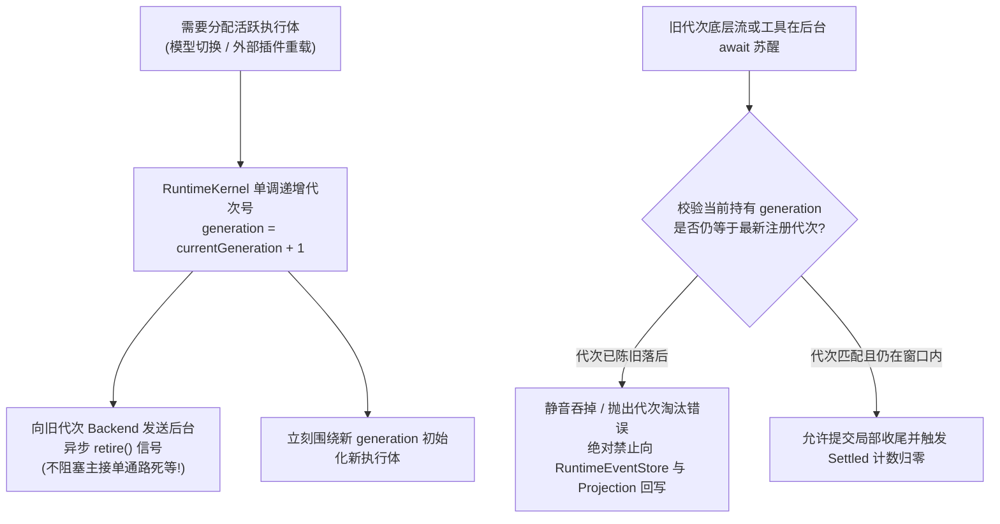

# 并发代次与停止围栏：RuntimeKernel 如何隔离热切换与冷启动竞态？

## 1. 为什么在有活跃工具或热配置变更的会话上，绝不能直接 `delete session; create session`？

在一个可长跑多步的 Agent 宿主内，会话并不是一条直线从头顺滑跑到底的孤立对象。运行时经常同时面对三类极其凶险的并发重叠交叉：

1. **配置热切换时旧实例未死**：用户在第 2 步等待某个慢速 API 或 MCP 工具返回之际，手动把会话背后的默认模型换成了更强的推理模型。系统切出新版配置后的 `Backend`，但刚才旧代次底层尚未彻底撤销的网络请求流还在幽灵般地等着 `await` 返回，万一老流在 3 秒后苏醒顺手往数据库写了一条报错终态，直接就会把新开出的运行彻底污染砸毁！
2. **停机请求发完却出现虚假“立即停止”**：用户点了界面上的 Stop 按钮，前端马上显示“已取消”；结果底层一个正在收尾的 `Code Mode` 沙箱或者正在写盘的 SQLite `T2` 提交还在半途跑了 400 毫秒，如果新的回合立刻抢跑接管文件工作区，前后两代命令就会同时改动同一个源码文件引发灾难。
3. **后台冷启动恢复期与用户热触发撞车**：Host 重启正在对断电前悬空会话做恢复校验（`resolveRuntimeRecovery`）并准备续跑交接（Continuation）的零点几秒里，连接上来的客户端正好发来了一条新指令。

Maka TypeScript 版在 `packages/runtime/src/runtime-kernel.ts` 与 `session-manager.ts` 中构造了三道互锁屏障：**五层生命期范围定位、单调递增的 `BackendGeneration` 代次淘汰机制，以及严格区隔逻辑打断与物理收尾的 `completion` vs `settled` 双等待契约**。

---

## 2. 会话内的五级资源寿命坐标系

为了防止对象提前析构（Use-After-Close）或长驻泄露，`RuntimeKernel` 把所有活动资源精确锁定在由外向内逐层收缩的五个生命周期容器内：

| 作用域层级 | 典型实体与宿主容器 | 生死边界与销毁铁律 |
| :--- | :--- | :--- |
| **1. Host 进程级** | `HostEpoch`、Root 排他锁、`SecretStore`、插件平台与 Peer 节点 | 随宿主机启停，经由六阶段有序激活、停机逆序收缩直至所有物理租约归还才放锁 |
| **2. Backend 代次级** | `RuntimeKernel` 中注册绑定的底层执行适配器（由 **`BackendGeneration`** 标定） | 每次配置切换模型类型、认证变更或强制重建时自增递增；新旧可重叠等待，老代次失权后禁止一切共享状态写入 |
| **3. Session 逻辑级** | `SessionManager` 内部按需装载的活动句柄与准入闸门队列 | 承载连续跨回合对话，可在无活跃运行且无人订阅时优雅逐出内存缓存，保留磁盘规范真相 |
| **4. Run / Invocation 级** | `AgentRun` 实例及其关联的持久化 `RuntimeEvent` 脊柱与操作账本 | 每次物理启动开场必落 `invocation_opened`，退出无论胜负中止必须闭合于终态边界事件与清理收口 |
| **5. Turn / Attempt 级** | 瞬态 `AiSdkTurn`、`AsyncEventQueue`、`StreamWatchdog` 与请求取消令牌 | 只在当前执行尝试期间短暂存活，退出瞬间必须清空本地队列与挂起定时器句柄 |

---

## 3. `BackendGeneration` 并发代次锁：零互斥卡死的安全热交替

传统的对象管理如果想切换后台模型引擎，往往先 `await oldBackend.dispose()` 卡住整个会话不准任何操作进来，然后再新建实例。如果旧实例正连着一个卡死半天不关闭的 HTTP 流，用户换个模型甚至都要卡着转圈十几秒。

`RuntimeKernel` 采用无阻塞的 **生成代次凭证（`BackendGeneration`）** 来让新旧实例实现优雅擦肩交接：



这一设计的巧妙之处在于其非对称写入锁机制：
- **新任务秒级上位**：老引擎进入后台优雅消亡与网络连接排水期，不影响新版 `Backend` 围绕新配置立刻对后续消息就位接客；
- **绝对防僵尸反噬**：任何异步回调函数在拿到资源准备修改核心会话头部（`SessionHeaderPatch`）、追加持久事件或者向 `SessionContinuity` 发状态变动前，全部强制由 Kernel 包裹代次断言守卫——哪怕旧引擎中的某个超时定时器晚了五秒才炸响，它也已经完全丧失了向这片领地写入半个比特的法定权利。

---

## 4. `completion` 与 `settled` 双等待契约：为什么 Stop 完不能立刻认为能用？

对于大多数简单框架而言，“停止会话”等价于 `abortController.abort()` 然后等待生成 Promise 返回结果。但这在生产引擎中会遗留一个极为隐蔽的致命裂缝：**`abort()` 只是发出了逻辑打断意图，而工具进程树的彻底杀绝（`ProcessTreeTerminator`）、MCP 远程连接释放、以及 `AgentRun` 尾部的持久化终态写盘与 `AgentRunStore` 对账（`RuntimeOwnerCleanup`）往往才刚刚开始**！

为了精准表达“业务上停止推进了”和“物理现场已经打扫干净了”这两件不同时发生的事件，Maka 严格暴露了两个语义截然不同的边界等待门闩：

```typescript
// 概念演示：双层等待语义如何守护停机与状态交接边界
interface TurnShutdownContract {
  // 1. completion：代表逻辑推理/工具步进主干已收到终止信号并停止生成新意图
  // 适用场景：UI 立即停止显示“思考中”动画，提示用户本轮已经回应停止
  waitForCompletion(): Promise<TurnOutcome>;

  // 2. settled：代表整棵进程树、StreamWatchdog 句柄、内部 AsyncEventQueue
  // 以及末尾物理持久化落盘与 RuntimeOwnerCleanupError 自检已 100% 收口完毕
  // 适用场景：下一轮热启动 Turn、工作区 Git 检查点恢复、Host 关停排空前必须死守的硬栅栏!
  waitUntilSettled(): Promise<SettledReceipt>;
}
```

请看这两层栅栏的工程区分威力：
- 如果前端只是为了让 UI 按钮响应灵敏，它可以监听逻辑层收束迅速恢复可点击输入状态；
- 而在宿主的 **`SessionAdmissionGate`、续接控制逻辑（Continuation）以及 `HostComposition` 逆序关停通道里**，任何实质性的状态覆写、工作区回滚或者重新发起模型流，必须死等前一个活跃实例达到 **`settled`**！哪怕中间由于清理异常抛出了 `RuntimeOwnerCleanupError`（在 `runtime-kernel.ts` 中显式建模），宿主也能精准捕获到“资源清理尚未彻底确认”，立即锁停风险续跑并上报异常边界，绝不会用脏现场误导下一代执行体。

---

## 5. 协作断点与 `ContinuationClaimV1` 交接不变式

当需要跨越一次进程崩溃或上下文压缩极限进行安全续跑（Continuation）时，`runtime-kernel.ts` 会联合 `AgentRun`、`ImmutableRuntimePrefixV1` 和 `ContinuationClaimV1` 对老一代执行体的边界光标 `RuntimeBoundaryCursor` 执行原子交接校验：
- 系统首先核实前任 `Invocation` 确确实实停留在一条**合法可续接的非悬空边界上**（已闭合终态或明确受控挂起，且无未经解决的阻塞型未知工具）；
- 随后在一个单一原子存储事务内同时写出对前序前缘的认领宣示（`ContinuationClaimV1`）与新代次 `invocation_opened` 事件（并在其中写明指向上一代物理尝试的 `RuntimeInvocationLineage` 血缘指针），确保任意多个同时复苏的宿主副本中永远最多只有一个成功抢占认领续跑权。

---

## 6. 总结

`RuntimeKernel` 将传统难以捉摸的“会话关闭与重建竞态”收敛成了可验证的三道物理栅栏：
1. **五级生命期逐层嵌套**：从进程纪元 `HostEpoch` 到瞬态 Attempt 逐级清晰归属，不留游离长悬句柄；
2. **`BackendGeneration` 乐观淘汰机制**：支持配置变更或插件重载毫秒级无阻塞切换到新一代引擎，同时绝杀过期实例的延迟回写；
3. **`completion` 与 `settled` 严格分离**：保证UI敏捷响应的同时，确保工作区状态回滚、Git 检查点签发和下轮任务发射永远踩在前序执行体完全物理清零后的绝对安全地基之上。

稳住了会话外壳和并发代次接力之后，接下来我们走进单个 Turn 最核心的引擎内部：**`AiSdkTurn` 在这层外壳保护下，到底是怎么把单步模型推理、多阶段流式看门狗、步间 Steering 与多工具并总结算编排成一体化闭环的？** 请看下一篇：[AiSdkTurn 双层循环：流式看门狗、步间 Steering 与工具结算栅栏](./model-step.md)。
