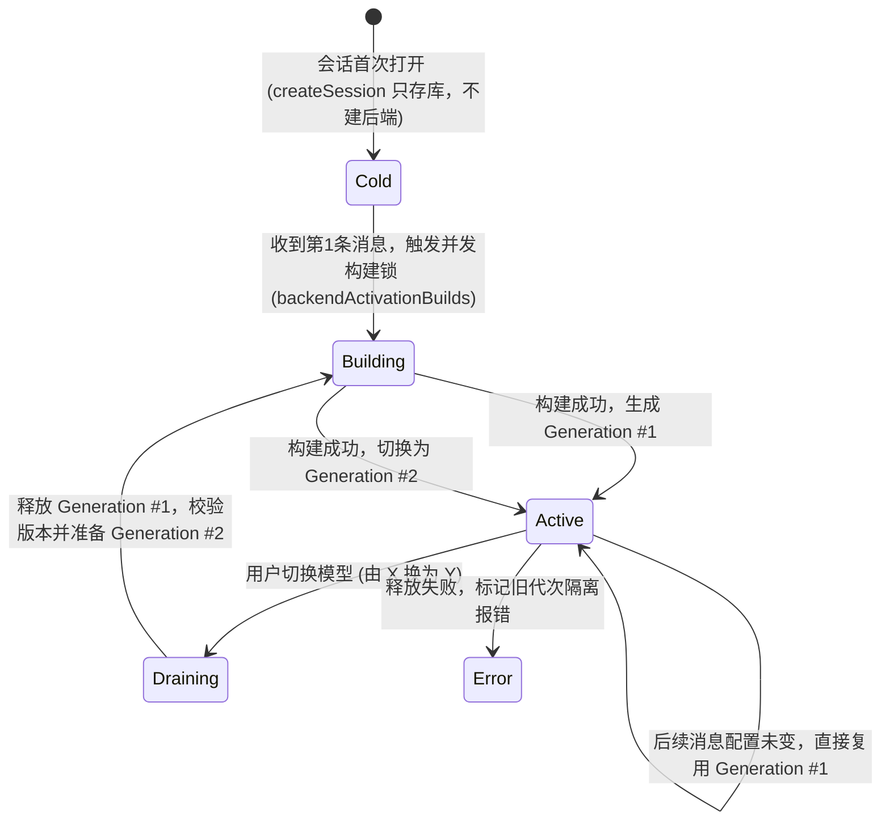

# 会话与执行对象的生命周期

[返回手册目录](../README.md)

想象用户在同一个会话 S 中连续发起两次交互：首先问“读一下项目”，等它回答完毕，紧接着追问“刚才那个函数是做什么的？”。两条消息共享同一个 `sessionId`，它们处于同一个业务会话中。

在工程实现上，这引发了一系列关于**对象寿命与资源管理**的关键问题：
1. 第二次提问时，是销毁一切从头创建，还是沿用第一次的模型连接和工具列表？
2. 如果在两次提问之间用户切换了大模型（例如从模型 X 换成模型 Y），或者第一条还没跑完用户就发起了第二条，系统如何避免内存状态互相踩踏？
3. 当用户点击“停止”时，如果底层后端还在初始化，或者工具正卡在等待人类确认上，资源该如何安全回收？

本章深入剖析 Maka 运行时中四大核心对象的创建、持有、并发隔离与销毁边界。

---

## 1. 四层对象模型：谁活多久？

很多初学者容易把所有运行中的状态都塞进一个叫 `Agent` 的大类里。但在复杂的托管架构中，不同状态的寿命差异极大：

```mermaid
flowchart TD
    Store["Session (持久记录)<br/>寿命：跨进程永久保存"] --> Gen["BackendGeneration (资源代次)<br/>寿命：当前配置版本有效期间，可跨多次请求复用"]
    Gen --> Backend["AiSdkBackend (模型后端)<br/>持有：ModelAdapter、已激活工具清单、Prompt Cache"]
    
    Gen -.->|activeRuns 登记| Run["AgentRun (本次执行记录)<br/>寿命：从准入开始到终态写入与收尾完毕"]
    Backend -->|每次 send() 新建| Turn["AiSdkTurn (步进作用域)<br/>寿命：仅限本次模型循环，含独立 runId 与 AbortSignal"]
    Turn -->|构造时创建| TR["ToolRuntime (工具执行环境)"]
```

| 对象名称 | 核心职责 | 寿命范围 | 为什么不能合并？ |
| :--- | :--- | :--- | :--- |
| **Session** | 组织对话历史与配置边界的持久化记录（并非内存单例）。 | **永久**（存储在 SQLite） | 即使进程完全重启，会话 ID 和历史依然存在。 |
| **BackendGeneration** | 为一批配置资源分配的“版本代号”与资源护栏。 | **配置有效期内**（可服务多次请求） | 切换模型时用于隔离旧代次未退出的残留请求，防止旧执行误用新模型。 |
| **AgentRun** | 负责“这次工作留下了哪些运行事实与最终结局”。 | **单次执行周期**（准入到 `finalize()`） | 即使后端初始化还没成功（Turn 尚未创建），输入事实和启动报错也必须记录在案。 |
| **AiSdkTurn** | 负责“本次发送的模型步进、流式消费与取消信号”。 | **单次 `send()` 作用域内** | 同一后端上可能存在重叠执行，必须把 `runId` 与工具作用域锁在 Turn 内防串扰。 |

### 为什么 `AgentRun` 和 `AiSdkTurn` 要由两个对象负责？
假设用户在启动一个会话时，后端的构建工厂（`build()`）因为网络鉴权失败抛出了异常。此时，`AgentRun.begin()` **已经记下了用户输入**，但 `AiSdkBackend.send()` 根本还没有开始，自然也没有 `AiSdkTurn` 对象。
正因为分离了 `AgentRun`（事实账本代表）与 `AiSdkTurn`（执行循环引擎），`RuntimeKernel` 才能从容地将启动阶段的失败归档到已经存在的 `AgentRun` 中，确保“有输入必有结局”。

---

## 2. 后端复用与 Turn 隔离的艺术

### 为什么不每次发消息都新建 Backend？
当用户发起第一条消息时，系统可能会通过 `tool_search` 动态激活一批工具，并与供应商建立提示词缓存（Prompt Cache）。如果第二条消息摧毁并重建后端，不仅要重新建立网络和鉴权开销，更会破坏工具列表的稳定性，导致昂贵的 Prompt Cache 失效。
因此，只要会话配置没有改变，Maka 会让第二条消息复用同一个 `BackendGeneration` 下的 `AiSdkBackend`。

### 为什么每次 `send()` 还要新建独立的 `AiSdkTurn`？
既然复用了 Backend，为什么不把 `currentRunId` 和 `ToolRuntime` 直接挂在 Backend 上呢？
设想以下并发场景：同一个 Backend 上同时运行着两个任务 A 和 B。A 率先执行完毕，开始执行清理；此时 B 刚刚调用了读文件工具。如果 A 和 B 共享 Backend 上的 `currentRunId`，A 在收尾时擦除 `currentRunId`，就会导致 B 的工具调用失去身份归属，甚至误触发 B 的取消信号！

因此，Maka 严格规定：**长寿命的稳定资源（模型适配器、已激活工具清单）留在 Backend；短寿命的可变执行状态（`runId`、取消控制器 `AbortController`、独立的 `ToolRuntime` 实例）全部锁死在每次新建的 `AiSdkTurn` 闭包中。**

---

## 3. 代次管理：冷启动并发与模型热切换

当系统面临并发启动和配置热更新时，`RuntimeKernel` 依靠 **代次（Generation）机制** 来维持秩序：



### 场景 1：双请求并发冷启动
如果两条执行在同一毫秒同时首次唤醒一个冷会话，Kernel 内部用一张共享构建表（`backendActivationBuilds`）保存正在构建中的 Promise。后到达的请求不会重复调用工厂创建两个后端，而是共同 `await` 这同一个构建 Promise，保证工厂只执行一次。

### 场景 2：会话中途换模型（从模型 X 切换到模型 Y）
Maka 规定切换配置必须通过版本校验（乐观锁 `expectedRevision`）并在会话空闲时执行：
1. 系统先标记并释放属于模型 X 的 `Generation #1`（调用 `AiSdkBackend.dispose()`）。
2. 如果旧后端的释放失败，整个配置切换报错中止，防止僵尸资源残留。
3. 旧代次安全退出后，提交模型 Y 的配置。只有当下一条消息真正到达时，系统才会懒加载创建 `Generation #2`。

### 场景 3：登记与派发之间的“生死窗口”
假设任务 A 刚刚向 `Generation #1` 登记了准入资格，正准备调用 `backend.send()`，就在此微秒间隙，用户点击了“停止”或触发了代次销毁。
为了堵住这个竞态窗口，Kernel 在真正派发 `send()` 前，必须执行一次**原子三连核验（`assertRunCanDispatch`）**：
1. 本次 Run 是否已被标记停止？
2. 刚才拿到的后端是否仍然属于当前活跃代次？
3. 本次 Run 是否依然合法登记在该代次的 `activeRuns` 集合中？

只要有一项不满足，派发立即被拦截，绝不向模型发出无效请求。

---

## 4. 教学伪代码：Kernel 代次复用与派发保护

以下伪代码展示了 `RuntimeKernel` 如何在并发冷启动、配置代次隔离与异常收尾之间保持绝对安全：

```text
class RuntimeKernel:
    // 记录每个 session 当前激活的代次与正在构建中的共享 Promise
    activeGenerations = new Map()      // sessionId -> BackendGeneration
    buildingPromises = new Map()       // sessionId -> Promise<BackendGeneration>

    function ensureActiveBackend(sessionId, config):
        // 1. 已有匹配代次直接复用
        gen = this.activeGenerations.get(sessionId)
        if gen != null and gen.matchesConfig(config) and not gen.isDisposing():
            return gen

        // 2. 并发冷启动防重：若正在构建中，则合并等待同一个 Promise
        if this.buildingPromises.has(sessionId):
            return await this.buildingPromises.get(sessionId)

        // 3. 发起唯一一次后端构建
        buildPromise = (async () => {
            backend = await this.factory.build(config)
            newGen = new BackendGeneration(id: nextGenId(), backend, config)
            this.activeGenerations.set(sessionId, newGen)
            return newGen
        })()

        this.buildingPromises.set(sessionId, buildPromise)
        try:
            return await buildPromise
        finally:
            this.buildingPromises.delete(sessionId)

    function dispatchTurn(sessionId, run, userInput):
        gen = await this.ensureActiveBackend(sessionId, run.config)
        gen.activeRuns.add(run.id)

        try:
            // 核心：派发前最后一道同步核验，封堵登记后到 send 前的取消窗口
            if run.isCancelled() or this.activeGenerations.get(sessionId) != gen:
                throw new DispatchAbortedError("Generation rotated or run stopped")

            // 进入独立 Turn 作用域，yield* 消费并转发事件
            for await event in gen.backend.send({ runId: run.id, input: userInput }):
                yield event
        finally:
            gen.activeRuns.delete(run.id)
            await run.finalize() // 结清运行记录
```

---

## 5. 停止时机与优雅清理边界

用户在界面点击“停止”的瞬间，系统可能处于完全不同的状态。Maka 根据停止发生的阶段执行精准打击：

| 停止发生时机 | 系统状态 | 清理动作与保障策略 |
| :--- | :--- | :--- |
| **后端还在构建中** | `buildingPromises` 尚未完成 | 取消启动申请；若工厂随后才交回后端，Kernel 立即销毁它，确保 `send()` 一次都不会被调用。 |
| **模型或工具运行中** | `AiSdkTurn` 正在循环或等待输入 | 触发 `AbortController`；如果工具正阻塞在人类审批或交互等待，同时调用 `ToolRuntime.endTurn()` 强制解除等待。 |
| **要求步进边界停止** | `after_step` 软停止标志 | 允许当前步骤和正在进行的工具安全结算完，在进入下一步模型请求前优雅退出循环。 |
| **落盘取消结果失败** | 底层资源已停，但数据库写入异常 | 保留本次停止指令的待重试记录；下次重试补写数据库时，确保底层 `backend.stop()` 不会重复调用。 |

### “看到 `complete`”不等于“后台全部清理完毕”
这是并发编程中极易踩坑的一点。在托管执行接口中，Maka 严格区分了两个等待信号：
- **`completion`**：代表逻辑执行结果（`CompleteEvent`）已经产生，可以向用户展示最终答案了。
- **`settled`**：代表后台的事件流抽水任务、工具子进程回收、数据库终态归档以及 Turn 作用域 `close()` 已经**100% 物理结清**。

客户端或自动化测试脚本在连续发起下一轮动作或关闭进程前，必须等待 `settled` 信号，而不是看到 `complete` 就直接强杀进程。

---

## 6. 对照 Pi：对象寿命的不同组织哲学

- **Pi 的常规模式**：在 `createAgentSession()` 时实例化一个长寿命的 `Agent` 对象，保留监听器和消息队列。每次 `prompt()` 在内部创建一个简单的 `activeRun` 标记（附带 Promise 和 `AbortController`），同时通过互斥锁直接拒绝在前一个未结束时重入。Pi 逻辑极度紧凑，因为它不需要跨客户端共享，也不需要支持在运行过程中通过代数锁平滑旋转后端。
- **Pi 的实验性 `durable` 模式**：引入了 `HarnessImpl` 来管理持久化任务调度，在关闭时同样需要等待调度器任务结清，这与 Maka 的 `settled` 思想殊途同归。

---

## 7. 延伸阅读

- 了解 `AiSdkTurn` 内部是如何一轮轮推进模型与工具的，阅读 [01.3 模型步进与循环](model-step.md)。
- 了解配置变更与多 Provider 凭据是如何注入到 `BackendGeneration` 的，阅读 [01.4 模型、连接与配置的注入](provider-configuration.md)。
- 了解如果进程直接崩溃（连 `finally` 都没来得及走），重启后如何处理，阅读 [04.1 持久化执行与崩溃恢复](../04-state/durable-execution.md)。
