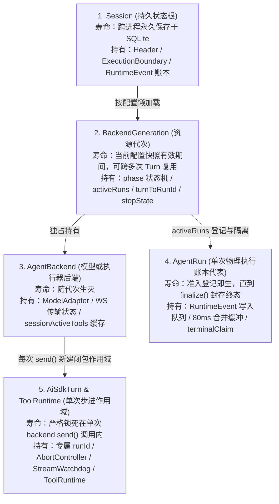
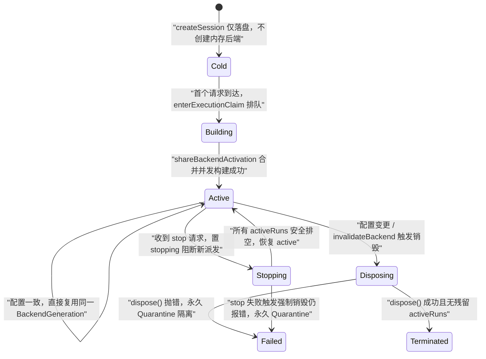

# 会话与执行对象的生命周期

[返回手册目录](../README.md)

想象用户在同一个会话 `S` 中连续发起两次交互：首先提问“读一下项目结构”，等待回答完毕后紧接着追问“刚才提到的模块职责是什么？”。两条消息共享同一个 `sessionId`，但在系统的底层运行时中，对象的寿命差异却跨越了从**永久落盘**到**单次回调闭包**的巨大跨度。

如果粗暴地把所有状态都塞进一个单一的 `Agent` 类里，系统一旦面临真实生产环境就会迅速崩塌：
1. **并发冷启动踩踏**：两个客户端同时向一个尚未激活的会话发送首条消息，如果各自构造后端，就会产生两份互相冲突的连接池与工具注册状态。
2. **换模型与在途任务撕裂**：当用户在两次提问之间切换大模型（从模型 X 切到模型 Y），或者上一步的清理挂起失败时，残留的在途调用如何被安全隔离，防止旧执行误用新配置？
3. **并发任务间的状态污染**：同一个会话后端上如果同时并发跑着主任务和后台提取/压缩任务，先结束的任务在收尾时如果擦除了共享的 `currentRunId` 或工具环境，正在运行的兄弟任务就会瞬间崩溃。
4. **过早退出或重入陷阱**：前端看到界面打印出了最终答复（`complete`），是否意味着后台的文件清理、账本封存与子进程回收已经全部结束？

本章全面剖析 Maka 运行时中**五层对象模型**的寿命边界、冷启动与代次隔离机制、派发生死窗口的防御、以及精细的停止与双等待契约。

---

## 1. 概念先行：五层对象寿命模型

在 Maka 中，状态按**变更频率**与**故障隔离域**被严格划分为五个层级。每一层都有不可越界的所有权职责：



| 对象层级 | 核心职责 | 寿命边界 | 为什么绝不能合并到上一层或下一层？ |
| :--- | :--- | :--- | :--- |
| **Session** | 持久化业务边界、历史账本与权限配置。 | **永久**（SQLite 持久化） | 进程重启后业务会话依然存在，必须独立于易逝的内存对象。 |
| **BackendGeneration** | 为一组固定模型/连接/策略分配版本代号与资源围栏。 | **配置稳定期内**（可复用多个 Turn） | 换模型或改策略时用于隔离旧代次未退出的请求，并在销毁失败时将其永久“隔离（Quarantine）”。 |
| **AgentBackend** | 复用连接池、`ModelAdapter` 与延迟工具表 `sessionActiveTools`。 | 绑定于所属 `BackendGeneration` | 保留 `tool_search` 已激活工具清单与底层连接复用，避免每次发言破坏厂商 Prompt Cache。 |
| **AgentRun** | 负责“这次物理执行留下了哪些不可变事实与终态”。 | **准入建档至 `finalize()` 结清** | 即使后端构建在工厂阶段就因网络报错失败，`AiSdkTurn` 尚未诞生，`AgentRun` 也已记录用户输入并负责写入失败结局。 |
| **AiSdkTurn & ToolRuntime** | 封装单次 `send()` 的流循环、看门狗、工具执行与人机审批。 | **仅限单次 `send()` 作用域** | 同一 Backend 允许存在受控并发运行；将可变执行状态锁死在独立 Turn 作用域，杜绝交叉擦除身份。 |

### 关键架构洞察：为什么 `sessionActiveTools` 留在 `AiSdkBackend`，而 `ToolRuntime` 锁在 `AiSdkTurn`？
这是一个深思熟虑的缓存与隔离权衡：
- `AiSdkBackend` 持有一张会话级字典 `sessionActiveTools`。当某次工具调用通过 `tool_search` 动态激活了延迟工具后，这些工具名会被保留在 Backend 层，**Turn 结束与历史压缩都不会清空它**。因为保留一致的工具声明列表是命中大模型服务端 Prompt Cache 的前提，而且同一 Backend 上的并发 Run 也能立刻看到新激活的工具。
- 反之，真正执行工具权限检查、计数限制、审批挂起与看门狗暂停的 `ToolRuntime` 与 `abortController`，则必须随 `AiSdkTurn` 按次新建。哪怕前一个 Turn 在收尾清理，也绝不会影响到另一个并发 Turn 正在等待审批的工具调用。

---

## 2. 代次生命周期：冷启动并发与模型热切换

`RuntimeKernel` 通过严密的状态机与代次（Generation）管理，确保冷启动、复用、失效重建与销毁之间不存在并发漏洞。



### 2.1 准入占坑与并发冷启动防重（`PendingExecutionClaim` & `backendActivationBuilds`）
新建会话时，系统只在 SQLite 写入元数据，绝不预先拉起昂贵的后端连接。当两条请求在同一毫秒并发唤醒一个冷会话时：

1. **准入队列排队（`claimExecution` & `enterExecutionClaim`）**：
   每次调用 `startTurn`、`resumeContinuation` 或紧凑操作前，Kernel 会创建一个处于 `'pending'` 阶段的 `PendingExecutionClaim` 并登记到会话的 `executionClaims` 集合。它先等待 `admissionBarrier`（即当前正在进行中的会话级配置变更锁 `sessionMutationTails` 完成），若此时会话正在停止（`stopIntents` 非空），直接拒绝准入。
2. **Promise 合并（`backendActivationBuilds`）**：
   在 `ensureActive()` 内部，Kernel 先检查当前是否已存在活跃代次，若不存在则等待任何正在进行的旧代次销毁（`waitForBackendDisposal`），随后以 `activationKey = "parent:" + sessionId` 检索 `backendActivationBuilds` 字典：
   - 首个到达的请求启动唯一一次异步构建（调用 `backends.prepare` 解析模型与凭据，再调用 `prepared.build` 装配后端），并将该 Promise 存入 `backendActivationBuilds`。
   - 后续并发到达的请求发现字典中已有正在构建中的 Promise，**直接 `await` 这同一个 Promise**，保证底层的工厂初始化与 OAuth 鉴权绝对只执行一次。
3. **构建期被取消的幽灵后端清理（`rejectCancelledBackendActivation`）**：
   如果在漫长的异步准备/构建期间用户点击了“停止”，导致 `execution.abortController.signal.aborted` 变为 `true`，即使工厂随后交出了新建好的 `backend` 实例，Kernel 也会立即拒绝将其放入 `active` 池，而是给它包一层临时 `BackendGeneration` 并送入 `quarantineBackendGeneration()` 物理销毁，确保 `send()` 一次都不会被误触发，连接池也不会泄漏。

### 2.2 配置热更新、权限放宽与隔离熔断（Quarantine）
当会话需要修改配置（例如在菜单里把模型从 X 换为 Y，或调整沙箱权限模式）时，Maka 区分了两种截然不同的变更路径：

- **非破坏性权限放宽（`invalidateBackend`）**：如果只是放宽工具权限而未改变模型与工作区，直接调用 `disposeBackend` 会粗暴打断正在执行中的长 Turn。此时 `SessionManager` 走 `runSessionAdmissionMutation` 提交变更，并调用 `runtimeKernel.invalidateBackend()`：它把在途预检的头快照标为失效（`invalidateBackendHeaderSnapshots`），并登记 `BackendInvalidationState`（同时保留当时正在构建中的 `backendActivations` 集合不被半路偷袭），**直到当前所有运行中的 Run 安全退出后（`flushBackendInvalidation`）才真正销毁并重塑代次**。
- **破坏性资源切换（`disposeBackend`）**：涉及更换模型、缩窄权限或迁移工作区时，必须在 `runSessionQuiescentMutation`（静默期变更门控，拦截一切持有 `executionClaims` 的会话及其子会话树）内确保当前无活跃执行，随后调用 `disposeBackend()` 触发 `quarantineBackendGeneration()` 释放旧代次。
- **隔离熔断（Quarantine）防撕裂**：如果旧代次在调用 `backend.dispose()` 时抛出了异常（例如残留的子进程无法杀掉或连接关闭失败），Kernel **绝不会装作无事发生并覆盖掉旧代次引用**。相反，它会将该 `BackendGeneration` 的 `phase` 永久置为 `'failed'` 并保存 `disposalFailure` 误差凭证。下一次任何请求试图唤醒该会话时，`clearBackendQuarantineForActivation()` 会检查并立即拒绝启动，防止僵尸后端带着未知副作用继续服务，直到问题被彻底清除。

### 2.3 登记与派发之间的“生死窗口”（`assertRunCanDispatch`）
在复杂异步调度中，存在一个极易被忽视的竞态时间窗：
1. `AgentRun.begin()` 向目标 `BackendGeneration` 登记了占用资格（`reserveGenerationRun` 将本次 Run 写入 `activeRuns` 与 `turnToRunId` 映射表）。
2. 紧接着进入交互权限绑定、合作交接组合快照落盘（`prepareBeforeDispatch`）等若干个 `await` 间隙。
3. 就在此微秒间隙里，外部可能触发了会话停止或代次轮换，将 Run 标记为停止或把该代次转入了 `stopping`/`disposing` 状态。

为了彻底堵死这个“生死窗口”，Kernel 在同步发起 `backend.send()` 之前的最后一行，强制执行一次**同步五连核验（`assertRunCanDispatch`）**：
1. 本次 `run.isStopped()` 必须为 `false`；
2. 能够从活跃代次池找到该 `backend` 对应的 `BackendGeneration`；
3. 该代次的状态 `phase` 必须严格为 `'active'`；
4. 该代次依然是当前会话名下的权威代次（`this.isCurrentGeneration(active)`）；
5. 该代次的 `activeRuns.get(runId) === run` 且 `turnToRunId.get(turnId) === runId`。

只要有一项校验不通过，Kernel 当场抛出异常拦截，绝不向外部大模型发出哪怕一个字节的无效请求。

---

## 3. 进程纪元、停止边界与 `completion` vs `settled` 双等待契约

### 3.1 `sessionRunEpoch` 与 `sessionHostGeneration`：跨快照的乱序防护
在多端架构中，客户端可能先后读取同一份会话配置（此时 `revision` 版本号相同），但中间可能已经完整启动并结束了一轮后台 Run。为了防止客户端把“先发出但后到达”的旧活跃状态误当成当前状态，`RuntimeKernel` 在每次 `reserveGenerationRun`（入集）、`unregisterRun`（出集）以及 Host 独占操作挂载/卸载时，都会递增进程内单调计数器 **`sessionRunEpoch`**，并与每次进程启动随机生成的 **`sessionHostGeneration`** 配对暴露给上层，确保同一修订号下的多端观测依然严格可比。

### 3.2 五种停止时机与精准清理策略

用户点击“停止”或宿主关闭时，运行引擎可能处于任意状态。Maka 按所处生命周期阶段精准拆解停止动作：

| 停止发生时机 | 系统所处状态 | 清理与防护策略 |
| :--- | :--- | :--- |
| **1. 后端尚在构建中** | 处于 `backendActivationBuilds` 等待期 | 将 `PendingExecutionClaim` 置为取消；待工厂返回实例后立即交由 `quarantineBackendGeneration` 销毁，`send()` 不会被调用。 |
| **2. 处于派发登记窗口** | `attachExecutionClaim` 刚挂上 `Run` 尚未开跑 | 同步传递 `stopIntent` 标记 `run.stop()` 并触发 `abortController.abort()`；`assertRunCanDispatch` 同步拦截派发。 |
| **3. 模型或工具运行中** | `AiSdkTurn` 循环执行或卡在人工审批 | 触发 `AbortController` 掐断 HTTP/WS 流；通过 `Promise.allSettled` 遍历并调用所有活跃 Turn 的 `endAbortedTools()` 强制解除审批挂起，防止一个 Turn 抛错导致兄弟 Turn 永久卡死在交互注册表上。 |
| **4. 步进边界软停止** | 传入 `mode: 'after_step'` | 设置 `stopRequested = true` 但不中断当前正在进行的 HTTP 流与工具，待本批工具安全落盘结算完毕后，在下一轮步进门控优雅退出。 |
| **5. 落盘取消终态失败** | 底层流和进程已停，但写入 SQLite 异常 | 保留 `StopOperation` 对象与 `StopRunTarget` 引用（记录 `delivery: 'delivered'` 而 `stopCompleted: false`）；当后续外部重调 `stopSession` / `stopRun` 重试写库时，只重试持久化落盘，**绝不重复触发 `backend.stop()`**。 |

### 3.3 `completion` vs `settled`：为什么看到 `complete` 还不算完？

这是编写上层协调器、自动化脚本或集成测试时最致命的并发陷阱。在 `HostedExecutionAuthority` 返回的 `HostedExecutionAdmissionResult` 契约中，Maka 明确暴露了两个语义截然不同的等待句柄：

```text
HostedExecutionAdmissionResult {
  snapshot:   HostedExecutionSnapshot,          // 初始快照
  completion: Promise<HostedExecutionCompletion>, // 逻辑业务结局已就绪
  settled:    Promise<void>                     // 后台物理资源与状态机已 100% 结清
}
```

两者的严格时间线差异如下：
1. **`completion` 何时兑现？**
   在 `drainTurn` 中，当后端事件流耗尽、读回规范终态快照（`completed` / `failed` / `cancelled`）并调用 `observeExecutionCompletion` 触发完业务监听回调（`completionObserver`），或在异常处理分支捕获权威错误后，最终在 `finally` 块中兑现 `active.completion.resolve(...)`。此时业务层可以认为“这轮对话的结果数据已经确定了”。
2. **`settled`（对应 `active.done`）何时兑现？**
   它包裹了整个 `drainTurn` 协程从头到尾的完整运行周期：
   - Kernel 侧执行完 `cleanupRunExecution`、`AgentRun.finalize()` 刷新合并缓冲、解除工具运行环境与互动绑定、`unregisterParentRun` 释放代次中的 `activeRuns` 占位；
   - Host 侧执行完 `settlePlanAfterTerminalTurn`（推进计划模式流转）、`materializeAdmittedMessageSources`（将本轮引用的队列消息物化为已消费）、`completeTerminalTransition`（解除终态发布围栏并向所有在线客户端广播最终快照）；
   - 释放 `HostedExecutionRegistry` 中的会话独占锁以及恢复驻留租约（`residency.release()`）。

**工程铁律**：如果调用方仅等待 `completion`（或在订阅流里刚看到 `complete` 事件）就立刻向同一会话发起下一轮 `turn.start`、修改模型配置或强杀进程，极大概率会撞上 `session_busy` 报错或截断收尾广播与计划结算！任何需要串行衔接下一步变更或安全停机的操作，**必须等待 `settled`（或 `whenIdle(sessionId)`）完全兑现**。

---

## 4. 教学伪代码：`RuntimeKernel` 代次管理与派发窗口保护

以下教学伪代码展示了 `RuntimeKernel` 如何在并发冷启动合并、代次隔离、失效清理与派发生死窗口核验间保持严密的并发安全：

```text
class RuntimeKernel:
    active = new Map()                   // sessionId -> BackendGeneration
    backendGenerations = new Map()       // genId -> BackendGeneration
    backendActivationBuilds = new Map()  // activationKey -> Promise<BackendGeneration>
    executionClaims = new Map()          // sessionId -> Set<PendingExecutionClaim>

    // 1. 并发冷启动安全合并与隔离检查
    async function ensureActive(sessionId, header, execution):
        // 检查是否存在处于 failed/stopping/disposing 的隔离或待处理代次
        await clearBackendQuarantineForActivation(sessionId, execution)

        if existing = active.get(sessionId):
            existing.cachedHeader = header
            return existing

        // 若有正在进行中的销毁，先等待其完全退出或抛出 Quarantine 异常
        await waitForBackendDisposal(sessionId)

        return await shareBackendActivation("parent:" + sessionId, async () => {
            if current = active.get(sessionId): return current

            prepared = execution.backendPreparation ?? await backends.prepare(header.backend, { sessionId, header })
            execution.run?.bindProviderStateIdentity(prepared.providerStateIdentity)
            backend = await prepared.build({ sessionId, header, ... })

            // 如果构建期间已被取消，立即包裹并销毁这个“幽灵后端”，绝不入池
            if execution.abortController.signal.aborted:
                tempGen = createBackendGeneration(sessionId, backend, header)
                await quarantineBackendGeneration(tempGen)
                throw execution.cancellation

            generation = createBackendGeneration(sessionId, backend, header, prepared.providerStateIdentity)
            active.set(sessionId, generation)
            return generation
        })

    async function shareBackendActivation(key, activateFn):
        if pending = backendActivationBuilds.get(key):
            return await pending
        task = activateFn()
        backendActivationBuilds.set(key, task)
        try:
            return await task
        finally:
            if backendActivationBuilds.get(key) === task:
                backendActivationBuilds.delete(key)

    // 2. 派发前的“生死窗口”五重同步防线
    function assertRunCanDispatch(run, backend):
        gen = findGenerationByBackend(backend)
        if (
            run.isStopped() or
            gen == null or
            gen.phase !== "active" or
            active.get(gen.sessionId) !== gen or
            gen.activeRuns.get(run.runId) !== run or
            gen.turnToRunId.get(run.turnId) !== run.runId
        ):
            throw new Error("Run no longer owns an active backend generation")

    // 3. 隔离销毁与失败熔断 (Quarantine)
    async function quarantineBackendGeneration(gen):
        if gen.phase == "terminated": return { ok: true }
        if gen.phase == "failed": return gen.disposal ?? { ok: false, error: gen.disposalFailure }
        gen.phase = "disposing"
        gen.disposal ??= (async () => {
            try:
                await gen.backend.dispose()
                if gen.activeRuns.size == 0 and not hasRetainedStopOps(gen):
                    gen.phase = "terminated"
                    if active.get(gen.sessionId) === gen: active.delete(gen.sessionId)
                    backendGenerations.delete(gen.generation)
                return { ok: true }
            catch err:
                // 销毁失败绝不静默丢弃，永久挂起 failed 状态阻止后续复用导致幽灵泄漏
                gen.disposalFailure = new Error("Generation quarantined after disposal failed", { cause: err })
                gen.phase = "failed"
                return { ok: false, error: err }
        })()
        return await gen.disposal
```

---

## 5. 对照 Pi：对象寿命的极简组织 vs 代次隔离治理

| 对比维度 | Maka（五层对象与代次隔离） | Pi（单进程会话持有模型） |
| :--- | :--- | :--- |
| **核心容器寿命** | `Session` 持久化于 SQLite；`BackendGeneration` 跨 Turn 缓存可热切；`AgentRun` 管事实；`AiSdkTurn` 管单次执行作用域 | `createAgentSession()` 构造长寿命内存对象 `Agent`，持有一套稳定的监听器、历史数组与配置 |
| **并发与重入控制** | 同一 `BackendGeneration` 可安全容纳多路并发 Run（如主对话 + 后台提取）；状态严格隔离在 `AiSdkTurn` 闭包中 | 通过单一 `activeRun` 标记与互斥锁直接拒绝在前一次运行结束前发起新 `prompt()` |
| **冷启动与切换代价** | 会话列表打开零开销，首次发言懒加载合并并发构建；换配置须校验静默期并先隔离销毁旧代次 | 随应用初始化即就绪，配置切换直接就地更新内存字段并重置状态 |
| **停机与等待契约** | 严格区分业务结果的 `completion` 与物理回收彻底结清的 `settled`（含 `Quarantine` 熔断防泄漏） | 常规模式等待 `waitForIdle()` 即可；实验性 `durable` 模式同样在 `HarnessImpl` 中等待持久化任务调度器完全排空 |

---

## 6. 延伸阅读

- 了解一次用户请求是如何通过双级背压队列穿过这五层对象并推流回客户端的，阅读 [01.1 从输入到回答](request-to-response.md)。
- 了解模型配置与凭据是如何通过乐观锁 `expectedRevision` 安全注入并触发代次轮换的，阅读 [01.4 模型、连接与配置的注入](provider-configuration.md)。
- 了解当进程彻底崩溃（连 `finally` 和 `settled` 都来不及走完）时，重启后如何重建 `AgentRun` 账本与状态恢复，阅读 [04.1 持久化执行与崩溃恢复](../04-state/durable-execution.md)。
