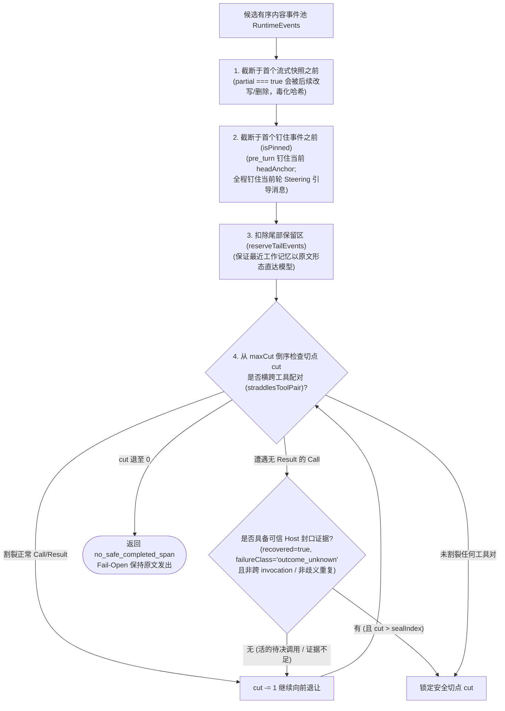
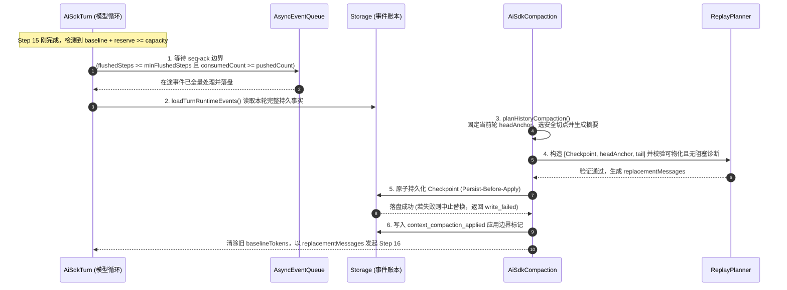

# 历史压缩：安全切点、双重校验与多模态溢退

[返回手册目录](../README.md)

在长周期的软件工程任务中（例如连续调试 30 轮测试失败、跨越十几次代码修改与构建输出），哪怕单条大工具结果已经经过 `read-page` 分页裁剪，累积起来的上下文也终将逼近或撞破大模型的上下文窗口（Context Window）上限。此外，在单轮对话的内部循环中，模型可能一口气连续执行十几个 `Read` / `Bash` 步骤，导致历史在**本轮尚未结束的中途（Mid-turn）**突然溢出。

给 Agent 做历史压缩，绝不是像普通聊天机器人那样“保留最后 10 条消息，把前面的删掉”。如果在错误的边界截断，会把一对互为依赖的工具调用与结果生生劈开引发 `400 Bad Request`，或者把用户当前正在进行的任务目标压缩成模糊概括导致模型跑偏，更可能让已失效的旧摘要重新复活已被裁剪的工具输出。

本章深入剖析 Maka **“Compaction Is a Projection（压缩即投影）”**的核心工程架构，覆盖安全切点算法与 `#6254` 封存调用突破、双重防伪哈希、双轨压缩引擎、Mid-turn 持久化卡点，以及多模态溢退与 PDF 拒收防呆原则。

---

## 1. 概念先行：压缩是有损投影，而非历史变更

在 Maka 的体系里，历史压缩（History Compaction）的本质不是“删除或修改日志”，而是**为不可变 `RuntimeEvent` 账本的一个有序前缀计算一份有损但可验证的延续视图（`HistoryCompactCheckpoint`）**：

```text
权威事实空间   = RuntimeEvents[0..n]                      （只追加、永远不删改）
压缩检查点     = Project(RuntimeEvents[0..k], policy)      （持久有损投影，绑定前缀边界与双哈希）
模型请求上下文 = Materialize(Checkpoint, RuntimeEvents[k+1..n])  （本次调用的瞬态工作集）
```

这一模型守住了几条不可动摇的工程底线：
1. **源不可变性（Source Immutability）**：压缩成功后，被覆盖的 `RuntimeEvent[0..k]` 依然完整留在账本中，审计、历史回放、UI 浏览与未来重新压缩随时可以读取原始事实。
2. **LLM 只是值生成器，不是权威判定者**：大模型只负责“把这段历史总结成什么内容”，绝不决定“覆盖了哪几条事件”“摘要是否依然有效”或“还留多少尾部原文”——这些边界与生命周期全部由确定性的 Runtime 代码裁决。
3. **触发谦逊原则（Provider Decides Fit）**：Runtime 从不擅自伪造模型窗口大小，也不在本地凭估算直接拒发请求；**只有用户显式声明的上下文窗口（Declared Context Window）配合上一次真实请求的 Provider 用量计数，才能触发主动压缩**，且 `finishReason === 'length'` 绝不作为溢出触发信号（因为外部无法区分“窗口满了”和“模型自身输出上限较小”）。

---

## 2. 安全切点算法与 `#6254` Host 封存调用突破

历史压缩的第一道计算关卡，是在候选事件池中找出允许被折叠的**最大安全前缀（`selectSafeCompactionPrefix`）**。算法从最大可行索引向前退让，严格遵守四重边界约束：



### 2.1 四重约束的工程动因

1. **禁止覆盖 `partial` 事件**：流式增量快照在步进结算时会被替换或删除，若覆盖其中任意一条，基于前缀计算的摘要哈希在下一毫秒就会失效。
2. **钉住引导消息与轮次锚点（`isPinned`）**：
   - 在 `pre_turn` 阶段，`headAnchor`（当前轮次的用户指令）必须钉在尾部保留区，绝不能被压进前序摘要。
   - 在任意阶段，当前轮次运行中插队的 `steering` 消息都被强制钉在尾部——因为后台注入器会在本轮后续每一步重新追加活跃的引导指令，若将其折叠进前缀摘要，会导致请求体积测量失真与重复引导。
3. **尾部原文保留（`reserveTailEvents`）**：手动独立压缩（`standalone`）允许 `reserveTailEvents = 0`；主动及运行中压缩至少保留 `1` 条尾部事件作为热上下文。
4. **工具配对完整性（`toolPairSpans`）**：只要 `function_call` 与 `function_response` 属于同一配对跨度，切点要么同时覆盖两者，要么同时排除两者；遇到仅有 `call` 尚无 `response` 的开放跨度（Open Span），常规情况下绝对不允许越过该 `call`——否则后续步骤工具返回结果落盘后，该 `response` 将失去前置 `call` 成为孤立消息，触发 API `400` 报错。

### 2.2 `#6254` 深度剖析：为什么被封存的崩溃调用曾永久卡死压缩？

考虑一个真实生产故障（Issue `#6254`）：Host 在调用外部工具（例如等待用户回答的 `AskUserQuestion`）已提交派发事实（T1）但尚未拿到结果（T2）时进程崩溃。重启恢复器扫描账本后，将该次调用封口（Seal）为不可变的失败终态：
- `status: 'failed'`，`actions.endInvocation: true`
- `actions.stateDelta: { recovered: true, recoveryReason: 'outcome_unknown', failureClass: 'outcome_unknown', unresolvedToolCalls: [{ toolCallId, toolName }] }`

**故障根因链**：
1. **缺陷 B（永久阻塞的开放跨度）**：原先 `straddlesToolPair` 只认 `function_response`，把这笔永远等不到结果的 `function_call` 当成“仍在执行中的活调用”，导致安全切点永远被迫退让到它**之前**。此后哪怕用户继续聊了 50 轮，所有新历史全被这颗“历史钉子户”堵死，永远无法被压缩！
2. **缺陷 A（无进展空转与假成功）**：当手动触发 `compactHistory` 时，因为池子里有后续新消息，前置空检查放行；进入规划器后，切点退回上一次检查点的覆盖边界，`newlyFoldedRuntimeEvents` 变为空集；摘要器直接复用旧摘要返回，规划器又照常铸造了一枚覆盖数一模一样的新 Checkpoint，向用户返回 `compacted`——出现“三次压缩只调一次模型、覆盖数纹丝不动、却次次报成功”的诡异空转。

**Maka 的三联精确修复**：
- **可信封口准入（`hostSealedUnknownCalls`）**：只有同时满足“非 partial、`status === 'failed'`、`endInvocation === true`、`recovered === true`、`failureClass === 'outcome_unknown'`、具备合法 `unresolvedToolCalls` 数组、**`invocationId` 严格匹配**且同一个 `toolCallId` 未被多条封口冲突声明”时，才将其标记为已封口跨度（`sealedThroughIndex`）。**而且切点必须越过封口事件本身（`cut > sealedThroughIndex`）才放行**——如果切点落在 `call` 与 `seal` 之间，依然严格阻塞！因为终态封口证据必须与调用一起被覆盖，摘要器才能知情。
- **零进展明确退出（`already_compacted`）**：在 `planHistoryCompaction` 的增量滚动匹配后，若 `successorRuntimeEvents` 已为长度 `0`（代表安全切点退回了上一枚检查点的边界，没有任何新事件被折叠），立即返回 `{ decision: 'fail_open', reason: 'already_compacted' }`，绝不调用摘要器、绝不铸造重复检查点；手动压缩路径将其如实映射为 `{ kind: 'unchanged', reason: 'already_compacted' }`。
- **不确定性显式传入摘要器（禁止伪造结果）**：当封口调用被放行进入覆盖前缀后，底层重放计划仍会按防 `400` 规则从模型消息序列中剔除孤立的 `call`（记录非阻塞诊断 `unmatched_tool_call`）。为防止摘要模型“静默遗忘这笔未决操作”，`buildLlmHistorySummarizer` 专门检查 `unmatched_tool_call` 诊断，向摘要指令末尾追加明确警告：*“下列工具调用已派发但结果未知（封存为 `outcome_unknown`），其副作用可能已经发生，严禁自动重试，必须在摘要中显式陈述此不确定性。”* 既守住了协议合法性，又不虚构 `function_response`。

---

## 3. 双重防伪哈希与双轨压缩引擎

选定安全前缀并生成摘要后，Maka 持久化的不是一段裸字符串，而是结构化的 **`HistoryCompactCheckpoint`（Schema V2 与 Schema V3）**。

### 3.1 为什么需要双重 Digest（`sourceDigest` + `effectiveSourceDigest`）？

如果一个 Checkpoint 只记录“我总结了前 50 条事件”甚至只记录一个 `checkpointId`，系统就无法回答最关键的真实性问题：**账本或投影视图后来变了没有？** Maka 在 `coverage` 字段中强制钉死**两枚 SHA-256 哈希**：

1. **原始覆盖摘要（`coverage.sourceDigest`）**：对被覆盖的不可变 `RuntimeEvent` 前缀（对 `function_response` 提取持久投影或服务端输出身份，剥离底层冗余字段）计算有序长度前缀 SHA-256。它验证 Checkpoint 与物理账本的前缀数量（`eventCount`）、起止游标（`lowWater`/`highWater`）及每个事件的原始身份完全一致。
2. **有效投影摘要（`coverage.effectiveSourceDigest`）**：对**创建 Checkpoint 当下经过 `ModelProjectionTransitionLedger` 归约后的有效前缀视图**计算摘要。

**双重校验解决的致命并发漏洞**：
假设第 10 轮生成了 Checkpoint C1，其中概括了第 2 轮工具返回的一段长文本；到了第 12 轮，后台或用户触发了某种投影变更（例如通过 `ModelProjectionTransition` 归档或抹除了第 2 轮那条工具结果的有效内容）。此时原始 `RuntimeEvent` 账本没有任何增减——如果只校验 `sourceDigest`，C1 会被误判为“依然有效”，导致第 13 轮重放 C1 时把刚刚被移除的内容通过摘要重新“洗白复活（Launder）”回模型上下文！
有了 `checkHistoryCompactCheckpointCurrency` 的双重比对：一旦发现当前归约后的有效前缀与 `effectiveSourceDigest` 不符，系统立即判定 `effective_history_changed` 并拒绝复用 C1（同时在滚动压缩时也禁止从 C1 增量继任，必须全量重算），彻底堵死过时摘要复活被删数据的漏洞。

### 3.2 通用文本增量摘要（Schema V2）与 OpenAI Codex 原生压缩（Schema V3）

Maka 维护两套共享同一套安全切点规划与双重哈希边界的压缩引擎，各自服务不同模型生态：

| 对比维度 | Schema V2：便携式文本增量摘要 (`sections_v1`) | Schema V3：OpenAI Codex 原生状态压缩 (`openai_codex_remote_v2`) |
| :--- | :--- | :--- |
| **适用路由** | 全部大模型厂商（Claude / GPT / DeepSeek / 本地模型及跨厂商切换） | `providerType === 'openai-codex'` 订阅通道 |
| **产物形态** | 结构化 Markdown 文本（强制有序包含 `## Goal`、`## Progress`、`## Next Steps`、`## Critical Context`） | 远端返回的唯一加密状态句柄 `{ itemId, encryptedContent }`，物化为 `openai.compaction` 自定义块 |
| **路由绑定约束** | **便携可迁移**：切模型、切连接后依然可直接重放或继续增量压缩 | **强绑定连接与模型**：`connectionId` 或 `modelId` 任一变化即拒绝重放与续压，回退到原始事件重投影 |
| **增量滚动（Rolling）** | 仅向模型发送 `previousCheckpoint.summary` + `newlyFoldedRuntimeEvents`，避免反复总结旧历史 | 仅向远端发送上一份 `openai.compaction` 句柄 + `newlyFoldedRuntimeEvents` 并附带 `compactionTrigger: true` |
| **结构与容量校验** | 输出上限 8,000 Tokens；`findCheckpointSummaryDefect` 拒绝模板复读、未闭合代码块、截断尾标点及超大折叠过短摘要（输入 `> 10k` 时输出至少 `200` Tokens）；失败先缩短或修复重试 1 次，并维护 **16 条会话级 `malformedSummaryFailures` 熔断器** | 不传固定输出上限，仅当流中返回**唯一且非空**的合法状态句柄时才接受；针对 `store: false` 限制，压缩请求内部临时将已结算的托管工具降级为普通成对函数调用以保真证据 |
| **单次确定性退避与降级** | 遇到 `input_too_large` 时，通过 `acceptedInputBoundary` 精准回退到**同一路由上一次被 Provider 成功接受的输入跨度**（不盲目折半猜容量），仅退避一次 | 遇到 `invalid_provider_state` 或协议级 `request_rejected` 时，通过 `withOpenAiCodexHistoryCompactionFallback` 降级执行一次 V2 文本摘要保活（中断/鉴权/限流/`input_too_large` 绝不错误降级） |

> **工程细节：为什么文本摘要指令不放在 `system` 角色？**  
> `buildLlmHistorySummarizer` 刻意将摘要指令作为**最后一条 `user` 消息**追加在待压缩对话尾部，而复用主对话的 `system prompt`：一方面避免部分 Agent 模型（如 Kimi 系列）在 `system` 变更后忽略总结要求而直接继续回答问题；另一方面完整保留了主循环已经在 Provider 侧预热好的 **System Prompt Prefix Cache**，显著降低压缩请求的延迟与费用。

---

## 4. Mid-turn 运行中压缩：触发哲学与持久化卡点

最考验基础设施一致性的场景，是在一次 `AiSdkTurn` 尚未结束的内部循环中（例如第 15 步执行完工具、准备发起第 16 步模型请求前）突然触发了上下文超限。此时最新几步的事件还在异步事件队列里飞驰，内存里的 `messages` 数组也随时可能与磁盘产生分歧。

### 4.1 触发数学模型：真实基线 + 有界回复预留

Maka 的主动触发判定极其克制，绝不依靠本地拍脑袋的字符估算去拦截正常对话：
- **唯一阈值来源**：用户为当前模型声明的上下文窗口 `capacity = resolveDeclaredContextWindow(connection, modelId)`（或显式配置的 `midTurn.fallbackThresholdTokens`）。若无声明，绝不自造阈值，全权交给 Provider 裁决。
- **真实基线（`baselineTokens`）**：取同一 `(modelId, connectionId)` 路由上**上一次被 Provider 成功接受的请求**的真实 `inputTokens + outputTokens`（来自上一步的 SDK `usage` 或持久化 `LastRequestAnchor`；注意在计算 `LastRequestAnchor` 时必须核对 `context_compaction_applied` 应用时间戳，防止本轮刚压缩完还没成功发新请求就崩掉的旧锚点误判下一轮）。
- **有界回复预留（`replyReserveTokens`）**：按模型上一次**真实写出的回复大小**预留两倍空间，封顶 `8,000` Tokens，即 `min(lastReplyTokens * 2, 8_000)`。这样设计是因为某些模型声明的 `max_output_tokens` 占总窗口的一半（如 256K 窗口配 128K 输出上限），若按最大输出上限预留会导致刚用一半窗口就过早频繁压缩。
- **触发条件**：仅当 `baselineTokens + replyReserveTokens >= capacity` 时触发 `compactActiveRequestHistory`。

### 4.2 严格的同步卡点协议（Validate → Persist → Apply）



**三道不可逾越的卡点**：
1. **队列排空边界（Seq-Ack Barrier）**：替换投影会**整体替换**发给模型的消息列表。如果第 15 步刚刚产出的助手思考或工具结果还在 `AsyncEventQueue` 中未落盘，直接从数据库重读就会把刚跑完的一步凭空丢掉。因此必须等到 `state.flushedSteps >= minFlushedSteps && queue.consumedCount >= queue.pushedCount`（消费拉取确认，不会因非持久化诊断事件而死锁）后再读库。
2. **先校验后落盘，先落盘后应用（Validate → Persist → Apply）**：如果候选替换消息无法合法物化（`replacement_unmaterializable`）或写入 `HistoryCompactCheckpoint` 时发生磁盘/数据库错误（`write_failed`），运行时**绝不允许**仅在内存中应用未持久化的替换视图去继续调用模型——否则进程一旦重启，模型上下文与权威账本将永远撕裂。
3. **有限重试熔断**：在单次 Turn 内，若摘要器本身产生异常（`summarizer_failed`），会立刻在 `state.summarizerFailure` 上锁存熔断标记，防止同一步骤的旧基线在后续每一步反复触发必败的摘要调用；但若是 `no_safe_completed_span`（因当前恰好在开放工具调用中找不到切点），则**不锁存熔断**，因为随着后续步骤工具返回结果，安全切点随时可能重新出现。

---

## 5. 被动溢出恢复：多模态图片降级与 PDF 拒收防呆原则

当主动容量预判未配置或因单步新增海量工具输入导致请求仍然被 Provider 拒收并抛出 `context_overflow` 错误时，系统进入第二道防线：**被动溢出恢复（`recoverFromOverflowError`）**。

### 5.1 两阶段单步降级序列（先省图片，再折历史）

为了以最小语义损失救回当前步骤，Maka 在单步内严格遵循 `omit_images → fold` 的两阶段恢复状态机（`state.stepShaping`）：

1. **第一阶段：历史图片工具结果降级（`omit_images`）**：
   一张高清截图往往消耗上千至数千 Tokens，但很多时候模型在几轮前已经看懂了图中的信息。`recoverFromOverflowError` 首先通过 `collectHistoricalImageToolResults` 扫描有效历史中（非错误响应）由工具返回的内联图片（`isInlineImageFilePart`），调用 `omitHistoricalImageToolResults` 将其替换为轻量文本占位提示：
   `[Image artifact "<label>" omitted after provider context overflow. Repeat the preceding <toolName> tool call if visual context is required.]`
   同时将已被省略的 `toolCallId` 记入 Turn 级的 `state.omittedImageToolResults`。**这一点至关重要**：如果后续步骤重新基于账本投影或触发了历史折叠，所有请求都会继续穿过 `projectHistoricalImageOmissions` 过滤，防止之前被 Provider 拒收的大图在下一步重新混入请求导致二次崩溃。
2. **第二阶段：紧急历史折叠（`fold`）**：
   如果本步没有可省略的历史图片，或者省略图片后重发依然遭遇 `context_overflow`，系统进入 `compactActiveRequestHistory(..., reason: 'overflow')` 执行紧急压缩。压缩生成的新消息同样会叠加 `omittedImageToolResults` 过滤后再次尝试发送。
3. **终点保护**：每个 Step 在未被 Provider 接受前，最多允许一次 `omit_images` 与一次 `fold`；若折叠后仍溢出，直接向调用方暴露真实的 Provider 错误，**绝不死循环重试，也绝不伪造成功结束状态**。

### 5.2 PDF 拒收防呆原则：为什么严禁在无结构化信号时偷偷丢弃 PDF 重试？

当用户附加了大型 PDF 文档或模型不支持原生 PDF 输入时，部分 Provider 会拒收请求。工程上极具诱惑力的“快捷修复”是：*只要捕获到异常且文本里好像提到了 PDF，就自动把消息里的 PDF 分片剥掉再默默重试一次*。

**Maka 明确禁止这种无结构化信号下的静默 PDF 降级重试**（参见 `docs/architecture/runtime-pdf-rejection-recovery.md`），原因在于现有 AI SDK 对 OpenAI Chat、OpenAI Responses 与 Anthropic Messages 的错误解析边界仅能提取泛化的 `{ type, code, message, status, requestId }`，**没有任何一家提供结构化的请求级 PDF 拒收字段**：
1. **无法证明零副作用**：仅凭自由格式的报错文案、HTTP 400 状态码或未收到流式首帧，根本无法证明请求在远端是否已经产生了服务端计费、流式中间态甚至工具副作用。盲目剥离 PDF 重试会导致双重扣费或不可逆状态污染。
2. **掩盖真实协议错误**：如果一次失败源自畸形参数或鉴权异常，却因文本模糊匹配被系统私自剥离 PDF 后发出第二次请求，不仅掩盖了真正的 bug，还会让用户误以为模型读过该 PDF 而继续产生幻觉回答。
3. **账本与计费归属撕裂**：未建立独立的物理请求尝试（Attempt）隔离与单次重试门闩前，隐式修改输入重发会破坏持久消息身份与账单审计的一一对应。

因此，Maka 设定了严格的**五项准入契约（Admission Contract）**——只有当 Provider 适配器在错误边界同时满足以下全部条件时，未来才允许接入受控的 PDF 降级重试，否则一律诚实落入有界 `ModelFailure`：
1. Provider 返回了明确命名的**结构化 PDF 拒收字段**（禁止启发式正则猜测自由文本）。
2. 错误明确发生于任何流式输出或工具副作用开始**之前**。
3. 原始请求身份与每一次物理重试 Attempt 能被独立记录与计费审计。
4. 配备**每请求单次重试门闩（Per-request Latch）**，至多触发一次降级。
5. 被替代的 PDF 部件必须映射为有界说明占位，**PDF 原始字节与完整请求体严禁进入任何错误栈、日志、`RuntimeEvent` 或诊断数据中**。

---

## 6. 教学伪代码：安全切点判定、双哈希验证与溢出恢复

```text
// === 1. 安全切点选择（含 #6254 Host 封存未知调用放行） ===
function selectSafeCompactionPrefix(events, options):
    firstPartial = findIndex(events, e => e.partial == true)
    firstPinned  = findIndex(events, e => options.isPinned(e))
    maxCut = min(
        events.length - options.reserveTailEvents,
        options.maxCoveredCount ?? events.length,
        firstPartial == -1 ? events.length : firstPartial,
        firstPinned  == -1 ? events.length : firstPinned
    )
    sealedCalls = collectAuthenticHostSeals(events) // 须满足 failed + endInvocation + recovered + outcome_unknown 且非歧义
    pairSpans   = buildToolPairSpans(events, sealedCalls)

    for cut from maxCut down to 1:
        if not straddlesToolPair(pairSpans, cut):
            // 注：若某 call 无 response 且已被 Host 封存，仅当 cut > span.sealedThroughIndex 时才不视为 straddle
            return { ok: true, coveredCount: cut }
    return { ok: false, reason: "no_safe_completed_span" }

// === 2. 双重防伪校验与增量滚动规划 ===
function planAndValidateCompaction(events, transitions, prevCheckpoint):
    boundary = selectSafeCompactionPrefix(events, ...)
    if not boundary.ok: return failOpen("no_safe_completed_span")

    coveredRaw = events.slice(0, boundary.coveredCount)
    // 校验旧检查点是否同时匹配 RAW 前缀 与 当前有效投影视图 (effectiveSourceDigest)
    if prevCheckpoint != null:
        currency = checkCheckpointCurrency(prevCheckpoint, coveredRaw, transitions)
        if currency.status == "current":
            newlyFolded = currency.match.successorRuntimeEvents
            if newlyFolded.length == 0:
                return failOpen("already_compacted") // #6254：无新覆盖进展，禁止铸造重复 Checkpoint
        else:
            prevCheckpoint = null // 原始或有效视图发生漂移，丢弃旧摘要全量重算

    effectiveCovered = reduceEffectiveModelProjections(coveredRaw, transitions).events
    // 若存在被封存的 unmatched_tool_call，摘要器显式注入“结果未知、禁止自动重试”警告
    summaryOrState = summarize(effectiveCovered, prevCheckpoint)

    checkpoint = buildCheckpoint({
        coveredRuntimeEvents: coveredRaw,
        effectiveCoveredRuntimeEvents: effectiveCovered, // 钉死 sourceDigest + effectiveSourceDigest
        value: summaryOrState
    })
    assert canMaterializeWithoutBlockingDiagnostics(checkpoint, events.slice(boundary.coveredCount))
    await ledger.recordCheckpoint(checkpoint) // 铁律：先持久化落盘，再替换内存请求
    return checkpoint

// === 3. 被动溢出恢复（先省略历史大图，再紧急折叠） ===
function recoverFromOverflowError(turnState, currentMessages, eligibleImages):
    if turnState.stepShaping.has("fold"):
        return null // 本步已折叠过仍溢出，如实暴露 Provider 错误

    if not turnState.stepShaping.has("omit_images"):
        omission = omitHistoricalImageToolResults(currentMessages, eligibleImages)
        if omission.omittedParts > 0:
            turnState.stepShaping.add("omit_images")
            turnState.omittedImageToolResults.merge(omission.omittedToolCallIds)
            turnState.baselineTokens = undefined
            return { messages: omission.messages }

    outcome = await compactActiveRequestHistory(turnState, reason: "overflow")
    if outcome.decision != "compacted": return null
    turnState.stepShaping.add("fold")
    turnState.baselineTokens = undefined
    return { messages: applyStoredImageOmissions(outcome.replacementMessages, turnState.omittedImageToolResults) }
```

---

## 7. 对照 Pi：分支节点压缩 vs 双哈希检查点账本

| 对比维度 | Maka (`history-compaction.ts` & `ai-sdk-compaction.ts`) | Pi (`compaction.ts` & `session-manager.ts`) |
| :--- | :--- | :--- |
| **压缩存储结构** | `HistoryCompactCheckpoint`（写入 `AgentRunEvent` 账本 + 有界投影缓存，支持 V2 文本摘要与 V3 Codex 远端状态） | `CompactionEntry`（追加写入树状 JSONL 会话文件，携带 `firstKeptEntryId`、`summary`、`details.readFiles/modifiedFiles` 及 `systemMessage` 快照） |
| **完整性防伪机制** | **双重 SHA-256 哈希**：同时钉死不可变原始前缀 `sourceDigest` 与变更账本归约后视图 `effectiveSourceDigest`；支持与 `#6254` Host 封存调用协同推进 | 依赖本地单写入者追加写入 JSONL 文件并立即重载会话分支，不涉及多端并发投影变更与分布式摘要防伪 |
| **运行中压缩与卡点** | 基于真实 `usage` 基线 + 有界预留 `min(reply * 2, 8000)` 触发；严格等待 `AsyncEventQueue` seq-ack 排空，先验证并持久化 Checkpoint 再替换当前请求 | 触发压缩时暂停当前流或执行 `compact()`，将 `CompactionEntry` 写入文件后从 `firstKeptEntryId` 重建分支上下文继续执行 |
| **多模态溢退保护** | 分层恢复：`omit_images` 持久化省略历史大图 → `fold` 紧急折叠；严格禁止无结构化信号的隐式 PDF 剥离重试 | 通过工具返回与模型适配器策略处理输入超限，未内置独立的跨步图片省略状态机与结构化 PDF 准入协议 |

---

## 8. 延伸阅读

- 了解压缩检查点在常规请求中是如何与 `ModelProjectionTransitionLedger` 及 `read-page` 归档共同物化为模型请求的，阅读 [02.1 历史事实与模型输入投影](history-and-projection.md)。
- 了解当自动历史压缩生成 Checkpoint 时，如何联动触发跨会话长期记忆提取与隐私边界冻结，阅读 [02.3 长期记忆、隐私边界与会话可迁移性](memory-and-session-portability.md)。
- 了解物理请求重试、流式看门狗与上下文溢出恢复在全局韧性体系中的配合方式，阅读 [06.1 重试、超时与幂等](../06-operations/retry-timeout-idempotency.md)。
