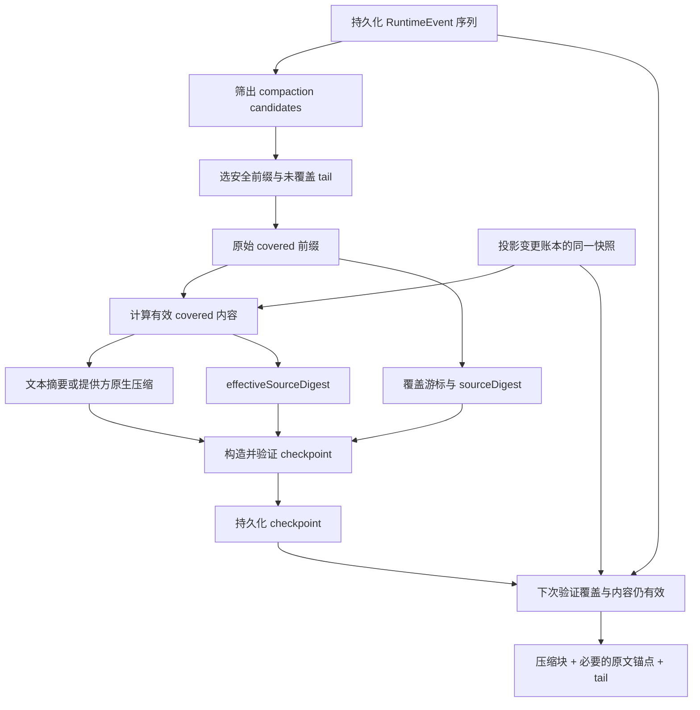
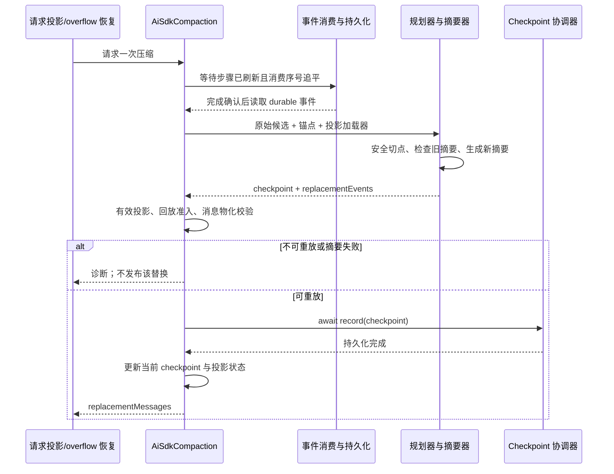

[手册目录](../README.md)

# 历史压缩：从安全前缀到可验证的下一次请求

用户提出“继续修复刚才的错误”，而先前一次工具调用返回了数万行日志。
直接丢弃旧消息会使模型遗忘目标；将所有消息合并为摘要，又可能把尚未完成的工具调用截断为两部分。
更隐蔽的问题在于：日志原文没有变化，系统却已限制模型可见的工具结果，而旧摘要仍在引用被限制的内容。
Maka 的 compaction（历史压缩）需要同时回答三个问题：哪些事件可以覆盖、摘要描述的是哪个版本的内容、下一次如何验证并重建请求。

本文基于 2026-10-24 的静态阅读，Maka 固定提交 `15d0a0dd19d39e2bc09ae35940e432c636982315`。
源码及现有测试是证据；未运行测试、服务或真实模型。事件示例是按实现规则手工演算，不是运行日志。
Pi 对照基线为 `482c1381a00d8d00bc81697e4a980c593db6803e`；涉及文件含用户既有修改，对照明确按当前工作区阅读，不将其冒充该提交的原始行为。

## 1. 压缩范围：改写与保留的边界

`RuntimeEvent` 是运行中记录的事件，例如用户文本、模型工具调用、工具结果。
projection（投影）是从这些记录计算出的“某个消费者应当看到的内容”，不是另一份可随意改写的历史。
checkpoint（压缩检查点）则是一个持久化凭据：摘要或提供方状态，加上它覆盖哪些源事件的证明。
它不同于“保存整个进程内存、恢复到某条指令”的执行检查点。
下文称被覆盖的连续前缀为 covered，未覆盖的后缀为 tail；digest 是内容校验摘要值，不是自然语言摘要。



`planHistoryCompaction()` 返回 checkpoint 和替换事件，并不删除输入事件；`projectHistoryCompactCheckpointReplay()` 构造的是请求视图。
因此“原始历史仍在”与“下一次不再把所有原文发送给模型”可以同时成立。
协调器另有可选的压缩产物清理入口，因此不能据此推出“所有附件与产物永久保留”。
参见[规划器输出](https://github.com/apache/maka/blob/15d0a0dd19d39e2bc09ae35940e432c636982315/packages/runtime/src/history-compaction.ts#L466)、[重建投影](https://github.com/apache/maka/blob/15d0a0dd19d39e2bc09ae35940e432c636982315/packages/runtime/src/history-compact-checkpoint.ts#L749)与[清理入口](https://github.com/apache/maka/blob/15d0a0dd19d39e2bc09ae35940e432c636982315/packages/runtime/src/history-compact-checkpoint-coordinator.ts#L123)。

## 2. candidate 与最终 message 的差异

candidate（候选事件）表示“纳入压缩覆盖序列的事件”，不是“已经批准发送给提供方的消息”。
`isHistoryCompactContentEvent(event)` 首先排除隐藏事件；一般内容通过字符量估算判定是否有内容。
存在一个重要例外：`thinking` 的文本可以为空，只要同时有非空的 OpenAI `itemId` 和 `reasoningEncryptedContent`，仍是候选事件。
这种 reasoning（推理状态）携带的是可供提供方续接的加密内容，不是可读说明文字。
候选检查本身不代替后续阶段检查流式未完成状态（partial）、工具配对与路由兼容性。
参见[候选谓词](https://github.com/apache/maka/blob/15d0a0dd19d39e2bc09ae35940e432c636982315/packages/runtime/src/history-compact-checkpoint.ts#L892)与[内容估算](https://github.com/apache/maka/blob/15d0a0dd19d39e2bc09ae35940e432c636982315/packages/runtime/src/model-history.ts#L414)。

随后区分出两种视图，后文的“原始”均限定为候选序列，并非数据库的所有行：

- 原始候选序列：负责事件身份、顺序、覆盖终点和 `sourceDigest`。
- 有效候选内容：把已经持久化的投影变更应用到原始事件上，负责摘要输入和 `effectiveSourceDigest`。

例如工具事件 e03 的 `result` 是完整日志，原先模型可见投影 P0 也是全文。
后来一次投影变更 T1 把它变成 P1：“测试失败，详情存于产物 A”。
`reduceEffectiveModelProjections()` 返回新事件视图，不回写 e03；摘要必须看到 P1，不能再次读取全文并将其纳入摘要。
变更链会校验源投影 digest、前一个变更 ID、工具调用 ID 和工具名；目标变更不可读时使用受限替代内容，不恢复原文。
参见[有效投影归约器](https://github.com/apache/maka/blob/15d0a0dd19d39e2bc09ae35940e432c636982315/packages/runtime/src/model-projection-transition-ledger.ts#L165)。

规划器每轮取得一个投影快照，同时用于检查旧 checkpoint 是否仍有效、生成新摘要输入。
这避免了“用新规则判断旧摘要，却用旧内容生成新摘要”的快照混用；该契约由源码注释明确说明。
若调用者未提供 `loadProjectionSnapshot`，规划器只能执行原始前缀匹配，无从检查投影账本。
参见[同快照检查与折叠](https://github.com/apache/maka/blob/15d0a0dd19d39e2bc09ae35940e432c636982315/packages/runtime/src/history-compaction.ts#L348)。

最终的 provider message（提供方请求消息）还要经过时间线重建、工具配对与 reasoning 路由准入。
空模型文本、孤立工具结果、跨路由推理状态可能产生诊断或被省略；因此候选事件数不等于请求消息数。
文本摘要器还主动省略独立 thinking 与模型步骤中的 reasoning，并非将所有候选内容无差别拼接。
参见[回放计划](https://github.com/apache/maka/blob/15d0a0dd19d39e2bc09ae35940e432c636982315/packages/runtime/src/model-history.ts#L828)、[推理状态准入](https://github.com/apache/maka/blob/15d0a0dd19d39e2bc09ae35940e432c636982315/packages/runtime/src/model-history.ts#L307)与[摘要时间线转换](https://github.com/apache/maka/blob/15d0a0dd19d39e2bc09ae35940e432c636982315/packages/runtime/src/history-compact-summarizer.ts#L287)。

## 3. 安全切点：结构优先于 token 计算

token 是模型计量输入输出的单位，不等于 Java 字符数。
`selectSafeCompactionPrefix(events, options)` 的输入是有序候选事件和边界约束，输出是排他索引 `coveredCount`，或 `no_safe_completed_span`。
若输出 8，覆盖的是 `events[0..7]`，tail 是 `events[8..]`；它不修改数组，也不调用模型。

其控制流可分为三步：

1. 取最大允许切点：总长度减保留尾部数、调用者上限、首个 partial、首个 pinned 事件位置，四者取最小值。
2. 从该切点起逐个向前查找，拒绝使同一工具调用与其结果分处两侧的切点。
3. 返回遇到的第一个合法切点，即约束范围内最大的连续前缀；若不存在则失败。

partial 是仍可能被替换的流式事件快照，不能写入稳定摘要的覆盖证明。
pinned 是“必须保留原文在 tail”的事件；`pre_turn` 的用户锚点和当前轮的 steering 指令会参与此限制。
steering 是执行过程中追加的用户指令；源码说明其还会被注入当前请求，将其纳入摘要并不能消除该份原文。
参见[边界计算](https://github.com/apache/maka/blob/15d0a0dd19d39e2bc09ae35940e432c636982315/packages/runtime/src/history-compaction.ts#L91)与[指令固定规则](https://github.com/apache/maka/blob/15d0a0dd19d39e2bc09ae35940e432c636982315/packages/runtime/src/history-compaction.ts#L293)。

尚未收到结果的工具调用也不能覆盖，否则未来结果抵达时，请求中将仅剩结果而找不到对应调用。
反之，候选池内仅有结果而没有调用时，边界检查将其视为不跨界；这不等于最终回放认定其合法。
此处 `toolPairSpans()` 按 `content.id` 聚合，而消息时间线还使用 invocation（一次运行调用）信息配对；不应将两个阶段视为同一个验证器。
参见[工具跨度与未完成调用](https://github.com/apache/maka/blob/15d0a0dd19d39e2bc09ae35940e432c636982315/packages/runtime/src/history-compaction.ts#L123)。

`planHistoryCompaction()` 接收 `sessionId/orderedEvents`、阶段和锚点、旧 checkpoint、投影加载器及摘要函数。
成功返回 `decision:'compacted'`、checkpoint、covered/tail 和替换事件；失败返回 `decision:'fail_open'` 及原因，不返回可发布的新摘要。
它在结构边界外还叠加了阶段条件：

| 阶段 | 默认保留尾部数 | 对当前用户锚点的要求 | 输出 checkpoint 的阶段 |
| --- | ---: | --- | --- |
| `standalone` | 0 | 不要求锚点；至少覆盖一条 | 未设置，按 `pre_turn` 理解 |
| `pre_turn` | 1 | 锚点必须存在且留在 tail；只覆盖此前历史 | 未设置，按 `pre_turn` 理解 |
| `mid_turn` | 1 | 必须覆盖锚点、至少两条事件，且不只是锚点与运行元数据 | `mid_turn`，保存 `headAnchor` |

`mid_turn` 是当前轮执行中压缩；`pre_turn` 是保留本轮输入、压缩此前内容。
前者将锚点纳入连续覆盖，同时仍在请求中按原文重放一次，用以保持当前任务的准确表述。
这不是重复累计覆盖数，而是“源身份”与“请求呈现”分别计算。
参见[阶段条件及输出](https://github.com/apache/maka/blob/15d0a0dd19d39e2bc09ae35940e432c636982315/packages/runtime/src/history-compaction.ts#L287)。

## 4. e01–e16 三次压缩演算

假设会话 S 的候选池如下，全部已完成、非隐藏，工具调用 ID 彼此不同。
e01–e04 属于 `r0/t0`，e05 起属于当前 `r1/t1`；e05 是当前用户锚点。
e03 原始候选内容仍是 P0，但已存在投影变更 T1，当前有效内容是 P1。

| 事件 ID | 内容 | 工具调用 ID | 首次压缩的归属 |
| --- | --- | --- | --- |
| e01 | 用户：定位测试失败原因 | — | covered |
| e02 | 模型调用 `readLog` | cRead | covered |
| e03 | `readLog` 结果；有效视图 P1 为错误摘要与产物位置 | cRead | covered |
| e04 | 模型：错误位于配置解析 | — | covered |
| e05 | 用户：修复它，但不要改公共接口 | — | covered，且作为 head 原文重放 |
| e06 | 模型调用 `patchFile` | cPatch | covered |
| e07 | `patchFile` 结果：修改成功 | cPatch | covered |
| e08 | 模型：修改完成，接着验证 | — | covered |
| e09 | 模型调用 `runChecks` | cCheck | tail |
| e10 | `runChecks` 结果：检查通过 | cCheck | tail |

此处的工具名仅为事件内容示例，并非声称 Maka 提供这些同名内置 API。
按 `mid_turn` 默认 `reserveTailEvents=1` 演算：

| 步骤 | 中间值 | 判定及下一步 |
| --- | --- | --- |
| 找锚点 | e05 的数组索引为 4 | 当前轮身份可确定 |
| 最大切点 | `10 - 1 = 9` | 暂拟覆盖 e01–e09 |
| 检查工具对 | cCheck 的调用索引 8，结果索引 9 | 切点 9 分裂工具对，拒绝 |
| 向前一格 | 切点 8 | e09/e10 均在 tail，其他工具对完整 |
| 检查阶段 | 覆盖数 8，大于锚点索引 4 | 包含锚点且有实际历史，可摘要 |
| 准备摘要 | 原始 covered=e01–e08；有效 covered 中 e03=P1 | 原始用于身份，有效用于摘要 |
| 构造 C1 | 覆盖 8 条、2 个 turn，终点 e08 | tail=e09/e10 不写入摘要 |

切点的“不跨工具对”保证可读性，但并不断言摘要之后的请求一定小于模型窗口。
本例若改为 `pre_turn`，e05 被固定在 tail，最大可覆盖 e01–e04；若为 `standalone`，默认可覆盖全部十条。
若 e09 尚无结果，即使不保留尾部，也不能跨过该未完成调用。
这些行为对应[安全切点测试](https://github.com/apache/maka/blob/15d0a0dd19d39e2bc09ae35940e432c636982315/packages/runtime/src/__tests__/history-compaction.test.ts#L38)。

### C1 checkpoint 的完整内容

以下为教学数据示例，展示真实字段的子集，并非可直接传给 API 的完整对象。
`C1`、`H_raw_1`、`H_eff_1` 是符号占位；实际 ID 与 digest 由构造器计算，summary 正文在此省略。

```json
{
  "kind": "maka.history_compact_checkpoint",
  "version": 2,
  "checkpointId": "C1",
  "sessionId": "S",
  "phase": "mid_turn",
  "headAnchor": { "runtimeEventId": "e05", "turnId": "t1" },
  "source": {
    "schemaVersion": 1,
    "kind": "runtime_event_projection",
    "policyVersion": "maka.compactable_runtime_event_projection.v3",
    "coverage": {
      "lowWater": {
        "ledger": "runtime_event_projection",
        "streamId": "S", "sequence": 0, "eventId": "e01"
      },
      "highWater": {
        "ledger": "runtime_event_projection",
        "streamId": "S", "sequence": 7, "eventId": "e08"
      },
      "eventCount": 8
    }
  },
  "coverage": {
    "eventCount": 8,
    "turnCount": 2,
    "through": { "runId": "r1", "turnId": "t1", "runtimeEventId": "e08" },
    "sourceDigest": "H_raw_1",
    "effectiveSourceDigest": "H_eff_1"
  },
  "summaryFormat": "sections_v1"
}
```

`source.coverage` 是带策略版本的候选流游标，不是数据库全局行号；高位 `sequence=7` 对应第八条候选事件。
顶层另有 `highWaterName/highWaterSeq`；构造器默认后者取 `createdAt`，不应将其误认为此处的 7。
`createdAt` 不早于被覆盖事件时间；`checkpointId` 对版本、会话、覆盖、内容、前驱等稳定序列化后取哈希。
构造器还拒绝空覆盖、跨会话、partial、无效摘要/原生状态，以及错误的 mid-turn 用户锚点。
参见[类型契约](https://github.com/apache/maka/blob/15d0a0dd19d39e2bc09ae35940e432c636982315/packages/runtime/src/history-compact-checkpoint.ts#L48)、[构造器](https://github.com/apache/maka/blob/15d0a0dd19d39e2bc09ae35940e432c636982315/packages/runtime/src/history-compact-checkpoint.ts#L210)与[游标生成](https://github.com/apache/maka/blob/15d0a0dd19d39e2bc09ae35940e432c636982315/packages/runtime/src/history-compact-checkpoint.ts#L770)。

### 下一次请求的 tail 定位

首先在原始候选序列中验证 C1：会话、数量、起止事件、`through` 的 run/turn/事件身份以及原始 digest 均须吻合。
随后用当前投影快照重算已覆盖内容的有效 digest；仍相同才允许沿用 C1。
正常匹配后，`projectHistoryCompactCheckpointReplay()` 产生如下教学序列：

```text
原始候选：e01 e02 e03 e04 e05 e06 e07 e08 | e09 e10
覆盖证明：<-------------- C1 ----------> | 未覆盖 tail
请求事件：[C1 的合成摘要事件] e05          | e09 e10
```

文本 checkpoint 的合成事件 ID 为 `history-compact:${checkpointId}`，`role=user`、`author=system`。
因此不能仅凭 author 字段就将其称为 provider 的 system-role 指令；其后还要经过消息转换。
e05 已在摘要覆盖内，重放时从 covered 中精确取出一次；e09/e10 保留原文及配对关系。
原生 checkpoint 则不生成这个文本事件，消息物化阶段另行插入提供方的压缩状态。
参见[前缀匹配](https://github.com/apache/maka/blob/15d0a0dd19d39e2bc09ae35940e432c636982315/packages/runtime/src/history-compact-checkpoint.ts#L573)、[内容有效性检查](https://github.com/apache/maka/blob/15d0a0dd19d39e2bc09ae35940e432c636982315/packages/runtime/src/history-compact-checkpoint.ts#L715)、[合成事件](https://github.com/apache/maka/blob/15d0a0dd19d39e2bc09ae35940e432c636982315/packages/runtime/src/history-compact-checkpoint.ts#L441)。

### C2：增量读取与全量覆盖

此时新增 e11“验证成功，继续补充检查”、工具调用 e12 与结果 e13。
最大切点为 12，因拆分 e12/e13 而退至 11：新覆盖 e01–e11，tail=e12/e13。
C1 经同一投影快照检查仍有效，因此规划器得到 `newlyFoldedRuntimeEvents=[e09,e10,e11]`。
文本摘要器的请求是“C1.summary + 这三条有效事件 + 摘要指令”，不重新发送 e01–e08 原文。
C2 的 `coverage.eventCount=11`、`through=e11`、`previousCheckpointId=C1`；并非将 eventCount 写成增量数 3。
参见[增量计算](https://github.com/apache/maka/blob/15d0a0dd19d39e2bc09ae35940e432c636982315/packages/runtime/src/history-compaction.ts#L355)与[只读取新增区间的测试](https://github.com/apache/maka/blob/15d0a0dd19d39e2bc09ae35940e432c636982315/packages/runtime/src/__tests__/history-compact-summarizer.test.ts#L1371)。

再新增 e14 模型说明、e15/e16 工具对；与此同时 T2 将 e03 的有效内容从 P1 改为 P2。
第三次安全覆盖到 e14，但 C2 的原始 digest 虽匹配，有效 digest 已不匹配。
规划器丢弃作为摘要输入的 C2，从 e01–e14 的当前有效内容重新摘要，e03 必须使用 P2。
C3 不继承这个失效 C2 的 `previousCheckpointId`；e15/e16 仍是 tail。
此例刻意令覆盖增长到 14；等覆盖数的替换另有独立的前驱限制，不能假设任意重算都能覆盖旧 checkpoint。
参见[投影变化后重算测试](https://github.com/apache/maka/blob/15d0a0dd19d39e2bc09ae35940e432c636982315/packages/runtime/src/__tests__/history-compaction.test.ts#L646)。

## 5. 双 digest、source policy 与持久化的防护职责

digest 是内容摘要值，用来判定“是否还是同一份输入”，不是模型写出的自然语言 summary。
`historyCompactSourceDigest()` 对事件做稳定序列化，以 UTF-8 字节长度分隔每项后计算 SHA-256，避免简单拼接的边界歧义。
但原始 digest 也不是所有落盘字段的备份校验和：工具结果有专门的身份归一化规则。
优先保留提供方执行结果的 `providerOutput`；其次，存在 `modelProjection` 时使用它，再次使用 `result`，排除未选中的并列载荷。
因此仅改变未参与模型投影的 raw result，不一定改变摘要覆盖身份；现有测试明确覆盖了这种情况。
参见[digest 实现](https://github.com/apache/maka/blob/15d0a0dd19d39e2bc09ae35940e432c636982315/packages/runtime/src/history-compact-checkpoint.ts#L857)与[原文/投影变化测试](https://github.com/apache/maka/blob/15d0a0dd19d39e2bc09ae35940e432c636982315/packages/runtime/src/__tests__/effective-history-compaction.test.ts#L106)。

两条检查不能相互替代：原始 digest 防止将摘要衔接至错误历史；有效 digest 防止摘要恢复已被投影变更移除的内容。
`checkHistoryCompactCheckpointCurrency()` 先匹配原始前缀，再归约有效视图并核对 pin（创建时固定的 digest）。
有效 pin 缺失或内容变化会得到 `effective_history_changed`；不能仅凭事件 ID 未变来判定摘要可复用。
单独调用 `applyRuntimeEventHistoryCompact()` 只做前缀匹配；自动请求路径的 `prepareContextBudgetPolicy()` 补充有效性检查。
参见[有效性判断](https://github.com/apache/maka/blob/15d0a0dd19d39e2bc09ae35940e432c636982315/packages/runtime/src/history-compact-checkpoint.ts#L715)、[应用函数](https://github.com/apache/maka/blob/15d0a0dd19d39e2bc09ae35940e432c636982315/packages/runtime/src/history-compaction.ts#L529)与[请求准备](https://github.com/apache/maka/blob/15d0a0dd19d39e2bc09ae35940e432c636982315/packages/runtime/src/ai-sdk-compaction.ts#L678)。

不应混淆三个版本：checkpoint `version:2` 表示文本格式，`version:3` 表示原生状态；source policy 当前是 `.v3`；文本契约是 `sections_v1`。
source policy 定义“覆盖哪种候选流、怎样关联原始和有效内容”，不是模型名称或摘要模板版本。
源码明确说明：旧 v2 source policy 的摘要可能引用已经被投影移除的工具正文，因此旧策略被判为 superseded（已被新策略取代），不直接重放。
这与下文同一策略内的空 reasoning 兼容不属于同一问题。
参见[策略声明及理由](https://github.com/apache/maka/blob/15d0a0dd19d39e2bc09ae35940e432c636982315/packages/runtime/src/history-compact-checkpoint.ts#L38)与[旧策略识别](https://github.com/apache/maka/blob/15d0a0dd19d39e2bc09ae35940e432c636982315/packages/runtime/src/history-compact-checkpoint.ts#L533)。

`HistoryCompactCheckpointCoordinator` 用四个按 session 分组的 Map 保存缓存、正在加载的 Promise、写入链和清理链。
Promise 可类比 Java 的 `CompletionStage`：表示未来完成的结果；`await` 等待结果后继续执行，并不意味着状态已经落盘。
`record()` 排在该会话前次写入之后执行，重新加载并检查能否替换，等待 `run.recordHistoryCompactCheckpoint()` 完成后才更新缓存。
`canReplaceHistoryCompactCheckpoint()` 拒绝覆盖倒退；相同覆盖数必须有正确 `previousCheckpointId` 且原始覆盖相同，防止竞争写入相互静默覆盖。
这段串行链是进程内协调，不应自行推断为跨主机分布式锁。
参见[协调器状态与写序](https://github.com/apache/maka/blob/15d0a0dd19d39e2bc09ae35940e432c636982315/packages/runtime/src/history-compact-checkpoint-coordinator.ts#L43)与[替换规则](https://github.com/apache/maka/blob/15d0a0dd19d39e2bc09ae35940e432c636982315/packages/runtime/src/history-compact-checkpoint.ts#L544)。

加载同样不是“按时间取最新一条”。`loadLatestHistoryCompactCheckpointFromRunLedger()` 优先使用有效的已投影状态，必要时从运行账本恢复。
恢复候选需通过形状、文本格式与截断检查，再按覆盖进度和等覆盖前驱链选取；较晚时间但较短覆盖不能倒退状态。
修复缓存投影失败不等于丢弃已经恢复出的有效 checkpoint。
参见[加载与恢复](https://github.com/apache/maka/blob/15d0a0dd19d39e2bc09ae35940e432c636982315/packages/runtime/src/history-compact-ledger.ts#L47)。

## 6. 摘要器的文本与原生两条路线

规划器依赖的 `HistoryCompactionSummarizer` 接收完整 covered、仅新增的 newlyFolded，以及可选旧 checkpoint。
结果可以是字符串、原生状态、`undefined`，也可以异步返回这些值；规划器通过 `Promise.resolve()` 统一等待。
此依赖注入意味着规划器不必知道如何连接模型，但仍负责检查摘要结果，不能将可信性完全交由插件实现。
参见[摘要器类型](https://github.com/apache/maka/blob/15d0a0dd19d39e2bc09ae35940e432c636982315/packages/runtime/src/history-compaction.ts#L166)与[统一调用和写入门槛](https://github.com/apache/maka/blob/15d0a0dd19d39e2bc09ae35940e432c636982315/packages/runtime/src/history-compaction.ts#L404)。

### 文本路线：对话重建与摘要结构约束

`buildLlmHistorySummarizer()` 生成一个异步摘要函数，输入事件先转换为时间线，再转换为模型消息。
同一步的并行工具调用保留在同一 assistant 消息，随后按时间线接入工具结果；不会采用“全体调用、全体结果”两组式的粗糙拼接。
旧 checkpoint 若是文本，则加入旧 summary 和有效新增事件；没有可续写文本时使用全部有效 covered。
因此从原生状态回退到文本时不能只总结 tail：加密状态不可读，必须重算完整有效来源。
参见[摘要输入构造](https://github.com/apache/maka/blob/15d0a0dd19d39e2bc09ae35940e432c636982315/packages/runtime/src/history-compact-summarizer.ts#L114)与[原生转文本测试](https://github.com/apache/maka/blob/15d0a0dd19d39e2bc09ae35940e432c636982315/packages/runtime/src/__tests__/history-compact-summarizer.test.ts#L1410)。

请求提供摘要系统指令，并在末尾追加用户摘要指令，不提供用于实际执行工作的工具集合。
默认输出上限是 8,000 token；实现没有先按本地字符预算裁剪摘要输入，容量拒绝交由提供方报告。
目标格式包含 Goal、Progress、Key Decisions、Next Steps、Critical Context 等段落；实际必需校验的是按序、有正文的 Goal、Progress、Next Steps、Critical Context。
不应将提示模板的每一个标题都误认为验证器的硬约束。
参见[请求与输出上限](https://github.com/apache/maka/blob/15d0a0dd19d39e2bc09ae35940e432c636982315/packages/runtime/src/history-compact-summarizer.ts#L126)与[格式验证器](https://github.com/apache/maka/blob/15d0a0dd19d39e2bc09ae35940e432c636982315/packages/runtime/src/history-compact-summary-validation.ts#L109)。

失败处理分层进行：

- 提供方以 `length` 结束：追加缩短要求，再生成一次；仍被截断则报 `output_length`。
- 结果缺必需段落、只有模板、代码围栏未闭合或有截断迹象：允许一次修复；仍不合格则不写 checkpoint。
- 首次压缩有真实 usage（提供方报告的 token 用量），输入超过 10,000 而输出不足 200：视为异常短摘要；增量续写不使用该判断。
- 修复请求自身溢出窗口：转为 `input_too_large`；中止不伪装为格式错误；空结果最终也不能成为 checkpoint。

“一次缩短”与“一次格式修复”是两个分支，不能概括为整个摘要操作最多只调用两次模型。
规划器与 checkpoint 构造/加载路径还有各自的验证门槛，防止替换摘要器绕过契约。
这些是结构与完整性线索检查，并不证明摘要事实正确、业务信息没有任何遗漏。
参见[生成后的处理分支](https://github.com/apache/maka/blob/15d0a0dd19d39e2bc09ae35940e432c636982315/packages/runtime/src/history-compact-summarizer.ts#L180)与[usage 下限的适用范围测试](https://github.com/apache/maka/blob/15d0a0dd19d39e2bc09ae35940e432c636982315/packages/runtime/src/__tests__/history-compact-summarizer.test.ts#L1261)。

### 原生路线：消费流，保存不透明状态

Host 的模型组合在 `providerType=openai-codex` 且有连接身份时选择原生摘要器，并包装一个受限文本后备路线。
其他组合使用文本摘要器；不能仅按模型字符串中是否含 “Codex” 决定。
原生请求设置压缩触发选项，`maxRetries:0`，保留提供方支持的消息结构与兼容 reasoning。
参见[Host 选择](https://github.com/apache/maka/blob/15d0a0dd19d39e2bc09ae35940e432c636982315/packages/runtime-host/src/server/execution-model-composition.ts#L220)与[原生请求](https://github.com/apache/maka/blob/15d0a0dd19d39e2bc09ae35940e432c636982315/packages/runtime/src/openai-codex-history-compactor.ts#L56)。

下面是真实源码摘录，省略循环前后的请求构造和状态提取：

```ts
const content: unknown[] = [];
for await (const part of result.fullStream) {
  if (isStreamErrorPart(part)) throw part.error;
  if (isOpenAiCompactionPart(part)) content.push(part);
}
if (streamError) throw streamError;
```

`AsyncIterable` 是“下一项可能将来才到”的序列。Java 普通迭代器同步返回下一项，`for await` 则会等待下一块到达再进入循环。
此处并非收到第一个文本块即完成，也不是将所有流块都存为摘要：仅收集压缩状态块，流内错误与回调错误都会阻止成功。
最后必须提取到恰好一个包含非空 `itemId/encryptedContent` 的状态，否则是 `invalid_provider_state`。
参见[流消费](https://github.com/apache/maka/blob/15d0a0dd19d39e2bc09ae35940e432c636982315/packages/runtime/src/openai-codex-history-compactor.ts#L126)与[状态提取](https://github.com/apache/maka/blob/15d0a0dd19d39e2bc09ae35940e432c636982315/packages/runtime/src/openai-codex-history-compactor.ts#L322)。

保存后的 `providerState` 含 `connectionId/modelId/itemId/encryptedContent`；后两项不能解读为可见摘要。
重放必须仍是 openai-codex、同一实际连接和同一模型；重建了同名连接但身份不同，也不能复用。
从文本 checkpoint 转原生可以携带既有文本摘要、必要锚点和增量，不应将已覆盖的原文重新纳入请求。
原生变为文本则如前述重算全量有效来源，两种转换并非对称的“修改 version”操作。
参见[原生重放准入](https://github.com/apache/maka/blob/15d0a0dd19d39e2bc09ae35940e432c636982315/packages/runtime/src/history-compact-checkpoint.ts#L414)与[跨压缩格式测试](https://github.com/apache/maka/blob/15d0a0dd19d39e2bc09ae35940e432c636982315/packages/runtime/src/__tests__/openai-codex-history-compactor.test.ts#L298)。

后备文本路线只接收无效原生状态，或分类为 `request_rejected` 的协议/请求拒绝。
容量不足应走规划器的同路由退让；中止、认证、限流、暂时性故障不因此再向同一连接发送一份文本请求。
这是源码注释明示的流量控制理由，并非“原生失败就自动换一个更小模型”。
参见[后备条件](https://github.com/apache/maka/blob/15d0a0dd19d39e2bc09ae35940e432c636982315/packages/runtime/src/openai-codex-history-compactor.ts#L159)。

## 7. 运行时流程：预算触发、落盘等待与验证发布

`AiSdkCompaction` 是会话级协作对象，持有策略、摘要器、checkpoint 读写、投影加载等能力，不承担模型主循环的全部职责。
它的 `MidTurnCapacityCompactState` 用 `capacity/baselineTokens/replyReserveTokens` 决定是否触发；`lastAcceptedTotalTokens` 在压缩后仍保留此前已接受的用量证据，不继续作为旧基线触发。
`seedCheckpoint` 是本轮起点，`projectionCheckpoint` 是本轮接受的压缩结果；`previousCheckpoint` 取后者优先，决定下次增量摘要继承哪个 checkpoint。
`stepShaping` 记录本次请求已经做过的压缩/图片省略，`flushedSteps` 参与落盘等待，`summarizerFailure` 阻止重复失败尝试。
实际替换消息保存在 `buildMidTurnCapacityCompactProjection()` 返回函数的闭包中；闭包指函数继续持有外层局部变量，仅在原输入前缀身份仍匹配时复用该闭包。
状态不维护独立的当前轮已完成事件镜像；压缩时回读持久化历史，避免内存副本与账本分叉。
参见[能力对象](https://github.com/apache/maka/blob/15d0a0dd19d39e2bc09ae35940e432c636982315/packages/runtime/src/ai-sdk-compaction.ts#L184)与[中途状态字段](https://github.com/apache/maka/blob/15d0a0dd19d39e2bc09ae35940e432c636982315/packages/runtime/src/ai-sdk-compaction.ts#L1389)。

主动触发使用真实已接受请求的用量：`baseline = inputTokens + outputTokens`。
输出会成为下一次输入的一部分，因此不能只依据上一轮 input；无有效 input 用量即视为未知，不按零处理。
下一回复预留为 `min(2 × 上次实际输出, 8000)`，未知时为 0；阈值取用户声明目标或 Host 后备值。
例如 input=90,000、output=4,000，baseline=94,000，预留=8,000，目标=100,000，则 102,000 触发压缩。
没有可信用量或阈值时不主动推断触发，但仍可能进入实际 overflow 的恢复路径。
参见[主动判定](https://github.com/apache/maka/blob/15d0a0dd19d39e2bc09ae35940e432c636982315/packages/runtime/src/ai-sdk-compaction.ts#L870)与[预留和基线计算](https://github.com/apache/maka/blob/15d0a0dd19d39e2bc09ae35940e432c636982315/packages/runtime/src/ai-sdk-compaction.ts#L1473)。

重启或换轮时可以从持久化请求锚点恢复基线，但只认可相同模型与连接的最新有效记录；最新记录不适用时不会向前选取更旧的值。
`estimatedTokensBefore/After` 则是诊断用估算，前者主要针对 covered，后者针对压缩块，不能视为完整请求的精确 token 差。
成功替换后旧 baseline 清空，等待新请求被提供方接受后重新测量；实现没有“本地估算不够小就撤销摘要”的门槛。
参见[持久化用量锚点](https://github.com/apache/maka/blob/15d0a0dd19d39e2bc09ae35940e432c636982315/packages/runtime/src/ai-sdk-compaction.ts#L1497)、[替换后重测](https://github.com/apache/maka/blob/15d0a0dd19d39e2bc09ae35940e432c636982315/packages/runtime/src/ai-sdk-compaction.ts#L941)与[不按估算拒绝重放的测试](https://github.com/apache/maka/blob/15d0a0dd19d39e2bc09ae35940e432c636982315/packages/runtime/src/__tests__/history-compact-checkpoint.test.ts#L969)。



`compactActiveRequestHistory()` 同时服务主动触发和被动溢出恢复。
它等待 `flushedSteps` 达到要求且队列 `consumed` 追上 `pushed`；并非看到工具返回值进入队列就立即摘要。
随后读取当前 turn，结合先前内容重新组成原始候选池，确认锚点存在，再调用规划器。
等待中止或读取失败分别给出 `ledger_wait_aborted`、`ledger_read_failed`，不构造来源不完整的 checkpoint。
参见[等待与读取](https://github.com/apache/maka/blob/15d0a0dd19d39e2bc09ae35940e432c636982315/packages/runtime/src/ai-sdk-compaction.ts#L972)。

规划成功后流程尚未结束：替换事件需归约有效投影、构造回放计划、检查阻断诊断并物化为实际消息。
空计划、不支持的原生状态或阻断性角色/内容/工具身份问题会成为 `replacement_unmaterializable`。
只有该检查通过且 recorder 成功，才修改内存中的 checkpoint 并返回新请求；写入失败不能仅在内存中视为成功。
这条“验证 → 持久化 → 应用”的次序是源码明确契约；据此可以推断它是在避免恢复后重新注入已经声称被覆盖的原文，而不是证明任意外部副作用恰好执行一次。
参见[校验与发布次序](https://github.com/apache/maka/blob/15d0a0dd19d39e2bc09ae35940e432c636982315/packages/runtime/src/ai-sdk-compaction.ts#L1148)。

手动 `compactHistory()` 使用同一规划器的 `standalone` 路线，默认不保留尾部，并排除调用输入标识的当前 turn。
它先执行工具结果投影裁剪，再加载旧 checkpoint；没有新 tail 且旧内容仍有效时返回已压缩，不重复摘要。
先裁剪再摘要的必要性在于：否则下一次请求准备阶段一旦执行裁剪，刚生成摘要的有效 digest 就立即失效。
手动路径也要等待 recorder；缺能力、空历史、中止和写失败都有各自结果，而不是强行生成摘要。
参见[手动流程](https://github.com/apache/maka/blob/15d0a0dd19d39e2bc09ae35940e432c636982315/packages/runtime/src/ai-sdk-compaction.ts#L277)。

## 8. overflow 的处理策略

overflow 是提供方拒绝请求容量的结果；它与“本地阈值即将达到”不是同一个信号。
摘要请求自身也可能 overflow，规划器仅对类型化的 `input_too_large` 进行一次有依据的退让。
`acceptedInputBoundary()` 从候选池末尾寻找有 runtime 来源、相同模型与连接的模型事件，再向前越过连续的同路由模型事件组。
返回值是这组模型回复开始之前的排他索引，用它代表此前已接受请求的输入边界；其他路由、插件执行或缺少来源证据的情况不计入。
参见[已接受输入边界](https://github.com/apache/maka/blob/15d0a0dd19d39e2bc09ae35940e432c636982315/packages/runtime/src/history-compaction.ts#L258)。

例如独立压缩 `[U0,M0,U1,M1]`，U 是用户文本，M 是同路由模型文本，初次可以覆盖全部四条。
摘要拒绝后上限退至 M1 之前，只尝试覆盖 `[U0,M0,U1]`，M1 留在 tail；其他场景还需重新通过相应阶段与工具配对条件。
这是根据原交互推导的接受边界，并不保证新摘要提示词与所有输出预留也必然可以容纳，因此再次容量拒绝即结束此次尝试。
没有更小可信边界，或退让后跨不过 mid-turn 锚点，也返回 `summarizer_failed/input_too_large`，不进行随机二分。
参见[退让控制流](https://github.com/apache/maka/blob/15d0a0dd19d39e2bc09ae35940e432c636982315/packages/runtime/src/history-compaction.ts#L414)与[一次退让测试](https://github.com/apache/maka/blob/15d0a0dd19d39e2bc09ae35940e432c636982315/packages/runtime/src/__tests__/history-compaction.test.ts#L185)。

外层 reactive recovery（被动恢复）另有每次请求的 shaping 记录：同一请求已经 fold 后，不再重复 fold。
它可先尝试移除历史图片载荷，再尝试一次历史压缩；失败返回无替换，让调用者呈现原有失败，而不是声称恢复成功。
自动状态会记住摘要器失败，以免在本轮反复进行付费尝试；`no_safe_completed_span` 则不同，后续事件到达后可能形成安全跨度。
此外，手动路线的坏摘要缓存按输入指纹记录且有数量上限，不将所有暂时性故障永久缓存。
参见[摘要失败记忆](https://github.com/apache/maka/blob/15d0a0dd19d39e2bc09ae35940e432c636982315/packages/runtime/src/ai-sdk-compaction.ts#L1121)、[被动恢复](https://github.com/apache/maka/blob/15d0a0dd19d39e2bc09ae35940e432c636982315/packages/runtime/src/ai-sdk-compaction.ts#L1230)与[坏摘要指纹](https://github.com/apache/maka/blob/15d0a0dd19d39e2bc09ae35940e432c636982315/packages/runtime/src/ai-sdk-compaction.ts#L504)。

此处的 fail-open 意味着“压缩失败不发布不可信替换，尽量保留原请求投影”，并不意味着忽略提供方错误、越权发送被限制的原文或保证任务继续成功。
排查时至少分清四处：结构无安全切点、摘要生成失败、替换不能物化、checkpoint 写失败；它们对应不同的恢复条件。

## 9. 空文本 reasoning 与 eventCount 切分的失效

设旧候选规则未纳入空文本加密 reasoning，当时 checkpoint 覆盖 `[A,B]`，`eventCount=2`、`through=B`。
同一 source policy 下候选规则扩展后，读到的完整序列变成 `[A,R_old,B,R_new,C]`。
R_old 在已覆盖终点之前，R_new 在终点之后；两者都是空文本但有加密内容的 reasoning。

| 算法 | 认为被覆盖的部分 | 得到的 tail | 问题 |
| --- | --- | --- | --- |
| 直接 `slice(2)` | A、R_old | B、R_new、C | B 被重复回送；覆盖身份也发生错位 |
| 整池过滤空 reasoning 再切分 | A、B | C | 新 tail 中 R_new 意外消失 |
| 按 through 找终点，旧规则只校验该前缀 | 终点前投影 A、B | R_new、C | 既维持旧覆盖，又保留新 tail |

`matchHistoryCompactCheckpointPrefix()` 先做正常精确匹配；失败且满足当前 source policy 的兼容条件时，才尝试第三条路线。
它按 `through.runtimeEventId` 找到当前池中的终点，取截至该点的前缀，用旧候选规则排除空文本 thinking 后再次严格匹配。
匹配成功才从终点之后取 successor；已在旧覆盖区间内的 R_old 不会被重新注入，新的 R_new 原样留在 tail。
这条兼容过滤针对 `thinking.text.length===0`，不应将其误写为所有路径都永久排除加密 reasoning。
参见[兼容匹配分支](https://github.com/apache/maka/blob/15d0a0dd19d39e2bc09ae35940e432c636982315/packages/runtime/src/history-compact-checkpoint.ts#L573)。

它没有放弃安全验证：原始内容或有效投影漂移仍拒绝复用；新生成的 checkpoint 正常纳入新候选规则中的 reasoning，并对它们计算覆盖身份。
文本与原生 checkpoint 都有对应的兼容测试；原生续写寻找 mid-turn 锚点也必须使用匹配后的事件关系，不能沿用旧数组下标。
“按事件终点定位，再按相应规则验证”比“信任历史数量直接切分数组”多一步，但这是候选集合演进后维持准确 tail 的必要条件。
参见[两种 checkpoint 的兼容与漂移测试](https://github.com/apache/maka/blob/15d0a0dd19d39e2bc09ae35940e432c636982315/packages/runtime/src/__tests__/history-compact-checkpoint.test.ts#L1070)与[锚点位置变化测试](https://github.com/apache/maka/blob/15d0a0dd19d39e2bc09ae35940e432c636982315/packages/runtime/src/__tests__/openai-codex-history-compactor.test.ts#L240)。

## 10. 与 Pi 对照：分层比较与实验层标注

Pi 默认应用路径中，历史摘要与会话持久化主要在 `coding-agent`；`agent` 是代理循环层，`ai` 是模型消息和提供方适配层。
不能因仅阅读 `agent` 未见摘要存储，就断言 Pi 没有历史压缩；也不能将 `packages/durable` 的任务协议直接套用于默认 `AgentSession`。
以下仅比较本地已读实现，不声称 Maka 的每项校验都已在 Pi 中找到一一对应物。

| 具体问题 | Maka 本文路径 | Pi 当前工作区的默认 coding-agent |
| --- | --- | --- |
| 如何留下原文尾部 | 最大安全连续前缀，尾部数、锚点、工具对约束 | 按 `keepRecentTokens` 向前找投影切点，处理切入一个 turn 的情况 |
| 摘要覆盖如何定位 | `source.coverage`、`through`、双 digest | `CompactionEntry.summary` 与 `firstKeptEntryId`，沿会话分支重建 |
| 历史是否删除 | 新增 checkpoint，改变请求投影 | `appendCompaction()` 追加条目，`buildSessionProjection()` 负责模型视图 |
| 何时主动压缩 | 真实用量基线加实际回复预留 | `contextTokens > contextWindow - reserveTokens`；默认 reserve=16384、keepRecent=20000 |

Pi 的 `prepareCompaction()` 已基于会话投影准备摘要，继承已有 summary，并区分历史消息与被切开的当前 turn 前缀。
当前投影受 context edit 或 compaction 改变后，`estimateProjectedContextTokens()` 不会盲目沿用变化前的 usage。
因此“Pi 只是删除旧消息”的说法同样不准确；它以会话条目与分支投影表达压缩，Maka 本文则突出事件覆盖与有效内容的双重验证。
参见[Pi 准备与切点](https://github.com/earendil-works/pi/blob/482c1381a00d8d00bc81697e4a980c593db6803e/packages/coding-agent/src/core/compaction/compaction.ts#L789)、[预算估算](https://github.com/earendil-works/pi/blob/482c1381a00d8d00bc81697e4a980c593db6803e/packages/coding-agent/src/core/compaction/compaction.ts#L227)、[会话投影](https://github.com/earendil-works/pi/blob/482c1381a00d8d00bc81697e4a980c593db6803e/packages/coding-agent/src/core/session-manager.ts#L543)与[追加压缩条目](https://github.com/earendil-works/pi/blob/482c1381a00d8d00bc81697e4a980c593db6803e/packages/coding-agent/src/core/session-manager.ts#L1261)。

Pi 实验 `durable` 层另有 `CompactionTask`：`select` 阶段提交模型、输出上限、tail、firstKept 等参数，再进入 `summarize`。
摘要阶段按已固定 tail 重建上下文；重试进入带 `until` 的持久化 `retry` 阶段，摘要放置还区分 generation 所有权与 conversation 所有权。
这是明确存在的可恢复压缩任务能力；本文没有验证它与默认 coding-agent 的集成程度，也不据此推断提供方调用具备 exactly-once（恰好一次）语义。
参见[durable 压缩任务](https://github.com/earendil-works/pi/blob/482c1381a00d8d00bc81697e4a980c593db6803e/packages/durable/src/harness/compaction.ts#L112)与[重试阶段](https://github.com/earendil-works/pi/blob/482c1381a00d8d00bc81697e4a980c593db6803e/packages/durable/src/harness/compaction.ts#L219)。

## 11. 用现有测试验证理解

以下测试均已静态阅读，未执行；它们验证特定输入与断言，不等于真实提供方的容量或摘要质量保证。

| 想验证的推演 | 现有测试证据 | 阅读时应跟踪的值 |
| --- | --- | --- |
| 切点不能拆开工具对，也不能越过 partial | [history-compaction.test.ts](https://github.com/apache/maka/blob/15d0a0dd19d39e2bc09ae35940e432c636982315/packages/runtime/src/__tests__/history-compaction.test.ts#L38) | `coveredCount`、保留尾部、未完成调用 |
| mid-turn 重新放回用户原文且只放一次 | [history-compact-mid-turn-checkpoint.test.ts](https://github.com/apache/maka/blob/15d0a0dd19d39e2bc09ae35940e432c636982315/packages/runtime/src/__tests__/history-compact-mid-turn-checkpoint.test.ts#L34) | covered、headAnchor、replacement |
| 摘要读有效结果，不读已被隐藏的原文 | [effective-history-compaction.test.ts](https://github.com/apache/maka/blob/15d0a0dd19d39e2bc09ae35940e432c636982315/packages/runtime/src/__tests__/effective-history-compaction.test.ts#L79) | 原始 result、modelProjection、摘要输入 |
| 旧有效内容变化后不能以增量方式混入新摘要 | [history-compaction.test.ts](https://github.com/apache/maka/blob/15d0a0dd19d39e2bc09ae35940e432c636982315/packages/runtime/src/__tests__/history-compaction.test.ts#L646) | previousCheckpoint 是否丢弃、新 covered |
| 摘要修复仍失败时不得产生有效 checkpoint | [history-compact-summarizer.test.ts](https://github.com/apache/maka/blob/15d0a0dd19d39e2bc09ae35940e432c636982315/packages/runtime/src/__tests__/history-compact-summarizer.test.ts#L681) | 调用次数、初始缺陷、修复错误链 |
| 原生容量拒绝应退让，不直接走文本后备 | [openai-codex-history-compactor.test.ts](https://github.com/apache/maka/blob/15d0a0dd19d39e2bc09ae35940e432c636982315/packages/runtime/src/__tests__/openai-codex-history-compactor.test.ts#L89) | 两次覆盖区间、tail、后备调用次数 |
| 空 reasoning 兼容不能错误丢弃新 tail | [history-compact-checkpoint.test.ts](https://github.com/apache/maka/blob/15d0a0dd19d39e2bc09ae35940e432c636982315/packages/runtime/src/__tests__/history-compact-checkpoint.test.ts#L1070) | through 位置，而非旧 eventCount 下标 |

可通过手工修改主示例检验理解：将 e07 标为 partial，应先将上限限制在它之前，再因 e06/e07 配对退至 e05 之后。
将 e03 的有效投影改为 P2 而不改变事件 ID，应使旧摘要的内容有效性检查失败；仅将 e12/e13 加入 tail，则不应使 C1 的原始覆盖失效。
这两类变化分别改变“摘要陈述的内容”与“摘要之后新发生的内容”，不应共享同一个失效条件。

本次未核实边界：真实提供方压缩协议与计费行为、加密状态内部信息、摘要事实保真度、跨主机竞争及产物清理的完整实现。
正文对触发、序列与失败处理的结论来自固定源码；设计解释已区分源码注释契约与基于流程的推断，不将单元测试当作生产运行证明。

## 相关专题

- [历史与投影](history-and-projection.md)：先理解工具结果为何存在原始与有效两种内容，再回看双 digest 的必要性。
- [模型步骤](../01-runtime/model-step.md)：追踪压缩后的消息如何进入下一步，以及新的真实 usage 何时产生。
- [持久化执行](../04-state/durable-execution.md)：区分本文的历史 checkpoint、事件写入确认与可恢复执行状态。
- [重试、超时与幂等](../06-operations/retry-timeout-idempotency.md)：进一步分析一次压缩失败后，哪些请求可以重发、哪些副作用不能凭重试假设为安全。
