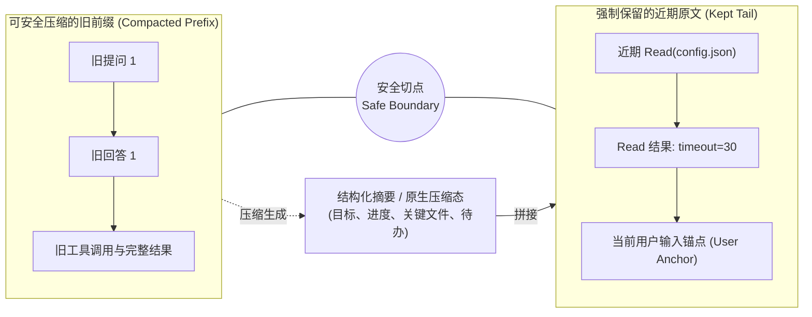
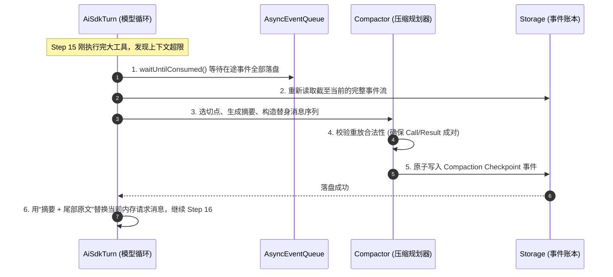

# 历史压缩：摘要切点、双重校验与运行时接续

[返回手册目录](../README.md)

在长周期工程任务中（例如连续调试 30 轮代码、读取十几份日志文件），会话历史很容易触及大模型的上下文窗口上限（如 128K 或 200K Tokens）。即使窗口没满，过长的上下文也会导致高昂的账单和推理注意力退化。

然而，给 Agent 做历史压缩，绝不是像普通聊天机器人那样“保留最后 10 条消息，把前面的删掉”这么简单。如果在不恰当的位置截断，极易把一对相互依赖的工具调用与结果生生劈开，引发模型接口报错或记忆断层。本章深入剖析 Maka 是如何寻找安全切点、生成带双重防伪校验的检查点（Checkpoint），以及如何在 Turn 执行中途无缝完成上下文压缩的。

---

## 1. 概念先行：为什么不能随便按 Token 数“一刀切”？

假设当前会话按时间顺序发生了以下交互：
`[1. 用户旧提问] → [2. 助手旧回答] → [3. 助手发起 Read(config.json)] → [4. Read 结果: timeout=30] → [5. 用户当前新指令]`

如果粗暴地按长度从第 3 条和第 4 条之间切开：
- 前半段被压缩成摘要，后半段只剩 `[4. Read 结果] → [5. 新指令]`。
- 当这份上下文发给大模型时，模型会看到一条突兀的 `tool_result`，却找不到对应的 `tool_call`，**大模型网关会立刻返回 `400 Invalid Request` 拒收！**
- 更隐蔽的问题是：如果切点正好落在正在运行的一轮任务中间，把“当前用户的原始需求”给压缩没了，模型就会忘记自己此刻到底要干什么。

因此，**历史压缩的第一条铁律是：只能在完整的逻辑边界（Safe Prefix Boundary）下刀，且必须锚定当前轮次的原始意图。**

---

## 2. 安全切点选择与压缩结构

Maka 的切点选择算法（`selectSafeCompactionPrefix`）从后往前扫描历史，寻找一个既能保留近期足够工作记忆，又绝对不会破坏调用配对的安全分割点：



### 切点划定的三大约束
1. **尾部保留预算**：预留最近 N 个 Token 或最近几轮完整交互作为热上下文（Working Memory），保证模型对刚修改过的代码行号和文件状态保持精准记忆。
2. **工具配对完整性**：如果算出的保留边界正好切在一个 `tool_call` 和 `tool_result` 中间，算法必须**向前退让**，把整组工具调用及结果完整归入“保留区”或完整归入“压缩区”。
3. **当前轮次锚点保护**：如果压缩发生在某个正在进行的 Turn 内部（Mid-turn Compaction），Checkpoint 会显式记下当前这一轮的用户输入锚点（Anchor），确保重放时用户的核心指令以原文形式紧接在摘要之后，绝不被摘要稀释。

---

## 3. 摘要生成与 Checkpoint 的双重防伪校验

选定安全前缀后，系统必须用**和真实模型请求完全一致的有效投影视图**作为材料来生成摘要（不能用未脱敏或未裁剪的原始日志去总结，否则总结出来的摘要本身就包含超长垃圾数据）。

### 两种压缩策略
- **通用文本摘要器（Structured Text Summarizer）**：调用模型将安全前缀总结为包含“用户核心目标、已完成进度、关键决策事实、当前遗留问题”的结构化文本。下次再触发压缩时，支持**增量压缩**（用旧文本摘要 + 新增的历史片段生成新摘要）。
- **厂商原生压缩（Native Compactor）**：对于支持原生状态压缩的模型通道（如 OpenAI Codex 特定接口），直接保存供应商返回的加密/不透明压缩状态句柄，并绑定当时的模型与连接身份。

### 关键设计：双重 Digest（摘要哈希）防伪校验
Maka 的 Checkpoint 不仅保存摘要文本和覆盖的终点事件 ID（`coveredEndEventId`），还保存两个哈希校验值：
1. **原始事件集合摘要值（`rawEventsDigest`）**：针对被压缩的原始 `RuntimeEvent` 序列计算。
2. **有效投影视图摘要值（`effectiveProjectionDigest`）**：针对当时生效的工具投影视图计算。

**为什么要做这么重的双重校验？**
假设之前压缩过一次并生成了 Checkpoint C1。随后，账本修复器修复了一条历史数据，或者某条工具结果的投影视图被用户手动更新了。下次加载历史时，投影引擎比对两个 Digest：一旦发现账本事实或投影视图与生成 C1 时不一致，C1 立即判定失效（Stale），系统会自动降级重新计算，**绝不用过期的摘要误导大模型！**

---

## 4. 运行中途（Mid-turn）触发压缩的协同流程

通常压缩发生在“新的一轮 Turn 开始前”。但如果模型在一个 Turn 内部连续调用了 15 次 `Read` 工具，导致上下文在**当前 Turn 的 Step 15 和 Step 16 之间突然溢出**，该怎么办？

Maka 的运行中压缩（`compactActiveRequestHistory`）必须遵循严格的同步协议：



**关键原则：先落盘 Checkpoint，再应用替换消息。** 如果在写入 Checkpoint 时数据库报错，运行时绝不允许悄悄使用未持久化的替换消息继续调用模型，否则一旦进程重启，模型上下文与持久账本将彻底对不上。

---

## 5. 教学伪代码：安全切点与 Checkpoint 校验

```text
function planAndCommitCompaction(sessionId, currentTurnId, minKeepTailTokens):
    // 1. 获取权威事实与当前有效的投影视图
    events = store.loadRuntimeEvents(sessionId)
    effectiveView = reduceEffectiveProjections(events)

    // 2. 寻找安全切点：保留尾部 + 保护未闭合工具调用 + 保护当前用户输入锚点
    cutIndex = events.length
    accumulatedTokens = 0
    
    for i from events.length - 1 down to 0:
        accumulatedTokens += estimateTokens(effectiveView[i])
        if accumulatedTokens >= minKeepTailTokens and isSafeCutBoundary(events, i):
            cutIndex = i
            break

    if cutIndex <= 0:
        return null // 历史太短或全是一个巨型未闭合工具，无法安全压缩

    prefixEvents = events.slice(0, cutIndex)
    prefixProjection = effectiveView.slice(0, cutIndex)

    // 3. 调用摘要器生成结构化摘要 (若已有旧 Checkpoint，则增量合并)
    summaryText = await summarizer.summarize(prefixProjection)

    // 4. 计算双重防伪哈希
    checkpoint = {
        kind: "history_compaction_checkpoint",
        coveredEndEventId: prefixEvents.last().id,
        userAnchorEventId: findCurrentTurnUserInputId(events, currentTurnId),
        summary: summaryText,
        rawEventsDigest: hashEvents(prefixEvents),
        effectiveProjectionDigest: hashProjection(prefixProjection)
    }

    // 5. 验证拼接后能否合法重放 (防止破坏 API 结构契约)
    testMessages = materializeWithCheckpoint(checkpoint, events.slice(cutIndex))
    assert replayPlanner.isValidSequence(testMessages), "Compacted sequence invalid"

    // 6. 先落盘，再返回给当前循环生效
    await store.commitRuntimeEvent(checkpoint)
    return checkpoint
```

---

## 6. 对照 Pi：树节点压缩 vs 检查点账本

- **Pi (`compaction.ts`)**：根据 Token 预算直接在会话树上选出 `firstKeptEntryId`，把之前的分支总结成 `summary`，作为一个新的树条目追加进 `SessionManager`。在构造消息时，从根节点找到压缩条目，直接拼上 `firstKeptEntryId` 之后的分支即可。模型简洁直观，非常契合 Pi 的分支探索特性。
- **Maka (`history-compaction.ts`)**：在压缩过程中引入了**当前轮次锚点保护、双重 Digest 有效性校验以及运行中同步落盘卡点**。这是为了适应 Maka 多端并发访问、账本可修复以及严格可重放的持久执行需求。

---

## 7. 延伸阅读

- 了解投影引擎如何在普通请求中加载 Checkpoint 并拼接后续事件，阅读 [02.1 历史事实与模型输入投影](history-and-projection.md)。
- 了解当模型请求真的因为 `context_overflow` 报错失败时，重试机制如何联动触发紧急压缩恢复，阅读 [06.1 重试、超时与幂等](../06-operations/retry-timeout-idempotency.md)。
