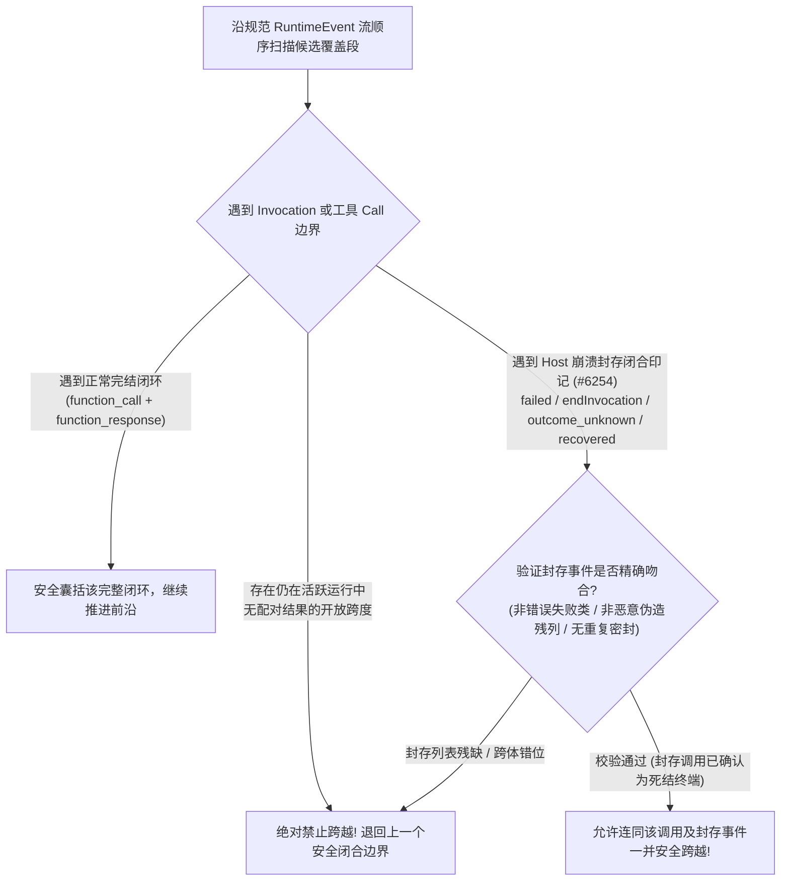

# 安全压缩切点与双哈希防伪：#6254 未知封存收敛与多模态溢退

## 1. 为什么“在半途找个第 K 条消息一刀劈开压缩”是长程 Agent 最隐蔽的定时炸弹？

很多开源框架处理“上下文快满了”的做法写起来不到 30 行：保留最新 10 条消息，把前面的历史一股脑拼成字符串丢给大模型摘要，然后把摘要插在最前面取代旧消息。只要系统跑上几十次含工具调用和崩溃恢复的长对话，这种“任意切点压缩”就会接连引爆四类灾难：

1. **一刀劈断 `Call / Result` 连体婴**：如果截断点好死不死落在助手发出工具调用意图（`function_call`）和工具结果回包（`function_response`）正中间，压缩后送出的请求立刻缺失前置意图或遗漏响应闭环，大模型网关当场报错 `HTTP 400` 彻底瘫痪整个会话！
2. **孤儿封存调用永久卡死切点（Issue `#6254` 核心痛点）**：如果上一任 Host 在工具 `T1` 派发后、结果写盘前意外崩溃，恢复器会写入一条封存标记（`outcome_unknown`）以锁定未知风险。倘若压缩划定切点时把该调用误判为一个“仍在等结果、永远没关上的未配对 Span”，手动或自动压缩就会永远死停在这个调用之前一步，每次反复打出一模一样的重复检查点且覆盖率零前进！
3. **自以为的摘要“恰好能塞进去”与摘要反噬爆仓**：盲目按本地拙劣的 `chars / 4` 估算去硬切历史，结果摘要输入真发出去才被模型报 `input_too_large`；或者摘要模型抽风反过来写了一篇两万字长论文，把原本想腾出来的高宝贵空间再次填死。
4. **多模态溢出盲目删 PDF 欺骗用户**：当上下文由于一张超大高分截图或者上百页 PDF 溢出时，粗糙架构不仅瞎做文字压缩无济于事，甚至还会默默删掉用户刚上传的 PDF 文件再重发一次请求，模型在毫无所觉的情况下产生“根本没收到文档”的致命误判。

Maka TypeScript 版在 `packages/runtime/src/history-compaction.ts`、`ai-sdk-compaction.ts` 与 `compaction-boundary.ts` 中围绕**安全前缀选择、双防伪哈希锚点、`#6254` 封存跨越语义、双轨摘要引擎及严格多模态降级契约**构建起了防御体系。

---

## 2. 安全切点选择与 `#6254` 未知封存调用突破

在真正允许一条检查点边界（`HistoryCompactCheckpoint`）向前推进覆盖旧历史之前，`selectSafeCompactionPrefix` 会像安检扫描仪一样沿规范 `RuntimeEvent` 时间流严格向前推进并把关每处界标：

这段源自真实修复 `fix(runtime): advance compaction past host-sealed unknown tool calls` 的逻辑极为精辟：
- **普通在飞调用不可拆散**：只要某个调用尚未收口或只看到一半调用意图，切点边界绝不从中横劈；
- **封存终态即闭合证据**：当且仅当一条工具调用连同其对应的真实恢复封存印记（满足 `failed`、`endInvocation`、`failureClass: 'outcome_unknown'` 且经 `recovered` 验明）**成对同时落入被覆盖的摘要跨度之中**，规划器才会承认该未完成 Span 已经获得法律意义上的终结封箱，放行检查点边界向前滚动；
- **停步返回洁净状态**：如果全段滚进完与上次已覆盖水位分毫不差（`already_compacted`），手动压缩通路会精准识别并返回明确不变信号（`unchanged`），绝不在原地空打一串毫无新增价值的重复 Checkpoint 污染账本。

---

## 3. 双防伪哈希校验、上限封顶与双轨摘要引擎

哪怕找到了无懈可击的安全物理切点，压缩器自己还面临三类新风险：**谁来生成摘要？摘要失控写太长怎么办？重放时怎么证明新生成的那份摘要没有被并发写错版本？**

### 3.1 `DEFAULT_HISTORY_COMPACT_MAX_OUTPUT_TOKENS = 8_000` 与权威窗判定

打开 `packages/runtime/src/ai-sdk-compaction-contract.ts` 可以读到两条刷新常规认知的反直觉设计原则：
1. **对摘要输出施以明确硬顶上限（8,000 Tokens）**：实测健康摘要通常落在 1K Tokens 左右；设置 `8_000` 的硬上限并非为了干预文风，而是**充当防御性熔断器，防止失控的摘要器反而写出巨无霸摘要反噬它原本奉命去腾空的珍贵上下文窗口**（一旦命中 `finishReason: length` 截断，压缩器仅按契约做一次明确的短摘要重试请求）。
2. **输入能否装下交给远端权威判定，而非靠本地拙劣估算**：源码注释直接言明——待压缩的输入材料究竟放不放得进摘要模型窗口，**永远以目标模型供应商接口返回的明确反馈（`input_too_large`）为唯一裁决依据，绝不用脆弱的本地字符估算率替代真实协议判定**！

### 3.2 双防伪校验与 `pre_turn` vs `mid_turn` 双阶段触发

在 `compaction-boundary.ts` 与检查点落盘流程中，每一次检查点推进都必须绑定：**覆盖原始事件的完整性集合标识与摘要（Coverage IDs & Body SHA-256 Digest）** 以及 **被截尾锚点的基线校验哈希**。一旦运行途中有人分支改写了前缀或账本出现并发偏差，重放阶段的双哈希防伪验证会当场把伪造/漂移检查点拒之门外。

同时按照介入时机不同，系统区隔出 **`pre_turn`** 与 **`mid_turn`** 双阶段策略（记录于 `CompactionDecision.phase`）：
- **`pre_turn`（步前静态规整）**：在用户发起新一轮 Turn 之前即发现历史水位迫近极限，优先从容生成新摘要再发起推理，保护后续全部多步连击连贯缓存；
- **`mid_turn`（多步长工具链运行中无缝抢救）**：如果单轮执行了 25 次高频 `Code Mode` 或文件查阅步骤致使上下文瞬间激增，压缩器在 Step 与 Step 间的天然安全间隔无缝落盘 `mid_turn` 检查点——同时严格继承 `RunId` 不变且依托 `AgentRunStore` 在不丢失本轮正在推进目的的前提下削薄身姿继续冲刺到终点。

---

## 4. 多模态溢退与“PDF 拒绝绝对不盲重试”原则

如果某次尝试触发溢出错误（Context Overflow），仅仅依靠文字摘要往往治标不治本——因为真正占满窗口的可能是一叠上百万像素的连续截图或者一份超过页面限额的高清 PDF 报告。

结合 `docs/architecture/runtime-pdf-rejection-recovery.md` 核心约束，Maka 在被动溢出恢复路径上立下了极其理智的两项退避防线：

| 负载类型 | 发生溢出或网关拒收时的合法降级路径 | 严禁的错误操作（Fail-Safe 红线） |
| :--- | :--- | :--- |
| **高分辨率图像帧 (`imageOmission`)** | 依循历史降级先裁剪陈旧步骤里的历史低价值大图（并通过 `ModelProjectionTransitionLedger` 记账留存省略凭证 `[image omitted]`），优先保全最新当前步骤图像与文本 | 禁止私自全量擦除模型未感知的历史事实而不在账本留下明确替代说明 |
| **原生文档 / PDF 载荷** | 必须在协议层提取**明确的结构化拒绝诊断原因**（例如页面超限、不支持该 MIME 文档块）才可触发结构化降级或退回切片提取；并向模型精确暴露文档不可用原因 | **严禁在没有拿到结构化拒绝诊断的前提下，暗中悄悄丢弃掉用户的 PDF 附件并盲目重发同一句请求**——宁可透明中断并明确上报文档受拒故障，也绝不允许模型在假装无事发生的状态下胡乱编造回答！ |

---

## 5. 总结

Maka TypeScript 版的历史压缩体系将“缩短提示词”从一种高风险字符串戏法，升级为了严谨的状态机级维护手术：
1. **`selectSafeCompactionPrefix` + `#6254` 封存突破**：死守工具配对完整性不横劈，同时精准识别由 Host 崩溃封存落案的 `outcome_unknown` 终态，确保长程恢复历史不被孤儿调用永久卡死；
2. **`8_000` 摘要输出硬上限 + `input_too_large` 真实权威判据 + 双哈希覆盖绑定**：杜绝虚假局部估算带来的误切与失控膨胀；
3. **透明可审计的 `mid_turn` / `imageOmission` / PDF 拒收契约**：用显式转换账本承接多模态退避，斩断“悄悄删掉用户 PDF 蒙混过关”的黑盒欺诈路径。

到这里为止，系统已经完全掌握了“当前会话之内怎么装得下、怎么放得长”。但真正的工程师协作体系绝不局限于单一会话窗口内——如果模型在昨天总结出了开发规范，今天怎么保证它不是靠脑补瞎编的？一个跑在大规模项目的完整会话环境如何打成标准跨机迁移包导出，甚至无缝吞下从 Claude Code 或 Codex 导出的过往对话继续无缝运行？下一篇揭晓长期记忆证据核验、无痕隐私与便携迁移架构：[证据锚定记忆与 USTAR 便携迁移：incognito 无痕边界及异构历史导入](./memory-and-session-portability.md)。
