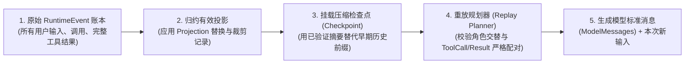

# 历史事实与模型输入投影

[返回手册目录](../README.md)

想象在一个排错会话中，第一轮用户让 Agent 读取了一份 5000 行的服务器错误日志，Agent 精准定位了报错原因是配置错误；紧接着第二轮用户说：“按刚才的结论修改 `config.json`”。

如果直接把 5000 行的原始日志原封不动塞进每一轮大模型的上下文，不仅会瞬间撑爆上下文窗口、消耗天价 Token，还会严重稀释模型对当前指令的注意力；反之，如果为了省钱直接把数据库里的日志删掉，当用户在界面上想回看刚才查了什么日志，或者系统审计需要核对原始证据时，数据就会永远丢失。

Maka 通过**“不可变历史事实 + 按需模型投影（Projection）”**解决了这一根本矛盾。本章解析投影机制的设计原理、计算流水线以及如何保障模型消息结构的合法性。

---

## 1. 概念先行：事实（Fact）与投影（Projection）的分离

在 Maka 中，历史数据被严格区分为两个概念：

| 维度 | 运行事实 (`RuntimeEvent`) | 模型投影 (`ModelProjection`) |
| :--- | :--- | :--- |
| **定位** | 物理世界发生过的客观记录（**Single Source of Truth**） | 专门为下一次模型请求构造的计算视图（**Derived View**） |
| **可变性** | **只追加、不可篡改** | **可裁剪、可替换、可压缩** |
| **内容形态** | 保留完整的 `result`（如 5000 行原始日志）、时间戳、执行身份 | 只保留关键报错行 + “完整日志已省略，如需查看更多请使用 offset 读取”提示 |
| **消费者** | 审计日志、UI 界面展开查看、崩溃恢复扫描器 | 大语言模型 API（OpenAI / Anthropic SDK） |

### 为什么投影变更也要记账？
当某个巨型工具结果在第一轮被精简投影后，随着对话推进，到了第十轮系统可能决定把更早的投影进一步收缩成一句话摘要。Maka 引入了**投影变更账本（Projection Transition Ledger）**，通过事件顺序记录“某条工具结果被替换成了更精简的版本”，使投影的演变过程本身也是可追溯、可重放的。

---

## 2. 投影计算流水线全景

在每次发起模型请求前，Maka 都会按以下流水线从底层事实推导出本次发给模型的合法 `messages` 数组：



### 第一步：归约有效工具投影
工具在写入 `RuntimeEvent` 时，往往同时带有完整结果和模型可读版本。`reduceEffectiveModelProjections` 会按时间顺序扫描投影变更事件，计算出每条工具调用当前“对模型可见”的最新文本内容。

### 第二步：衔接压缩检查点
如果会话已经触发过历史压缩（Compaction），账本中会存在一个检查点。投影器会直接以检查点中的摘要（Summary）作为开篇上下文，然后根据检查点记录的覆盖终点（Cursor），把后续尚未被压缩的原文事件拼接在后面。

### 第三步：重放规划与结构修复（极关键！）
**大模型 API 对消息序列有着严苛的结构契约**：
1. 每一条包含 `tool_call`（如 `call_1`）的助手消息，后面**必须**紧跟着一条带有相同 `call_1` 的 `tool_result` 消息。
2. 如果进程曾意外崩溃，账本里可能只有一条孤立的 `tool_call` 而没有 `tool_result`；或者一条异常中断的半截回答。

如果直接把这种“残缺历史”发给模型接口，API 会直接返回 `400 Bad Request` 报错导致会话彻底卡死。**重放规划器（Replay Planner）**的核心职责，就是在最后关头检查并配对调用与结果，对于未完成的孤立调用自动补全或修剪为合法状态，确保发往模型的每一组上下文 100% 符合协议规范。

---

## 3. 教学伪代码：从事件账本构建合法模型请求

以下伪代码展示了 `buildPriorMessages` 的核心推导逻辑：

```text
function buildModelRequestMessages(sessionId, currentTurnId):
    // 1. 加载权威事实与投影变更记录
    events = store.loadRuntimeEvents(sessionId)
    effectiveToolOutputs = reduceEffectiveProjections(events)

    // 2. 检查是否有已生效的历史压缩检查点
    checkpoint = findLatestValidCheckpoint(events)
    if checkpoint != null:
        // 以摘要作为开头，只保留检查点边界之后的原文事件
        baseMessages = [ systemSummaryMessage(checkpoint.summary) ]
        tailEvents = sliceEventsAfter(events, checkpoint.coveredEndEventId)
    else:
        baseMessages = []
        tailEvents = events

    // 3. 重放规划：将事件流整理为严谨的 Step 序列，确保 Call/Result 成对
    plannedSteps = replayPlanner.organize(tailEvents, effectiveToolOutputs)
    
    for step in plannedSteps:
        if step.hasUnpairedToolCalls():
            // 若历史中存在崩溃遗留的孤立调用，显式注入“未完成/未知”占位结果，防止 API 400 报错
            step.fillMissingToolResults("[Execution interrupted before completion]")
        
        baseMessages.append(materializeToProviderFormat(step))

    // 4. 核对上下文 Token 预算，必要时触发截断或紧急压缩
    return enforceContextBudget(baseMessages)
```

---

## 4. 工程判断：为什么不在后台静默 `UPDATE` 历史消息？

初学者常问：“既然模型不需要那 5000 行日志，为什么不直接在数据库里把那条消息的文本 `UPDATE` 成摘要，省得每次都要算投影？”

在工程实践上，**就地修改（In-Place Update）是一条不归路**：
1. **调试与审计盲区**：当模型在后续第 10 轮改错了代码时，开发者需要回溯第 1 轮工具到底吐出了什么原始输出，才能判断是工具读错了，还是模型理解错了。一旦 `UPDATE` 覆盖，证据永久毁灭。
2. **模型切换失效**：不同的大模型厂商（如 Claude vs GPT vs Gemini）对多模态内容、Thinking 推理块、工具调用嵌套格式的协议要求不同。保存中立的原始事实并在请求前按需投影，使同一个会话中途从 Claude 无缝切换到 GPT 成为可能。

---

## 5. 对照 Pi：树状分支回溯 vs 扁平日志投影

Pi 的 `coding-agent` 提供了非常有特色的**会话分叉（Branching）**功能（允许用户回到上一条消息重新开启一条平行对话分支）：

- **Pi 的做法（基于树指针的分支投影）**：`SessionManager` 把每条记录保存为带有 `id` 和 `parentId` 的树节点。构造请求时，`buildSessionProjection()` 从当前叶子节点沿着 `parentId` 指针一路向上回溯出一条线性路径，中途合并分支上的 `context_edit` 与压缩节点，最后转换为模型消息。
- **Maka 的做法（基于多端事件的线性投影）**：Maka 的核心场景是“多端协同的持久化长会话”，以线性时间序追加写入 `RuntimeEvent`，重点解决工具大结果替换、并发归属以及崩溃边界修复。

---

## 6. 延伸阅读

- 了解当有效投影仍然超出上下文窗口时，系统如何安全切分历史并生成摘要检查点，阅读 [02.2 历史压缩与检查点](compaction.md)。
- 了解工具执行时是如何同时产生原始结果与精简模型投影的，阅读 [03.1 工具执行内核](../03-tools/tool-runtime.md)。
