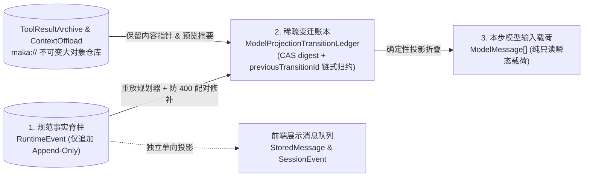

# 三账本投影归约与资源卸载：从 ModelProjectionTransitionLedger 到 Read-Page

## 1. 为什么直接修改数据库里的 `messages` 表一定会毁掉长上下文与提示词缓存？

在短对话工具里，程序员会把发送给大模型的 `messages[]` 直接当成持久化数据库主表：工具吐了 5MB 编译日志觉得太占地方，就原地 `UPDATE messages SET text = "[truncated]"`；发现某张截图被远端视觉接口拒绝，就顺手把数组里那条历史图像删掉重试。

在长周期生产运行时里，这种“就地改写历史”的做法会产生三类不可收拾的破坏：
1. **暖运行与冷重启认知分裂（Projection Divergence）**：当前进程内存里剪掉了一段超大工具返回，但数据库原始事件没跟着留下归约凭据。宿主一旦重启重新从事件流拼装消息，那段被删掉的 5MB 垃圾竟然又复活塞进了模型上下文，直接炸毁后续提示词前缀缓存（Prompt Cache）。
2. **乱序并发写入撕裂**：第 2 轮刚刚异步裁剪了某条工具输出，另一条迟到的审计流又往里补写记录；如果仅仅靠数据库插入顺序或本机系统时间做裁剪排序，时钟微调或并发落盘顺序就能彻底改写模型看到的上下文文本！
3. **审计丢真与注意力爆窗的死结**：要么把几兆的目录清单或测试输出原封不动留给大模型瞬间撑爆窗口；要么一剪子下去丢光原始文本，导致模型排查问题时看不到关键的第 3,500 行错误。

Maka TypeScript 版通过**“不可变事件脊柱 + `ModelProjectionTransitionLedger` 单向稀疏变迁链 + `Tool Result Archive` (`maka://` 按页懒读) & `Context Offload` 内容寻址卸载”**，将“历史发生的真相”与“此刻模型看到的投影”清晰拆成可审计的三级流水线。

---

## 2. 三层事实分离：绝不用展示层和裁剪态反噬规范历史

打开 `packages/runtime/src/ai-sdk-message-projection.ts` 与 `packages/core/src/model-projection-transition.ts`，整条历史投影遵循绝对单向流向：



这一划分守住了最底线的不变量：**一切“剪掉某段巨型工具输出”、“省略被服务商拒绝的图片”等有损操作，绝不允许直接修改 `RuntimeEvent`，必须首先在伴生操作账本 `AgentRunEvent` 中追加一条不可变的变迁继承者记录（`model_projection_transition_recorded`）**。只有该记录先于磁盘落定，任何后续的重放（Replay）、历史压缩（Compaction）、会话分支（Fork）乃至断电冷重启才全数遵循这条已生效的投影替代规则。

---

## 3. `ModelProjectionTransitionLedger`：基于内容摘要 CAS 与前驱指针的确定性归约

仅仅追加一条“把工具 X 替换掉”的日志还不够。如果两个并发协程几乎同时看中同一条大返回，或者因为消息队列滞后导致“后发先至”写进了存储库，普通按时间游标排序的做法立刻得出错误投影。

`packages/core/src/model-projection-transition.ts` 在每条稀疏变迁记录里写入四项缺一不可的秩序约束：

```typescript
// 核心归约契约（源自 packages/core/src/model-projection-transition.ts）
interface ModelProjectionTransition {
  // 1. 精确寻址目标：锁定是哪一个 function_response 事件及其内部的 toolCallId
  target: { runtimeEventId: string; part: 'tool_result'; toolCallId: string; toolName: string };

  // 2. 乐观内容摘要 CAS：仅当目标当前投影摘要精确匹配 sourceProjectionDigest 才允许替换
  //    阻止手握陈旧内容的并发写者在不知情时强行覆盖别人刚更新的结果！
  sourceProjectionDigest: string;

  // 3. 替代载荷声明：保留替换后的轻量摘要文本以及指向 ToolResultArchive 的可恢复原件指针
  replacement: DurableToolResultProjection;

  // 4. 因果链序指针：读端沿着 previousTransitionId 前驱指针依次追链归约，
  //    绝不依赖系统时钟或物理插入先后，彻底免疫节点时钟漂移与并发到达乱序！
  previousTransitionId?: string;
}
```

请注意其中的 **`previousTransitionId`** 与 **`sourceProjectionDigest`** 的双重配合：
- **防盲目覆盖**：任何新裁剪必须在 `sourceProjectionDigest` 上核对当前即将被替掉的正文哈希完全一致，并发过时写入直接遭拒；
- **时钟免疫秩序**：读取器重构模型视图时，不看谁的时间戳更晚，也不管数据库行号排列，而是死循前驱 ID 组成的单向链条逐级应用替换，使得**内存中增量推演**与**从零冷读取全库事件重算**永远得出完全一模一样的字节级输出。

---

## 4. 重放规划器：步级时序重组与“防 400 协议自愈”

在大模型 HTTP 协议规范中，如果出现了一条孤立的助手工具调用 intent（`function_call`）却在随后的输入列表里找不到匹配的响应（`function_response`），或者两条工具返回的次序被并发搅乱而偏离原本发射组号，主流服务商网关（尤其是 Anthropic 与 Gemini）会立刻在入口处回绝一条冷冰冰的 **`HTTP 400 Bad Request`**，直接锁死整场会话再也发不出请求！

Maka 在重放规划期（`request-projection.ts` & `ai-sdk-message-projection.ts`）充当着严格的**协议拓扑重构师**：
- **消除半程残影**：自动过滤标记为 `partial = true` 尚未正式结案的流式碎片；
- **封存调用闭合匹配**：如果前一次宿主崩盘导致某个工具调用停留在了 `T1` 之后却未进入 `T2`，恢复调度器（`resolveRuntimeRecovery`）写入的明确 `outcome_unknown` 错误结案密封事件会被精确拼装到紧随该工具调用之后的槽位中，确保模型上下文永远严格保持“每条 `Call` 必对应完整唯一的 `Result`”；
- **步内多工具配对重整**：在保留步级语义先后关系的前提下，将并发乱序完成返回的多个兄弟工具回执重新排回各自所属轮次的响应集合内，将 400 格式拒绝消灭在本地出包前一毫秒。

---

## 5. `Tool Result Archive` 与 `Context Offload`：把兆字节数据请出上下文，但保留原始细节

当某次 `Bash` 单元测试或文件检索一口气输出了 2 MB 的日志，既不能把它硬塞进下一步 Prompt 里白白烧光十几万 Token，也不能一刀砍死只留前 500 字符导致模型瞎猜后面的堆栈报错。

Maka 将大载荷治理拆为两个精确协同的基础设施部件：

| 机制维度 | `Tool Result Archive`（工具结果永久档案库） | `Context Offload`（动态内容寻址上下文卸载） |
| :--- | :--- | :--- |
| **定位与介入点** | 在 `ToolRuntime` 执行 **`T2` 提交入账瞬间** 即刻判定介入 | 在上层投影规划期按整体上下文配额预算（Context Budget）触发动态腾挪 |
| **物理保存与 URI** | 超出安全预览阈值的大返回完整剥离为 `maka://` 开头的不可变内容资源，在正文留下边界锚点与文件摘要 | 将较早历史步骤里占位的巨块负载卸载为 `sqlite-context-offload-store` 中的外部引用对象并受哈希保护 |
| **按需精确懒读取** | 暴露标准分页游标工具 **`read-page`**（按字符页段/行号范围按需调取第 N 页局部切片） | 模型需要细查前尘细节时可通过关联 URI 与凭据回溯，日常保持主提示极度轻量 |
| **保留期清理治理** | 关联 `archive-retention-coordinator` 结合会话存续周期与全局空间配额执行确定性清理 | 与最近成功确认压缩检查点边界（Watermark）挂钩，确保历史基线前冗余旧引用安全回收 |

当模型看到系统注入的一句轻量提示：`[输出 1.4MB 已归档至 maka://tool-results/<id>，共 180 页，当前展示首页预览，请调用 read-page 按需检索]` 时，它的上下文窗口消耗瞬间下降 98%，却拥有比传统“头尾强行截断”多出百倍的信息保真度！

---

## 6. 总结

Maka TypeScript 版的历史投影体系用三道工程机制打通了长上下文工程中最矛盾的“轻量、保真、可重放”三角困境：
1. **单向无损源头**：展示界面、模型输入、运维诊断各有独立投影，绝不互改源 `RuntimeEvent` 脊柱；
2. **`ModelProjectionTransitionLedger` 链式规则**：用摘要校验（CAS）+ 链式前驱追踪，让任意针对历史结果的稀疏有损裁剪都具备跨重启、跨线程的百分之百确定性；
3. **`Tool Result Archive` (`read-page`) & `Context Offload`**：把兆字节海量原件请出模型输入主干道，同时用 `maka://` URI 保留零失真的随查随读能力。

但再怎么单点裁剪和按页读取，长跑几百步的会话总有一天会逼近模型物理窗口的绝对天花板（Context Limit）。此时，系统必须在不动摇历史账本真实性、不劈断工具调用配对、不丢弃多模态文档的前提下把长链浓缩成检查点摘要——下一篇直击这一最凶险边界的核心机制：[安全压缩切点与双哈希防伪：#6254 未知封存收敛与多模态溢退](./compaction.md)。
