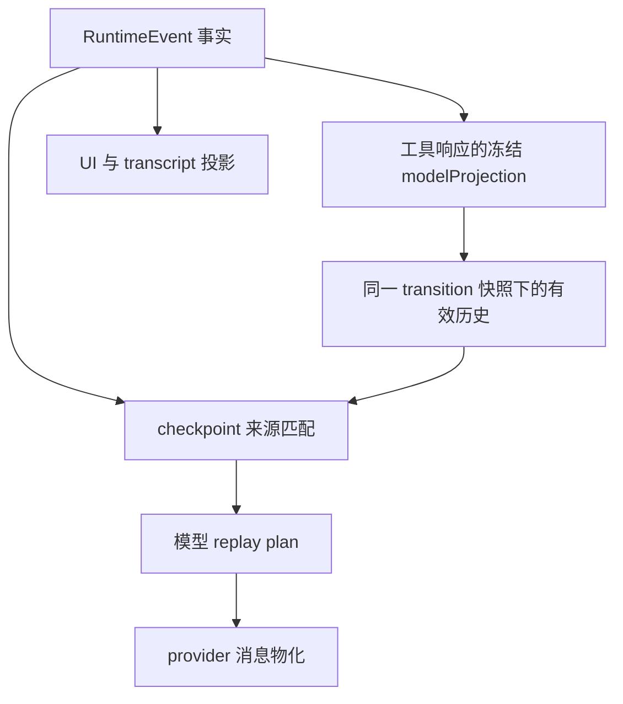

# 历史事实与模型输入投影

[手册目录](../README.md)

适用范围：Maka 固定提交 `15d0a0dd19d39e2bc09ae35940e432c636982315`，重点是 RuntimeEvent 到模型请求的历史投影，以及 history compaction checkpoint。
Pi 以 `482c1381a00d8d00bc81697e4a980c593db6803e` 为基线；相关源码存在用户未提交修改，本文保留这些修改，链接行号按当前工作区核对。
本文依据源码和测试断言做静态追踪，未运行测试或付费模型调用；不把注释中的目标当作已实现能力。

## 1. 问题：模型记忆与全部历史的差异

假设用户要求“读取配置文件，解释启动失败的原因”。工具返回了体量很大的配置，模型指出错误；下一轮用户询问“按刚才的结论继续”。
此时需要同时回答三个问题：工具当时实际返回了什么、下一次请求还需发送多少内容、进程重启后应从何处继续。
三者不能用同一个“上下文”对象解释。

```text
事实历史：用户提问 → read_file 返回大文件 → assistant 给出判断 → 用户追问
模型视图：用户提问 → 精简后的工具结果 → 判断 → 追问
进一步压缩：覆盖前缀的摘要 → 尚未覆盖的尾部 → 追问
```

工具结果的模型视图可以缩短，前缀可以被摘要代替，但这不等于删除当时的工具返回值。
摘要中写着“已经修改配置”，也不能证明外部修改已成功提交，更不能据此跳过一个尚未完成的工具调用。
本章将“保存事实”“构造请求”“恢复执行”分别考察；前两项是主要实现范围，第三项仅讨论边界。

## 2. 四种历史状态

| 对象 | 保存或表达什么 | 不应当推导出的结论 |
| --- | --- | --- |
| `RuntimeEvent` | 带 session/run/turn 身份的运行事实，含文本、thinking、工具调用和响应等 | 它不是一条现成的供应商消息，也不全是用户界面文本 |
| `modelProjection` 与 projection transition | 工具结果供模型读取的内容，以及后续对这份内容的替换记录 | 模型读到缩略结果，不代表原始 `result` 被覆盖 |
| history compaction checkpoint | 某个历史前缀的摘要或供应商压缩状态，以及覆盖证明 | 它不是任务程序计数器，也不是工具副作用的提交凭证 |
| 请求内状态 | 当前消息数组、流式片段、队列及本轮投影等 | 保存这些对象的某个子集，不自动获得完整执行恢复能力 |

`RuntimeEventFunctionResponseContent` 同时容纳原始 `result`、可选供应商输出和冻结的 `modelProjection`。
后续 `reduceEffectiveModelProjections()` 按 transition 链生成有效视图，校验前驱与来源摘要，而不是回写原始事件。
历史中的 `partial` 表示尚未完成的片段，不能与完整的稳定事实同等处理；compaction 只接受符合覆盖规则的稳定来源。
对应定义见 [RuntimeEvent 工具响应](../../../../maka/packages/core/src/runtime-event.ts#L224)与 [projection reducer](../../../../maka/packages/runtime/src/model-projection-transition-ledger.ts#L165)。

## 3. text 请求的历史构建过程

下文以“上一轮问候，本轮追问”为例走查真实调用路径；文字为示例，并非本次执行日志。
范围限定为普通新 turn、无未决工具结果的 text 路径；continuation 和 unknown-outcome 分支还有额外约束。

```text
已有 RuntimeEvent：U0「你好」→ A0「你好，有什么问题？」
当前输入：U1「刚才说了什么？」
AiSdkTurn.runWithinScope()
  → buildPriorMessages(input, priorUnknownProjection)
    → 普通路径排除当前 turn 的事件
    → prepareContextBudgetPolicy(rawPrior)
      → 得到有效投影、projectionSnapshot、可用的 checkpoint 策略
    → applyRuntimeEventContextBudget(rawPrior, policy)
      → 按原始覆盖身份匹配 checkpoint，形成摘要块与尾部
    → foldEffectiveModelHistory(上述结果, 同一个 projectionSnapshot)
    → buildRuntimeEventModelReplayPlan()
    → materializeRuntimeReplayPlan()：变成模型消息
  → buildCurrentUserContent()：形成 U1 内容
  → 初始 messages = priorReplay.messages + 当前 user 消息
  → 若配置持久化 turn reader：loadDurableTurnProjection() 重读并重建本轮视图
  → 请求投影与上下文组装
  → modelAdapter.startStream({ messages, ... })
```

无 checkpoint 时，普通文本历史仍是 U0、A0，再接 U1；有有效文本 checkpoint 时，已覆盖前缀改为摘要消息，再接未覆盖尾部。
持久化 reader 分支不能省略：实际发送前可能重新读取已落盘的本轮事件，初始数组不是所有配置下的最终请求。
入口见 [`buildPriorMessages()`](../../../../maka/packages/runtime/src/ai-sdk-turn.ts#L2832)与 [`startStream()` 调用点](../../../../maka/packages/runtime/src/ai-sdk-turn.ts#L1707)。

此处存在一个容易读反的顺序：预算准备会读取有效投影，但 checkpoint 的前缀匹配仍使用原始候选事件；匹配完成后，再用同一份 transition 快照折叠重放内容。
否则，检查摘要时看到一种工具结果，发送请求时却看到另一种，摘要就可能意外过期。
`buildRuntimeEventModelReplayPlan()` 还处理角色、assistant step 分组、工具调用配对和不完整历史；它不是简单的 `events.map(...)`。
这条运行时历史路径以 RuntimeEvent 为依据，不应将 UI/import 使用的 `StoredMessage` 当作无条件的供应商历史回退来源。

### 3.1 历史处理的整体数据流



图表示数据来源与校验关系；实际调用顺序见上文的 buildPriorMessages 轨迹。投影改变一个消费者看到的内容，原始事件仍承担事实来源的职责。预算、切点、摘要生成与压缩失败分支集中在[压缩实现](compaction.md)。

## 4. Compaction：替换请求前缀，不删除事实历史

`selectSafeCompactionPrefix()` 先选择可压缩的连续前缀：不越过 partial 或 pinned 事件，不拆分跨边界的工具调用/结果，并保留要求的尾部。
`planHistoryCompaction()` 再用有效投影生成摘要，用来源覆盖信息构造 checkpoint，最后计算重放视图。
这两个函数操作的是选取、摘要和投影；此处没有删除被摘要覆盖的 RuntimeEvent 的步骤。

还需区分调用时机：`standalone` 是独立压缩，`pre_turn` 在新轮请求前准备，`mid_turn` 在同一轮内部压缩。
mid-turn checkpoint 要验证并保留该 turn 的用户 head anchor；重放时可把锚点原文接回，避免当前任务本身在摘要中丢失。
`compactActiveRequestHistory()` 会等待已完成步骤进入可读取的持久化历史，校验重放可用性，记录 checkpoint 后才应用到活动请求。
这些步骤见 [安全前缀选择](../../../../maka/packages/runtime/src/history-compaction.ts#L91)、[规划器](../../../../maka/packages/runtime/src/history-compaction.ts#L287)和 [mid-turn 压缩入口](../../../../maka/packages/runtime/src/ai-sdk-compaction.ts#L972)。

### 4.1. Source coverage 的证明范围

| 字段或检查 | 真实含义 |
| --- | --- |
| `source.policyVersion` | 当前为 `maka.compactable_runtime_event_projection.v3`，定义来源投影规则 |
| `coverage.eventCount`、`turnCount` | 被覆盖的候选事件数和 turn 数，不是整个 session 的总量 |
| `coverage.through` | 覆盖终点的 runId、turnId、runtimeEventId |
| `coverage.sourceDigest` | 校验原始候选前缀的内容身份；不是对数据库全部字段做逐字节备份校验 |
| `coverage.effectiveSourceDigest` | 对当时有效模型投影的摘要值，用于发现后续 projection transition 造成的变化 |
| `source.coverage` 的 sequence | 该来源投影内的低水位 0、高水位 N−1；不是执行日志的物理偏移或恢复指令 |

摘要归一化与两道检查的细节在[历史压缩](compaction.md)的“双 digest”一节展开。此处仅保留结论：修改未参与模型投影的原始 `result` 不会改变摘要；修改 `modelProjection` 会触发 `effective_history_changed`，过期摘要不能被重新规划复用。

### 4.2. 两种 checkpoint 的定位差异

文本 checkpoint 的 `version: 2` 保存摘要；`projectHistoryCompactCheckpointReplay()` 把它转成合成的 user 角色事件，再接锚点和尾部。
供应商原生 checkpoint 的 `version: 3` 保存压缩状态，例如 `openai_codex_remote_v2` 的 encryptedContent；重放时由适配层前置相应原生消息。
原生状态还要求兼容的 provider 类型、同一个 connectionId 和 modelId，不能因为摘要存在就跨连接复用。
这两个 `version` 与上一表的 source policy `.v3` 是不同维度，不应混为一个版本号。

checkpoint 校验失败时，历史重放有拒用摘要、保留原历史并附诊断的路径；没有安全前缀或摘要生成失败也可能不压缩。
这不保证请求一定能装入模型窗口，更不意味着所有不可读 transition 都能安全退回原文。
已有有效 checkpoint 则可以直接用于重放，不能仅因本地估算“当前还很短”就忽略它。

此处恢复的是“下一次请求应看到哪份历史”，不是任意暂停位置的执行。
checkpoint 不包含恢复 JavaScript 调用栈或确认所有外部副作用的充分信息；执行 continuation 另有 claim、边界摘要及 replay manifest 等结构。
因此应说“可重建上下文投影”，不能仅凭 history checkpoint 就说“任务从该指令继续执行”。
参见 [checkpoint 重放](../../../../maka/packages/runtime/src/history-compact-checkpoint.ts#L749)和 [continuation 边界类型](../../../../maka/packages/core/src/runtime-event.ts#L510)。

## 5. 新版 reasoning admission：空文本也可能是历史

reasoning admission 指“某类推理内容是否获准进入某一处理阶段”。此处存在两道不同的准入检查，不能只检查 `thinking.text.length`。
第一道是 compaction 来源准入：非 hidden 的 thinking 即使 `text === ''`，只要同时有非空 `openai.itemId` 和 `reasoningEncryptedContent`，也可成为覆盖源。
第二道是供应商重放准入：存在这种内容，不表示其可发送给任意模型或连接；还需检查运行来源及适配器支持的格式。

`compatibleProviderReasoningReplayEventIds()` 允许当前 run；历史 run 则要求 runtime provenance、匹配的 `providerStateIdentity` 和 modelId。
同名模型不足以证明旧 reasoning 仍适用于新凭据或端点；非 reasoning 的文本/工具内容也不能随之被一概删除。
这与原生 compaction checkpoint 的 connectionId/modelId 检查相关，但不是同一个检查函数或身份字段。
参见 [来源准入](../../../../maka/packages/runtime/src/history-compact-checkpoint.ts#L892)和 [reasoning 重放准入](../../../../maka/packages/runtime/src/model-history.ts#L307)。

### 5.1. 旧 checkpoint 与 eventCount 切分的失效

旧 checkpoint 可能建立于“只计非空 thinking 文本”的候选集；新版把加密、空文本 reasoning 纳入后，同一终点之前会多出候选事件。
源码中的兼容测试同时覆盖文本和原生 checkpoint，核心情形如下：

兼容匹配的算法对照表、`matchHistoryCompactCheckpointPrefix()` 的两阶段匹配与安全验证细节，在[历史压缩](compaction.md)的“空文本 reasoning”一节展开。要点：旧 checkpoint 以 `through.runtimeEventId` 定位终点、按旧候选规则校验前缀，tail 从真实终点之后截取；`R_old` 不回插、`R_new` 不被旧 eventCount 错误排除，完整性检查仍然生效。

## 6. 与 Pi 对照：完整 session tree 与当前分支视图

Pi 默认路径需分别考察 `coding-agent` 的会话管理、`agent` 的运行循环和 `ai` 的模型接口。
在本章涉及的会话层，SessionManager 用带 `id/parentId` 的条目构成树；当前 leaf 的祖先路径只是其中一条分支。
`buildSessionProjection()` 先选择当前路径上的上下文条目，再把 `context_edit` 应用到消息投影；并非将整棵树都交给模型。

| 比较项 | Maka 本章路径 | Pi 默认 coding-agent 会话路径 |
| --- | --- | --- |
| 完整历史 | RuntimeEvent 是运行事实源；还有相关投影/控制记录 | JSONL 中保留带父指针的 session entries，可构成完整树 |
| 下一请求的历史 | 重放计划、有效工具结果投影及适配器共同生成 | 当前分支经 `buildSessionProjection()` 生成消息，再转换为模型消息 |
| 压缩记录 | checkpoint 有来源覆盖、摘要值、文本或原生状态 | `CompactionEntry` 有 summary、firstKeptEntryId、tokensBefore 等 |
| 压缩后保留范围 | 覆盖前缀被摘要替代，尾部按来源终点保留 | 最新 compaction 摘要，加保留区间与其后条目 |
| 局部上下文修改 | projection transition 改变有效模型视图，可能令摘要过期 | `context_edit` 可替换内容或以 null 隐藏；原 entry 保留 |
| 完整性边界 | 校验 raw/effective 覆盖，另有 reasoning 路由准入 | 以分支条目身份及投影规则选择内容，不是同构的双摘要校验 |
| 执行恢复 | history checkpoint 不等于 continuation 执行边界 | session 重载不等于 durable task 恢复；两条路径须分别分析 |

例如同一分支发生下列追加（仅列对话内容，省略 system/tools）：

```text
A(user) → B(assistant) → C(user) → D(assistant)
  → E(compaction: summary=S, firstKeptEntryId=C)
  → F(context_edit: target=D, replacement=null) → G(user)
当前模型上下文：S + C + G；D 仍在原始 session tree 中
若从 D 另开一条不经过 F 的分支：该分支不会继承 F 对 D 的隐藏
```

Pi 的内部 `compactionSummary` 消息经 `convertToLlm()` 转为 user 消息，并非提升为 system 指令。
`appendCompaction()` 追加记录；`appendContextEdit()` 校验目标后追加编辑记录；这两项都不是删除原消息。
`prepareCompaction()` 使用投影后的消息做摘要，因此已隐藏的内容不会仅因开始压缩就重新出现。
见 [上下文选择](../../../packages/coding-agent/src/core/session-manager.ts#L478)、[会话投影](../../../packages/coding-agent/src/core/session-manager.ts#L550)、[摘要输入准备](../../../packages/coding-agent/src/core/compaction/compaction.ts#L867)与 [消息转换](../../../packages/coding-agent/src/core/messages.ts#L148)。

Pi 另有实验性 `packages/durable`：恢复示例在 task checkpoint 中保存 phase/n，关闭 Harness 后用同一 SQLite 存储重开，再等待任务完成。
那是按持久化阶段重新进入任务的机制，不是普通会话摘要，也不是恢复原 JavaScript 栈；不应据默认会话路径断言“Pi 没有恢复或编排”。
本章不评估两者的沙箱能力，不能从上下文机制推断沙箱存在与否。参见 [durable 恢复示例](../../../packages/durable/test/examples/13-recovery.ts#L21)。

## 7. 源码定位

| 要回答的问题 | 文件与准确入口 |
| --- | --- |
| 运行事实有哪些身份字段？ | Maka [`RuntimeEvent`](../../../../maka/packages/core/src/runtime-event.ts#L671) |
| 旧事件如何成为模型消息？ | Maka [`AiSdkTurn.buildPriorMessages()`](../../../../maka/packages/runtime/src/ai-sdk-turn.ts#L2832) |
| 哪些事件进入重放计划？ | Maka [`buildRuntimeEventModelReplayPlan()`](../../../../maka/packages/runtime/src/model-history.ts#L828) |
| reasoning 和工具消息如何物化？ | Maka [`materializeRuntimeReplayPlan()`](../../../../maka/packages/runtime/src/ai-sdk-message-projection.ts#L270) |
| checkpoint 如何形成覆盖证明？ | Maka [`buildHistoryCompactCheckpoint()`](../../../../maka/packages/runtime/src/history-compact-checkpoint.ts#L210) |
| 原始匹配成功为何还可能过期？ | Maka [`checkHistoryCompactCheckpointCurrency()`](../../../../maka/packages/runtime/src/history-compact-checkpoint.ts#L715) |
| 如何避免检查与请求使用不同快照？ | Maka [`prepareContextBudgetPolicy()`](../../../../maka/packages/runtime/src/ai-sdk-compaction.ts#L678) |
| 原生 checkpoint 能否换连接使用？ | Maka [`canReplayHistoryCompactCheckpointForModel()`](../../../../maka/packages/runtime/src/history-compact-checkpoint.ts#L414) |
| Pi 如何从 leaf 找到当前分支？ | Pi [`buildSessionPath()`](../../../packages/coding-agent/src/core/session-manager.ts#L390) |
| Pi 如何追加压缩而不删除历史？ | Pi [`SessionManager.appendCompaction()`](../../../packages/coding-agent/src/core/session-manager.ts#L1269) |
| Pi 如何保存一次局部编辑？ | Pi [`SessionManager.appendContextEdit()`](../../../packages/coding-agent/src/core/session-manager.ts#L1370) |
| 哪些测试证明编辑不改原记录？ | Pi [`session-context-edit.test.ts`](../../../packages/coding-agent/test/session-context-edit.test.ts#L36) |

## 8. 术语速查

- 原始事实：运行产生的事件与结果；“原始”不表示每个字段都直接发给模型。
- Projection（投影）：从事实导出某个消费者所需的视图；本章主要指模型可见历史。
- Compaction（压缩）：把选定历史前缀折叠为摘要或供应商原生压缩状态。
- Coverage（覆盖）：说明摘要对应哪些来源事件，终点在哪里，内容身份是否仍匹配。
- Checkpoint：此处是上下文压缩检查点；同名的任务执行 checkpoint 必须另看协议。
- Admission（准入）：某种内容能否进入覆盖源或供应商请求，两阶段条件可以不同。
- Session tree：Pi 的完整分支条目树；当前模型上下文仅是选定分支的投影。

## 9. 源码练习

1. 在纸面上重放 reasoning 迁移：将第 5 节示例中的 `R_old` 移到 B 之后，再分别删除 B、修改 A。预测覆盖匹配与尾部结果，核对 [兼容与拒绝断言](../../../../maka/packages/runtime/src/__tests__/history-compact-checkpoint.test.ts#L1106)。重点解释为什么尾部不能用旧 eventCount 切分。
2. 区分两种摘要值：原 `result` 变化、`modelProjection` 不变；原事件不变、后续添加 projection transition；只改变未覆盖尾部。分别判断来源匹配与有效性检查应如何变化，对照 [工具结果摘要测试](../../../../maka/packages/runtime/src/__tests__/effective-history-compaction.test.ts#L106)与 [有效投影变化测试](../../../../maka/packages/runtime/src/__tests__/history-compact-checkpoint.test.ts#L1216)。
3. 绘制 Pi 的 A—G 分支图，将 F 改为替换 D 的文本，再从 D 分叉。分别列出原始条目、当前分支投影、摘要输入；核对 [分支相关编辑测试](../../../packages/coding-agent/test/session-context-edit.test.ts#L119)。最后说明这些结果为何仍不足以证明一次外部工具副作用可以安全重试。

本章的边界是上下文事实与投影：压缩不等于抹除历史，重放摘要不等于恢复执行。

## 相关专题

- [压缩算法](compaction.md)：展开安全切点、预算、摘要路线和 checkpoint 提交。
- [领域模型](../00-foundations/domain-model.md)：确认输入、执行、步骤和尝试的身份边界。
- [持久化与恢复](../04-state/durable-execution.md)：追踪状态提交与中断后继续执行的条件。
