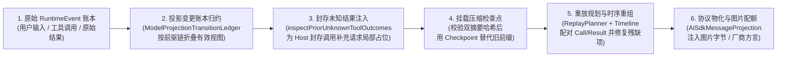
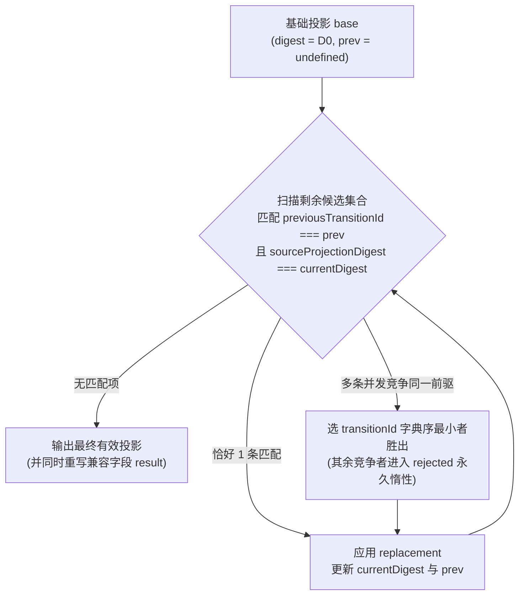
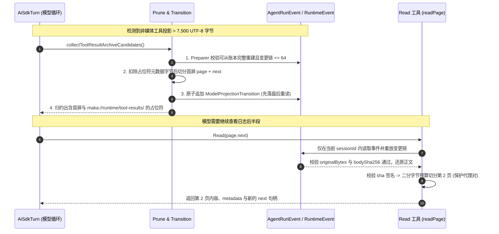
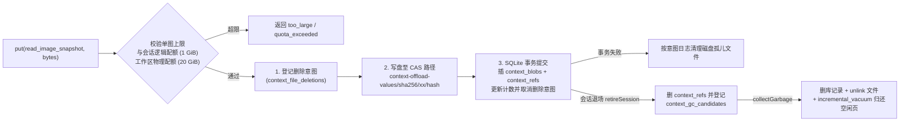

# 历史事实与模型输入投影

[返回手册目录](../README.md)

想象在一个长周期排错会话中，第 1 轮用户让 Agent 读取了一份 5,000 行的服务器错误日志并定位了配置缺陷；第 5 轮用户查看了一张 4 MB 的界面报错截图；第 8 轮系统在调用远程工具时进程意外崩溃；重启后用户在第 9 轮继续追问：“基于刚才的日志和截图，完成配置修改。”

如果把这 5,000 行原始日志和 4 MB 图片在每一轮原封不动地塞进大模型请求，上下文窗口会在两步之内被撑爆，推理注意力也会被海量机器噪声稀释；反之，如果在数据库里就地覆盖（In-Place Update）或删掉原始日志与图片快照，不仅审计与界面回看会失去证据，切换模型厂商（如从 Anthropic 切换到 OpenAI）或崩溃恢复时也会彻底丧失重建能力。

Maka 用**“三层事实分离 + 确定性投影变更账本 + 分页懒读归档 + 内容寻址卸载”**解决了这一核心矛盾：底层账本只追加不可变事实，模型请求只消费当下合法的计算视图，超限工具结果与历史大图通过独立边界按需读取或卸载。

---

## 1. 概念先行：三层事实分离架构

在 Maka 中，一次会话的数据生命周期被严格切分为三个互不可换的层次，每一层拥有独立的权威边界（Authority）与生命周期：

| 层次 | 核心载体 | 权威定位 | 可变性 | 消费者 |
| :--- | :--- | :--- | :--- | :--- |
| **1. 权威事实层** | `RuntimeEvent` 账本 | 物理世界发生过的语义事实（**Single Source of Truth**） | **只追加、不可篡改** | 审计追踪、UI 历史回放、崩溃恢复、压缩重建 |
| **2. 持久投影层** | `ModelProjectionTransition`（记于 `AgentRunEvent`）<br/>`HistoryCompactCheckpoint` | 对已发生事实的有损/裁剪替换记录（**Durable Projection**） | **追加链式演进**（通过前驱链与摘要哈希定序） | 模型历史构建器、上下文预算器、压缩验证器 |
| **3. 瞬态请求层** | `ModelMessage[]`（由 `AiSdkMessageProjection` 物化） | 为本次物理请求拼装的协议消息（**Ephemeral View**） | **单次请求有效**，随模型能力与配额动态变形 | Anthropic / OpenAI / DeepSeek 等具体 Provider SDK |

> [!IMPORTANT]
> **`StoredMessage` 仅是 UI 与外部导入投影，绝不作为模型历史回退数据源。**  
> 在早期架构演进中，已彻底废弃“当 `RuntimeEvent` 投影诊断出现异常时回退读取前端展示消息表 `StoredMessage`”的路径。所有发往模型的上下文必须唯一且确定地从 `RuntimeEvent` 账本推导。

### 工程判断：为什么绝不在后台静默 `UPDATE` 历史事件？

把 5,000 行工具日志在 SQLite 里直接 `UPDATE` 成一句话摘要看似简单，但在生产级 Agent 基础设施中是一条不归路：
1. **审计与复盘证据毁灭**：第 10 轮发现修改错了代码时，开发者需要核对第 1 轮工具到底输出了什么原始文本，才能区分“工具返回错误”还是“模型推理错误”。一旦覆写原始事实，证据链永久断裂。
2. **多模型协议切换失效**：Anthropic 的签名思考块（Signed Thinking）、OpenAI Responses 的加密推理状态（Encrypted Reasoning）以及服务端托管工具（Provider-Executed Tools）各自有着互不兼容的线缆格式（Wire Format）。保留中立的底层事实并在请求前按目标模型适配器动态投影，才使得跨模型切换与重放成为可能。
3. **跨进程并发写撕裂**：当工具裁剪、历史压缩与崩溃恢复在不同时间点或不同进程实例上并发发生时，原地修改极易造成“旧决策覆盖新裁剪”或“被删内容死而复生”。

---

## 2. 投影计算流水线全景

在每次发起模型请求前，Maka 都严格从不可变的 `RuntimeEvent` 账本出发，经由六级确定性流水线物化出发送给 Provider 的 `ModelMessage[]`：



这条流水线揭示了一个关键原则：**没有任何一个下游环节会修改上游事实，也绝不允许用上一轮拼装好的 `ModelMessage[]` 作为下一轮的事实源。** 哪怕是运行中途触发压缩或图片降级，最终持久化的也只是“压缩检查点”或“投影变更记录”，下次重建仍然回到 `RuntimeEvent` 账本重新推导。

---

## 3. 投影变更账本（`ModelProjectionTransitionLedger`）的确定性归约

当一条巨大的工具输出被裁剪、或一张历史图片被永久省略时，系统如何保证“已经从模型视野移除的内容，在重启、切分支或另一台机器重放时绝不会重新冒出来”？

答案是把每一次对模型可见历史的有损修改，也作为一条不可变记录（`model_projection_transition_recorded`）追加写入 `AgentRunEvent` 操作账本。

### 3.1 `ModelProjectionTransition` 的核心数据契约

每一条投影变更记录自包含确定性归约所需的全部要素，且其主键本身由内容哈希派生：
- **`target`**：精准定位到某条 `RuntimeEvent` 的特定部件（`{ runtimeEventId, part: 'tool_result', toolCallId, toolName }`）。注：服务端托管工具（`providerExecuted === true` 且带 `providerOutput`）属于厂商不透明状态，禁止被变更记录改写。
- **`sourceProjectionDigest`**：基于规范键排序 JSON 计算的源投影 SHA-256 摘要（`durableToolResultProjectionDigest`）。
- **`replacement`**：替换后的 `DurableToolResultProjection`（例如精简首屏占位符）。
- **`previousTransitionId`**：对于同一目标的前驱变更 ID；缺省表示直接作用于基础投影（`baseToolResultProjection`）。
- **`transitionId`**：`mptransition-<sha256(version, sessionId, target, sourceProjectionDigest, replacement, previousTransitionId)>`。注意**计算 ID 时故意排除了时间戳 `createdAt` 和写入进程信息**——只要两个并发写入者对同一源投影作出了相同的裁剪决定，它们就会生成一模一样的 `transitionId`，重复追加天然幂等。

### 3.2 为什么归约不依赖时间戳排序？

在多端同步、并发请求或进程重启重试的场景下，两个并发写入者可能针对同一条 `RuntimeEvent` 的 `tool_result` 各自发出裁剪决策，或者某台设备的系统时钟发生回拨。如果按 `createdAt` 或入库顺序做简单覆盖，就会出现**旧决策覆盖新状态**，或者**不同节点算出不一致的模型历史**。



`reduceEffectiveModelProjections` 通过两条铁律实现了**无时钟依赖的确定性归约**：
1. **源投影摘要校验**：后来者携带的旧 `sourceProjectionDigest` 一旦与当前生效投影的摘要不匹配，归约器立即将其判定为**永久惰性拒绝（Rejected）**——拒绝不是等待重试，以后无论在哪个进程、何时重启都不会被应用。
2. **前驱链串联与双字段同步**：归约器只顺着 `previousTransitionId` 链条向前推进，从不对记录数组做时间排序；应用替换后，除了更新 `content.modelProjection`，还会同步以 `legacyResultForProjection` 重写 `content.result`，确保任何仍读取旧版兼容字段的下游消费方都绝无可能复活已被移除的正文。

### 3.3 不可读记录的隔离与故障闭环（Fail-Closed）

当旧版本二进制读取到了新版本写入的、自身无法解码的 `ModelProjectionTransition` 记录时，系统绝不允许“假装没看见这条记录而把原始内容放回模型上下文”：
- **定向隔离（`unreadableTargets`）**：由于记录外层信封携带了 `runtimeEventId` 与 `part`，归约器能把损害精准限制在单个工具结果上，将其强制折叠为扣留占位符（`DURABLE_TOOL_RESULT_PROJECTION_FAILURE`），彻底阻断被移除内容的复活。
- **全局熔断（`unscopedUnreadable`）**：如果存在连目标索引都无法解析的损坏记录，系统无法证明它是否移除过敏感或超限历史，此时 `AiSdkCompaction.loadModelProjectionTransitions()` 直接抛出异常中止投影构建，宁可中断也绝不泄密或制造虚假历史。

---

## 4. 重放规划器：步级时序重组与防 400 协议修复

大模型厂商的 API 对消息序列有着极为严苛的结构契约。Maka 在 `RuntimeEvent` 账本中按事件物理发生的顺序记录（`tool_call` → `tool_result` → `thinking` → `text`），这与模型 API 期望的协议顺序截然不同。重放规划器（`model-history.ts`）与物化器（`ai-sdk-message-projection.ts`）共同承担了结构合法化职责。

### 4.1 按 `Step` 重组时序与两种工具的年代学差异

`buildRuntimeEventReplayTimeline` 将扁平的投影条目按照 `(invocationId, stepId)` 重组为 `assistant_step` 单元，严格区分本地工具与服务端托管工具（Provider-Executed Tools）的执行时序：

- **本地客户端工具（Client Tools）**：模型必须先完成思考与文本输出并提出工具请求，工具随后在本地执行。因此物化为一条 `assistant` 消息 `[reasoning, text, tool-call...]`，紧随一条或多条独立的 `role: 'tool'` 结果消息。Anthropic 接口严格要求**签名思考块（Signed Thinking）必须处于包含 `tool_use` 的同一个 `assistant` 消息最前端**，绝不能将 `thinking` 拆成单独消息。
- **服务端托管工具（Provider-Executed Tools，如内置搜索）**：模型服务商在单步内部先执行搜索，再基于搜索结果生成落地文本（Grounded Text）。因此同一条 `assistant` 消息内部必须保持 `[reasoning, server-tool-call, server-tool-result, text]` 的时序。若某步只有思考与工具调用（其闭合的 `text_complete` 为空字符串，被规划器记为非阻塞 `empty_text_skipped`），物化器会按 `stepId` 在步结束时自动将暂存的思考与调用聚合输出，无需依赖空文本触发。

### 4.2 修复半残历史：防止 `400 Bad Request` 的六道防线

| 异常历史形态 | 若直接发送给模型 API 的后果 | Maka 重放规划器与物化器的防御机制 |
| :--- | :--- | :--- |
| **崩溃遗留的孤立 `tool_call`**<br/>（工具尚未返回即断电） | 网关直接返回 `400` 报错（存在 `tool_use` 却无对应 `tool_result`），会话永久卡死 | 普通未结算调用由规划器从重放 `items` 中剔除并记为非阻塞诊断 `unmatched_tool_call`；对已被 Host 恢复封存为 `outcome_unknown` 的调用，`inspectPriorUnknownToolOutcomes` 在**请求局部**紧邻插入带 `retrySafe: false` 的合成错误响应（永不写入持久账本，且保持系统提示词字节稳定以保护 Prompt Cache） |
| **历史裁剪后的孤立 `tool_result`**<br/>（调用方在前序切片中被移出） | 孤立的 `tool` 消息无前置 `tool_use`，同样触发 Anthropic `400` | 规划器将其标记为非阻塞诊断 `unmatched_tool_result`，物化器仅在确认其归属的 `tool_call` 存在于当前请求计划中时才输出该结果，否则静默丢弃 |
| **跨路线重放不兼容的推理块**<br/>（从 Claude 切到 GPT，或无 `stepId` 的旧工具轮） | 携带他厂签名思考块或位置错乱的思考块导致网关拒收 `400` | `compatibleProviderReasoningReplayEventIds` 核验原始 Run 的路由指纹（`providerStateIdentity` + `modelId`）；支持 Anthropic 签名/隐匿思考、OpenAI Responses 明文/加密推理及兼容协议推理字段；对无 `stepId` 的旧历史通过全账本 `toolActivityTurnIds` 跳过签名思考块（`signed_thinking_in_tool_turn_skipped`） |
| **`apply_patch` 工具配置切换**<br/>（切换模型后原补丁参数格式不匹配） | 工具入参 Schema 校验报错或上下文异常 | `normalizeApplyPatchReplayInput` 尝试将历史入参转换为当前 `applyPatchProfile`；若无法适配则通过 `durableApplyPatchReplayFactText` 降级为助手文本事实回放，同时保留执行证据 |
| **流式快照与非对话系统事实**<br/>（`partial: true`、终态状态或 `error` 内容） | 残缺文本干扰推理或触发全历史回退 | 规划器跳过 `partial` 与 `model_hidden` 事件；`error` 内容记为非阻塞 `error_content_diagnostic_only`，避免一条历史失败把整场会话降级 |
| **修复后的助手前缀开局**<br/>（恢复场景下第一条可见消息是 `assistant`） | 部分接口拒绝以 `assistant` 开篇的对话 | `applyRuntimeEventProviderHistoryBoundary` 默认剥离首个可见 `user` 消息之前的修复态助手前缀（`repaired_prefix_dropped`），仅对通过准入的延续轮次放行 |

### 4.3 未知结果（`outcome_unknown`）的退休机制与内联引用防注入

对于崩溃封存后插入的请求级 `outcome_unknown` 提示，系统并非永久挂着它：`unknownOutcomeRetired` 会检查之后是否存在**显式用户发起、非延续/非分支/非子代理（`root.kind === 'user'`, `source.kind === 'fresh'`, `lineageIsEmpty`）且已成功完结（`completed`）的轮次**——只有确认模型已经知晓该未知状态并带着用户推进了对话，才安全退休该提示；自动化调度或重试轮次绝不允许私自退休它。

此外，用户消息中的引用摘录（`quotes`）、目录引用（`directoryReferences`）、附件（`attachments`）与插队引导（`steering`）在 `formatTextWithInlineRefs` 与预算估算中受到严格保护：
- **精确预算权重**：`estimateRuntimeEventChars` 在估算用户事件大小时，必须计算**投影后实际展开的文本块长度**（例如附件指令块可能长达数百字符，而非仅算文件名 25 字符），且多模态图片按独立常量 `MATERIALIZED_IMAGE_TOKENS` 计入，不与 `charsPerToken` 文本校准系数混淆。
- **防标签逃逸与越权引导**：`<quoted_excerpt>` 正文中的闭合标签与属性值引号、换行符均被转义，防止用户引文伪造第二段带有欺骗性 `comment` 的摘录；`<directory_references>` 声明为不可信文件系统数据；`steering` 消息凭借 `providerOptions.maka.steeringEventId` 做基于身份的精确消重（`steeringMessagesMissingFromBase`），彻底免疫字面文本撞车。
- **位置逆索引（`memoryEventMessagePositions`）**：物化器通过 `WeakMap<ModelMessage, readonly string[]>` 记录每条模型消息对应的源 `RuntimeEvent` ID，为后续记忆提取模块提供零冗余的精确消息下标绑定。

### 教学伪代码：从事件账本归约到协议物化

```text
function buildModelRequestMessages(sessionId, currentTurnId, targetModelAdapter):
    // 1. 读取权威事件与投影变更账本，执行无时钟确定性链式归约
    rawEvents = runtimeStore.loadRuntimeEvents(sessionId)
    loadedTransitions = runStore.loadModelProjectionTransitions(sessionId)
    if loadedTransitions.unscopedUnreadable > 0:
        throw FatalProjectionError("Unscoped unreadable transition blocks safe replay")

    effectiveView = reduceEffectiveModelProjections(
        rawEvents,
        loadedTransitions.transitions,
        loadedTransitions.unreadableTargets
    )

    // 2. 识别 Host 封存且尚未退休的未知结果调用（仅在请求局部注入合成工具响应）
    unknownProjection = inspectPriorUnknownToolOutcomes(effectiveView.events, invocations)
    replaySource = (unknownProjection.kind == "projected")
        ? appendPriorUnknownToolResponses(effectiveView.events, unknownProjection)
        : effectiveView.events

    // 3. 应用历史压缩检查点（校验 raw 与 effective 双重完整性，详见 02.2）
    checkpoint = loadValidatedCheckpoint(replaySource, loadedTransitions)
    windowEvents = checkpoint ? applyCheckpoint(checkpoint, replaySource) : replaySource

    // 4. 构建重放计划：全账本扫描 toolActivityTurnIds，修复半残 Call/Result 配对
    fullToolTurns = collectToolActivityTurnIds(rawEvents)
    plan = buildRuntimeEventModelReplayPlan(windowEvents, { toolActivityTurnIds: fullToolTurns })

    // 5. 按步重组时间线，按路由匹配推理块，并受单请求图片预算约束物化
    admitted = admitProviderReasoningReplayItems(plan.items, compatibleReasoningIds(targetModelAdapter))
    timeline = buildRuntimeEventReplayTimeline(admitted)
    imageBudget = { used: 0, decisions: new Map() }

    return materializeTimelineToProviderMessages(timeline, imageBudget, checkpoint)
```

---

## 5. Tool Result Archive：`maka://` 归档资源与 `read-page` 分页懒读

为了在不启动大模型做有损摘要的前提下控制单条巨型工具输出（如 5,000 行日志、`grep` 扫描结果或超长构建输出）的上下文体积，Maka 在投影层实现了确定性的**工具结果归档与分页懒读机制（Tool Result Archive）**。

### 5.1 为什么采用 7,500 UTF-8 字节与 Ledger 重建归档？

1. **为什么按 UTF-8 字节（`READ_PAGE_MAX_BYTES = 7_500`）而不是字符数划线？**  
   工具结果裁剪仅暴露单一开关 `toolResultPrune.enabled`，**历史轮次与当前活跃轮次共用同一条固定体积规则**。选择 `7,500` UTF-8 字节（约合 `2,000` Tokens）而非字符数，是因为英文约 4 字节对应 1 Token，而中文单字虽只有 1 字符却占 3 个 UTF-8 字节（约 1.5~2 字符/Token）——若按字符数限流，中文输出会膨胀到约 3.3K Tokens 才触发裁剪，造成中英文上下文预算的严重失衡。
2. **从外部副本文档演进至基于账本重建（`rewriteVersion: 2, storage: "ledger"`）**：  
   早期的 `rewriteVersion: 1` 需要把被裁剪的文本另存为外部 Artifact，再构造 `maka://archive/<artifactId>/<sha256>/<bytes>` 引用；随着事件账本机制完善，被裁剪前的原始 `RuntimeEvent.content.modelProjection` 本身已经持久化在权威账本中。因此当前主路径采用 **Ledger-Backed Archive**：
   - 写变更前，`createLedgerArchivePreparer` 先核验目标事件可从 `RuntimeEvent` 加上不超过 `64` 条变更记录（`TOOL_RESULT_ARCHIVE_EVIDENCE_MAX_TRANSITIONS`）完整重建，且总证据体积不超过 `TOOL_RESULT_ARCHIVE_EVIDENCE_MAX_BYTES`。
   - **不复制任何冗余字节到外部存储**，直接向 `AgentRunEvent` 提交一条承载 `ArchivedToolResultPlaceholder` 的 `ModelProjectionTransition`（限制单条变更序列化体积不超过 `32 KiB`）。
   - 为模型注入的精简占位符中内嵌了规范资源地址 **`maka://runtime/tool-results/<encodeURIComponent(runtimeEventId)>`** 以及受控尺寸的第一页内容（`page`）。

### 5.2 `read-page` 分页引擎与资源读取的四道防呆边界

无论是通过 `Read` 工具浏览工作区大文件，还是继续翻阅被归档的 `maka://runtime/tool-results/<eventId>`，底层均复用同一套分页内核（`read-page.ts` 与 `tool-result-archive-resource.ts`）：

1. **占位符与首屏协同控容**：构建占位符时，系统以 `READ_PAGE_MAX_BYTES - utf8ByteLength(JSON.stringify(placeholder)) - 32` 作为有效页预算切分第一页，确保“元数据 + 首屏正文 + 续读句柄”整体绝不突破单页上限；并且无论调用方关闭裁剪还是传入超大的 `limit`，都无法绕过单次响应字节封顶。
2. **内容哈希锁定的续读句柄（`maka://read/`）**：若请求范围未完结，`page.next` 生成精确的续读参数：
   ```text
   { "path": "maka://read/<base64url(原始路径)>?at=<字符位置>&sha=<内容32位SHA256前缀>", "limit": <剩余行数> }
   ```
   下次翻页时，`resolveReadInput` 解码出原始路径与锚点摘要；如果在此期间底层文本发生了任何改动导致摘要不匹配，`readPage` 立即拒绝续读并要求模型从原路径重新开始，杜绝跨版本拼接错位内容。
3. **超长单行分段与 UTF-16 代理对安全**：针对没有换行符的巨型单行文本（如压缩后的 JSON），`readPage` 通过二分搜索查找满足 `Buffer.byteLength(JSON.stringify(page)) <= maxBytes` 的最大切分点，在断点处标记 `partialLine: true`；在截断位置若恰好落在 UTF-16 高代理字符（`[\uD800-\uDBFF]`）之后，**自动回退 1 个码元**，防止将四字节 Emoji 或生僻汉字劈成孤立乱码；若出现无法匹配或连超长路径都装不进预算的极端情况则明确抛出错误。
4. **终端结构化提取与会话级鉴权读取**：对于 `terminal` / `shell_run` 类型的工具结果，`readableToolResult` 自动抽取出纯正的 `stdout`/`stderr` 或 PTY `scrollback`/`screen` 文本分页展示，同时将 `exitCode`、`status`、`signal`、`stdoutTruncated`、`redacted` 等状态保留在 `metadata` 中。模型随后拿着 `maka://runtime/tool-results/<eventId>` 调用 `Read` 时，`createLedgerArchiveResourceReader` **强制限定在调用方自身 `sessionId` 内检索**，逐条重放变更链还原目标版本并校验 `originalBytes` 与 `bodySha256`（拒绝 `session_mismatch`、`source_mismatch`、`size_mismatch`、`too_large`、`corrupt`），绝不泄露原始未脱敏 `result` 或跨会话数据。



### 教学伪代码：工具结果归档与分页安全切分

```text
function archiveToolResultAsTransition(services, req):
    bodySha256 = sha256(req.serializedResult)
    // 1. Preparer 核验该事件可从不可变账本无损重建，且未达到 64 条变更上限
    prepared = await services.prepareLedgerArchive({
        sessionId: services.sessionId,
        runtimeEventId: req.runtimeEventId,
        expectedDigest: digest(req.sourceProjection),
        bodySha256,
        originalBytes: req.originalBytes
    })
    if not prepared.ok: return

    // 2. 构建占位符，并扣除占位符外框字节后切分第 1 页预览
    placeholder = buildLedgerPlaceholder({
        runtimeEventId: req.runtimeEventId,
        resourceRef: "maka://runtime/tool-results/" + encodeURIComponent(req.runtimeEventId),
        bodySha256, originalBytes: req.originalBytes
    })
    envelopeOverhead = utf8Bytes(JSON.stringify(placeholder)) + 32
    placeholder.page = readToolResultPage(
        req.serializedResult,
        { path: placeholder.resourceRef },
        READ_PAGE_MAX_BYTES - envelopeOverhead
    )

    // 3. 构造内容派生 transitionId 的变更记录（超 32 KiB 拒绝落盘）并提交
    transition = buildModelProjectionTransition({
        target: { runtimeEventId: req.runtimeEventId, part: "tool_result", ... },
        sourceProjection: req.sourceProjection,
        replacement: archivedToolResultProjection(placeholder)
    })
    if utf8Bytes(JSON.stringify(transition)) > 32 * 1024: return
    await services.recordTransition(transition)
```

---

## 6. Context Offload：内容寻址卸载与配额治理

既然文本工具结果已经演进为基于不可变账本的零拷贝重建，那么图片和重型二进制快照又该如何管理？例如用户让 `Read` 工具读取工作区中的一张 4 MB 架构截图——磁盘原文件随时可能被用户修改或删除，而 `RuntimeEvent` 账本若直接内联存储 4 MB Base64，不仅会令主数据库急剧膨胀、阻塞日常查询，也会让多会话引用同一张截图时产生大量冗余副本。

Maka 为此构建了独立的**上下文卸载存储（`ContextOffloadStore`：`context-offload.sqlite` + `context-offload-values/`）**，作为受租约保护的内容寻址对象存储（CAS）层。

### 6.1 双模物理存储与两阶段原子发布

`SqliteContextOffloadStore` 与 `ReadImageSnapshotStore` 将逻辑引用与物理字节彻底解耦：
- **内容寻址主表（`context_blobs`）**：以原始字节的 SHA-256（`blob_id`）为主键，同一工作区内相同内容只保存一份物理数据。支持两种存储模式：
  - `inline`：直接作为 SQLite BLOB 存放在数据库行内（兼容小型历史归档）。
  - `managed_file`：将字节写入 `context-offload-values/sha256/<前2位>/<64位sha256>`，数据库仅保存 512 字节以内的路径定位符（`locator`）。`read_image_snapshot` 强制优先选用 `managed_file`，避免巨型图片污染 SQLite 页面缓存。
- **两阶段磁盘发布防孤儿**：在将 `managed_file` 写入盘前，系统先在 `context_file_deletions` 表写入一条删除意图（Deletion Intent），再原子发布文件并进入 SQLite 事务插入 `context_blobs` 与 `context_refs`；事务成功提交后清除删除意图。若事务失败或中途崩溃，后台维护任务可直接依据残留意图日志清理未被引用的磁盘文件。
- **所有权边界收敛**：每条引用受 `(session_id, owner_kind, owner_id)` 唯一约束与外键 `ON DELETE RESTRICT` 保护。在当前 Runtime Host 组合中，`ownerMaxBytes.tool_result_archive` 已设为 `0`（文本归档全面收敛至 Ledger 重建），而 `read_image_snapshot` 保持 `MAX_READ_IMAGE_BYTES` 单图上限以保障视觉重放的跨轮次可复现性。



### 6.2 双重配额、零拷贝复用与单请求图片预算

| 治理维度 | 实现机制 | 工程目的 |
| :--- | :--- | :--- |
| **逻辑 / 物理双配额** | `sessionLogicalBytes`（Host 默认 `1 GiB`，按会话引用计数）<br/>`workspacePhysicalBytes`（Host 默认 `20 GiB`，按去重 `blob_id` 计数） | 防止单个失控会话刷爆配额，同时让多个会话复用相同快照时不重复扣减工作区物理磁盘额度 |
| **零拷贝跨会话复制** | `copyReferences` 仅在目标会话新增 `context_refs` 行指向同一 `blob_id` | 支持会话修订（Revision）、跨会话材料提取（`RecallMaterial`），毫秒级完成且不增加物理磁盘占用 |
| **空闲页空间回收** | `reclaimFreePages` 探测 `PRAGMA freelist_count`，有界执行 `PRAGMA incremental_vacuum` 与 `PASSIVE` WAL 检查点 | 在不阻塞读并发的前提下把已删除内联块占用的 SQLite 页面真正归还给操作系统 |
| **租约隔离与单轮预算** | 写入需持有 `StorageRootLease<'interactive', 'write'>`；物化层仅获颁只读视图 `InteractiveContextOffloadReader`，配合每轮独立的 `ProviderImageBudget`（通过 `decisionKey` 去重缓存决策） | 防止历史回放路径越权改写卸载库；同时确保同一个请求内重复物化相同图片引用时不会重复扣减 `MAX_PROVIDER_IMAGE_REQUEST_BYTES` 配额 |

### 对比总结：四大上下文存储与投影机制的分工边界

| 机制 | 存储位置 | 适用数据类型 | 大小阈值 / 配额 | 是否参与模型上下文 |
| :--- | :--- | :--- | :--- | :--- |
| **`RuntimeEvent`** | `operational-state.sqlite` | 对话全文、思考、工具调用与原始结果 | 全量持久化，不做原地覆盖 | 不直接发送，作为上游权威事实源 |
| **`ModelProjectionTransition`** | `AgentRunEvent`（账本内） | 被裁剪或省略的投影替身 | 单条变更 `<= 32 KiB` | 归约后直接替代原 `tool_result` |
| **Ledger `read-page` 归档** | 基于 `RuntimeEvent` 零冗余重建 | 超长文本工具结果 | 单次展示/翻页上限 `7,500` UTF-8 字节 | 仅展示受控首屏与 `maka://` 句柄，按需 `Read` |
| **`ContextOffloadStore`** | `context-offload.sqlite` + `context-offload-values/` | `Read` 图片快照等重型二进制 | 单图 `MAX_READ_IMAGE_BYTES`；逻辑 1 GiB / 物理 20 GiB | 在单请求 `ProviderImageBudget` 内按需注入多模态 `file` 分片 |

---

## 7. 对照 Pi：树状分支投影 vs 线性归约与卸载账本

Pi（`@mariozechner/pi-coding-agent`）与 Maka 在构建模型历史投影上体现了截然不同的产品定位与工程权衡：

| 对比维度 | Maka（多端持久微内核宿主） | Pi（本地嵌入式编码 Agent 库） |
| :--- | :--- | :--- |
| **历史拓扑结构** | **线性事件账本 + 归约链表**：以 `RuntimeEvent` 为线性事实轴，所有后续裁剪与修复都通过 `ModelProjectionTransition` 追加记账 | **树状分支 JSONL（`SessionManager`）**：每条条目携带 `id` 与 `parentId`，支持用户在任意历史节点原地分叉开启平行对话分支 |
| **投影构建管线** | `reduceEffectiveModelProjections` + `buildRuntimeEventModelReplayPlan` + `buildRuntimeEventReplayTimeline`：重点解决崩溃恢复残留、跨厂商推理块准入、多端并发裁剪竞争 | `buildSessionProjection()` / `buildSessionContext()`：从当前叶子节点沿 `parentId` 指针回溯到根节点生成线性消息流 |
| **大工具结果与媒体卸载** | 内置 `tool_result_archive`（7,500 UTF-8 字节分页懒读 + `maka://` URI + 内容哈希防漂移）与独立 `ContextOffloadStore`（CAS 去重 + 双配额 + 两阶段 GC） | 主要依赖工具自身输出截断与会话级压缩（Compaction），不单独维护跨会话 CAS 图片卸载库与数据库级垃圾回收 |
| **协议损坏防护** | 内置 `unmatched_tool_call/result` 自动配对修复、Host 封存未知结果合成注入、标签防注入逃逸与 `steering` 身份去重 | 假设单进程本地顺序写入 JSONL，以 `convertToLlm` 映射消息结构，并发与跨端崩溃窗口复杂度显著更低 |

---

## 8. 延伸阅读

- 当经过 `read-page` 裁剪后的有效投影依然触及模型上下文窗口上限时，系统如何寻找安全切点并生成双重校验的摘要检查点，阅读 [02.2 历史压缩与检查点](compaction.md)。
- 了解跨越单个会话边界后，长期记忆如何通过证据核验防幻觉沉淀、以及会话如何以 USTAR 规范树无损迁移，阅读 [02.3 长期记忆、隐私边界与会话可迁移性](memory-and-session-portability.md)。
- 了解工具执行循环如何配合 `AsyncEventQueue` 的背压确认点保证“工具落盘后再重新投影”，阅读 [01.3 模型步进与循环](../01-runtime/model-step.md) 与 [03.1 工具执行内核](../03-tools/tool-runtime.md)。
