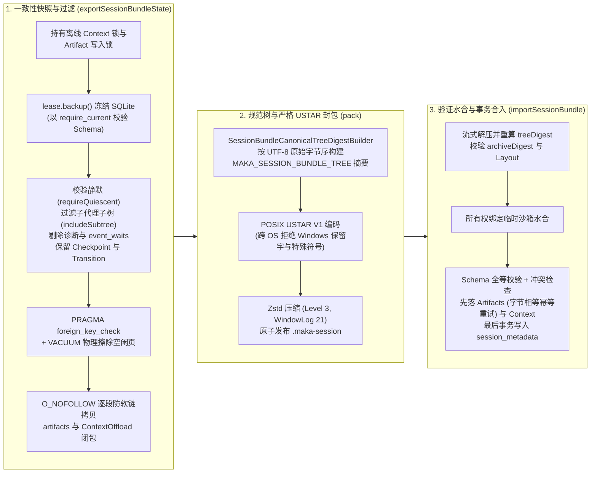

# 长期记忆、隐私边界与会话可迁移性

[返回手册目录](../README.md)

当用户在前一天的排错会话里强调**“记住：这个服务的数据库迁移必须附带可回滚脚本”**，三天后又在新机器上新开一个会话继续重构时，基础设施必须跨越两道单靠上下文窗口无法逾越的鸿沟：
1. **跨会话记忆鸿沟**：新会话的 `RuntimeEvent` 账本是一片空白，如何在不把海量历史硬塞进 System Prompt 的前提下沉淀并按需召回高价值规律，同时防止模型产生“记忆幻觉”或泄露隐私？
2. **会话可迁移性鸿沟**：用户希望把包含子智能体（Subagent）执行树、附件和图片卸载快照的复杂会话打包带走，或者把自己在 Claude Code / Codex / Cursor / OpenCode 中积累的既有会话无损迁入 Maka，如何在跨操作系统与多端并发下保证零损坏、零泄露？

本章全面剖析 Maka 的**双轨长期记忆与防幻觉证据核验体系**、**Fail-Closed 无痕隐私继承与每日复盘引擎**，以及基于 **USTAR 规范树的 `Session Bundle` 迁移协议与四端外部会话导入器**。

---

## 1. 概念先行：会话上下文、长期记忆与会话迁移的边界

在设计跨会话基础设施前，必须明确划分三者的职责边界：

| 机制维度 | 作用域与生命周期 | 核心权威数据源 | 对模型可见的方式 | 典型工程风险 |
| :--- | :--- | :--- | :--- | :--- |
| **会话内投影与压缩** | 单会话内（Intra-Session） | `RuntimeEvent` + `HistoryCompactCheckpoint` | 每步自动重组进入 `ModelMessage[]` | 工具配对撕裂、摘要过期复活已删内容 |
| **长期记忆双轨体系** | 跨会话（`workspace` 或 `global`） | `memory.sqlite`（结构化事实）<br/>`MEMORY.md` / `PENDING.md`（透明文档） | `Recall` 工具按需检索召回<br/>`MEMORY.md` 开关开启时自动注入 | 模型自我引用产生幻觉、密钥污染、隐私越界 |
| **会话打包与外部导入** | 跨工作区 / 跨设备 / 跨产品 | `.maka-session` 归档包<br/>外部客户端 JSONL / SQLite | 导入后重建标准 `StoredMessage` 与产物引用 | WAL 状态撕裂、SQLite 空闲页残留泄露、路径穿越 |

---

## 2. 长期记忆双轨架构与防幻觉证据核验

Maka 没有选择“把所有历史对话盲目塞进向量库做模糊召回”的路线，而是构建了两条职责清晰、互为补充的记忆通道：

```mermaid
flowchart TD
    Source["会话交互事件流<br/>(仅限非 partial 的 user 发言进入证据域)"] --> TrackA
    Source --> TrackB

    subgraph TrackA["轨道 A：自动化证据核验与结构化检索 (memory.sqlite + Recall)"]
        Trigger["触发源: memory_remember /<br/>memory_extract / Compaction 边界"] --> Evidence["1. 证据投影与拟合<br/>(仅提取 user 原文, 严禁助手/工具混入)"]
        Evidence --> Propose["2. 提案与单跳定位<br/>(若指代不明, search_required 仅限解释语境)"]
        Propose --> Canon["3. 隔离规范化与核验<br/>(redactSecrets + 分钟量化 + 逐字引文匹配)"]
        Canon --> MemDB[("memory.sqlite<br/>MemoryItem + Provenance + Cursor")]
        MemDB --> RecallTool["新会话按需调用 Recall /<br/>RecallMore / RecallMaterial"]
    end

    subgraph TrackB["轨道 B：人类可审计文档审批流 (PENDING.md -> MEMORY.md)"]
        HostCoord["HostMemoryCoordinator<br/>(CAS expectedRevision 乐观锁)"] --> Pending["写入 PENDING.md<br/>(status=review_required)"]
        Pending -->|"人类在界面审阅批准"| Formal["合入 MEMORY.md<br/>(status=active, 上限 128 KiB)"]
        Formal -->|"开启 agentReadEnabled"| PromptInj["装配为 local-memory 片段注入上下文<br/>(上限 12,000 字符)"]
    end
```



### 2.1 轨道 A：`MemoryExtractionEngine` 的三道防幻觉闸门

放任大模型在会话结束后自由总结“用户偏好”，最大的灾难是**记忆幻觉与自证循环**：模型会把自己在上一轮猜测的方案当成用户交代的铁律，或者把一段工具日志的报错误提取为全局规则，写进库后在下一轮被 `Recall` 召回，形成“自我引用、越错越真”的闭环。

Maka 的提取引擎（`memory-extraction.ts` 与 `memory-extraction-evidence.ts`）通过严苛的隔离与核验架构根除这一问题：

1. **严苛的证据域隔离（User-Only Evidence Domain）**：
   `projectMemoryExtractionEvidence` **只接受非流式（`!partial`）且满足 `role === 'user' && author === 'user'` 的用户原话**作为记忆证据。助手回答、工具调用参数、工具输出、思考块以及系统控制事件**被物理排除在证据域之外**，模型永远没有资格把自己的回答作为记忆出处。
2. **全量拟合与转弯边界拆分（All-or-Nothing Coverage）**：
   每次提取绑定明确的事件序数区间 `(expectedCursorOrdinal, targetBoundaryOrdinal]` 与覆盖哈希 `coverageHash`。`planMemoryCoverage` 强制要求区间内的每一条用户证据都能纳入不超过 `12,000` 字符的预算索引（优先通过 `sourceEventMessagePositions` 引用消息下标避免正文重复；超长文本通过二分检索截断至最低 `64` 字符）；若仍放不下，则由 `findMemoryRangeSplit` 优先沿 Turn 边界自动二分拆分范围逐段提交，**绝不静默丢弃区间中间的证据却推进游标**。
3. **单跳同会话定位与隔离规范化（最多 3 次模型调用）**：
   - **第一阶段（Proposal）**：遇到指代不明的用户表述（如用户只说“按刚才说的记住就行”），模型可返回 `search_required`，由 `searchSameSessionMemoryHistory` 在同一会话历史中做单跳关键词检索（最多返回含前后邻域共 `7` 个 Turn、`12,000` 字符）。这段上下文被明确包裹在 `<interpretation_context_only>` 中——**仅用于辅助消歧义，绝不允许替代用户原话作为出处引用**。
   - **第二阶段（Isolated Canonicalization）**：候选记忆进入完全隔离的规范化模型调用（脱离源会话上下文，仅见候选文本与用户引文），负责凝练规则并剔除无依据的过度外推。
   - **第三阶段（Deterministic Admission）**：最终落盘前，`admitMemoryProposalItemDetailed` 执行三项硬性代码裁决：
     - **密钥零容忍**：一旦 `redactSecrets` 检测到候选正文、检索键或引文中包含 API Key / Token 等敏感凭据，直接触发 `sensitive_information` 拒绝写入。
     - **时间边界与精度防伪**：按 `temporalType`（`undated` / `point` / `interval` / `open_ended`）校验起止区间合法性，并将时间戳统一对齐到分钟粒度（`minuteTimestamp`），禁止模型凭空捏造秒级精确时间。
     - **逐字引文核验（Verbatim Quote Check）**：每条记忆必须附带至少一条 `sourceRef` 及长度不少于 `4` 个 Unicode 码点的引文 `quote`，校验器核对引文真实作为**逐字子串**存在于对应用户的 `providerVisibleTexts` 中，任何“意译编造”一律被拒之门外。

### 2.2 崩溃安全游标、两轮失败弃置与版本化存储（`memory.sqlite`）

提取与存储通过 `SqliteMemoryItemStore` 维护严格的幂等与进度语义：
- **确定性操作 ID 与提取游标（`MemoryExtractionCursor`）**：每次提取依据 `(sessionId, trigger, stableBoundary)` 计算 SHA-256 `operationId`，与单调推进的 `processedOrdinal` 游标及 `MemoryExtractionReceipt` 在同一 SQLite 事务中原子提交。若在 Compaction 自动提取期间崩溃，下次触发会自动通过历史 `HistoryCompactCheckpoint` 的 `memoryExtractionBoundary` 接续补跑尚未处理的区间。
- **有界重试防卡死（`PendingMemoryExtractionFailure`）**：当提取因模型超时、Schema 错误或证据核验失败而受阻时，系统冻结该失败区间记录为 `PendingMemoryExtractionFailure`；下一轮触发时先按原语义重试一次；若第二次依然失败，则由 `settleFailure` 确定性标记为 `discarded` 并推进游标，防止一段异常对话永久阻塞后续所有会话记忆提取。
- **可审计的实体模型**：每条 `MemoryItem` 拥有 `version` 乐观锁、`scopeType`（`'workspace' | 'global'`）、类型化检索键 `keys`（`exact` / `entity` / `concept` / `alias` / `code`），以及不可伪造的溯源指针表 `MemoryItemSource`（精确锚定 `sessionId`、`runId`、`turnId`、`eventId`）。

### 2.3 `Recall` / `RecallMore` / `RecallMaterial` 跨会话按需检索

开启新会话时，Maka 不会把 `memory.sqlite` 和历史会话全量塞入上下文，而是向模型提供只读检索工具套件（`recall-tools.ts` 与 `recall.ts`）：

| 核心机制 | 设计细节与数值约束 | 解决的工程问题 |
| :--- | :--- | :--- |
| **双层联合召回** | 同时返回来自 `memory.sqlite` 的结构化事实（`RECALL_FACT_LIMIT = 10`）与跨会话可见对话段落（默认 `8` 段，上限 `25` 段） | 兼顾“已提炼的长期准则”与“尚未被抽象的具体历史操作上下文” |
| **候选缩小与全扫兜底** | `listCandidateSessions` 仅作超集预筛选，最终由 `runRecall` 对候选会话拉取转录并逐条运行精确谓词；遇到含 `"`、`\`、控制字符或孤立代理项（`JSON.stringify` 会转义的字符）的词条时，**强制绕过预筛选执行全量扫描** | 保证索引加速绝不改变匹配语义；避免字符因 JSON 转义字面量不一致而漏召回 |
| **脱敏先于匹配** | 所有文本在匹配前先经 `redactSecrets` 脱敏，并剥离投影合成占位文本（`syntheticTextPatterns`） | 防止攻击者或模型利用子串命中信号对已脱敏密钥实施“前缀逐字符探测（Prefix-Extension Oracle）” |
| **BM25 + 机器输出降权** | 采用 Okapi BM25（`k1 = 1.2`, `b = 0.75`）配合 Lucene 平滑 IDF，并对 `tool_result` 乘以权重 **`RECALL_TOOL_RESULT_WEIGHT = 0.5`**（单条结果文本截断至 `10 KiB`） | 防止满屏包含搜索词的 `grep`/`find` 工具输出在评分上碾压真正给出结论的人类或助手解释段落 |
| **自含邻域与增量扩读** | 每个命中锚点自动携带前后各 `4` 个同 Turn 可见消息（单条上限 `4 KiB`，单段上限 `12 KiB`，总信封上限 `96 KiB`），并附带 `gaps` 说明覆盖边界；不足时再按需调用 `RecallMore` 扩展最多 `8` 条邻域 | 减少二次工具往返消耗，同时避免长 Turn 一次性撑爆上下文 |
| **活跃轮隔离与材料拷贝** | `Recall` 与 `RecallMore` 均通过 `excludeTurnIds` 屏蔽当前正在运行中的 Turn（对未授权锚点一律返回无差别的 `not_found`）；`RecallMaterial` 校验源会话可见性后，将历史附件**物理拷贝**进当前会话再返回 | 防止模型把自己本轮刚说的话检索回来当作“跨会话佐证”；确保跨会话引用的文件在原会话被清理后依然可稳定重放 |

### 2.4 轨道 B：`PENDING.md → MEMORY.md` 透明文件审批流

对于希望用明文 Markdown 审阅、版本化管理团队或个人规范的用户，Maka 提供了由 `HostMemoryCoordinator` 统一仲裁的双文件工作流（`local-memory.ts`、`memory-bundle-io.ts`、`memory-coordinator.ts`）：
- **生命周期隔离**：模型提取或自动提炼的建议先以 `status=review_required` 落入 `PENDING.md`（草稿区），**绝不直接进入模型上下文**；只有经过用户在设置审阅队列或编辑器中显式批准（`approve`）或手动保存（`remember`），才会带上 `approvedBy=user` 与 `confirmedAt` 元数据转入正式的 `MEMORY.md`（上限 `LOCAL_MEMORY_MAX_BYTES = 128 KiB`）。
- **默认关闭读取与上下文防爆**：即便写入了 `MEMORY.md`，默认设置依然是 `{ enabled: true, agentReadEnabled: false }`；只有当用户显式开启读取授权时，Host 才将 `status=active` 且满足作用域（`workspace` 或匹配当前 `sessionId`）的条目过滤脱敏后注入 Prompt（上限 `12,000` 字符）。
- **并发 CAS 锁与崩溃原子发布**：所有读写均持有包级 `expectedRevision`（对 `MEMORY.md` 与 `PENDING.md` 联合计算的 `sha256`）。手动大编辑支持分块上传（单连接上限 8 并发、1 MiB 缓冲）；底层文件发布通过 `.memory-bundle-transaction/decision.json` 实现两阶段崩溃恢复，并自动维护 `MEMORY.md.bak`、`reset.bak` 及最多 `5` 份滚动 `restore.bak` 备份；一旦文件受损（非 UTF-8 或超过 128 KiB），系统自动切入 `safe_mode` 停止注入。

---

## 3. 无痕隐私边界（`incognito`）与每日复盘（`daily-review`）

### 3.1 Fail-Closed 无痕隐私边界的跨层继承

在隐私保护上，任何“校验失败就默认放行”的降级策略都是严重漏洞。Maka 在 `packages/core/src/incognito.ts` 定义了极简但刚性的 `WorkspacePrivacyContext` 契约，并由 Runtime Host 策略存储作为唯一权威：

- **强校验与拒绝伪造（Fail-Closed）**：前端渲染进程只允许发起变更请求与展示状态，**永远无权自证当前不处于无痕模式**。每个敏感消费边界都必须通过 `validateWorkspacePrivacyContext()` 解析权威策略快照——任何缺失字段、非布尔值或非对象载荷都会被直接判定无效，消费方**一律按隐私激活状态拒绝服务，绝不回退为 `false`**。
- **跨层无缝继承策略**：
  - **`HostMemoryCoordinator`**：当 `incognitoActive === true` 时，`memory.query`、`memory.mutate` 全部返回 `blocked: incognito_active`，`readPromptProjection` 直接返回空载荷（不向模型注入任何 `MEMORY.md`）。
  - **`Recall` 套件**：`runRecall`、`expandRecallPassage` 与 `fetchRecallMaterial` 在接触任何会话列表、事实库或附件存储前先校验隐私状态，无痕状态下直接拒绝。
  - **最关键的防漏设计——Compaction 策略拒绝边界冻结（`policy_denied`）**：如果用户在无痕模式下触发了历史压缩并产生了一个 `HistoryCompactCheckpoint`，难道等用户明天关闭无痕模式后，后台恢复器就能把昨天无痕期间的对话重新提取成长期记忆吗？**绝对不行！** `MemoryExtractionEngine` 在无痕或禁用策略拦截 `compaction` 触发时，会立即调用 `recordCompactionPolicyDenial` 并提交一条 `skipReason: 'policy_denied'` 的跳过回执，**原子性地将记忆提取游标越过整个无痕检查点区间**。此后哪怕用户重新开启记忆提取，历史游标也已经永久跨过该段受保护区间，彻底杜绝“事后倒查无痕对话”。

### 3.2 每日复盘引擎（`daily-review`）

为了帮助开发者回顾高频工程瓶颈与 Token 成本分布，`HostDailyReviewCoordinator` 提供了本地时间语义的每日复盘机制（`daily-review.ts` & `daily-review-coordinator.ts`）：
1. **本地时区日界与夏令时安全**：复盘按用户本地自然日（`localDayBoundsForInstant` / `localDayBoundsAt`）切分，支持 `1 / 7 / 30` 天跨度，生成规范归档 ID `YYYY-MM-DD-{range}d`（跨夏令时安全对齐本地零点）。
2. **多源数据严谨对齐**：汇总计算前先强制等待并修复规范用量投影（`readCompleteCanonicalUsageSummary`，若修复未完成则拒绝生成避免误导账单），合并遥测分桶（Top Tools / Top Models）与折叠修订后的活跃会话列表（`collapseSessionRevisions`）。
3. **单飞去重与降级兜底**：
   - 定时调度器每 `60` 秒检查本地配置时间 `executeTime`（默认 `08:00`），且**仅生成前一个刚结束的完整自然日（`offsetDays: -1`）摘要**，避免因历史上未开启过定时任务而在开启瞬间触发海量历史回溯。
   - 多客户端同时请求同一 `archiveId` 时，通过 `#inFlight` 在首个 `await` 前抢占单飞凭证并持有 `RuntimeHostResidency`（支持在 Host 平滑交接 `holdForHandoff` 期间安全等待生成结束）。
   - 若未配置分析模型（`no_model`）、当日无活动（`no_data`）或模型生成失败/超时（`failed`），自动降级输出确定性规则汇总章节而非整份丢失，本地滚动保留最多 `180` 份归档。

---

## 4. `Session Bundle`：USTAR 规范树打包迁移与无损还原

要把一个包含父子智能体树、工具附件与图片卸载对象的会话安全地打包为单文件（`.maka-session`），在另一台不同操作系统的机器上导入继续工作，朴素的“直接把数据库和目录 `tar` 打包”会遭遇五大致命故障：
- **活跃 WAL 撕裂**：热写入中的 SQLite 与外部文件处于不同时间切片；
- **空闲页隐私泄漏**：`DELETE FROM ... WHERE session_id != ?` 只是逻辑删行，被删其他会话的敏感文本依然残留在 SQLite 的 Freelist 字节中，任何十六进制编辑器都能直接读出；
- **凭据误传**：把本地 API Key 或配置顺手打进便携包；
- **跨平台路径陷阱**：在 Linux/macOS 上合法的文件名（如包含 `:` 或名为 `CON`）解压到 Windows 时会直接损坏或引发设备路径漏洞；
- **符号链接与路径穿越攻击**：恶意构造的归档包利用 `../` 或软链接覆写宿主机任意文件。

Maka 的导出与导入流水线（`session-export.ts`、`session-import.ts`、`session-bundle-policy.ts`、`session-bundle-canonical-tree.ts`、`session-bundle-ustar.ts`）逐一彻底封堵了上述漏洞：



### 4.1 导出侧核心工程防线

1. **先冻结快照、后检验静默（Freeze Before Inspect）**：必须在 `lease.backup()` 取完私有数据库副本之后，再在该副本上校验目标会话及其子代理树均处于非活跃静默状态（`assertSessionQuiescent`），并读取子代理 ID 列表、Artifact 清单与连接信息——确保“校验过的状态”和“实际打包出去的字节”绝对属于同一瞬间。
2. **智能表级净化与 `VACUUM` 物理擦除**：
   - 自动追踪整棵子代理树（`collectSubagentSessionTree`），防止父会话因缺失子会话工具结果而成为残缺对话；
   - 过滤剔除其他会话行、主机独占的 `event_waits`（防止跨实例触发虚假唤醒），以及占表体积大头但不参与模型推理的纯诊断型 `core_agent_run_events`——**同时精心保留 `history_compact_checkpoint_recorded` 与 `model_projection_transition_recorded` 两类决定模型历史的投影事件**；
   - 强制执行 `PRAGMA foreign_key_check` 证实无悬空外键后，运行 **`VACUUM`** 重建页面，将其他被删会话曾经占用的物理空闲页彻底清零擦除！
   - 导出清单 `manifest.json` 仅记录 `llmConnectionSlug` 与 `model` 名称供目标端匹配，**绝不携带任何本地配置或 API 密钥**。
3. **规范树摘要与跨平台可移植 USTAR V1**：
   - `SessionBundleCanonicalTreeDigestBuilder` 要求所有条目严格按**原始 UTF-8 字节序**递增排列，每个子文件前必须存在显式父目录，权限位严格规范为 `0o644` 或 `0o755`，共同计算出全局确定性的 `treeDigest`。
   - `encodeSessionBundleUstarHeaderV1` / `decodeSessionBundleUstarHeaderV1` 实现了一套跨宿主统一的便携路径语言：哪怕是在 Linux 上打包，也同样拒绝控制字符、`< > : " | ? *`、尾随 `.` 或空格，以及 `CON`、`PRN`、`AUX`、`NUL`、`COM1`、`LPT1` 等 Windows 保留设备名；解码时甚至会将解码出的结构重新编码一次并与原始 512 字节头做位级比对（`header.equals(canonical)`），杜绝任何非规范 USTAR 头部字段绕过检查。

### 4.2 导入侧幂等安全落盘

导入端（`importSessionBundle` → `hydrate` → `importSessionBundleState`）坚持**“依赖资源先就位，会话主记录最后发布”**的原则：
1. **流式验签与沙箱水合**：解码先通过 `SessionBundleCanonicalLayoutValidator` 实时拒绝乱序、越界、缺父目录和超限流（最高支持 2 GiB 压缩 / 8 GiB 解压、100 万条目），验证通过所有权锚定目录后再交由存储层合入。
2. **Schema 全等与非覆盖防撞**：由于底层批量合并使用 `INSERT ... SELECT *` 按列位置复制，导入前强制校验源 `operational_schema_migrations` 与 `PRAGMA user_version` 与当前工作区完全一致；同时检查待导入 `sessionIds` 在目标库尚不存在（`session_exists`），防止合并两段共享 ID 却毫无关系的冲突历史。
3. **可重试的幂等资源阶段与事务发布**：先拷贝 `artifacts`（使用 `COPYFILE_EXCL`，若目标已存在且逐字节 `O_NOFOLLOW` 比对完全一致则视为同一内容或上次中断残留予以接纳，不同则报 `conflict`）并合并 `context-offload` 引用；最后在单一数据库事务内合并 SQLite 行并重分配本地自增序列。若中途任何环节出错，仅精准回滚本次新建且尚未发布的资源文件，已发布的原工作区数据毫发无损。导入后的会话若本机尚未配置对应 `llmConnectionSlug`，会安全呈现为需用户重新选定连接的待路由状态。

---

## 5. 外部会话无损导入（Claude Code / Codex / Cursor / OpenCode）

除了 Maka 自有格式之间的迁移，基础设施还通过 `ExternalSessionImporter` 与 `ExternalSessionAdapterRegistry` 统一对接了四种主流编码 Agent 的本地会话资产（`external-session-importer.ts`、`external-session-adapters.ts`）：

| 外部源适配器 | 数据源位置与底层存储结构 | 格式解析与边界处理亮点 |
| :--- | :--- | :--- |
| **`ClaudeCodeSessionAdapter`** | `~/.claude/projects/<encoded-cwd>/<uuid>.jsonl` | 目录名将分隔符替换成 `-` 存在路径歧义（`/a/b` vs `/a-b`），适配器直接读取 JSONL 每条记录内的真实 `cwd` 消歧；目录分页预览仅扫描头尾共 `512 KiB` 窗口避免全扫 OOM，正式导入支持高达 `2 GiB` / `25 万`条消息 |
| **`CodexSessionAdapter`** | `$CODEX_HOME` 或 `~/.codex`（SQLite 线程表 + JSONL Rollout） | 覆盖 `cli`/`exec`/`vscode`/`atlas`/`chatgpt` 线程来源，使用定制路径字符消毒与分块 JSONL 流式解析，严格隔离原始字节上限与转换后消息字节上限（`256 MiB`） |
| **`CursorSessionAdapter`** | `User/globalStorage/state.vscdb`（SQLite KV 表） | 通过 `composerData:<id>` 获取会话有序 `bubbleId` 列表并关联 `bubbleId:<composerId>:<bubbleId>` 消息行；容忍 Cursor 自身裁剪造成的缺失 bubble 空洞，防范单个 800 KB+ 巨型 bubble 撑爆内存（限制原始载荷 `64 MiB` / `25 万`行） |
| **`OpenCodeSessionAdapter`** | `~/.local/share/opencode/opencode.db`（`session` / `message` / `part` 三表） | 解析 JSON `data` 列；精准利用助手消息上的 `time.completed`、`finish`（`stop` vs `tool-calls`）及 `error.name` 还原精确的 Turn 结束与异常中断状态 |

### 统一导入保障（`ExternalSessionImporter`）

各适配器只需负责将私有格式映射为标准的 `StoredMessage[]` 与可选的 `sourceImages`，公共导入器负责统一把守四道安全关卡：
1. **规范消息与时间戳校验**：经 `decodeCanonicalMessage` 标准化校验，拒绝负数或非安全整数时间戳。
2. **实质对话门禁（`isConversationTextMessage`）**：只有工具调用、笔记或状态行而没有任何可读对话文本的空壳外部会话会被直接拒绝，防止导入后在界面呈现为空白会话。
3. **标题与路径清洗**：经 `sanitizeExternalSessionTitle` 与 `sanitizeExternalSessionCwd` 剥离控制字符并保持合法文件系统标识。
4. **图片产物原子提交与回滚**：在 `createImportedSession` 中将外源图片持久化为新会话的 `Artifact`，若 `prepareExternalSessionImages` 在中途失败，自动触发 `purgeSessionArtifacts(sessionId)` 清理已写入的残留文件。

---

## 6. 教学伪代码：防幻觉记忆提取与隐私边界冻结

```text
// === 1. 防幻觉记忆提取与原子游标提交 ===
function executeMemoryExtraction(snapshot):
    // 1. 隐私与策略闸门（含无痕模式的 Fail-Closed 判定）
    gate = readMemoryGate(snapshot.sessionId)
    if not gate.allowed:
        if snapshot.trigger == "compaction" and gate.reason != "unavailable":
            // 关键：无痕期间触发的压缩边界永久标记为 policy_denied 并推进游标，
            // 防止日后关闭无痕模式时倒查提取无痕期间的敏感对话！
            recordCompactionPolicyDenial(snapshot.sessionId, snapshot.compactionCheckpointId)
            commitPolicySkipCursor(snapshot.sessionId, snapshot.compactionBoundaryEventId)
        return unavailableResult()

    // 2. 严格投影证据域：仅纳入非 partial 的 user 文本，物理隔离助手与工具输出
    entries = loadOrderedSessionEvents(snapshot.sessionId)
    pendingEntries = sliceRange(entries, cursor.processedOrdinal + 1, boundaryOrdinal)
    coverage = planMemoryCoverage(pendingEntries, maxJsonChars: 12_000)

    // 3. 提案（必要时仅允许单跳同会话解释检索，不可作引文出处）
    proposal = modelGenerate("proposal", buildFirstPrompt(coverage.evidence))
    if proposal.status == "search_required":
        localizedTurns = searchSameSessionHistory(entries, proposal.search, maxTurns: 7)
        proposal = modelGenerate("localized", buildLocalizedPrompt(coverage.evidence, localizedTurns))

    // 4. 隔离规范化 + 代码级逐字出处核验
    candidates = filterAndPrecheckSecrets(proposal.items)
    canonical  = modelGenerate("canonicalize", buildIsolatedCanonicalPrompt(candidates))

    verifiedWrites = []
    for item in canonical.acceptedItems:
        if hasSecret(item) or not validMinuteTemporalBounds(item):
            rejectOrAbortIfRequested(item)
        // 核验引文必须作为 >= 4 码点的逐字子串真实出现在用户原始证据中
        for citation in item.evidence:
            source = coverage.evidenceByRef.get(citation.sourceRef)
            assert source != null and length(citation.quote) >= 4
            assert source.providerVisibleTexts.some(t => t.includes(citation.quote))
        verifiedWrites.append(attachProvenanceSources(item, source.events))

    // 5. 原子提交记忆条目、检索键、出处溯源、幂等回执与游标
    return memoryStore.commitExtraction({
        operationId: deterministicId(snapshot),
        expectedCursorOrdinal: cursor.processedOrdinal,
        nextCursorOrdinal: pendingEntries.last().ordinal,
        coverageHash: hashEntries(pendingEntries),
        items: verifiedWrites
    })
```

---

## 7. 对照 Pi：极简文件契约 vs 证据隔离与便携迁移体系

| 对比维度 | Maka（全生命周期记忆与迁移体系） | Pi（`ResourceLoader` + `session-export.ts`） |
| :--- | :--- | :--- |
| **长期记忆形态** | **双轨协同**：`memory.sqlite`（自动提取 + 引文溯源 + BM25 `Recall`）与 `PENDING.md → MEMORY.md`（CAS 乐观锁 + 人工审批注入） | **文件系统即事实（`ResourceLoader`）**：自动沿用户全局目录与工作区祖先路径向上发现并拼接 `AGENTS.md` 等静态上下文文件直接注入 Prompt |
| **防幻觉与隐私治理** | 物理隔离 User-only 证据域、逐字引文核验、脱敏先于检索匹配、Fail-Closed `incognito` 继承及 `policy_denied` 历史区间永不倒查 | 依赖开发者通过 Git 手工维护 `AGENTS.md` 内容质量，本身即人类显式授权，无后台自动提取与无痕游标状态机 |
| **会话导出与跨平台安全** | `.maka-session`：离线一致备份 + `requireQuiescent` + `VACUUM` 物理擦除空闲页 + 规范树 SHA-256 + 严格跨平台 USTAR V1 + Zstd | `serializeSessionBranch` / `exportSessionToJsonl`：将当前分支沿 `parentId` 线性序列化导出为单文件 JSONL，轻量透明、零打包开销 |
| **外部生态接入** | 内置 `ExternalSessionImporter` 原生无损接入 Claude Code、Codex、Cursor、OpenCode 四大异构工具会话 | 以自有 JSONL 会话格式为核心，适合作为嵌入式 SDK 集成至自定义宿主中 |

---

## 8. 延伸阅读

- 回顾单会话内部是如何通过三层事实分离与 `read-page` 控制海量上下文的，阅读 [02.1 历史事实与模型输入投影](history-and-projection.md)。
- 了解历史压缩检查点是如何与长期记忆提取的 `MemoryExtractionBoundary` 协同工作的，阅读 [02.2 历史压缩与检查点](compaction.md)。
- 深入对比 Maka 与 Pi 在长期记忆架构哲学上的权衡取舍，阅读 [07.2 记忆设计对比](../07-comparison/memory-design.md)。
