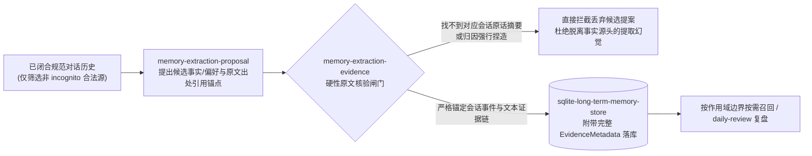

# 证据锚定记忆与 USTAR 便携迁移：incognito 无痕边界及异构历史导入

## 1. 为什么常规“自动总结写进向量库”迟早会把长期记忆变成污染池？

几乎每个做 Agent 记忆模块的团队，上线头一个月都兴致勃勃地在每轮对话结束挂一个提取脚本：“提取用户偏好并存入长期记忆库”。到了第三个月，产品投诉就会雪崩式涌来：
1. **模型编造记忆闭环幻觉**：提取模型为了凑任务 KPI，偶尔从对话里过度解读乃至凭空编出一条“用户要求所有脚本一律重写成 Perl”——只要写进记忆库，此后每一次对话都默认带上这条毒规则，且没有任何办法追查当年哪句话诱导它得出了这个荒唐结论。
2. **隐私试探泄漏跨界**：开发者在排查线上事故时开了临时会话粘贴过一段测试配置和私人故障猜测，结果系统后台“热情地”抽成了长期跨项目记忆，第二天在另一个普通客户演示会话里突然脱口而出。
3. **历史资产孤岛锁定**：团队换工作机、迁移测试环境或者以前长期攒在 Claude Code / Codex / Cursor 里跑了一半的重要调试上下文，只能当成死文本丢弃，根本没法无损搬迁进本地统一状态根里继续推进工具链。

Maka TypeScript 版在 `packages/runtime/src/memory-extraction*.ts`、`packages/core/src/incognito.ts`、`packages/storage/src/session-bundle*.ts` 及跨源导入器里，打造了三套严丝合缝的防御机制：**证据原文硬绑定提取**、**全链路只增不污染的 `incognito` 隐私冻结**与 **USTAR 规范树便携归档及异构会话无损导入**。

---

## 2. 防幻觉长期记忆双轨架构：强行核对原文证据链

在 `packages/core/src/long-term-memory.ts`、`packages/storage/src/sqlite-long-term-memory-store.ts` 与 `packages/runtime/src/memory-extraction-evidence.ts` 的协作下，任何记忆从提取诞生到注入下文，全链路遵循极其严苛的证据追认契约：

这一设计的威力不在于用了多复杂的 Prompt 技巧，而在于建立两条物理校验原则：
1. **无源之水不准入库（Evidence Verification Gate）**：后台提取模型（`memory-extraction`）不能光吐出一句干瘪的结论就结束，必须在提案结构（`memory-extraction-proposal`）中明确标定是受哪条原生输入事件触发及对应的原句证据摘录。核验模块直接穿透回规范存储中比对真实文本——**任何无法对应到现实对话证据链的幽灵结论一律就地销毁**，彻底堵住幻觉复利循环！
2. **可追溯、可纠偏的受控双轨状态**：每条持久记忆与支持它的多次佐证彼此关联，支持随着新对话演化做置信补强与显式复核；同时配套了独立的 **每日回顾通道（`daily-review` / `daily-review-coordinator`）**，在统一后台窗口按批次理性收敛日间积累的冗余与潜在矛盾碎片，避免零碎高频提取直接污染核心提示流。

---

## 3. 绝对零泄漏防线：`incognito` 无痕会话冻结语义

一旦用户在创建或分支（Fork）某个对话时开启了无痕隐私模式（`incognito: true`），`packages/core/src/incognito.ts` 不仅把“不在前端列表高亮展示”这种表面功夫做好，而是在宿主全周期内执行**渗透级行为隔断**：

| 系统组件维度 | `incognito` 模式下的刚性冻结表现 | 工程防漏意义 |
| :--- | :--- | :--- |
| **长期记忆读写隔离** | 严禁拉起后台 `memory-extraction` 协程抽取该会话内容；同时支持完全阻断过往记忆注入，维持纯粹空白基线 | 绝不让敏感故障排查、私密探讨意外写穿进跨会话持久记忆池 |
| **每日复盘与回忆索引** | 自动从 `daily-review` 批处理输入清单和全局 Recall 搜索索引池彻底排除无痕会话事实 | 避免虽未入长记忆表却依然能从后台回顾摘要里反推侧漏信息 |
| **分支与派生子代理传染继承** | 从一个 `incognito` 会话分叉（Fork）新分支或调起任何子 Agent 协同分支时，**强制不可逆继承 `incognito: true` 属性** | 从构造期杜绝“爸爸是隐身的，派生个子会话就把隐私写到外部公共库”的降级逃逸漏洞 |

---

## 4. `Session Bundle`：基于 USTAR 规范树的可验证跨机迁移包

怎么把某个跑了 50 步、附带十几张高分截图、内部带着工具输出归档（`maka://`）和完整 `AgentRunStore` 操作记录的工作会话，原封不动发给另一台电脑或另一套独立测试宿主挂载复原？

很多架构图省事的做法是导出一个大号 `session.json` 文件——结果大二进制附件没打进来、图片相对路径全失效、而且文件跨 OS 压缩解压后因为权限和字节序问题导致校验和全部对不上。

`packages/storage/src/session-bundle*.ts` 选择了一套极具工程正统性的标准封装——**基于 USTAR (`session-bundle-ustar.ts`) 的规范树（Canonical Tree）打包机制**：
1. **确定性归档封装**：严格按标准化 USTAR（POSIX `tar` 规范格式）序列化构建可验证档案包——严格排序路径目录树（`session-bundle-canonical-tree`）、剥离本机易变噪音时间/宿主环境元信息、封入明确契约清点清单（`session-bundle-manifest`）与文件完整性摘要。
2. **全资产连根打包与解包重映射**：不仅包含规范化的 `RuntimeEvent` 脊柱与 `AgentRun` 操作记录，连同关联在 `Artifacts` 与 `ToolResultArchive` 里的外部图片和巨型工具结果文件一并封进同包；到站导入由 `session-bundle-coordinator` 通过安全权限核查（`session-bundle-policy`）在原子边界下完成 ID 重映与完整状态重建，不丢半个字节资产。

---

## 5. 外部异构历史的无损吞吐导入：兼容 Claude Code / Codex / Cursor / OpenCode

现实中工程团队极少从一张绝对空白的白纸起步；开发者过往几个月已经在 **Claude Code、Codex、Cursor 或 OpenCode** 中积累了海量极有价值的对话上下文与代码演化思路。

依据 `docs/architecture/external-session-import-design` 与 `external-session-coordinator` 的设计规范，Maka 实现了一整套**外部异构历史会话无损导入引擎（External Session Import）**：

- **保留原生工具边界映射**：不粗暴地把别人历史里的代码编辑和命令执行全打扁成一段干巴巴的助手纯文本废话，而是精准翻译映射为严谨配对的规范 `RuntimeEvent` 事件结构（含工具呼出意向与对应结果槽位），并标定清楚其非本地生成的**跨源导入身份血缘**；
- **导入后直接支持续跑与压缩**：因为遵循的是完全符合标准的 `RuntimeEvent` 脊柱格式，一条从 Claude Code 导入的历史长对话进入 Maka State Root 后，立刻可以无缝套用 `AiSdkTurn` 续跑后续任务、照样享受 `ModelProjectionTransitionLedger` 裁剪及安全检查点压缩保护，真正打破不同 AI 编码工具之间的数据孤岛！

---

## 6. 总结

`02-context` 模块的三驾马车完美勾勒出上下文治理的立体坐标系：
1. **纵向投影清晰**：用双账本、`ModelProjectionTransitionLedger` 稀疏链和 `maka://` 按页读取平衡长上下文膨胀与原件保真；
2. **安全压缩收敛**：借 `selectSafeCompactionPrefix` 与 `#6254` 已知封存突破让历史窗口能够跨故障稳定滚雪球前移，用保守的多模态退避守住用户原始资产真相；
3. **跨时空可信延续**：借证据强绑定提取防记忆幻觉、借 `incognito` 继承护卫无痕边界、借 USTAR 规范包和异构导入打通全生命周期无缝迁徙。

上下文食材与记忆粮仓已备齐，接下来 Agent 要开始真正伸出双手操作本地磁盘、跑命令、调外网插件甚至直接点击屏幕界面了。进入 **03 工具执行、OS 沙箱与安全纵深篇**，首站切入一切本地工具流的心脏调度中心——[ToolRuntime 结算内核：三重参数快照、T1/T2 提交与 Code Mode 嵌套调用树](../03-tools/tool-runtime.md)。
