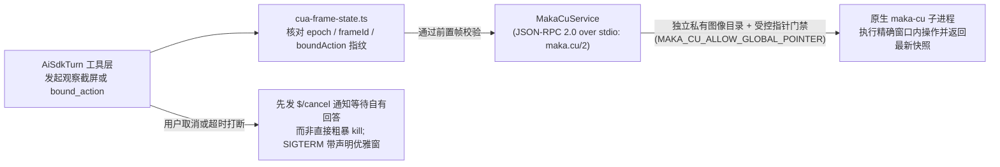

# 原生桌面视觉与 PTY 虚拟屏：MakaCuService 帧契约、坐标门控与进程树收尸

## 1. 为什么桌面 UI 自动化与交互式命令不能当作“盲拍截图 + `execSync`”处理？

当 Agent 必须离开标准文本代码文件、开始接管真实的桌面应用窗口或者运行需要上下键交互的全屏终端命令（如 `vim`、交互安装向导、进度条 CLI）时，传统直觉做法会立刻跌入三个物理黑洞：

1. **视觉过时与点击错窗（Stale Frame Race）**：大模型看的是 3 秒前拍下的桌面上“提交按钮”坐标 `(540, 320)`；但就在推理输出那 2 秒内，后台弹出一个覆盖全屏的系统警告框或窗口被切换走。若执行层收到坐标就盲目往当前屏幕戳下去，轻则点空，重则直接误触确认删除或切换别的应用。
2. **重复动作与“先拒绝后重试”恢复误导**：如果前一次手势因为参数或指针限制在真正分发给 OS 之前就已经被拦截（Retired），恢复层若笼统返回 `duplicate_action`（“这个动作发过了，快重新截屏确认界面是不是变了”），模型就会被错误引导去做无效重截屏甚至误判界面已变更！
3. **ANSI 制御字符垃圾流与进程树孤儿逃逸**：交互式程序不停刷出的 `\x1b[2K\x1b[1A` ANSI 光标清屏控制符直接吐给模型会污染几万 Token；而命令超时取消时如果仅仅朝最顶层的 `/bin/sh` 发一个 `SIGTERM`，底下派生出的子构建进程或浏览器驱动依然在后台僵死占锁。

Maka TypeScript 版利用 **`packages/computer-use` (`MakaCuService`)**、**`cua-frame-state.ts` 帧绑定与七态拒绝分类**、**`@xterm/headless` 虚拟屏幕栈（`PtyStack`）**以及 **跨平台 `ProcessTreeTerminator`**，把视觉操作与伪终端变成确定性、有状态保护的可观测协议。

---

## 2. `MakaCuService` 与 `maka.cu/2`：独立隔离的视觉执行监控器

翻开 `packages/computer-use/src/maka-cu-service.ts`，开篇注释就定下了极为清晰的隔离规则：**绝不能为了代码复用，把 `maka-cu` 监督器跟普通浏览器 `cua-driver` 硬揉成带布尔开关的同一个父类**，因为一旦混合标记出错，就会拿错了窗口拆除序列把桌面进程误杀。

`MakaCuService` 通过标准输入输出（stdio）按行传输 **JSON-RPC 2.0 (`maka.cu/2`)** 协议独立监管单个原生 `maka-cu` 执行子进程：



这一监控骨架蕴含三项重要安全边界：
1. **声明式取消优于粗暴强杀**：当外层取消执行时，`MakaCuService` 向 `maka-cu` 发送协议级 **`$/cancel`** 指令并等待其自有回执确认物理键鼠手势收束完毕，只有在 `SIGTERM` 声明宽限窗口超时未退时才升级终结，保护宿主机输入焦点和本地图像缓存不被撕碎。
2. **全球指针安全门闩（`MAKA_CU_ALLOW_GLOBAL_POINTER`）**：系统默认严格限制原生操作坐标只能落回目标绑定窗口标识（`ComputerUseWindowIdentity`）作用域内，仅当策略明确开闸并校验权限通过才放行全局屏幕级指针通道。
3. **私有隔离图库目录**：所有截取出的高分辨率帧均保存在专属隔离目录并经严格哈希与修订版本号追踪，不直接混合进入任意用户项目路径。

---

## 3. 帧身份绑定与七态拒绝分类：`cua-frame-state.ts`

为了彻底根治“看着第 N 张截图点了第 N+1 轮已经换掉的弹窗”，`packages/runtime/src/cua-frame-state.ts` 要求每一个发向桌面的键鼠意图都必须显式捆绑其所依据的那一帧视觉证明（`CuaFrameIdentity` + `CuaBoundAction.fingerprint`）：

| `CuaActionRejectionReason` | 精确触发场景 | 模型与调度器的恢复语义差异 |
| :--- | :--- | :--- |
| **`stale_frame` / `no_active_frame`** | 目标窗口自上次截屏后已发生变化或无有效当前帧 | 必须强制重新发起一帧最新观察快照后再决策坐标 |
| **`stale_epoch`** | 运行跨越了进程重启或宿主窗口会话纪元换代 | 原有视觉句柄全面失权，需从头建立目标绑定 |
| **`invalid_binding` / `action_not_claimed`** | 提交动作指纹同协议签发绑定不匹配，或未声明持有帧锁 | 当场拦停未授权篡改动作 |
| **`duplicate_action`** | 上一次一模一样的动作已进入过真实分发队列后被再次重提 | **副作用可能已经发生**！提示模型必须先观测确认最新窗口结果再决定后续 |
| **`retired_action`** | 相同的动作重提，但**前一次尝试在根本未分发给 OS 之前即遭门禁拦截** | **副作用绝未发生，窗口原封未动**！明确告知模型可直接跳过冗余再观察开销 |

特意把 `retired_action` 从 `duplicate_action` 拆出来的决定，在源注释里记下了极其深刻的实战教训：以前这两者混作一谈导致系统告诉模型“去刷新查看一个根本不可能发生变化的画面”，既浪费一整个多模态截屏回合又让模型陷入逻辑自相矛盾！

---

## 4. `PtyStack` 与 `PtyScreenCollector`：把 ANSI 控制乱流编译成二维纯净文本屏

转向终端命令行世界时，许多现代开发者用 `spawn()` 重定向 `stdout/stderr` 跑普通脚本没问题，一旦模型调起了自带彩色进度条、动态刷新表格甚至全屏界面菜单的交互式 CLI，裸读取出来的全是 `\r\x1b[32m...\x1b[0K` 覆盖流，完全无法让模型看懂现在屏幕最终定格在第几行！

Maka 在 `packages/runtime/src/pty-stack.ts` 与 `pty-screen-collector.ts` 中将真实的终端渲染引擎直接嵌进了后端内核：

```typescript
// 核心栈组成（源自 packages/runtime/src/pty-stack.ts）
interface PtyStack {
  spawn: typeof NodePty.spawn;           // 分配真实系统级伪终端 (TTY / ConPTY)
  Terminal: typeof HeadlessTerminal;     // @xterm/headless 无头虚拟屏幕状态机
  Unicode11Addon: typeof HeadlessUnicode11Addon; // Unicode 11 宽字符/CJK 对齐渲染扩展
}
```

- **懒加载与精准平台诊断**：`loadPtyStack()` 利用单例缓存（`loadPromise`）动态装配原生 `node-pty`、无头终端 `@xterm/headless` 与宽字符扩展 `@xterm/addon-unicode11`；一旦目标宿主机缺失原生依赖，立刻精准抛回 `${process.platform}/${process.arch}` 诊断报错。
- **实时刷屏归约器（`PtyScreenCollector`）**：真正运行命令时，PTY 吐出的千万条光标回退和色彩控制序列全部先灌入内存中的无头 `@xterm/headless` 屏幕缓冲区渲染定型，再通过 **`SessionRuntimeResourcePtyDataFrame`** 按需向模型和前端导出清晰干净的**最终二维屏幕字符网格与历史滚屏切片**，直接过滤掉 99% 的冗余重绘控制噪音。

---

## 5. `ProcessTreeTerminator`：拒绝留下僵尸子孙进程的跨平台终结器

无论跑的是重度构建 `Shell` 命令、无头测试浏览器，还是后台拉起的独立工具集，最常见的本地环境污染源就是：**命令超时或用户点取消后，主壳进程 `sh.exe` / `zsh` 确实死了，但它刚刚衍生出的孙子 `node` / `webpack` / `cargo` 子进程还在后台死死锁着 3000 端口甚至继续写入测试目录！**

`packages/runtime/src/process-tree-terminator.ts` 统一封装了跨 OS 进程树级联清理原语：
- **POSIX（macOS / Linux）**：强制以独立进程组（Process Group / `detached`）发起受控任务，取消收尾时先对整个 `-pgid` 进程组投递 `SIGTERM` 给予宽限清理窗口，超时尚未清零则果断升级至 `SIGKILL` 一锅端掉整棵衍生族谱；
- **Windows**：彻底放弃只杀顶层 PID 的无效做法，利用原生的作业控制通道（协同 `runtime-host-windows-task-launcher` 与 Win32 任务终止句柄）一次性扼杀整条进程家族树并确认句柄归零，确保后续工作区清理和 `settled` 门闩绝不踩空。

---

## 6. 总结

Maka TypeScript 版在跨出纯文件编辑边界、操作屏幕画面与伪终端时，依然维持了极高的系统确定性：
1. **桌面自动化（`MakaCuService`）**：依托 `maka.cu/2` 独立监督进程、优雅 `$/cancel` 及 **`stale_frame` / `retired_action` 七态精确识别**，消除了视觉误击和误引导恢复；
2. **伪终端（`PtyStack`）**：用无头 `@xterm/headless` 引擎替代裸字符拼接，输出纯正干净的屏幕投影；
3. **进程收尸（`ProcessTreeTerminator`）**：确保任何打断取消都伴随整个衍生进程树的完全退场，守住 `settled` 栅栏前提。

本地屏幕和终端都能严格锁住了，但如果插件工具运行在第三方 MCP 服务里（对方随时可能偷偷增删工具列表改变 Schema），或者需要跨网络让前端连接上的桌面用户本地帮我们执行一项受限反向动作（Client Capability）呢？下一篇剖析如何防止第三方工具定义“暗渡陈仓漂移”，以及端侧反向调用如何用 `accepted → admitted` 两步契约界定未知副作用边界：[MCP 加密防漂移与端侧两阶段准入：accepted 到 admitted 的权威切分](./mcp-and-client-capabilities.md)。
