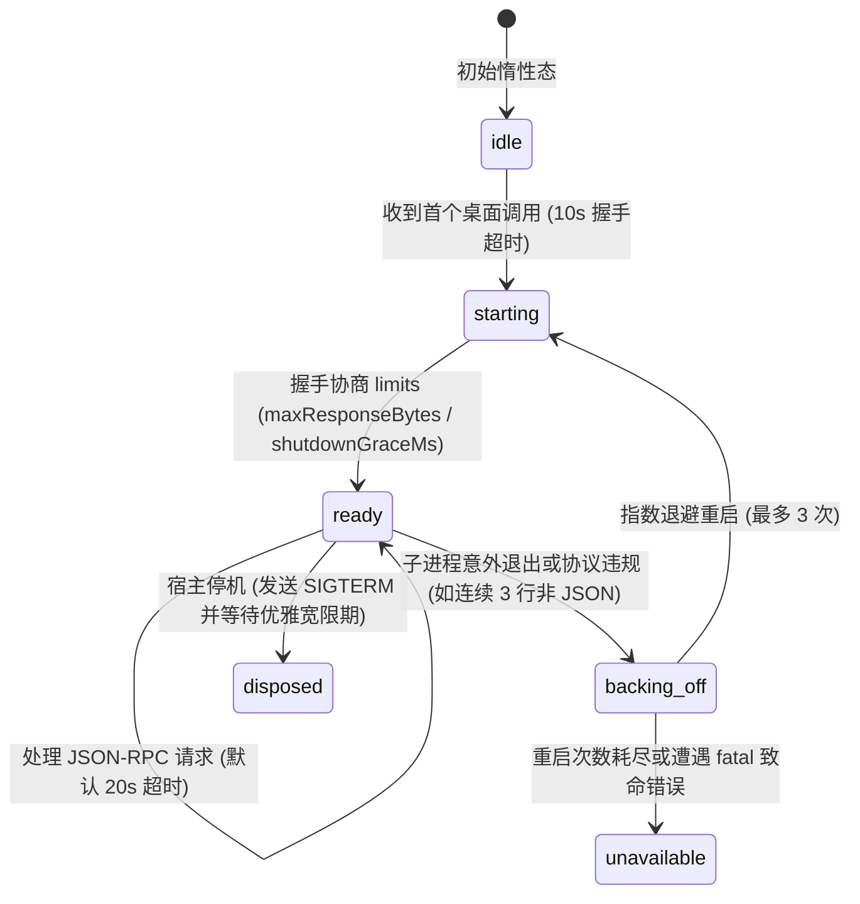
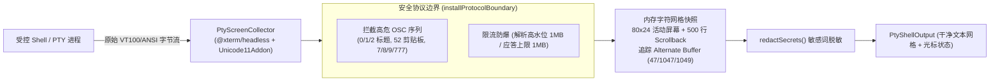

# 原生桌面自动化与 PTY 虚拟终端栈

[返回手册目录](../README.md)

当 Agent 的工作范围不再局限于读写代码文件，而是需要**“打开桌面应用点击按钮并截图验证”**，或者**“在交互式终端里运行 `vim`、调试器、带动态刷新的测试进度条”**时，普通的文本管道（`stdout`）与单次进程启动模式立刻失效：

1. **桌面自动化黑盒**：操作系统无障碍树（AX Tree）和键鼠事件直接驱动用户的真实屏幕。如果在模型点击“提交”的一瞬间用户点击了“停止”，直接用 `SIGKILL` 杀掉控制子进程，主进程根本不知道刚才那一下鼠标到底有没有点下去！
2. **交互式终端 ANSI 乱码**：交互式命令行程序依赖 VT100/ANSI 控制序列移动光标、刷新局部字符甚至切换全屏缓冲区。把带满 `\x1b[32m` 和 `\x1b[2J` 的原始字节流直接喂给大模型，不仅耗费海量 Token，还会让模型完全看不懂屏幕上的真实布局。更危险的是，恶意脚本输出一段 `OSC 52` 序列就可能劫持剪贴板。
3. **孤儿进程逃逸**：通过 Shell 拉起的服务可能衍生出多层子进程树。超时取消时如果只杀掉顶层 Shell，后台孙子进程会继续占用文件锁和网络端口。

本章深入剖析 Maka 在这一层构建的三大核心子系统：**`MakaCuService` 原生桌面服务监管、`PtyScreenCollector` 虚拟屏幕采集栈，以及跨平台 `ProcessTreeTerminator` 进程树清理引擎**。

---

## 1. 原生桌面自动化：`MakaCuService` 与确定性取消契约

Maka 将操作系统原生 UI 自动化（读取无障碍树、屏幕截图、鼠标键盘控制）隔离在独立的原生子进程 `maka-cu` 中，由宿主侧的 `MakaCuService` 通过基于行分隔的 **JSON-RPC 2.0 over stdio（`maka.cu/2` 协议）** 进行监管。



### 1.1 取消的艺术：为什么必须等 `$/cancel` 回答 2 秒，而不能直接 `kill`？
在设计异步子进程执行器时，最常见的错误是“一旦收到用户取消信号，立刻向子进程发送 `SIGKILL`”。但在桌面自动化场景下，这是绝对禁止的：

- **物理副作用的不可逆性**：一个已经发给 `maka-cu` 的请求可能已经驱动了系统鼠标指针或按下了回车键。如果 Host 在收到取消指令的同一毫秒就强杀子进程并向模型报告“已取消未执行”，就是在向历史账本撒谎！
- **2 秒优雅取消窗口（`CANCEL_GRACE_MS = 2,000ms`）**：
  当用户按下停止键时，`MakaCuService` 首先通过 `stdin` 向子进程冲刷一条 `$/cancel` 协议通知，然后等待子进程自己结清当前状态（关闭临时会话、移走 Agent 光标指示器、清理截图目录）并回答“这次动作到底有没有生效”。
  - **为什么不死等完整的 20 秒请求超时？** 实测表明，若在 $t=120\text{ms}$ 取消却等完默认 $20\text{s}$ 超时，用户点击停止后界面会白白卡死近二十秒。
  - **为什么又必须实打实地等待 2 秒？** 如果在发完 `$/cancel` 的同一个事件循环 Tick 里就强杀子进程，缓冲在 `stdin` 里的取消指令甚至还没来得及刷入内核管道，子进程根本收不到优雅收尾信号！2 秒窗口既能让健康子进程安全善后并报告真实状态，又能防止僵死进程拖垮用户体验。

### 1.2 图像目录隔离与流式缓冲防护
- **图像不走标准输出通道**：在 `maka.cu/2` 协议中，任何截图字节流**绝对禁止**通过 `stdout` 返回。子进程将截图写入独占的本地图像目录，只把路径与元数据传回主进程。`stdout` 通道保留给结构化的无障碍树（AX Tree）响应（配备最小 `4 MiB` 缓冲与 `1 MiB` 裕量），防止单张高清大图冲垮 JSON-RPC 解析器。
- **非 JSON 污染熔断**：若某个受损的子进程在同一个代次内向 `stdout` 连续吐出超过 `3` 行非 JSON 杂音（`MAX_NON_JSON_LINES = 3`），监督器立即判定协议破坏，触发代次解体并记录 `MakaCuReleaseEvent`（若在途调用无法确认，明确标记 `outcomeUnknown: true`）。
- **帧与会话状态隔离**：`cua-session-state` 与 `cua-frame-state` 将窗口句柄、全局指针许可（`MAKA_ALLOW_GLOBAL_POINTER`）及最新屏幕帧索引严格绑定在当前会话与执行代次上，防止跨会话误点。

---

## 2. 交互式终端仿真：`PtyStack` 与 `PtyScreenCollector`

当模型执行需要伪终端（PTY）的命令（如启动开发服务器、交互式 CLI 向导、或者全屏诊断工具）时，Maka 不会把杂乱的原始转义字符直接扔给模型，而是通过 `PtyStack` 构建了一套运行在后端的**无头虚拟终端引擎**。



### 2.1 虚拟终端采集器的四大核心工程设计
1. **基于标准终端内核的渲染还原**：底层装载无头 `@xterm/headless` 与 `Unicode11Addon`（精确计算中日韩双宽字符与 Emoji 宽度），将任意光标跳行、退格擦除、进度条原地覆写，实时渲染为干净规整的 `80 × 24` 活动屏幕文本 + 最多 `500` 行的历史回溯区（`PTY_SCROLLBACK_ROWS`）。
2. **拦截恶意终端逃逸（`BLOCKED_OSC`）**：终端世界存在著名的“OSC 转义注入”攻击——例如运行一个看似普通的测试脚本，它在标准输出里打印一段 `OSC 52` 控制码就能静默读写剪贴板，或者利用 `OSC 0/1/2` 篡改终端标题欺骗用户。`PtyScreenCollector` 在协议边界层显式拦截并屏蔽 `OSC [0, 1, 2, 7, 8, 9, 52, 777]`，同时将终端向子进程回传的协议应答严格封顶在 `1 MB` 以内。
3. **备用缓冲区（Alternate Buffer）追踪**：当进程进入 `vim`、`less`、`htop` 等全屏应用时（触发私有模式 `47 / 1047 / 1049`），屏幕会切入备用缓冲区并在退出时瞬间清屏。采集器专门记录 `lastAlternateRows` 与滚动保留抑制标记，确保即使全屏工具刚刚退出，模型也能看清它在退出前最后一眼展示的信息。
4. **屏幕快照实时脱敏**：在将字符网格组装成 `PtyShellOutput` 交付给模型或前端展示之前，所有内容必须经过 `redactSecrets()` 扫描替换（标记为 `[redacted]`），防止误打印的密钥进入持久事件账本。

---

## 3. 跨平台进程树终结器：`ProcessTreeTerminator`

一个 `Bash` 工具调用看似只启动了一个 `/bin/sh` 进程，但实际执行命令（如 `npm test`）可能会启动子进程 `vitest`，`vitest` 又派生出 8 个测试 worker，其中一个 worker 还拉起了本地数据库进程。

如果只调用 Node.js 的 `child.kill('SIGTERM')`，操作系统只会杀掉最顶层的 `/bin/sh`，下面的所有孙子进程会全部变成挂在系统 Init 进程下的**僵尸/孤儿进程**，不仅白白消耗宿主机资源，还会一直锁住工作区里的 SQLite 或代码文件导致后续工具失败！

`ProcessTreeTerminator` 采用分平台递归清理与竞态防护机制：

| 平台策略 | 发现与清理机制 | 关键防误杀保护 |
| :--- | :--- | :--- |
| **Windows** | 直接调用系统原生 `taskkill /PID <pid> /T /F` 强制连根摧毁整棵进程树（强制限定 `2000ms` 超时防工具挂起）。 | 信号前检查 `hasExited()`；执行前通过 `beforeSignal()` 钩子二次确认目标未提前自然退出，规避 PID 复用误杀。 |
| **POSIX (Linux / macOS)** | 解析 `/bin/ps` 或 `/usr/bin/ps` 快照构建完整 `(pid, ppid, pgid)` 父子拓扑图，由叶向根收集所有后代进程与同进程组成员。 | 先发优雅信号 `SIGTERM`，在 `2000ms` 宽限期（`DEFAULT_PROCESS_TERMINATION_GRACE_MS`）内观察进程退出情况；超时仍存活再发送 `SIGKILL` 兜底清场。 |

---

## 4. 教学伪代码：优雅取消与虚拟屏采集契约

```text
// === 1. MakaCuService 优雅取消与不确定性保留 ===
async function cancelComputerUseRequest(service, requestId):
    // 先通过 stdin 刷新协议级取消指令，让子进程有机会归还光标并如实汇报屏幕状态
    await service.writeStdinJsonRpc({ method: "$/cancel", params: { id: requestId } })

    // 只等待 2 秒优雅回答窗口 (既不卡死 20 秒总超时，也不同一 Tick 强杀丢状态)
    reply = await waitWithTimeout(request.settledPromise, timeoutMs: 2_000)

    if reply != null:
        return reply // 采信子进程明确返回的取消前已执行状态

    // 2 秒内仍无响应：强制销毁子进程代次，并显式向外广播 outcomeUnknown = true
    await service.teardownGeneration(reason: "cancel_grace_expired")
    throw new ToolOutcomeUnknownError("Computer Use child did not acknowledge $/cancel")

// === 2. PtyScreenCollector 安全输入与快照生成 ===
function acceptPtyChunkAndSnapshot(collector, rawAnsiChunk):
    if byteLength(collector.pending) > 1_048_576:
        // 超过 1MB 解析高水位，触发背压丢弃或标记截断
        collector.markTruncated()

    // 交由无头 xterm 内核渲染，协议边界自动屏蔽 OSC 52 等高危转义码
    await collector.terminalWrite(rawAnsiChunk)

    // 读取当前 80x24 活动窗口与 500 行 scrollback，对文本逐行执行密钥脱敏
    rawScreen = collector.extractActiveAndScrollback(includeAlternate: true)
    return {
        screen: redactSecrets(rawScreen.screen),
        scrollback: redactSecrets(rawScreen.scrollback),
        truncated: collector.historyTruncated,
        cursorVisible: collector.cursorVisible,
        mouseEncoding: collector.mouseEncoding
    }
```

---

## 5. 延伸阅读

- 了解普通前台/后台 `Bash` 与受限文件 Worker 如何在操作系统层面进行路径与网络隔离，阅读 [03.4 操作系统级双路沙箱](sandbox.md)。
- 了解系统如何通过 `AdmissionLimiter` 限制后台持久 Shell 进程的数量配额，阅读 [05.1 输入队列与执行准入](../05-coordination/queues-and-admission.md)。
- 了解连接桌面与浏览器的前端能力代理如何经过授权审批，阅读 [03.2 MCP 连接与客户端能力代理](mcp-and-client-capabilities.md)。
