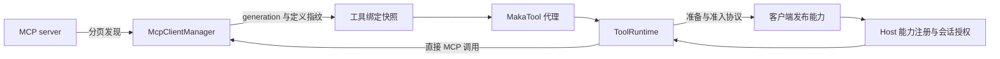
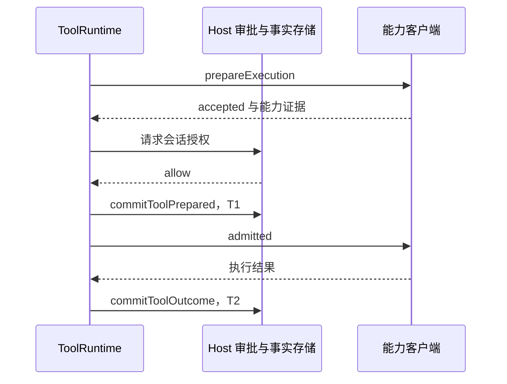

# MCP 连接与客户端能力

[手册目录](../README.md)

工具接入有两种拓扑：Host 直接连接 MCP 服务，或客户端发布能力并在客户端执行。两者最终进入工具运行时，但连接身份、准入与失效条件不同。

`MakaTool` 的执行细节见[工具运行时](tool-runtime.md)；本文集中解释外部声明如何取得可调用身份，以及批准如何到达实际执行点。

适用范围：Maka 提交 `15d0a0dd19d39e2bc09ae35940e432c636982315`，Pi 对照提交 `482c1381a00d8d00bc81697e4a980c593db6803e`；本文依据源码静态核对与已读取的测试，未连接真实 MCP 服务。

## 1. 接入与调用的数据流



图示为两条接入路径，并不表示所有 MCP 调用都必须经过客户端。绑定用于检验声明是否仍对应当前实现；会话授权决定谁可以使用它。

## 2. MCP：发现、绑定、调用与结果转换

MCP 引入外部工具描述与调用协议，但并未替 Host 解决权限、生命周期和结果记账。
Maka 的连接管理与模型工具适配分属 `packages/mcp` 和 `packages/runtime/src/mcp-tools.ts`。[M7]、[M8]

1. **发现。** `listAllTools()` 通过 `discoverMcpTools()` 分页获取工具；重复工具名、循环 cursor 和超限清单被拒绝。
2. **绑定。** `createToolSnapshot()` 为声明建立带指纹的快照；binding 包含 manager 身份、连接 generation、服务与工具身份、定义指纹。
3. **适配。** `buildMcpToolsWithIdentities()` 生成 `MakaTool`，保留独立的 serverId／toolName；可见名称由 `mcpProxyToolName()` 生成，不依赖反向解析名称进行路由。
4. **调用。** `McpClientManager.callTool()` 检查 binding 所属管理器、连接代次和当前快照，再向 SDK 发送原始工具名与参数。
5. **收口。** 检查服务错误、结果预算和已声明的结构化输出 schema，清理已知秘密；代理再转换模型可见内容。[M7]、[M8]、[M9]、[M13]

绑定的作用是防止旧声明误调用新实现，不是权限凭证。刷新后若代次和定义均未变，可以复用 binding；重连或定义变化则可能使旧绑定失效。
`refreshTools()` 合并并发刷新，管理器自行维护快照权威；不应将一次 `tools/list` 视为长期有效的注册表。[M8]、[M13]

默认 MCP 代理的 `categoryHint` 为 `network_send`；服务端 `readOnlyHint` 等 annotations 不会自动降低这个权限类别。
非 remote 执行位置在 managed 边界尚未启用网络时，通过 `requestSandboxBoundary()` 请求扩展；若被拒绝则不进入 provider 调用。测试断言顺序为 boundary → provider。[M7]、[M10]

管理器收到 `isError` 会抛出工具调用错误；代理的 `mcpResultToModelOutput()` 则限制文本、图像数量与尺寸，并处理结构化内容。
因此 MCP 原始响应、ledger 的规范结果、模型最终看到的内容可能不同。源码还拒绝不支持的 deferred 结果形态；不应从协议名称推断所有异步任务能力均已接通。[M7]、[M8]


## 3. 调用时快照检查的原因

假设模型在 step 开始时获得服务 A 的工具定义，随后连接重建，服务以同名工具发布了不同参数。若执行时仅按名称查找，旧参数可能被送往新实现。Maka 的 binding 保存管理器、generation 和定义指纹，调用时重新检查这些条件。

这解决的是声明与实现错配。连接检查通过后，参数校验、执行边界、T1/T2 与结果预算仍各有职责。旧绑定失效应让本次调用失败，再由上层重新取得可用工具；不能静默将同名定义视为同一契约。

## 4. Client Capability：发布、接受与获准执行的分离

Client Capability 是客户端提供、由客户端执行的能力，例如浏览器或桌面 MCP。Host 的本地 OS 沙箱不能限制客户端机器上的效果。
`ToolRuntime` 以 `hostAdmission: 'client_capability'` 识别这条路径，而不是信任客户端工具的类别标签；对应工具必须提供 `prepareExecution()`。[准入分支][m-client-admission]

这里有一处文案与条件的差别：错误常量写着需要 Bypass，但实际分支允许“boundary 为 bypass，或者实时 permissionMode 为 ask”进入准备阶段。
因此不应表述为“所有 Client Capability 只能在 bypass 中使用”。进入准备阶段也不等于已经派发执行。

集成测试构造 managed workspace-write、`ask`、浏览器 snapshot 工具，并用假客户端记录顺序。[完整测试][m-client-test]

```text
ToolRuntime.settleToolCall(browser-call-1)
  → executeTool → prepareExecution
  → 客户端返回 client.capability.accepted，提供 browser_url 证据
  → Host 创建 client_capability 交互；调用者超时 → 关闭交互
  → 此时 order 只有 accepted，没有 T1，也没有 admitted

browser-call-2 → accepted → 等待新的审批
browser-call-3 → accepted → 加入同一审批 → 单独取消
interaction.answer({ answer: { kind: 'client_capability', decision: 'allow' } })
  → 保存会话 grant → 测试记 approved
  → commitToolPrepared()：T1，即持久化派发准备事实
  → client.capability.admitted → 客户端返回 snapshot
最终 order = [accepted, accepted, accepted, approved, T1, admitted]
```

测试还断言第三个调用取消后，第二个调用的审批仍然待定；一个等待者结束不会替另一个等待者作决定。
协议中的 `accepted` 不是执行许可。客户端按 admission 协议等待，与 OS 强制隔离仍是两种保证，不能假定任意恶意客户端都会守约。

会话 grant 的键包含 `sessionId/providerId/contractId/serverId/toolName/capability/scope`，记录另有 `version: 1/grantedAt`。
scope 按能力分三类：browser 使用规范 HTTP(S) origin；computer_use 使用整个 capability；desktop_mcp 和 mcp 使用指定 server/tool。[grant 解码][m-client-grant]
这些字段既不是 Host operation 白名单，也不是模型服务的 OAuth scope。把批准迁移到另一个 provider、contract 或 Session，不能只复制一个“allow”布尔值。


## 5. 客户端协议的执行时序



这是批准成功的正常路径。超时、取消或拒绝会在相应等待点结束，不应在越过 T1 之后再伪装为尚未派发。客户端机器上的动作由客户端执行；Host 本机沙箱的文件规则不能限制另一台机器。

## 6. 源码定位

| 问题 | 入口 |
| --- | --- |
| 工具适配与 `MakaTool` 生成 | [mcp-tools.ts：`buildMcpToolsWithIdentities()`][M7] |
| 连接管理与并发刷新 | [packages/mcp 入口][M8] |
| 分页发现与拒绝规则 | [tool-discovery.ts][M9] |
| boundary → provider 顺序断言 | [mcp-tools.test.ts][M10] |
| 绑定与定义指纹 | [tool-binding.ts][M13] |
| client capability 准入分支 | [tool-runtime.ts][m-client-admission] |
| 准入/审批集成测试 | [client-capability-admission-integration.test.ts][m-client-test] |
| 会话 grant 解码 | [client-capability-grant.ts][m-client-grant] |

## 7. 与 Pi 对照

Pi 的 MCP 工具在 coding-agent 扩展中包装：工具名形如 `mcp__<server>__<tool>`，非法字符替换为下划线，超长或重名时截断并追加 sha256 后缀；定义经 `pi.registerTool()` 注册。[命名规则][p-mcp-name]、[注册入口][p-register]
配置来自 agent 目录与受信任项目的 `mcp.json`，以及扩展经 `pi.registerMcpServer()` 注册的服务器，mcp.json 同名优先。

Pi 没有 MCP 专属审批：扩展头注释明确每次调用走通用工具管道，`beforeToolCall` 等钩子与 permission 扩展同样适用；readOnlyHint 等注解由包装层透传，未经校验，供 permission 扩展决定是否确认。[通用钩子][p-hooks]、[注解透传][p-annotations]

断线行为：`McpClient` 断线即 `markClosed`，拒绝全部 pending 请求，无自动重连；重连在上层 `McpServerConnection` 按“下次调用重连”进行，工具调用本身不重试，因为可能已经执行。[断线关闭][p-markclosed]、[惰性重连][p-reconnect]

Pi 没有 Maka 的连接 generation / 定义指纹 / 调用时绑定快照校验机制；功能上最接近的是连接 attempt symbol（禁用或替换使早期工作失效）、执行时 `getClient()` 重新解析当前 server，以及 `tools/list_changed` 通知触发的工具刷新。

因此“两边都有 MCP”不等于授权与失效行为相同：Maka 在调用点用绑定快照校验声明与实现一致，Pi 用执行时重解析配合通用钩子。应对照已装配的入口下结论，不能仅凭协议名称认定两者断线、审批行为一致。

## 相关专题

- [工具运行时](tool-runtime.md)：MakaTool 进入执行内核后的参数、权限与提交边界。
- [分层授权与凭据生命周期](permissions-and-secrets.md)：Host 身份、工具权限模式与凭据库。
- [持久化与恢复](../04-state/durable-execution.md)：T1/T2 事实与客户端能力审批的交汇。

[M7]: https://github.com/apache/maka/blob/15d0a0dd19d39e2bc09ae35940e432c636982315/packages/runtime/src/mcp-tools.ts#L119
[M8]: https://github.com/apache/maka/blob/15d0a0dd19d39e2bc09ae35940e432c636982315/packages/mcp/src/index.ts#L807
[M9]: https://github.com/apache/maka/blob/15d0a0dd19d39e2bc09ae35940e432c636982315/packages/mcp/src/tool-discovery.ts#L56
[M10]: https://github.com/apache/maka/blob/15d0a0dd19d39e2bc09ae35940e432c636982315/packages/runtime/src/__tests__/mcp-tools.test.ts#L293
[M13]: https://github.com/apache/maka/blob/15d0a0dd19d39e2bc09ae35940e432c636982315/packages/mcp/src/tool-binding.ts#L39
[m-client-admission]: https://github.com/apache/maka/blob/15d0a0dd19d39e2bc09ae35940e432c636982315/packages/runtime/src/tool-runtime.ts#L1415
[m-client-test]: https://github.com/apache/maka/blob/15d0a0dd19d39e2bc09ae35940e432c636982315/packages/runtime-host/src/__tests__/client-capability-admission-integration.test.ts#L67
[m-client-grant]: https://github.com/apache/maka/blob/15d0a0dd19d39e2bc09ae35940e432c636982315/packages/core/src/client-capability-grant.ts#L31
[p-mcp-name]: https://github.com/earendil-works/pi/blob/482c1381a00d8d00bc81697e4a980c593db6803e/packages/coding-agent/src/extensions/mcp/tools.ts#L84
[p-register]: https://github.com/earendil-works/pi/blob/482c1381a00d8d00bc81697e4a980c593db6803e/packages/coding-agent/src/extensions/mcp/index.ts#L444
[p-hooks]: https://github.com/earendil-works/pi/blob/482c1381a00d8d00bc81697e4a980c593db6803e/packages/agent/src/agent-loop.ts#L728
[p-annotations]: https://github.com/earendil-works/pi/blob/482c1381a00d8d00bc81697e4a980c593db6803e/packages/coding-agent/src/extensions/mcp/tools.ts#L300
[p-markclosed]: https://github.com/earendil-works/pi/blob/482c1381a00d8d00bc81697e4a980c593db6803e/packages/mcp/src/client.ts#L388
[p-reconnect]: https://github.com/earendil-works/pi/blob/482c1381a00d8d00bc81697e4a980c593db6803e/packages/coding-agent/src/extensions/mcp/runtime.ts#L420
