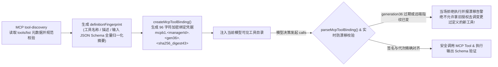
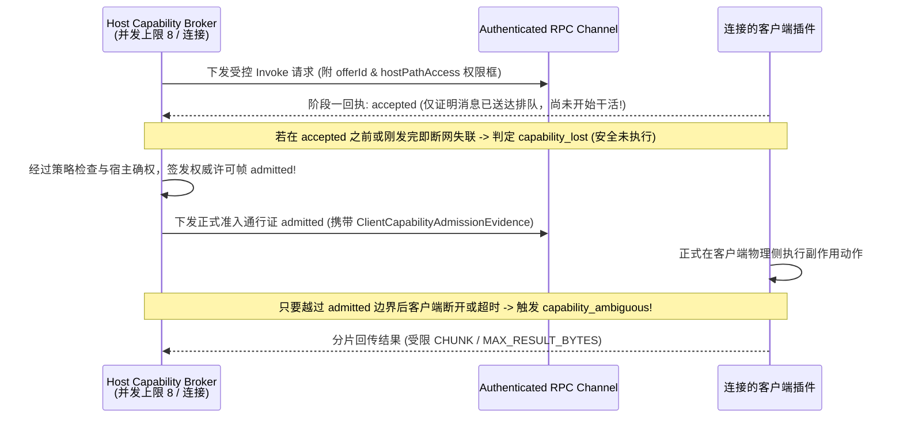

# MCP 加密防漂移与端侧两阶段准入：accepted 到 admitted 的权威切分

## 1. 外接协议工具的两大失控陷阱：远端契约漂移与端侧反向代理盲区

当微内核的扩展工具不再仅仅来自核心代码库写死的几个原生函数，而是来自以下两类动态边界时，常规的接口包装会瞬间失效：

1. **第三方 MCP（Model Context Protocol）服务端静默偷换工具定义**：某个远程或本地 MCP 服务在第 1 轮把工具 `update_record` 描述为只读查表并经过管理员审核允许进入可用名单；到了第 3 轮，远端静悄悄触发了一次服务端升级或恶意吐出参数 Schema 完全变形的同名工具——如果宿主只按裸字符串名 `"update_record"` 去路由发起调用，模型手里的调用意图和实际打向远端执行的参数格式当场错位甚至遭注入提权！
2. **反向端侧能力（Client Capabilities）断连生死盲区**：有时执行环境要求穿过网络反向请求客户端本机（比如让用户的桌面前端配合打开本地某项预览能力或表单扩展）。如果 Host 一发出 RPC 就当成“肯定跑成了”，一旦中间在浏览器关闭或断网瞬间失联，恢复层根本不知道客户端到底“仅仅收到消息还没来得及干活”还是“早已确认越过批准门禁开始改动状态了”！

Maka TypeScript 版分别在 `packages/mcp`（**加密工具绑定指纹 `mcpb1.*`**）与 `packages/runtime-host/src/server/client-capability-invocation-broker.ts`（**端侧代理 `accepted → admitted` 两阶段准入切分**）筑起严密防线。

---

## 2. 路线 A：MCP 服务发现、防漂移加密绑定（`mcpb1.`）与安全传输

观察 `packages/mcp/src/tool-binding.ts` 与 `transport-security.ts` / `tool-output-validation.ts` 的实现细节，Maka 为外部 MCP 工具确立了从“发现目录”到“每次真正调起”的整套鉴权铁链：



看看 `tool-binding.ts` 这几行代码所锚定的密码学精细度：
- **四元组防伪摘要封套**：每次 `createMcpToolBinding` 把 **`[managerId, connectionGeneration, serverId, toolName, definitionFingerprint]`** 序列化后过 SHA-256 生成 43 位 `base64url` 摘要，连同 `36 进制 connectionGeneration` 一并锁进长度上限 **`96` 字符**的紧致格式 **`mcpb1.<managerId>.<gen36>.<digest43>`** 里；
- **防连接重启换代偷渡**：哪怕远端重启连接后暴露出来的工具名称还叫同一个名字，只要 `connectionGeneration` 推进了一代或者工具参数结构悄悄改动了哪怕一个 `required` 属性，旧模型上下文里揣着的绑定串立刻通过正则和摘要核验原形毕露，彻底阻断“旧授权调新契约”的漂移漏洞；
- **独立输出边界验证与传输防线**：配合 `tool-output-validation.ts` 对远端吐回的数据严格执行负载检验与截断，以及 `transport-security.ts` 的传输层连接策略守护，使第三方 MCP 既进不来也出不去越权通道。

```typescript
// 教学级提炼自 packages/mcp/src/tool-binding.ts 的抗漂移绑定签名与运行时核验
function verifyAndDispatchMcpTool(bindingStr: string, currentLiveTool: DiscoveredMcpTool): void {
  // 1. 格式与最大字符防线校验：^mcpb1\.<22B-id>\.<gen36>\.<43B-sha256>$ (<= 96 chars)
  const parsed = parseMcpToolBinding(bindingStr);
  if (!parsed) throw new Error('Invalid or oversized MCP tool binding');

  // 2. 重建当下实时通道的期望指纹串并严格相等比对，阻断连接换代或远端 Schema 悄悄变形
  const expectedBinding = createMcpToolBinding({
    managerId: parsed.managerId,
    connectionGeneration: currentLiveTool.generation,
    serverId: currentLiveTool.serverId,
    toolName: currentLiveTool.name,
    definitionFingerprint: currentLiveTool.definitionFingerprint,
  });
  if (bindingStr !== expectedBinding) {
    throw new Error('MCP tool definition or generation drifted since binding was minted');
  }
}
```

### 2.1 外部扩展安全机制对比：裸工具名称路由 vs 双通道抗漂移治理

| 比较维度 | 常规框架裸名路由 (`callTool("update")`) | Maka MCP + Client Broker 治理 |
| :--- | :--- | :--- |
| **MCP 工具契约变动防御** | 远端悄悄新增高危参数或重连变更定义时依然照调不误 | **`mcpb1.` 四元组 SHA-256 指纹** + 代次比对，定义一变当场拒签 |
| **端侧反向调用断线判定** | 只要发了 RPC 就笼统报错“超时”，不知端侧到底动手没 | **`accepted → admitted`** 切分 `capability_lost`（零副作用）与 `capability_ambiguous`（锁死重试） |
| **单连接资源滥用防护** | 任由客户端无限开槽并发回调或返回几十 MB 垃圾 | 硬卡 `MAX_CONCURRENT = 8` 并发槽及 `CHUNK / MAX_RESULT_BYTES` 封顶 |

---

## 3. 路线 B：客户端反向能力的两阶段准入协议（`accepted → admitted`）

当工具动作无法在后端服务端独立完成，而必须借助宿主反过来向已建立长连接的客户端（`ClientConnection`）派发一次反向能力执行（如端侧表单提交或受控局部操作）时，`packages/runtime-host/src/server/client-capability-invocation-broker.ts` 实施了一项与工具 `T1/T2` 遥相呼应的两阶段切分契约：



审视 Broker 在实现层卡死的五条铁边界：
1. **并发槽位硬隔离与退役容量边界**：每条客户端连接最多同时承载 **`MAX_CONCURRENT_INVOCATIONS_PER_CONNECTION = 8`** 个反向并发调用（超载当场报错 `provider_overloaded`），并在内存中滚动维护最多 **`MAX_RETIRED_INVOCATIONS = 1_024`** 条已退役记录防历史表重放攻击。
2. **清楚切开“收到了请求（`accepted`）”和“允许动手了（`admitted`）”**：在传统设计里往往把客户端说的一声 `ACK` 就视作“在跑了”。但在 Maka 的协议里，`accepted` 纯粹是传输层排队的收据，**没有宿主后续显式签发 `ClientCapabilityAdmissionEvidence`（`admitted`），端侧绝不能擅自开动具有副作用的真实动作**！
3. **跨切点故障精确分类**：
   - 在正式进入 `admitted` 准入期前断开连接，调度器极其明确地报为 **`capability_lost`**——代表副作用 100% 未曾跨出安全门口；
   - 一旦已经放行跨越 **`admitted`** 边界之后才遭遇连接崩溃或超时，Broker 立刻报错 **`capability_ambiguous`** 并协同 `ToolOutcomeUnknownError`（详见 [04.1](../04-state/durable-execution.md)），绝对禁止自动化任务当成“肯定没发生过”去偷偷再点一次！
4. **回传荷载分片与上限钳制**：客户端回传的任何输出全数受限于 `CLIENT_CAPABILITY_RESULT_CHUNK_MAX_BYTES` 与 `CLIENT_CAPABILITY_MAX_RESULT_BYTES` 强制封顶，避免低质量第三方客户端用无限字节洪水直接拖垮 Host 进程内存。

---

## 4. 总结

无论扩展触手是伸向本地/云端的第三方 MCP Server，还是逆向调用通过网络连进来的桌面客户端插件，Maka TypeScript 版都用极具一致性的机制将“不可信外部边沿”驯服进了单一安全框内：
- 在 **MCP 侧**，凭借紧致的 `mcpb1.` 四元组 SHA-256 绑定串将连接换代和 Schema 偷偷漂移彻底锁死在执行门口；
- 在 **Client Capability 侧**，凭借严谨的 **`accepted → admitted` 两阶段切分**、8 并发背压与明确拆分 `capability_lost` / `capability_ambiguous` 错误态，让端侧反向调用在崩溃恢复模型上达到了与核心工具 `T1/T2` 完全同等严谨的确定性水准。

工具沙箱锁好了，MCP 防漂移也建起来了，但最关键的一根红线还没有完全揭开——**贯穿 Host 接入、工作区协同时代、OAuth 刷新、直到子进程拉起全过程的“多层访问控制与高敏密钥信封（Managed Secrets）”究竟是如何做到零明文滞留、零跨进程泄露的？** 下一篇全盘剖析这套五层防御与密库体制：[五层纵深防线与 Managed Secret 信封：零凭据泄漏的作用域动态注入](./permissions-and-secrets.md)。
