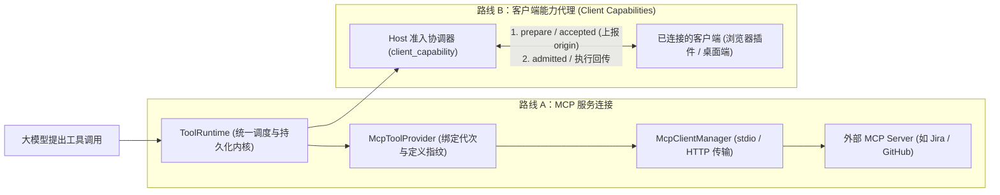
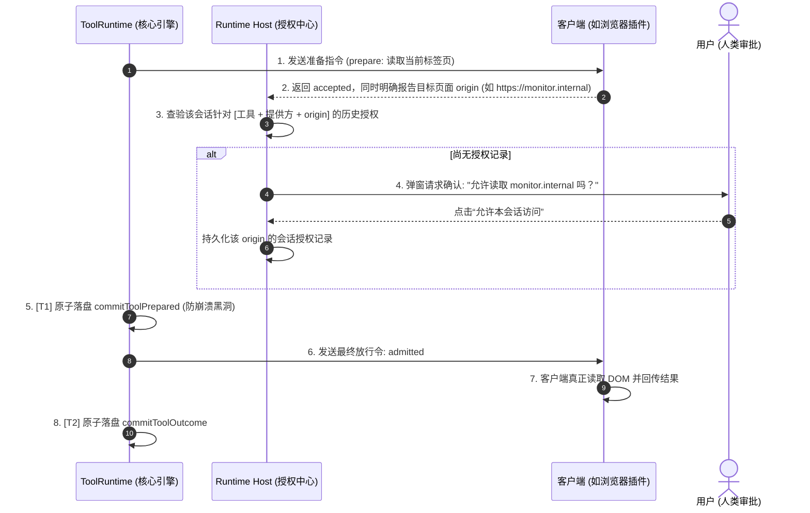

# MCP 连接与客户端能力代理

[返回手册目录](../README.md)

当用户在协作平台发出指令：“去公司工单系统查一下我的待办 Bug，顺便看看当前浏览器打开的监控页面有没有报错”。

这一个请求涉及了两类截然不同的外部工具：
1. **工单系统**：通常由独立的 **MCP（Model Context Protocol）服务** 提供，可能运行在远端 HTTP 接口上，也可能以本地标准输入输出（stdio）子进程运行。
2. **已登录的浏览器页面**：运行在用户本地的桌面客户端或浏览器插件中，它拥有用户个人的登录态（Cookies），运行在服务端或独立后台的 Host 进程**根本无法直接触碰**。

Maka 将这两条外部扩展路径统一收拢进 `ToolRuntime`，同时通过**连接绑定指纹**与**两阶段准入握手**，确保外部能力的接入既灵活又安全。

---

## 1. 概念先行：双路工具接入架构

无论是远端 MCP 服务还是前端浏览器能力，对上层的大模型循环（`AiSdkTurn`）而言，它们都表现为标准的工具定义。核心差异在于**工具的宿主位置与准入路径**：



---

## 2. 路线 A：MCP 服务的发现、绑定与代次校验

当 Host（或挂载在 CLI 侧的 MCP 管理器）连接上一个 MCP 服务（例如工单服务 `ticket-mcp`）时，并不是简单把工具名塞进列表就完事了。

### 2.1 分页发现与指纹绑定
1. **分页拉取**：`McpClientManager` 通过 MCP 标准的 `tools/list` 协议分页发现所有可用工具（如 `get_ticket`）。
2. **包装与身份绑定**：`buildMcpToolsWithIdentities()` 将每个外部工具包装成标准的 `MakaTool`。关键在于，它不仅记录暴露给模型的名字，还在底层绑定结构中固化了：**服务 ID（`serverId`）、原始工具名、当前连接代次（Connection Generation）以及工具定义的哈希指纹**。

### 2.2 为什么调用前必须核对连接代次与定义指纹？
想象一个隐蔽的故障场景：模型在第 1 步看到了旧版 `get_ticket` 的参数声明并决定调用它。在等待模型响应的几秒钟里，远端的 MCP 服务重启并重连了，新版服务修改了参数结构，甚至同名工具变成了另一个高危操作。

因此，`McpClientManager.callTool()` 在真正发送网络请求前，会执行严格的绑定核对：**只有当目前的连接代次和工具定义指纹与声明快照完全一致时，才允许转发参数；否则直接拒绝调用，让模型重新获取最新的工具清单。**

---

## 3. 路线 B：客户端能力的两阶段准入握手

让远端或独立的 Host 去驱动用户眼前的浏览器，最大的安全风险在于：**模型可能诱导浏览器访问恶意网址，或者在用户毫无察觉的情况下读取敏感后台页面。**

为此，所有以 `hostAdmission: 'client_capability'` 注册的能力，都必须经过严密的**`accepted → admitted` 两阶段准入协议**：



### 为什么需要把过程拆成 `accepted` 和 `admitted` 两步？
- **确认可执行性与真实上下文（`accepted`）**：在真正要求人类审批之前，必须先确认客户端当前确实在线、页面标签页存在，并且**由可信的客户端亲自上报目标页面的真实 `origin`**（防止模型在参数里欺骗路径）。
- **严格卡点持久化与授权（`admitted`）**：只有在人类批准、且工具准备记录 `[T1]` 安全写入数据库之后，Host 才下发 `admitted`。客户端遵循“不见 `admitted` 绝不动手”的铁律，彻底堵住了“人类还没同意或者数据库没记账，客户端就已经把网页操作完了”的漏洞。

### 细粒度的授权复用维度
不同的客户端能力有着不同的授权记忆维度，避免每次操作都频繁弹窗打扰用户：
- **浏览器能力**：按 `会话 ID + 能力提供方 + 页面 Origin` 记忆授权（同意读取 `github.com` 不代表同意读取公司内网财务系统）。
- **桌面 MCP 服务**：按 `服务 ID + 工具名` 记录授权。
- **GUI 自动化 (`computer_use`)**：按具体能力维度独立管控。

---

## 4. 教学伪代码：客户端能力代理的准入契约

```text
function executeClientCapability(call, clientChannel, turnContext):
    // 1. 阶段一：向客户端发起准备请求，获取不可伪造的运行时上下文 (如页面 origin)
    prepResponse = await clientChannel.sendPrepare({
        callId: call.id,
        capability: call.toolName,
        args: call.permissionArgs
    })

    if prepResponse.status != "accepted":
        return errorResult("Client declined or unavailable: " + prepResponse.reason)

    // 2. 授权检查：结合客户端上报的真实 origin 检查或请求用户批准
    grantScope = {
        sessionId: turnContext.sessionId,
        providerId: clientChannel.providerId,
        origin: prepResponse.observedOrigin // 必须采信客户端观察到的真实源，而非模型猜测
    }

    if not permissionStore.hasGrant(grantScope):
        approved = await hostUI.requestUserApproval(grantScope, call.permissionArgs)
        if not approved:
            return errorResult("User denied client capability access")
        permissionStore.saveGrant(grantScope)

    // 3. [T1] 获准后，在放行物理执行前落盘准备事实
    await commitSink.commitToolPrepared(call.operationId, call.id, call.persistedArgs)

    // 4. 阶段二：发送 admitted 放行执行并等待结果
    try:
        rawOutput = await clientChannel.sendAdmittedAndExecute(call.id, turnContext.abortSignal)
        await commitSink.commitToolOutcome(call.operationId, call.id, rawOutput)
        return rawOutput
    catch DisconnectError:
        // 客户端在 admitted 之后断线，必须标记结果未知
        throw new ToolOutcomeUnknownError("Client disconnected during capability execution")
```

---

## 5. 对照 Pi：扩展钩子集成 vs 托管准入协议

- **Pi 的做法 (`extensions/mcp`)**：Pi 读取 `mcp.json` 中的配置，将外部工具统一重命名为 `mcp__<server>__<tool>` 格式，通过 `pi.registerTool()` 直接注册进全局工具列表。执行时复用通用的 `beforeToolCall` 钩子进行拦截，直接发往当前连接。这种方案与单机扩展无缝融合，开发极为简便。
- **Maka 的做法**：面对多客户端连接、远端托管以及浏览器反向操作等复杂边界，Maka 在 MCP 层引入了**连接代次与定义指纹校验**，并在客户端能力层构建了 **`accepted -> admitted` 双向握手**，把安全核验权牢牢收拢在 Host 手中。

---

## 6. 延伸阅读

- 了解 `ToolRuntime` 如何统一处理这些工具的 T1/T2 持久化提交，阅读 [03.1 工具执行内核](tool-runtime.md)。
- 了解整个系统的用户认证、共享会话授权以及密钥管理体系，阅读 [03.4 分层授权与凭据生命周期](permissions-and-secrets.md)。
