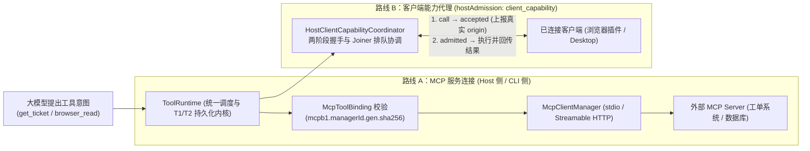
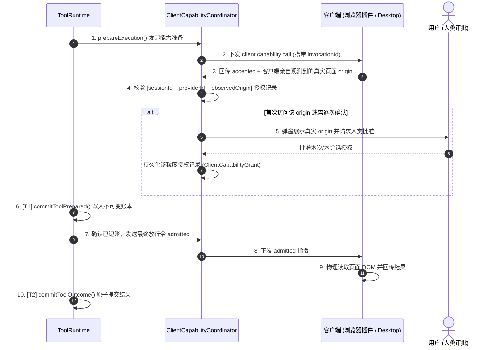

# MCP 连接与客户端能力代理

[返回手册目录](../README.md)

当用户在协同会话中发出指令：“去公司内部的 Jira MCP 服务查一下最新工单，再读取我当前打开的浏览器标签页里的生产监控报警面板，整理一份汇总。”

这一句需求直接触及了 Agent 基础设施中**两类位置完全不同的外部工具**：
1. **MCP 工具（Model Context Protocol）**：驻留在外部 MCP 服务进程或远端 HTTP 接口中（可挂载在 Runtime Host 侧，也可挂载在用户的 CLI 客户端侧）。
2. **客户端能力（Client Capabilities）**：运行在用户本地桌面客户端或浏览器插件中（如读取已登录的内网网页、控制桌面视图）。这些数据带有用户的个人登录态（Cookies），服务端或后台进程**根本无法直接访问**。

如果把这两类工具简单包装成普通异步函数，系统很快就会撞上三大安全与一致性漏洞：**MCP 服务重连后工具参数悄悄漂移导致错调、浏览器未获用户同意就提前操作页面、以及两个请求同时抢占同一个客户端能力时如何正确取消。** 本章深度剖析 Maka 如何通过加密绑定令牌（`mcpb1`）与两阶段准入握手协议化解这些难题。

---

## 1. 概念先行：双路扩展工具的统一收敛

无论是远端 MCP 服务还是用户眼前的浏览器扩展，在上层大模型循环（`AiSdkTurn`）看来，它们都表现为标准的 `MakaTool` 声明。真正的工程差异在于**发现时机、绑定校验与物理执行落点**：



---

## 2. 路线 A：MCP 服务发现、加密绑定与防漂移机制

### 2.1 分页发现与连接快照
当 Host 或 CLI 的 `McpClientManager` 连接上一台 MCP Server（如工单服务）时，会通过标准 `tools/list` 协议进行分页发现（处理可能存在数百个工具的大型服务），并通过 `createToolSnapshot()` 记录当前的连接快照与工具清单。

`buildMcpToolsWithIdentities()` 随后将每个 MCP 工具包装成标准的 `MakaTool`。但与普通扩展不同的是，它并不是只保存字符串名称，而是通过 `createMcpToolBinding()` 为每个暴露给模型的工具生成一条**密码学绑定令牌（`mcpb1`）**：

```text
mcpb1.<managerId>.<base36(connectionGeneration)>.<sha256_base64url(identityTuple)>
```

其中摘要部分绑定了五个不可伪造的维度：
1. `managerId`（22 位标识，区分该工具属于哪个连接管理器实例，如 Host 还是某个特定 CLI）。
2. `connectionGeneration`（连接代次，每次重连或重启递增）。
3. `serverId`（目标 MCP 服务器 ID）。
4. `toolName`（原始工具名称，如 `get_ticket`）。
5. `definitionFingerprint`（工具声明与参数 Schema 的 SHA-256 指纹）。

### 2.2 为什么调用前必须核对“连接代次 + 定义指纹”？
设想一个真实生产事故场景：
- 第 1 步模型看到了工单服务 v1 的 `update_ticket(id, status)` 参数定义并决定调用。
- 就在模型生成文本的 3 秒钟内，远端 MCP 服务热重启升级到了 v2，连接自动重连（`connectionGeneration` 递增），且 v2 删掉了保护字段或改变了参数语义！
- 如果运行时直接拿着工具名去发请求，模型可能会在毫不知情的情况下发出结构错位的危险写入。

凭借 `mcpb1` 令牌，`McpClientManager.callTool()` 在发送网络请求前的瞬间执行原子校验：解析令牌中的 `managerId` 与 `connectionGeneration`，再比对当前生效工具的 `definitionFingerprint`。**只要连接发生过代次切换或工具 Schema 发生过一丝漂移，调用立即拒绝并提示模型刷新工具视图，彻底消灭跨代错调。**

### 2.3 CLI 侧 MCP 的反向代理模式
并非所有 MCP 服务都跑在 Runtime Host 所在机器上。当用户在本地终端启动 `maka` 并配置了依赖本机私有环境的本地 `stdio` MCP 工具时，CLI 的 `RuntimeHostRunMcp.prepare()` 会在 CLI 本地拉起 MCP 连接，然后通过客户端能力协议反向向 Host 发布这组工具：
- 模型推理仍在 Host 驱动；
- 获准执行时，Host 将调用指令路由回发起连接的 CLI；
- 由 CLI 本地的 `McpClientManager` 通过本地管道完成调用并将结构化文本、图片或 JSON 结果安全代理回 Host。

---

## 3. 路线 B：客户端能力的两阶段准入握手（`accepted → admitted`）

将远端或后台 Host 的控制权延伸到用户的桌面或浏览器标签页，面临着极高的安全风险：**如果模型在参数中声称“我要读取监控页”，实际在客户端打开的却是一个内网财务系统或邮箱页面，该如何拦截？**

为此，所有标记为 `hostAdmission: 'client_capability'` 的工具都必须经过 **`accepted → admitted` 两阶段准入协议**：



### 3.1 为什么“必须由客户端上报 `origin`”且“不见 `admitted` 绝不动手”？
1. **拒绝模型自报来源**：大模型输入的 URL 参数可能是短链接跳转（如 `t.co/xxx`），也可能是经过 Prompt Injection 诱导的伪造描述。因此 Host **绝不采信模型在参数里写的目标地址**，而是要求客户端在准备阶段先定位目标标签页，在 `accepted` 帧中上报浏览器实际渲染的真实 `origin`（如 `https://finance.corp.internal`）。
2. **先记账后放行**：如果客户端一收到调用就开始执行，万一此时用户拒绝授权或者 Host 在写 `[T1]` 账本前崩溃，浏览器就已经发生了不可逆动作。将流程拆为 `accepted`（就绪报告）→ 人类授权 → `[T1]` 落盘 → `admitted`（正式放行），确保了**未授权绝不越界、未记账绝不触发物理副作用**。

### 3.2 精细的授权作用域隔离与 Owner/Joiner 并发取消
Maka 根据能力风险特征切分了不同的授权记忆主键，避免过度弹窗或权限泛滥：

| 能力类别 | 授权持久化作用域 | 安全性设计目的 |
| :--- | :--- | :--- |
| **浏览器能力** | `sessionId + providerId + origin` | 批准读取 GitHub 页面后，访问公司内网后台依然必须重新审批。 |
| **桌面原生 MCP** | `sessionId + serverId + toolName` | 按具体服务和特定工具名隔离，只读工具与写入工具分开授权。 |
| **桌面自动化 (`computer_use`)** | `sessionId + capability` | 按全局/独立桌面能力粒度管控，防止后台静默夺取键鼠控制权。 |

此外，在多人或并发多标签访问同一能力提供方时，协调器区分了 **Managed Approval Owner（正在主导等待审批的请求）** 与 **Joiner（等待同一授权决策的并发请求）**：当外部触发取消信号时，协调器能够按规范的提供方身份（`clientCapabilityProviderId`）同步干净地取消 Owner 与所有 Joiner，不遗留悬空挂起。

---

## 4. 教学伪代码：MCP 绑定防漂移校验与客户端能力握手

```text
// === 1. MCP 工具绑定验证 (防重连代次漂移与 Schema 篡改) ===
function invokeBoundMcpTool(manager, opaqueBinding, args):
    parsed = parseMcpToolBinding(opaqueBinding)
    if parsed == null:
        throw new InvalidBindingError("Malformed mcpb1 binding token")

    // 校验连接管理器身份与连接代次是否仍匹配当前激活实例
    if parsed.managerId != manager.id or parsed.connectionGeneration != manager.currentGeneration:
        throw new StaleToolBindingError("MCP server reconnected; refresh tool snapshot")

    // 重新计算当前工具定义指纹并比对全量令牌
    liveTool = manager.findActiveToolByBinding(opaqueBinding)
    if liveTool == null or createMcpToolBinding(liveTool.identity) != opaqueBinding:
        throw new SchemaDriftError("MCP tool schema changed since model saw it")

    return await manager.executeRemoteCall(liveTool.serverId, liveTool.toolName, args)

// === 2. 客户端能力两阶段握手与 T1 落盘门控 ===
async function runClientCapabilityWithAdmission(toolRuntime, call, channel, sessionCtx):
    invocationId = generateUUID()

    // 阶段 1: 发送调用意图，等待客户端回传 accepted 并附带不可伪造的真实 origin
    prep = await channel.requestPrepare(invocationId, call.toolName, call.permissionArgs)
    if prep.status != "accepted":
        return errorResult("Client capability rejected preparation: " + prep.reason)

    // 阶段 2: 依据真实 origin 核验会话授权 (未授权则挂起等待人类审批)
    grantKey = {
        sessionId: sessionCtx.sessionId,
        providerId: channel.canonicalProviderId,
        origin: prep.observedOrigin
    }
    if not grantStore.hasValidGrant(grantKey):
        decision = await interactionCoordinator.requestApproval(grantKey, call.permissionArgs, sessionCtx.signal)
        if not decision.approved:
            return errorResult("User denied access to origin: " + prep.observedOrigin)
        grantStore.recordGrant(grantKey, decision.scope)

    // 阶段 3: [T1] 原子锚定派发事实，封堵崩溃窗口
    await toolRuntime.commitToolPrepared(call.operationId, call.id, call.persistedArgs)

    // 阶段 4: 下发 admitted 正式放行并等待客户端执行回传
    try:
        output = await channel.sendAdmittedAndAwaitResult(invocationId, sessionCtx.signal)
        await toolRuntime.commitToolOutcome(call.operationId, call.id, output)
        return output
    catch ChannelDisconnectedError:
        // 已发出 admitted 但客户端失联：绝不假装未执行，标记为结果未知
        throw new ToolOutcomeUnknownError("Client disconnected after admitted")
```

---

## 5. 对照 Pi：轻量扩展注册 vs 托管准入协议

| 对比维度 | Maka (`McpClientManager` + `ClientCapabilityCoordinator`) | Pi (`extensions/mcp`) |
| :--- | :--- | :--- |
| **MCP 发现与命名** | 生成包含管理端 ID、代次与 Schema 指纹的加密令牌 `mcpb1`，调用瞬间强校验防漂移。 | 解析 `mcp.json` 将工具注册为 `mcp__<server>__<tool>`，通过 `pi.registerTool()` 接入管道。 |
| **客户端反向能力** | 拥有完整的 `accepted → admitted` 两阶段握手、真实 `origin` 上报与多粒度持久化授权表。 | 单机 CLI 进程直接运行本地扩展逻辑，通过 `beforeToolCall` 钩子同步或内存弹窗拦截。 |
| **跨端隔离能力** | 支持 CLI 本地挂载私有 stdio MCP 并通过 Host 能力协议安全反向代理给桌面端会话使用。 | 扩展与主进程共享同一个本地环境与进程生命周期。 |

---

## 6. 延伸阅读

- 了解 `ToolRuntime` 如何配合两阶段握手完成 T1/T2 持久化与 Code Mode 嵌套执行，阅读 [03.1 工具内核与 Code Mode](tool-runtime.md)。
- 了解系统如何通过独立子进程安全接管桌面 GUI 与交互式 PTY 终端，阅读 [03.3 桌面自动化与 PTY 虚拟终端](computer-use-and-pty.md)。
- 了解连接认证与五层权限防线如何保护 Host 与客户端通道，阅读 [03.5 分层授权与凭据生命期](permissions-and-secrets.md)。
