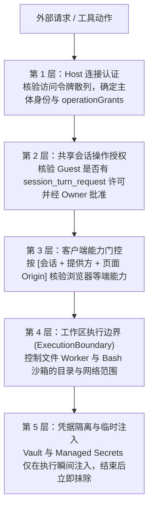

# 分层授权与凭据生命周期

[返回手册目录](../README.md)

设想一个团队协作场景：同事通过共享会话向你的工作区发送一条指令——**“帮我查询浏览器里已登录的工单系统，并生成一份修复报告写入项目目录”**。

在这条短短的指令背后，潜藏着四个不同层级的安全风险：
1. **身份伪造**：向 Host 发起请求的人，真的有权操作这个工作区吗？一个仅被邀请旁观的访客（Guest）能随便启动高成本的模型运行吗？
2. **越权浏览**：浏览器工具如果被诱导访问了财务后台而不是工单系统，怎么办？
3. **文件越界**：模型在写报告时，试图覆写工作区之外的系统配置，怎么拦？
4. **密钥泄漏**：模型调用 API Key、连接 MCP 的 OAuth Token、或者部署脚本所需的云端 Secret，如果直接塞进环境变量或 Prompt 上下文，模型一旦执行 `env` 命令或打印日志，密钥就会瞬间泄漏！

Maka 通过**纵深防御（Defense in Depth）**构建了五层互不替代的权限与凭据防线。本章全面拆解这套安全体系的设计原理与实现机制。

---

## 1. 概念先行：五层纵深防御模型

在设计安全架构时，一个常见误区是把“用户登录认证”、“工具执行权限”和“密钥管理”混为一谈。Maka 严格遵循**最小权限原则（Principle of Least Privilege）**，将安全核验拆解为自外向内的五道关卡：



---

## 2. 访问控制：从连接认证到会话边界

### 2.1 第 1~2 层：Host 认证与共享会话准入
任何客户端（CLI、Desktop、Web 或协作同事的端）接入 Runtime Host 时，都必须通过访问权威（`FileRuntimeHostAccessAuthority`）的核验：
1. **连接认证**：系统核对传入凭证的加密散列，解析出调用主体（Principal）以及允许调用的协议操作清单（`operationGrants`）。并非所有连接都能执行高危操作（如修改系统策略）。
2. **操作授权**：协议分发器针对具体 RPC 操作校验许可。
3. **访客协同（Guest 授权）**：如果同事以 `session_guest` 身份向你的会话提交了一条运行请求，Host 会检查该会话的 `session_turn_request` 授权，并在需要时由会话所有者（Owner）点击批准，之后才会放入执行准入队列。

### 2.2 第 3~4 层：工具执行时的动态门控
请求进入运行时后，不同性质的工具走各自独立的授权通道：
- **浏览器等客户端能力**：由 `ToolRuntime` 协同客户端完成 `accepted → admitted` 握手。Host 结合**会话 ID + 能力提供方 + 真实页面 `origin`** 查找已有授权记录；若首次访问该域名，弹窗等待人类批准并可选择记忆本次会话的同源授权。
- **本地文件与命令操作**：执行器读取会话当前的 `ExecutionBoundary`（如 `ask` 模式下的 `workspace-write` 边界）。若需要写入范围外的路径，必须发起边界扩张审批，批准后生成带有新版本号的 `ExecutionBoundary` 并持久化。

---

## 3. 凭据生命周期：物理隔离与按需注入

**高敏凭据永远不能作为普通文本进入模型上下文，也不应该裸露在常驻环境变量中。** Maka 按凭据的使用场景，将其严密隔离在不同的加密存储介质与注入管道中：

| 凭据类型 | 典型用途 | 存储载体 | 注入方式与生命周期 |
| :--- | :--- | :--- | :--- |
| **Host 访问凭据** | 客户端连入 Runtime Host 的身份鉴权 | `runtime-host-access.json` | 仅存储散列值与授权清单，用于连接握手阶段校验，永不进入模型层。 |
| **模型连接凭据** | 调用 OpenAI / Anthropic 等模型的 API Key 或 OAuth | `credential-vault.json` | 由 Runtime Policy 按 `connectionId` 定位；通过 `modelFactory` 闭包或 OAuth 请求拦截器在发包瞬间注入 HTTP 头。 |
| **MCP 服务凭据** | 连接外部 MCP 服务的 OAuth Token | `credentials.json` | 按 `mcp:<serverId>` 隔离保存；仅由对应的 MCP 传输连接器按需读取与刷新。 |
| **托管运行时密钥**<br>(`Managed Secret`) | 自动化脚本或云端激活任务所需的私有密钥 | 加密文件后端 (`AES-256-GCM`) | 仅保存 `secretId` 引用；由注入器在任务激活时临时注入环境，结束时立刻 `release()` 恢复原值。 |

### 关键机制：Managed Secret 的临时注入与清理 (`prepare` & `release`)
对于必须在命令行或自动化执行器中使用的业务密钥（例如部署脚本需要的第三方 Token），Maka 采用了严谨的**作用域生命周期注入（`ActivationSecretInjector`）**：
1. **先授权、用引用**：配置中只写明 `secretId`，调用方必须先为指定的执行会话显式授权该密钥。
2. **使用 AES-256-GCM 加密落盘**：底层文件存储通过独立的 `keyProvider` 进行对称加密保护。
3. **激活期注入与 `finally` 擦除**：任务启动瞬间，注入器调用 `prepare()` 批量解密并写入本次启动的隔离环境对象中；**无论执行成功、失败还是超时取消，收尾阶段必定调用 `release()` 将环境恢复原值并清理内存引用**，把密钥暴露的时间窗口压缩到极致。

---

## 4. 教学伪代码：分层拦截与密钥作用域注入

以下伪代码展示了在一个完整的托管执行请求中，认证、边界校验与密钥注入是如何严丝合缝地协同的：

```text
// === 1. Host 接入与会话准入防线 ===
function handleIncomingRpc(request, authToken):
    principal = accessAuthority.authenticate(authToken)
    if principal == null:
        throw new UnauthorizedError("Invalid host token")

    if not accessAuthority.hasOperationGrant(principal, request.operation):
        throw new ForbiddenError("Operation not permitted for principal")

    if principal.role == "session_guest":
        if not await ownerApproval.verifyGuestTurnRequest(request.sessionId, principal):
            throw new ForbiddenError("Session owner declined guest request")

    return runtimeKernel.dispatch(request)

// === 2. 激活期托管密钥的安全注入与释放 ===
function runWithManagedSecrets(activationContext, secretIds, executionFn):
    // 校验该会话是否已被授权使用这些 secretId
    assert secretPolicy.isAuthorizedForSession(activationContext.sessionId, secretIds)

    // 批量解密并注入临时环境快照 (底层采用 AES-256-GCM)
    envGuard = await secretInjector.prepare(activationContext.env, secretIds)
    try:
        return await executionFn(envGuard.isolatedEnv)
    finally:
        // 铁律：无论成功还是崩溃抛出异常，必须立刻还原环境并抹除临时密钥引用
        await envGuard.release()
```

---

## 5. 对照 Pi：单机信任模型 vs 多主体分层管控

- **Pi 的做法**：作为面向开发者的单机编码工具，Pi 通过 `AuthStorage` 统一管理模型供应商的密钥；在加载项目级配置文件与自定义扩展时，通过 `resolveProjectTrusted()` 核验用户是否信任当前项目目录，防止打开恶意仓库时自动执行隐患代码；具体的工具审批则交给用户自定义的 `tool_call` 拦截扩展（如 `permission-gate` 示例）处理。
- **Maka 的做法**：由于 Maka 面向多客户端连接、团队协同（Guest 介入）、浏览器控制和后台常驻服务，单靠“项目信任开关”已不足以覆盖风险。因此 Maka 建立了从 Host 接入、Origin 域授权、文件 Worker 边界收窄到 AES 加密托管密钥的完整企业级纵深防线。

---

## 6. 延伸阅读

- 了解第 4 层执行边界如何在 Linux / macOS / Windows 操作系统沙箱中物理落地，阅读 [03.3 执行环境与操作系统沙箱](sandbox.md)。
- 了解第 3 层客户端能力代理（如浏览器操作）是如何通过 `accepted -> admitted` 握手完成审批的，阅读 [03.2 MCP 连接与客户端能力](mcp-and-client-capabilities.md)。
