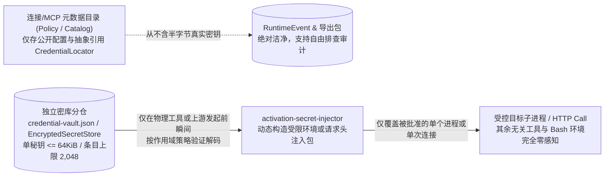

# 五层纵深防线与 Managed Secret 信封：零凭据泄漏的作用域动态注入

## 1. 为什么在本地 Agent 系统里“把密钥存在配置文件 `.env` 里然后用变量传给 Shell”迟早会泄露？

绝大多数开源助手对密钥管理采取非常朴素的“透明环境变量模式”：用户把 GitHub Token、云 API Key 或私有数据源密文配进全局设置文件（甚至直接挂进启动 Shell 的环境变量里）。一旦开始让大模型自主跑测试命令、写辅助脚本或接入多方协同，这套单薄做法会在三个地方瞬间失守：

1. **环境变量全域透穿（Env Leak via `Bash`）**：如果把所有第三方服务的 API Key 一股脑塞在 Node 主进程 `process.env` 里，大模型随便跑一句 `env` 或者一个第三方 NPM 安装脚本里的测试钩子，就能把你的全套密钥一口气打包打印进上下文甚至外发出去！
2. **配置文件与日志回传暴露**：密钥若和普通模型路由配置、MCP 连接元数据存进同一张明文 JSON 表里，一旦导入导出工作区（Session Bundle）或收集用户排障诊断报告，高危密文随时连带曝光。
3. **跨客户端/多协作者认证欺诈**：当多台本地客户端或临时加入的协作者连接到同一个 Host 时，如果没有严格的恒定时间凭据比对、独立身份散列与单次会话受控邀请机制，就无法防止协作者越界冒用高权操作。

Maka TypeScript 版通过**五层纵深防御架构**、**物理隔离密库（`SecretStore`）**以及 **作用域精确叠加的 `Managed Secret` 加密信封与瞬时激活注入机制**，让高敏凭据在整个系统里做到“平时看不见、落盘加密锁死、执行瞬间按最小作用域投递、事后毫不残留”。

---

## 2. 纵深安全五道环：接入层与执行层的正交解耦

在 Maka 的安全模型里，授权与秘密控制绝不止存在于某单个拦截函数上，而是贯穿从网络端到物理命令行的五个隔离环：

| 安全防御层级 | 核心守卫模块 | 防护目标与核心不变量 |
| :--- | :--- | :--- |
| **第 1 环：Host 入口接入身份认证** | `packages/runtime-host/src/server/access-authority.ts` | 客户端接入凭据在持久化账本仅留存不可逆密码学散列（`runtimeHostAccessCredentialHash`），比对强制使用恒定时间 `timingSafeEqual` 免疫时序侧信道；支持无中断双版本并发密钥轮换（Prepare -> Finalize -> Revoke） |
| **第 2 环：协同访客细粒度准入** | `SessionCollaborationGrant` & `CollaborationTurnRequest` | 多方协作采用显式邀请码（`encodeCollaborationInvitationCode`）与按会话/回合粒度审批裁决，随时可单独吊销某位协作者（`CollaborationPrincipalRevoke`）而不断宿主服务 |
| **第 3 环：策略审批与模式天花板** | `CollaborationMode` / `SandboxBoundary` / `interaction-coordinator` | 控制某轮次处于只读讨论、计划模式还是高危放行边界，任何外部工具突破预设轮廓必须暂停等待宿主确认回执 |
| **第 4 环：操作系统沙箱与句柄隔离** | `filesystem-worker` / Seatbelt / `bwrap` / Win32 Task Launcher | 把实际指令与文件动作限制在经二次收窄的最小目录网以及防 TOCTOU `(dev, ino)` 描述符之中，与宿主权限彻底脱离 |
| **第 5 环：凭据物理密库与动态按需注入** | `credential-vault-document.ts` / `managed-secret-store.ts` / `activation-secret-injector.ts` | 将真正的密码正文死死锁在隔离加密存储区内，禁止流经 LLM 上下文、模型目录投影与普通运行日志 |

---

## 3. 访问凭据隔离：把秘密彻底请出配置文件和对话脊柱

查看 `packages/storage/src/runtime-policy/credential-vault-document.ts` 与 `encrypted-file-managed-secret-store.ts`，Maka 对待“配置描述”和“真实密钥正文”执行了绝对的物理分仓治理：

这一双仓隔离架构直接收紧了多处日常研发最容易疏漏的后门：
- **严格配额防撑爆与版本锁死**：独立密库设定明确的 Schema 边界（`SCHEMA_VERSION = 1`、`MAX_SECRET_LENGTH = 64 * 1024`、`MAX_VAULT_ENTRIES = 2_048`、`VAULT_DOCUMENT_MAX_BYTES`），读写通过原子版本检查避免并发更新丢失；
- **会话导出免疫泄露**：哪怕用户打包导出整份工作区迁移文档（`Session Bundle`）或导出全套脱敏运行追踪供外部协助定位 Bug，因为整个事件流与目录仅保有惰性的 **`CredentialLocator`** 定位标记而没有一行明文秘钥正文，打包产物天生绝对安全。

---

## 4. `Managed Secret` 加密信封与精确作用域动态激活注入

即使在执行第三方 MCP 服务器或者专属授权外部工具真的必须把密钥交给某个子进程或 HTTP 头部的那几百毫秒里，Maka 也绝不选择“放进宿主全局 `process.env` 顺便让它继承下去”的做法，而是依靠 **`packages/core/src/mcp-secrets.ts`** 联合 **`activation-secret-injector.ts`** 实现按需信封注入（Scoped Secret Envelope Injection）：

1. **绑定具体归属目标的作用域信封**：每一枚受管机密均绑定严谨的作用域定义（它只属于哪一个配置好的 MCP Server 实例、哪一条指定目标域，或者哪一个被许可激活的插件组合）。没有对应身份绑定的工具即使知道名字也绝对调不到这笔密码；
2. **仅在启动与授权期“现解现注，用完即消”**：只有经过核心审批并确定即将启动该目标连接或服务进程瞬间，注入器才根据本次运行授权范围精准解封对应的环境变量映射键值对，仅附加到那一个目标进程的隔离 `env` 字典里——旁路同机在跑的 `Bash`、其它不相关 MCP 插件乃至模型自身的代码单元根本读不到半点风声；
3. **协同输出脱敏红线（`display-redaction.ts`）**：配合运行期核心模块 `packages/core/src/display-redaction.ts`，即便万一某个粗糙第三方工具一不小心把刚拿到的注入字符串回显进了错误诊断堆栈或终端报错文本，在文本进入持久化投影和前端渲染之前也会经过明确脱敏清洗护栏。

---

## 5. 总结

安全架构往往考验团队对“便利诱惑”的抵制能力。Maka TypeScript 版在权限与凭据体系上的每一处设计都精准命中核心痛点：
1. **入口身份安全闭环**：`access-authority` 采用密码学不可逆散列、`timingSafeEqual` 比对与双代并发轮换（Prepare/Finalize/Revoke），把远程/本地控制入口锁得严严实实；
2. **数据仓库物理撕裂**：连接清单和事件流永不接触高敏密文（只留惰性 `CredentialLocator`），秘钥单独栖身于受配额约束的加密分仓；
3. **动态最小作用域激活注入**：打破 Node `process.env` 全局透传陷阱，凭借 `Managed Secret` 信封实现只有受权目标工具能在启动瞬间按最小边界拿到自己那一份密钥。

至此，**03 工具执行、OS 沙箱与安全纵深篇（5 篇）** 已全数完成重铸！当我们把视野进一步放大，从单步工具和安全边框走向跨越重启断电的持久化一致性恢复、原生 Rust `gitoxide` 检查点提交和跨设备 Peer Mesh 时，系统在面对进程突毙后的残局到底如何精确裁决每一条线索？下一篇正式揭开持久化存储与故障恢复核心引擎——[P0–P4 崩溃窗口治理与原子续接：T1/T2 密封、`outcome_unknown` 与账本自愈](../04-state/durable-execution.md)。
