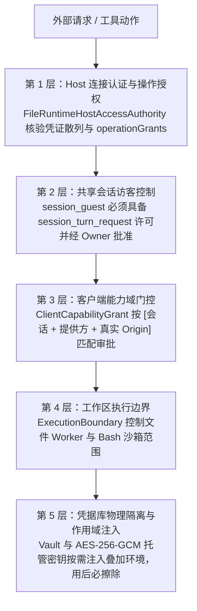
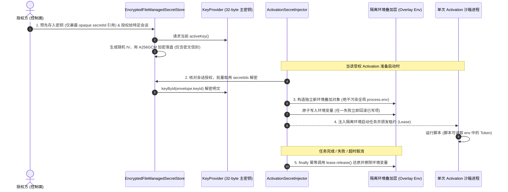

# 分层授权与凭据生命期

[返回手册目录](../README.md)

想象一个多人协作场景：同事通过共享会话向你的工作区发送了一条任务——**“帮我查询浏览器里已登录的工单后台，根据异常栈修好项目配置，最后用部署密钥执行一次验证脚本。”**

这条指令穿越了系统内多个安全边界：
1. **接入主体身份**：发请求的是会话所有者（Owner）还是受邀旁观的访客（Guest）？他的连接凭证是否被吊销过？
2. **共享操作许可**：访客能不能直接绕过所有者消耗算力、修改本地工作区？
3. **浏览器与端能力域隔离**：模型打开的浏览器标签页属于哪个域名 Origin？有没有授权访问公司内网后台？
4. **本地文件沙箱边界**：修改配置是否越出了工作区安全边界？
5. **高敏密钥生命周期**：大模型 API Key、MCP OAuth Token 以及部署脚本需要的业务密钥，如何做到**“能被程序或工具合法使用，却绝不被大模型通过 `env` 或读取日志窃取”**？

Maka 建立了一套互不替代的**五层纵深防御（Defense in Depth）体系**。本章全面拆解各层授权门控与四类凭据的物理隔离机制。

---

## 1. 概念先行：五层纵深防御模型

在 Agent 系统中，“身份认证通过”绝不等于“有权调用所有工具”，而“获准运行工具”也绝不等于“可以读取全局环境变量里的密钥”。Maka 沿请求自外向内的推进路径，设置了五道独立防线：



---

## 2. 访问控制：从 Host 接入到共享会话协同

### 2.1 第 1 层：Host 接入认证与 `operationGrants`
所有外部接入端（CLI、Desktop、Web 控制台、协作 Guest、外部评测引擎）连接 Runtime Host 时，均由 `FileRuntimeHostAccessAuthority.authenticate()` 基于持久化的 `runtime-host-access.json` 校验访问凭据：
- **抗计时攻击比对**：底层存储凭据的不可逆密码学散列（`runtimeHostAccessCredentialHash`），并使用常量时间比对（`timingSafeEqual`）验证令牌。
- **最小操作集授予**：认证通过后解析出主体（Principal）及其携带的 `operationGrants` 集合。随后 `authorizeRuntimeHostOperation()` 对每一条 RPC 指令（如更改全局配置、轮换密钥、查看诊断等）逐一鉴权。此外，系统内置了**凭证轮换与原子吊销机制**，可安全吊销某个连接主体而保留其他健康连接。

### 2.2 第 2 层：多人协同与 `session_guest` 准入门控
当团队成员受邀接入同一个共享会话时，访客被赋予受限的 `SESSION_GUEST_OPERATION_GRANTS` 权限集：
- 访客虽然能查看会话进度投影，但**无权擅自更改系统模型配置或扩大沙箱边界**；
- 当访客提交一条运行指令（`CollaborationTurnRequest`）时，Host 核对该会话的 `session_turn_request` 授权，挂起并推送给会话所有者（Owner）决定批准或拒绝；只有 Owner 明确确认后，该指令才被放入会话执行准入队列。

### 2.3 第 3~4 层：客户端能力与文件边界门控
请求正式进入运行时后，不同性质的副作用分别在各自门控处接受复核：
- **客户端能力门控**：如读取已登录网页，必须走 `accepted → admitted` 两阶段握手，结合**会话 ID + 能力提供方身份 + 客户端实际观测的页面 Origin** 三元组查表授权，严防模型利用 URL 重定向跨站窃取内网数据。
- **文件与命令沙箱门控**：`Write / Bash` 严格受限于当前会话版本号的 `ExecutionBoundary`（如 `workspace-write`），任何越界访问均需提交结构化 `SandboxBoundaryExpansion` 经用户审批并生成新版边界才可放行。

---

## 3. 凭据物理隔离：四类存储载体与边界划定

**Agent 安全的核心铁律：任何敏感凭据绝不写入 `Session` 会话表、绝不进入 `RuntimeEvent` 历史账本，且绝不暴露在 Host 主进程的全局 `process.env` 中。**

Maka 按凭据属性与消费者类型，将其严密隔离在四个互不连通的存储边界内：

| 存储载体 | 适用范围 | 保存内容与加密形态 | 为什么必须物理隔离？ |
| :--- | :--- | :--- | :--- |
| **`runtime-host-access.json`** | Host 连接接入鉴权 | 访问凭据散列值、主体身份、操作授予集与待交付凭据状态。 | 仅用于连接边界认证，模型与扩展插件完全不可见。 |
| **`credential-vault.json`** | 大模型供应商连接 | Runtime Policy 管理的各连接 API Key、OAuth 令牌与自定义请求头。 | 模型切换与凭证轮换由 Policy 层掌控，与会话历史解耦；通过 `modelFactory` 或 OAuth 请求拦截器在发包瞬间按需注入。 |
| **`credentials.json`** | 外部 MCP 服务连接 | 按 `mcp:<serverId>` 键控隔离的第三方 MCP 服务 OAuth 凭据。 | 防止 A 服务的令牌被 B 服务或内置工具读取。 |
| **`managed-secrets.json`**<br>(`controlPlaneRoot`) | 沙箱脚本 / 云端任务密钥 | **AES-256-GCM（`A256GCM`）加密信封**（含 `keyId`, `iv`, `ciphertext`, `tag`），主密钥由外部 `keyProvider` 持有。 | 刻意存放在**会话可移植状态之外的控制面根目录**（确保导出 Session Bundle 迁移分享时绝不意外带上密钥！）。 |

---

## 4. 关键机制：Managed Secret 的加密信封与作用域叠加注入

假设用户运行一个自动化部署或测试任务，要求脚本读取一个第三方 API Token，但又不希望这个 Token 常驻在宿主环境里让无关的工具或模型读到。

Maka 的 **`EncryptedFileManagedSecretStore`** 与 **`ActivationSecretInjector`** 构成了一套极具安全深度的生命周期管理闭环：



### 4.1 为什么采用“独立环境叠加层 + 原子回滚租约”？
1. **防范并发 Activation 横向窃听**：如果在 Node.js 进程全局的 `process.env` 上直接设置密钥，同一时间跑在同一个进程下的其他未授权任务或插件就能顺手读取 `process.env` 窃取密钥！因此，`ActivationEnvironmentSecretSink` 强制要求传入为当次激活专门构造的**全新独立环境对象（Overlay）**，确保并发任务之间绝对隔离。
2. **全批原子性（All-or-Nothing）**：注入多个环境变量时，如果在第 3 个变量格式化失败，注入器立即按照 `previous` 快照逆序还原前 2 个已注入变量，保证不会留下残缺环境。
3. **可重试的幂等 `release()` 租约**：无论任务正常完成、崩溃抛错还是被强杀，`finally` 块必然执行 `lease.release()` 恢复原环境并擦除内存明文引用；若清理过程中出现异常，保留可重试标记确保不悄悄漏掉清理。

### 4.2 界面展示与日志防泄漏兜底（`display-redaction`）
即便做到了物理隔离，脚本万一不小心把密钥打印到了 `stdout` 怎么办？Maka 在终端采集器（`PtyScreenCollector`）、日志流以及运行事件投影边界统一挂载了 `redactSecrets()` 脱敏过滤器，一旦匹配到已知凭据模式或敏感字段，立刻将其替换为 `[redacted]`，守住信息不落盘、不入模型上下文的最后一道防线。

---

## 5. 教学伪代码：接入认证、访客准入与安全密钥注入契约

```text
// === 1. Host RPC 接入认证与共享会话门控 ===
async function authorizeHostCommand(rpcRequest, bearerToken):
    // 使用时间恒定比对校验凭证散列，得出主体与操作授予集合
    principal = await accessAuthority.authenticate(bearerToken)
    if principal == null:
        throw new UnauthorizedError("Invalid or revoked access credential")

    if not principal.operationGrants.has(rpcRequest.operation):
        throw new ForbiddenError("Principal lacks operation grant: " + rpcRequest.operation)

    // 共享会话 Guest 提交执行请求时，必须单独过 Owner 批准
    if principal.kind == "session_guest" and rpcRequest.operation == "turn.start":
        approved = await accessAuthority.verifyOrAwaitGuestTurnApproval(
            rpcRequest.sessionId,
            principal.id,
            rpcRequest.payload
        )
        if not approved:
            throw new ForbiddenError("Session owner declined guest execution request")

    return principal

// === 2. Activation 托管密钥的隔离注入与原子清理 ===
async function runActivationWithManagedSecrets(activationCtx, secretBindings, launchTaskFn):
    // 1. 控制面校验该激活上下文是否有权使用指定的 secretId 引用
    secrets = await encryptedSecretStore.resolveForActivation({
        cloudSessionId: activationCtx.cloudSessionId,
        ownerPrincipalId: activationCtx.ownerPrincipalId,
        references: secretBindings.map(b => b.reference)
    })

    // 2. 构建独立隔离的环境变量对象，绝不污染宿主全局 process.env
    isolatedOverlayEnv = cloneBaseSafeEnv(activationCtx.baseEnv)
    sink = new ActivationEnvironmentSecretSink(isolatedOverlayEnv)

    // 3. 批量原子注入并取得可幂等释放的租约 (任一步失败自动回滚)
    lease = await sink.injectEnvironmentVariables({
        entries: bindSecretsToEnvEntries(secretBindings, secrets)
    })

    try:
        return await launchTaskFn(isolatedOverlayEnv)
    finally:
        // 4. 铁律：无论成功、异常或取消，必须还原并清除内存里的密钥明文
        await lease.release()
```

---

## 6. 对照 Pi：单机信任开关 vs 企业级纵深防御

- **Pi 的做法**：定位于本地单开发者使用，通过 `AuthStorage` 统一存储和读取大模型认证凭据；在加载仓库目录配置与自定义插件时，使用 `resolveProjectTrusted()` 提示用户确认当前项目目录是否可信；具体的精细工具阻断交给用户通过 `tool_call` 钩子扩展（例如仓库内置的 `permission-gate.ts` 示例）自行定制。
- **Maka 的做法**：面向多客户端接入、团队访客共享与高危沙箱/云端运行场景，不仅区分了四类物理隔离的凭据存储载体，还引入了 Host 认证散列吊销、Guest 审批门控、Origin 域三元组授权以及基于 `AES-256-GCM` 与独立环境叠加层的零泄漏托管密钥注入。

---

## 7. 延伸阅读

- 了解第 4 层工作区沙箱如何把权限 Profile 编译为操作系统级约束，阅读 [03.4 操作系统级双路沙箱](sandbox.md)。
- 了解第 3 层浏览器客户端能力如何通过 `accepted → admitted` 握手协同完成审批，阅读 [03.2 MCP 连接与客户端能力代理](mcp-and-client-capabilities.md)。
- 了解在配置模型连接时，Host 如何通过 `modelFactory` 与 `OAuthExecutionAuthority` 延迟绑定密钥，阅读 [01.4 模型配置与增量传输](../01-runtime/provider-configuration.md)。
