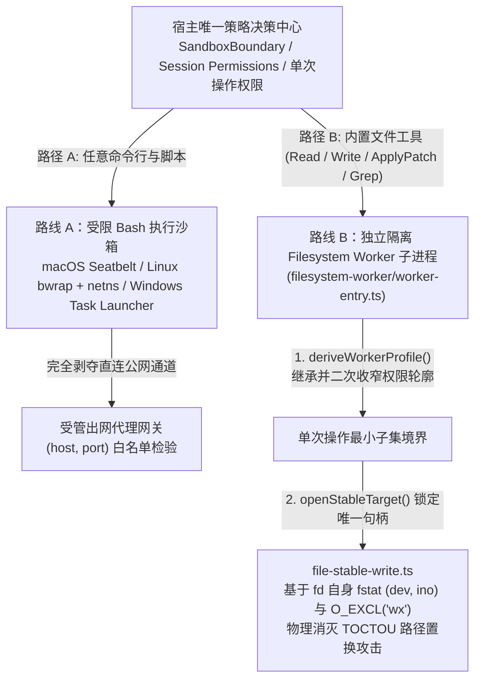

# 操作系统双路沙箱与 Worker 隔离：Bash 受限出网、文件二次收窄与 TOCTOU 防护

## 1. 为什么只给 `Bash` 上锁而让内置文件工具在主进程直接跑 `fs` 会导致系统性破防？

市面上大多数宣称“支持沙箱”的编码 Agent 往往只盯住一个目标：`Bash` / Terminal 执行工具。只要把 Shell 命令扔进容器或者 `sandbox-exec` 里执行，开发者就长舒一口气；而内置的 `Read`、`Write`、`Edit`、`ApplyPatch`、`Grep` 等文件工具却直接跑在拥有全套系统权限的主 Host Node.js 进程里，顶多用几行 `path.resolve(cwd, input)` 做个看起来很美的字符串检查。

这套“单腿沙箱”架构在稍微复杂的安全边界测试面前会瞬间在四处穿孔：
1. **符号链接与路径穿越绕过**：攻击者或误导提示词在项目里埋一个指向 `/etc/passwd` 或 `~/.ssh/id_rsa` 的软链接，`path.resolve` 看起来规规矩矩落在项目目录内，主进程一脚 `fs.readFile` 就把宿主机私钥念了出来！
2. **TOCTOU（检查时间窗置换攻击）**：哪怕你在调用 `writeFile` 前一微秒刚用 `realpath()` 检查过目标是项目里的普通文件；就在你刚通过校验、还没来得及再次 `open(path)` 覆写的那零点几毫秒空隙里，后台一个并发恶意进程瞬间把该路径置换成指向系统关键文件的软链接——传统路径式覆写 `fs.writeFile` 重新按名字打开路径，正好中计一刀覆写进敏感文件！
3. **环境变量与子进程树泄露**：在普通 Node `child_process` 下启动脚本，如果没有强约束出网路径与子进程派生回收，一个后台偷偷 fork 出来的长驻网络爬虫即使主命令被超时杀掉也依然活在系统里持续向外倒卖数据。
4. **“整座工作区宽松权限”与“局部只读飞地”矛盾**：即使只给局部工具开了单次扩权申请，如何确保不会越权顺带拉高同一会话里其它默认工具的能力上限？

Maka TypeScript 版在 `packages/runtime/src/sandbox/`、`filesystem-worker/` 与 `file-stable-write.ts` 中竖起了一套绝不妥协的**单一策略决策源 + 操作系统级双路物理隔离架构**。

---

## 2. 单一策略中心与物理双路合围

在架构顶层，不管前端配置怎么变更、插件提出了什么局部豁免（`SandboxBoundaryExpansion`），**唯有运行在主机侧的策略协调模块拥有解释沙箱规则的唯一决策权**；而具体落到执行载体时，所有改变工作区或执行指令的操作兵分两路，全数逐出主调度进程之外：



---

## 3. 路线 A：`Bash` 命令的跨平台原生封装与无盲区网络阻断

当大模型调用 Shell 工具执行 `npm test` 或复杂脚本时，`packages/runtime/src/sandbox/`（`sandbox-manager.ts`、`detect.ts`）会根据当前宿主机平台装配出隔离命令包装体（绝不轻易降级成裸奔启动）：

| 运行平台 | 底层 OS 隔离原语与协同机制 | 关键防突破设计 |
| :--- | :--- | :--- |
| **macOS** | 原生 **Seatbelt (`sandbox-exec` 策略描述)** (`macos-seatbelt.ts`) | 严格白名单挂载可读依赖与可写构建路径，封死未经授权的用户目录读取与直接出网套接字 |
| **Linux** | **`bubblewrap` (`bwrap`)** 轻量命名空间容器 (`linux-sandbox.ts` / `linux-profile-path.ts`) | 对根文件系统实施只读或精简重映射挂载，利用独立 `netns` 与宿主托管代理通道隔离所有出网流量，防止向内网任意扫描 |
| **Windows** | 原生 Rust **`runtime-host-windows-task-launcher`** + 低权限边界 | 填补 Node.js 在 Win32 下进程作业控制与环境擦除盲区，确保关联派生出来的子命令全树受控且在取消时整组彻底回收 |

特别值得强调的是网络控制面的做法：**彻底封堵沙箱内的直接出网套接字路径，迫使所有正当外网访问（比如拉取依赖或接口联调）必须流经受宿主权限策略监控的本地代理通道**，从而可以在包级别检验实际目标域名端口并截断恶意 302 跳转泄露。

---

## 4. 路线 B：独立 `Filesystem Worker` 与二次收窄（`deriveWorkerProfile`）

对于内置的文件读写、补丁应用与全文检索（`Read` / `Write` / `Edit` / `ApplyPatch` / `Grep` / `Glob`），Maka 没有让它们舒舒服服留在高权限 Host 主进程内部，而是专门拆出了运行于独立受控子进程中的 **`packages/runtime/src/filesystem-worker/`**：

1. **同样套上 OS 级沙箱外壳**：这个 Worker 子进程自身在启动时（`launch-spec.ts` / `process-runner.ts`）同样处于与所在 OS 匹配的隔离边界（Seatbelt / bwrap / 受限句柄）保护下，即使存在某款外部解压或正则表达式引擎缺陷被攻破，攻击者看到的也仅仅是已被剥去权限的瘦身子进程环境；
2. **每笔操作动态二次收窄（Narrowed Worker Profile）**：假如整个会话被配置为允许修改 `./src/` 和 `./tests/` 目录，当这一次模型仅仅调用 `Write("src/utils.ts")` 时，主控在向 Worker 投递 RPC 请求时会将本次授权轮廓**二次动态收窄到仅仅涵盖目标路径这一线必需域**；甚至还针对工具动作性质区分只读与可写映射（`operationAccess`），绝不敞开无关写入目录；
3. **跨 OS 的规范化对齐铁律**：`filesystem-worker/operations.ts` 中写明了极其敏锐的一句注释——*Canonicalisation must match the sandbox the worker runs in: realpath-based（路径规范化逻辑必须与底层物理沙箱的判定逻辑保持绝对一致，完全基于实路径解析）*，避免上层软件判定“放行”而底层 OS 沙箱依据真实软链位置当场拒绝的口径裂痕（若遇底层拦截则通过 `isLikelySandboxDenial` 精准向上归因为明确的权限拒绝信号）。

---

## 5. `file-stable-write.ts`：如何靠唯一描述符（fd）与 `fstat` 物理消灭 TOCTOU？

这是整个文件安全基础设施里最精彩的一段系统工程代码（`packages/runtime/src/file-stable-write.ts`）。常规文件系统库写文件总是这样工作：“先 `stat` + 检查权限是否合法 -> 再调用 `writeFile(path)` 按文件名字符串重新打开并截断覆盖”。这两次系统调用之间永远存在一段极危险的时间竞争缝隙。

Maka 用以下不可分割的文件句柄物理锁协议彻底移除了这扇机会窗口：

```typescript
// 教学化提炼自 packages/runtime/src/file-stable-write.ts
async function readModifyWriteThroughHandle(targetPath: string, expectedIdentity: FileIdentity, transform: (text: string) => string) {
  // 1. 全过程绝不按路径“再开一次”！针对已有目标使用非截断模式 ('r+') 一次性打开获取物理 fd
  const fd = await openOnceWithoutTruncating(targetPath, /* existing ? 'r+' : 'wx' */);

  // 2. 如果是全新创建文件，强制独占标志 'wx' (O_CREAT | O_EXCL)：
  //    一旦在审批后、创建前这微秒之间路旁突然被人抢塞进了实体/软链，内核立刻报 EEXIST，
  //    驱动直接抛出 StableWriteFailure('path_changed') 并撤出，绝不盲目踩爆现有节点!

  // 3. 在正式清空/修改任何字节之前，直接对已打开的描述符本身调 fstat(fd)！
  const actualStat = await fd.stat();
  if (actualStat.isDirectory()) {
    throw new StableWriteFailure('is_directory', 'Target became a directory');
  }
  if (!samePhysicalDeviceAndInode(actualStat, expectedIdentity)) {
    // 哪怕路径半途被调包指向别处，我们在任何字节遭到截断改写之前即已通过物理 (dev, ino) 精准抓包退场，
    // 磁盘原文件依然一字节未动保持完好无损!
    throw new StableWriteFailure('path_changed', 'Physical target identity swapped mid-operation');
  }

  // 4. 所有读取、修改与覆盖写回全部紧紧锁定在这同一个经校验的 fd 上推进!
  await writeAndFlushOnSameDescriptor(fd, transform);
}
```

看看这几层物理细节的细腻程度：
- **用 `r+` 打开而非 `w`**：如果按常规直接上 `w` 模式，文件刚打开那一毫秒旧内容就已经被内核物理截断清空成 0 字节，即便你后面 `fstat` 查出不对劲也已经酿成了破坏；用非截断 `'r+'` 打开并校验 `(dev, ino)` 完好无损后，才通过同一只已认证句柄写入并裁剪尾长，验证不过关时原文件字节 **100% 完好如初**！
- **独占创设 `'wx'` 防伏击**：面对本应新建的文件，决不允许静默覆写半路冒出的诡异硬链接或未知替代体，触发 `EEXIST` 即直接宣告 `path_changed` 异常终止；
- **`compareAndDeleteEntry` 安全删除**：即便在删除文件操作时也坚持对齐实体校验，从物理数据结构层把 TOCTOU 漏洞压缩至物理零窗口。

---

## 6. 总结

Maka TypeScript 版的工具沙箱层靠的不是一堆堆砌在文本层面容易绕过的正则黑名单，而是实打实的操作系统原语组合拳：
1. **两条跑道同样隔离**：`Bash` 与 `Filesystem Worker` 双双运行在 Seatbelt / `bwrap` / 原生 Win32 作业限制壳层内，主协调进程自身干净轻量；
2. **动态二次收窄**：每次小范围文件工具呼叫都会基于会话策略按需进一步压紧可读写目录边界，不让默认宽松规则顺带溢出给单项高敏动作；
3. **单一 fd 与 `(dev, ino)` 物理绑定**：借助 `file-stable-write.ts` 的一次性打开、验证前零截断和独占 `'wx'` 创建，从系统调用原理层面根绝经典的检查-使用时间窗置换（TOCTOU）漏洞。

掌握了文件与 Shell 命令的沙箱防线后，如果 Agent 需要离开文件与黑框命令行，去操作屏幕上真实弹出的图形软件与浏览器（**Computer Use**），或者在集成虚拟终端里和交互式 `vim`、`top`、密码输入程序打交道（**PTY Stack**），基础设施层又是如何把混乱的像素流、光标权限与 ANSI 转义乱码收拢为安全可控的契约协议的？下一篇深入原生视控与终端虚拟屏栈——[原生桌面视觉与 PTY 虚拟屏：MakaCuService 帧契约、坐标门控与进程树收尸](./computer-use-and-pty.md)。
