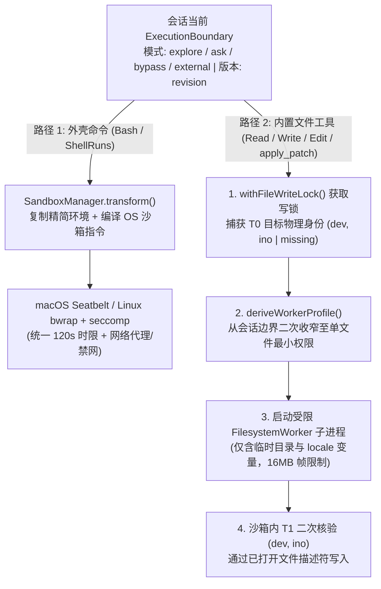

# 操作系统级双路沙箱与文件边界隔离

[返回手册目录](../README.md)

设想用户向 Agent 下达指令：“修复项目里的 `config.json` 并跑测验证。”模型有两条完全不同的路径来修改这个文件：
1. 调用 `Bash("node update-config.js")`，派生操作系统命令进程；
2. 调用内置文件工具 `Write("config.json", ...)` 或 `apply_patch`。

只给 `Bash` 套上操作系统沙箱，却放任内置文件工具在 Node.js 主进程里直接调用 `fs.writeFile()`，是 Agent 安全工程中最常见的致命漏洞——模型一旦利用软链接（Symlink）、路径穿越或并发竞态，就能直接借用高权限的 Host 主进程读写宿主机任意文件（甚至反手修改 `runtime-host-access.json` 夺取管理员权限）。

Maka 采用了**“命令沙箱 + 受限文件 Worker 子进程 + T0/T1 文件身份 CAS 锁”**的统一双路隔离架构。本章深度剖析 `ExecutionBoundary` 边界模型、单次权限二次收窄、`FilesystemWorker` 防置换锁，以及 macOS、Linux、Windows 三大平台的底层隔离机制与真实边界。

---

## 1. 概念先行：单一决策权与双路架构

在早期实现中，每个文件工具各自重复判断“该走 Worker 还是该走本地执行器”，很容易出现逻辑不一致（例如某个回退路径硬编码了 `cwd` 限制，反而比 `ask` 模式开放的临时目录还窄）。为此，Maka 将文件与命令路由收敛为单一权威规则：**当前激活的 `ExecutionBoundary`（执行边界）决定唯一后端与路径范围，工具自身不携带任何私有策略分支。**



### 1.1 会话初始边界模式（`PermissionMode`）

| 模式 | 编译的初始边界 | 核心读写与网络策略 | 典型应用场景 |
| :--- | :--- | :--- | :--- |
| **`explore`** | 只读探索边界 | 仅允许读取工作区目录，禁止任何写入操作，禁用网络。 | 代码架构研读、安全审计、纯问答排查。 |
| **`ask`** | `workspace-write` Profile | 允许写入工作区与系统临时目录，禁用网络；越界操作触发审批弹窗。 | 日常开发改代码、跑局部单测。 |
| **`bypass`** | 直通宿主边界 | 跳过沙箱转换，直接交由配置的执行器按实际启动用户权限运行。 | 已运行在外部强隔离容器（如 Docker/Harbor）内的 CI 环境。 |
| **`external`** | 外部注入边界 | 跳过本地沙箱转换，交由上层应用注入的自定义执行器托管。 | 远程云端沙箱或企业定制执行代理。 |

### 1.2 动态边界扩张（Boundary Expansion）
在 `ask` 模式下，如果模型需要修改工作区之外的 `~/.npmrc` 或读取特定外部配置目录，文件执行器识别越界后会返回受控的边界异常，允许工具提交一份结构化的 `SandboxBoundaryExpansion` 申请（写明目标路径、访问类型 `read/write` 与申请理由）。人类用户批准后，Host 将扩展后的 Profile 写入递增版本号的新 `ExecutionBoundary`，后续步骤和进程立刻生效，而无需销毁整个模型后端。

---

## 2. 路线 A：`Bash` 命令的沙箱转换与网络阻断

以在 Linux 上运行 `Bash("node update-config.js")` 为例，无论该命令是前台运行还是通过 `shellRuns` 进入后台挂起（`run_in_background: true`），**必须在区分前后台之前完成同一套沙箱转换**：

1. **规则编译**：`sandboxCommand()` 读取会话当前 `ExecutionBoundary`，交由 `SandboxManager` 选取平台后端（`LinuxBubblewrapBackend` 或 `MacOSSeatbeltBackend`）。
2. **Linux `bubblewrap` 隔离**：将只读系统路径、可读写工作区路径编译为 `bwrap` 的挂载绑定（`--ro-bind` / `--bind`）；当网络受限时启用独立非特权网络命名空间与 `seccomp` socket 过滤器。实测即使沙箱内脚本尝试连接本机 `127.0.0.1` 探测 Host 本地 RPC 端口，内核也会直接返回 `EPERM`。
3. **PTY 沙箱硬拦截**：若模型同时请求了交互式伪终端（`pty: true`）且当前 Profile 强制要求命令沙箱，系统在启动 PTY 之前直接拒绝执行（因为当前沙箱包装层不放行受限 PTY 的终端控制序列直通），绝不静默降级为无沙箱运行。
4. **环境变量传递**：`Bash` 会复制宿主必要环境变量（如 `PATH`、`LANG`、`NODE_ENV`）保证编译器与包管理器可用，但仍受限于 120 秒前台默认超时与进程树回收策略。

---

## 3. 路线 B：内置文件工具的受限 Worker 与 TOCTOU 防护

所有内置文件工具（`Read`、`Write`、`Edit`、`FormatJson`、`Glob`、`Grep`、`apply_patch`）全部通过 `createBoundaryFilesystemExecutor()` 统一调度。在 `managed` 模式下，文件操作由独立启动的 **`FilesystemWorkerClient`** 通过受限子进程执行（缺失 Worker 时直接返回 `requires_bypass` 拒绝，绝不悄悄回退到主进程 `fs`）。

### 3.1 双重权限收窄：`deriveWorkerProfile()`
为什么要对已经属于 `workspace-write` 的会话做二次权限收窄？
设想当前会话允许修改整个项目目录。此时模型调用 `Write("config.json")`。如果直接把“整个项目可写”的大权限授予文件 Worker，一旦参数解析或底层的路径规范化出现意外，这个进程就有能力写坏项目里的其他重要源码。

因此，`FilesystemWorkerClient` 在启动子进程前会做两件事：
1. **会话大边界核验**：使用完整会话 Profile 校验 `canWritePath("config.json")` 是否合法。
2. **单次操作权限裁剪**：调用 `deriveWorkerProfile()` 从会话边界派生出一份**极小化 Profile**——仅开放目标文件（以及创建文件所需的直接父目录）的写权限，其余工作区路径仅保留只读或完全隐藏，并彻底禁用网络与多余环境变量（文件 Worker 仅保留临时目录与 Locale 启动变量）。

### 3.2 写入并发漏洞与 T0/T1 物理身份 CAS 锁（TOCTOU 防护）
文件写入面临两个并发竞态陷阱：
- **排队等待窗口替换**：协程 A 检查完 `config.json` 合法后，在 `withFileWriteLock()` 排队等锁。此时外部进程把 `config.json` 删掉并建立了一个指向敏感系统文件的软链接！等 A 拿到锁直接按路径写入时，就会写穿边界。
- **跨进程盲覆盖**：A 在读取文件和写入新内容之间，文件已被其他工具修改，直接覆盖会静默抹掉中间变更。

Maka 通过强制的 **`FilesystemWorkerExpectedIdentity`（T0/T1 CAS 契约）** 彻底堵死了这个窗口：
- **T0（抢锁与观测）**：在发起任何写操作前，调用方**必须显式传入**在 T0 时刻观测到的目标物理身份：
  - `{ dev, ino }`：观测到目标已存在，记录其底层设备号与 Inode 号；
  - `'missing'`：观测到目标不存在（用于新建文件）；
  - `'unchecked'`：仅允许用于只读操作（运行时代码强制校验：**任何写操作若未提供有效 `expectedIdentity` 直接抛出运行时异常拒绝执行**）。
- **T1（Worker 沙箱内复核与句柄写入）**：受限 Worker 在沙箱内部打开目标文件后，立刻通过 `fstat` 核对实际的 `(dev, ino)` 是否与 T0 严格一致（若 T0 为 `'missing'` 而此时文件已存在，立刻报错 `path_changed` 失败），确认无误后通过**已打开的固定文件描述符句柄**写入字节，彻底免疫符号链接替换与中间覆写。

---

## 4. 跨平台沙箱实现与工程现实

由于三大主流操作系统的内核安全原语差异巨大，Maka 的隔离能力由宿主机平台能精确表达的机制决定（若当前规则超出平台表达能力，统一 **Typed Fail-Closed 拒绝**，绝不静默降级裸跑）：

| 操作系统 | 底层沙箱实现机制 | 关键设计要点与已知平台边界 |
| :--- | :--- | :--- |
| **macOS** | `sandbox-exec` (Seatbelt `.sb` 规则) | 将 `PermissionProfile` 编译为 Seatbelt 策略描述；精细保留系统动态链接库与运行库所需只读例外路径。 |
| **Linux** | `bubblewrap` (`bwrap`) + `seccomp` | 利用挂载命名空间与独立网络命名空间阻断越界；若出现平台不支持的显式 `deny` 规则，前置编译直接报错拒绝启动。 |
| **Windows** | **原生 Rust Broker + AppContainer SID + Job Object** | 拒绝了不稳定的受限令牌方案，改用每请求派生的**独立 AppContainer SID**（不授予网络 Capability）、`PROC_THREAD_ATTRIBUTE_JOB_LIST` 原子绑定且关闭即杀整棵树的 Job Object，以及禁止句柄继承和递归拒绝重解析点（Reparse Points）。<br/>**当前预览边界**：Windows 文件 Worker 预览版支持编辑已有文件；由于新建文件涉及修改父目录 ACL，当前预览策略会安全拒绝新建操作；受限 `Bash` 与 Worker 内 `Grep` 不可用（自动提示改用 `Glob + Read`）。 |

### 进程退出后，磁盘上的修改会怎样？
必须牢记一个工程常识：**沙箱限制的是“能力边界”，不是“数据库回滚事务”**。如果脚本先成功写改了 `config.json`，随后的校验命令失败了，已经写入磁盘的修改依然存在；若文件 Worker 在执行写入后、回传 JSON 响应前崩溃或超时（默认 `120s`），执行器会抛出 `ToolOutcomeUnknownError`，交由持久化恢复层显式处理未知状态。

---

## 5. 教学伪代码：双层收窄与 T0/T1 身份防置换写入

```text
function executeWriteViaRestrictedWorker(absPath, newContent, sessionBoundary):
    // 1. 强制要求写操作必须提供 T0 观测身份，杜绝静默跳过 CAS
    expectedIdentity = captureIdentityAtT0(absPath) // 返回 { dev, ino } 或 'missing'
    assert expectedIdentity != 'unchecked', "Mutations must participate in T0/T1 CAS"

    // 2. 在目标写锁保护下执行完整的“读取边界 -> 收窄 -> 启动 Worker -> 写入”
    return await withFileWriteLock(absPath, async () => {
        // 3. 会话级边界核验
        if not sessionBoundary.profile.canWritePath(absPath):
            throw new BoundaryExpansionRequiredError(absPath, "write")

        // 4. 权限二次收窄：派生仅限目标文件的极小化 Worker Profile (彻底禁网)
        narrowProfile = deriveWorkerProfile(sessionBoundary.profile, {
            operation: "write",
            targetPath: absPath,
            usesDirectoryEntry: (expectedIdentity == 'missing')
        })

        // 5. 由平台沙箱编译启动参数 (fail-closed：平台不支持则立刻报错，绝不裸跑)
        launchSpec = sandboxManager.transformWorkerLaunch(narrowProfile)

        // 6. 通过受控管道向独立子进程发送 16MB 封顶请求 (不传多余宿主环境变量)
        response = await runFilesystemWorkerProcess(launchSpec, {
            version: PROTOCOL_VERSION,
            op: "write",
            path: absPath,
            content: newContent,
            expectedIdentity: expectedIdentity
        }, timeoutMs: 120_000)

        // 7. Worker 内部在打开文件句柄后执行 T1 比对：
        //    若 inode 变更或缺失文件被抢建，Worker 返回 path_changed；
        //    若超时/崩溃未回执，必须抛出 ToolOutcomeUnknownError 暴露风险
        if response.timedOut or response.crashedBeforeAck:
            throw new ToolOutcomeUnknownError("Filesystem worker terminated before response ack")

        return response.result
    })
```

---

## 6. 对照 Pi：自由进程扩展 vs 原生系统级隔离

- **Pi 的做法**：Pi 的核心定位于开发者在自己信任的终端里高效协同编码，提供 Node、SSH 与外部沙箱后端路由，通过 `resolveProjectTrusted()` 在打开仓库时把关项目级配置与扩展的加载信任，但内置文件工具默认不额外派生 AppContainer / `bwrap` 文件 Worker 子进程。
- **Maka 的做法**：面对远程客户端协同、多租户访客介入与高自治长任务，Maka 将“不信任的模型参数”彻底挡在 Host 主进程之外，构建了“命令沙箱 + 权限二次收窄的文件 Worker + Windows AppContainer 原生 Broker + T0/T1 文件身份锁”的硬核防御矩阵。

---

## 7. 延伸阅读

- 了解在 Windows 等平台下，Maka 如何进一步借助原生 Rust `gitoxide-helper` 数据面守卫整个工作区树版本，阅读 [04.2 Gitoxide 与工作区版本](../04-state/gitoxide-and-workspace-versioning.md)。
- 了解当命令执行需要交互式终端或强杀整个孙子进程树时如何处理，阅读 [03.3 桌面自动化与 PTY 虚拟终端](computer-use-and-pty.md)。
- 了解连接认证、访客授权以及临时密钥注入是如何配合沙箱工作的，阅读 [03.5 分层授权与凭据生命期](permissions-and-secrets.md)。
