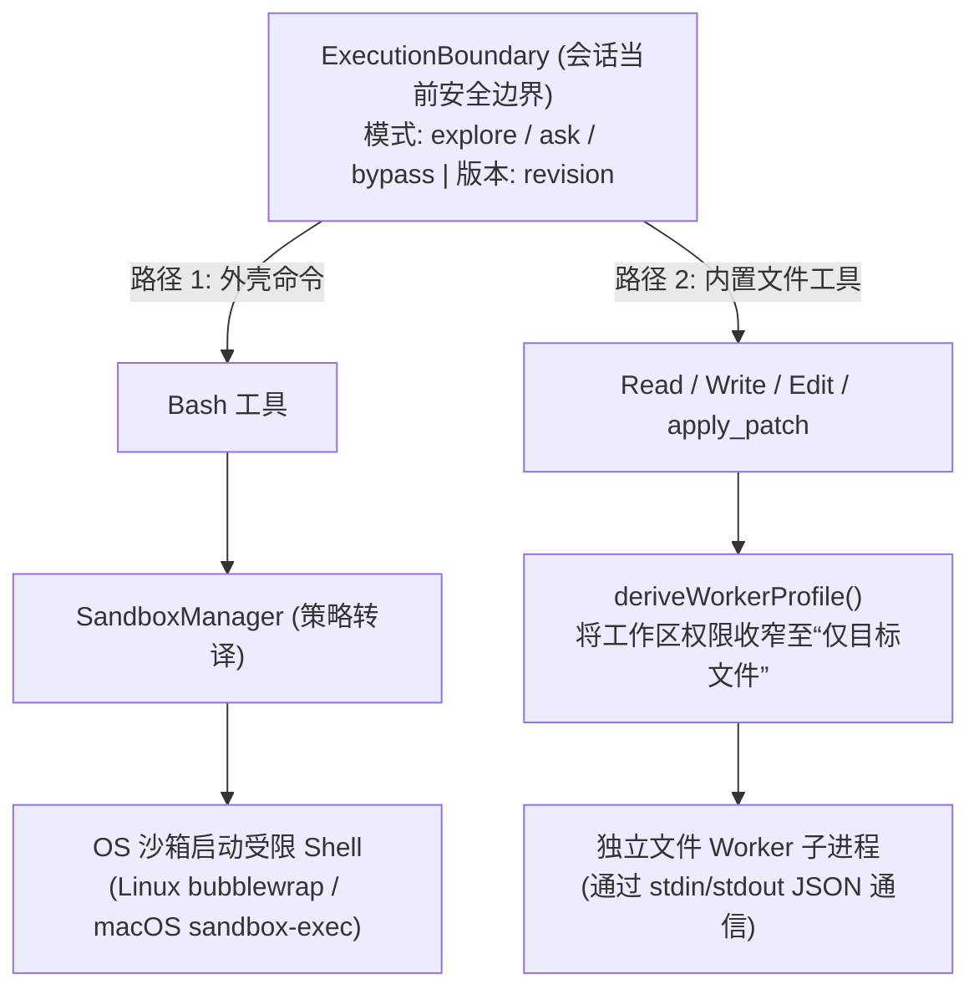

# 执行环境与操作系统沙箱

[返回手册目录](../README.md)

当用户让 Agent 修改项目里的 `config.json` 时，模型其实有两条路可以达成目的：
1. 调用 `Bash` 运行一段更新脚本（例如 `node update-config.js`）；
2. 调用内置的文件工具 `Write` 直接覆写文件。

很多初学者在设计沙箱时，只给 `Bash` 命令套上了容器或进程隔离，却让 `Write`、`Edit` 直接在 Node.js 主进程里调用操作系统的 `fs.writeFile()`。这会留下一个致命的后门：**模型一旦利用软链接（Symlink）或路径穿越（`../../.ssh/id_rsa`），就能直接借由高权限的 Host 主进程读写宿主机任意敏感文件！**

Maka 采用了**“命令沙箱 + 受限文件 Worker 子进程”**的双路隔离架构，确保两条路径受到同等严格的操作系统级约束。本章解析执行边界（`ExecutionBoundary`）的设计原理、双路沙箱的实现机制以及跨平台隔离的真实边界。

---

## 1. 概念先行：规则（Profile）与执行者（Worker）的分离

在 Maka 中，控制“Agent 能碰什么”的逻辑被拆解为两个层次：**规则描述**与**物理隔离**。



### 三种初始权限模式（`ExecutionBoundary`）
会话创建时，Host 会依据请求或默认策略生成创世边界：

| 权限模式 | 核心能力与限制 | 典型适用场景 |
| :--- | :--- | :--- |
| **`explore`（只读探索）** | 仅允许读取工作区文件，禁止写入，网络受限。 | 代码审查、架构分析、只读排错提问。 |
| **`ask`（工作区可写）** | 使用 `workspace-write` Profile，允许写工作区与临时目录，网络受限。 | 日常编码修改、本地配置调整；越界操作触发审批弹窗。 |
| **`bypass`（直通宿主）** | 跳过沙箱转换，受操作系统当前启动用户的原生权限约束。 | 受控的自动化 CI 容器内运行（环境外层已有硬隔离）。 |

### 动态边界扩张（Boundary Expansion）
假设在 `ask` 模式下，模型试图修改工作区之外的 `/etc/hosts` 或用户全局配置 `~/.npmrc`。文件执行器检测到目标超出当前 Profile，不会直接崩溃，而是允许工具发起一次**边界扩张申请**（附带目标路径、访问类型与申请理由）。一旦人类用户批准，Maka 会生成一个递增版本号的全新 `ExecutionBoundary`，后续步骤即可合法放行该路径。

---

## 2. 第一条路：`Bash` 命令的沙箱转换与网络隔离

以在 Linux 上执行 `Bash("node update-config.js")` 为例：

1. **策略转译**：`sandboxCommand()` 读取会话当前的 Profile，交由 `SandboxManager` 匹配当前操作系统的后端。
2. **参数生成**：Linux 后端（`LinuxBubblewrapBackend`）将允许读写的路径清单映射为 `bubblewrap`（`bwrap`）的只读/读写挂载参数；如果 Profile 要求禁用网络，则挂载独立的网络命名空间（`--unshare-net`）并配置 `seccomp` socket 过滤器。
3. **绝对隔离效果**：在独立网络命名空间下，即使脚本试图连接本机的 `127.0.0.1` 探测 Host 内部端口，操作系统内核也会直接返回 `EPERM` 拒绝连接。
4. **前台、后台与 PTY 约束**：无论命令是前台阻塞运行（默认 120 秒超时）还是后台挂起（`run_in_background: true`），都会先经过完全相同的沙箱转换。需要注意的是，若程序申请交互式伪终端（`pty: true`）且 Profile 强制要求沙箱隔离，系统会在启动前直接拒绝不安全的受限 PTY。

---

## 3. 第二条路：内置文件工具的 Worker 隔离与双层防御

内置文件工具（`Read`、`Write`、`Edit`、`Glob`、`Grep`、`apply_patch`）全部经由 `createBoundaryFilesystemExecutor()` 路由。在 `managed` 模式下，主进程绝不亲自碰文件，而是启动专门的**受限文件 Worker 子进程**。

### 3.1 为什么还需要 `deriveWorkerProfile()` 二次收窄？
设想当前会话处于 `workspace-write` 模式，理论上整个项目目录都允许写入。但此时模型调用的仅仅是 `Write("config.json", ...)`。
如果直接把“整个项目可写”的大权限交给子进程，万一路径解析或符号链接出了偏差，可能会波及其他文件。因此，Maka 会执行一次**单次操作权限收窄（`deriveWorkerProfile`）**：
- **先核验**：用会话 Profile 检查 `canWritePath("config.json")` 是否合规。
- **再收窄**：专门为本次启动的 Worker 子进程生成一个**极小化 Profile**——仅赋予 `config.json`（及新建时所需的父目录）的写权限，其余文件一律只读或不可见，并关闭网络。

### 3.2 写入前的 TOCTOU 防护（防文件身份置换）
在并发场景下，可能出现经典的时间差攻击（TOCTOU, Time-of-Check to Time-of-Use）：执行器检查完 `config.json` 的权限后正在排队等锁，此时另一个进程偷偷把 `config.json` 删掉并换成了一个指向 `/etc/passwd` 的软链接！

为了堵住这一漏洞，Maka 在等锁前会先记录目标路径的**底层文件身份（如 inode / 设备号）**；Worker 子进程在沙箱内真正打开文件准备写入之前，必须再次核对文件身份是否一致，并通过**已打开的固定文件描述符句柄**写入内容，彻底消除路径替换导致的误写风险。

---

## 4. 跨平台沙箱实现与客观边界

不同的操作系统内核提供了截然不同的安全原语，Maka 的沙箱能力受限于宿主机平台能表达的底层机制：

| 操作系统 | 底层沙箱机制 | 隔离特性与已知工程边界 |
| :--- | :--- | :--- |
| **macOS** | `sandbox-exec` (Seatbelt) | 通过 `.sb` 规则描述文件与网络访问边界；需保留系统运行库与动态链接器所需的只读例外路径。 |
| **Linux** | `bubblewrap` (`bwrap`) + `seccomp` | 完善的挂载命名空间与网络命名空间隔离；要求宿主机已安装可用 `bwrap`，且当前后端不支持显式 `deny` 规则覆盖。 |
| **Windows** | 专用 Launcher (`AppContainer` + ACL + Job) | **受限文件 Worker 为预览实现**；由于 AppContainer 权限模型与目录继承机制的差异，会出现“能编辑已有的 `config.json`，但新建文件（需要修改父目录条目）被拒绝”的情况；受限 Bash 与 worker 内 `Grep` 暂不可用（可降级使用 `Glob` + `Read`）。 |

### 环境变量与超时边界
- **环境变量隔离**：`Bash` 会复制宿主所需的环境变量以保证编译工具链（如 `PATH`、`NODE_ENV`）正常运作；而**文件 Worker 仅保留临时目录与语言环境等最小启动变量**，严防业务密钥通过环境变量意外泄漏给文件读写子进程。
- **物理超时与副作用留存**：前台 `Bash` 与文件 Worker 默认均设有 **120 秒执行时限**。需要牢记的是：**沙箱限制的是“能碰哪里”，而不是“事务回滚”**。如果脚本改完 `config.json` 后在验证阶段超时被杀，磁盘上已经发生的修改依然保留；如果 Worker 进程处理完请求但在回传 JSON 前崩溃，系统会抛出 `ToolOutcomeUnknownError` 交由恢复机制处理。

---

## 5. 教学伪代码：文件 Worker 权限收窄与身份防置换

```text
function executeWriteViaWorker(targetPath, newContent, sessionBoundary):
    // 1. 路径规范化与会话级大边界核验
    absPath = resolveAndNormalize(targetPath, sessionBoundary.cwd)
    if not sessionBoundary.profile.canWritePath(absPath):
        throw new BoundaryExpansionRequiredError(absPath, "write")

    // 2. 权限二次收窄：为本次 Worker 派生仅限单文件的最小权限配置
    narrowProfile = deriveWorkerProfile(sessionBoundary.profile, {
        operation: "write",
        targetPath: absPath
    })

    // 3. 记录操作前的文件物理身份 (防止等锁期间路径被偷换为软链接)
    expectedIdentity = captureFileIdentityIfExists(absPath)

    // 4. 通过平台沙箱 (bwrap / sandbox-exec / AppContainer) 启动受限 Worker
    workerArgs = sandboxManager.transformWorkerLaunch(narrowProfile)
    requestPayload = {
        op: "write",
        path: absPath,
        content: newContent,
        expectedIdentity: expectedIdentity
    }

    // 5. 通过 stdin 发送指令，严格限定 120s 超时
    response = await spawnRestrictedWorker(workerArgs, stdin: requestPayload, timeoutMs: 120_000)
    
    if response.timedOut or response.crashedBeforeAck:
        // Worker 极可能已经写入磁盘，必须标为结果未知，绝不可静默假装失败
        throw new ToolOutcomeUnknownError("File worker terminated without ack")
        
    return response.result
```

---

## 6. 延伸阅读

- 了解当需要连接外部服务或要求用户临时扩大权限时，系统是如何认证和管控凭据的，阅读 [03.4 分层授权与凭据生命周期](permissions-and-secrets.md)。
- 了解沙箱执行器抛出 `ToolOutcomeUnknownError` 后，持久化系统如何接管恢复，阅读 [04.1 持久化执行与崩溃恢复](../04-state/durable-execution.md)。
