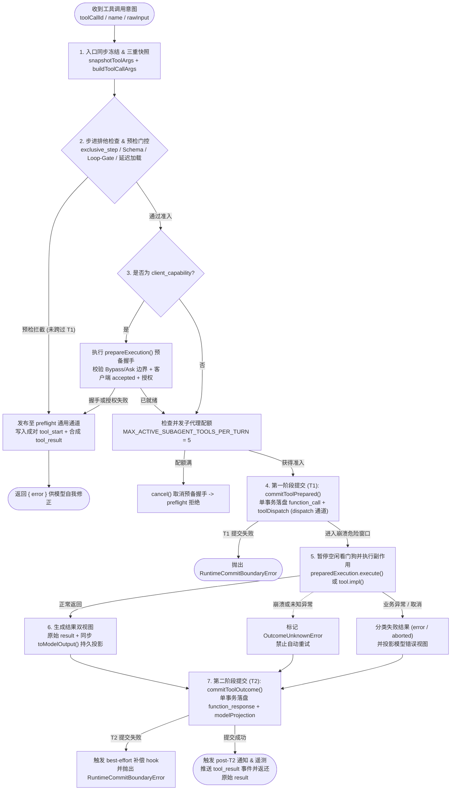
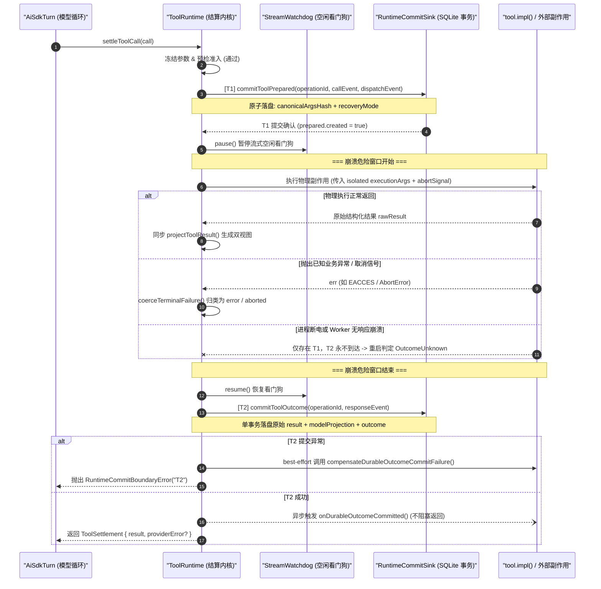

# 工具执行内核：从意图到可提交的运行事实

[返回手册目录](../README.md)

在玩具级 Agent 原型中，调用工具往往退化为一行内存查表：`tools[call.name](call.args)`。但在真实工程环境中，模型输出的工具参数本质上是**不可信的外部输入**，而工具一旦执行便会产生不可逆的物理副作用——覆写磁盘文件、启动后台 Shell 进程、操作桌面窗口或请求外部 API。

如果工具刚刚改写完 `config.json`，宿主进程却在结果写入数据库之前断电崩溃，重启后系统该如何区分“工具从未派发”与“副作用可能已生效”？如果模型一次读取了数万行后台构建日志，或需要在单步内批量分析几十个源码文件，如何在不撑爆大模型上下文窗口的前提下，依然保证每一次底层读取都受到权限约束与事件审计？

本章深入剖析 Maka 的工具执行内核（`ToolRuntime`），系统拆解它是如何通过**三重参数快照、双通道防孤儿提交、T1/T2 两阶段事务、结果双视图投影、有界流式缓冲**以及 **Code Mode（`exec`）嵌套调用树**，将模型的一次非结构化调用意图安全地结算（Settle）为可审计、可恢复的运行事实。

---

## 1. 概念先行：为什么工具执行必须是一个“结算内核”？

在 Maka 架构中，当 `AiSdkTurn` 在步进末尾收集到模型返回的调用意图后，绝不会直接触发工具函数，而是构造一个 `ResolvedMakaToolCall` 并交由 `ToolRuntime.settleToolCall()` 统一处理。这里的 **Settle（结算）** 代表一套严格的事务边界：从参数冻结、步进准入、防死循环门控、跨端预备握手、持久账本锚定、隔离执行，直到结果投影与终态落盘全部完成，才算一笔调用真正结清。



这套流程刻意划出了两条不可逾越的架构边界：
1. **业务失败与边界提交失败分离**：Schema 校验失败、文件不存在、命令退出码非零属于可恢复的业务/工具错误，`settleToolCall()` 将其温和地包装为模型可读的错误结果返回，让模型自主修正；而 `T1` / `T2` 数据库事务写入失败（`RuntimeCommitBoundaryError`）意味着状态根账本一致性受损，必须向上抛出并中止当前执行。
2. **异步卸载防遗留**：`ToolRuntime` 使用 `activeToolSettlements` 集合追踪所有正在结算中的调用（包括 Code Mode 嵌套调用），确保在 Turn 被用户中断（`endTurn`）时，系统必须等待所有在途的 T1/T2 结算收尾后才封存 Run 的终态。

---

## 2. 入口防线：三重参数快照与预检不变量

### 2.1 为什么要把一份参数拆成“三重快照”？

在模型流式输出结束后，原始入参首先经过 `snapshotToolArgs()` 的同步递归冻结：使用 `WeakSet` 拒绝任何循环引用，校验所有属性必须为普通数据属性（拒绝 Getter 等副作用属性），并逐层 `Object.freeze`。随后，`buildToolCallArgs()` 将同一份输入构建为职责完全隔离的三重视图（`ToolCallArgs`）：

| 参数视图 | 构建方式与生命周期 | 核心消费者 | 隔离的原因（不这样做会怎样） |
| :--- | :--- | :--- | :--- |
| **`executionArgs`** | 入口同步冻结原始 JSON；真正交给 `tool.impl()` 或 `prepareExecution()` 时传入 `structuredClone` 私有可变副本 | `tool.impl()`、`validateDeclaredToolArgs()`、Loop-Gate 签名 | 防止工具内部顺手修改嵌套字段后，污染后续审计事件或同一批次内其他读者的视角。 |
| **`permissionArgs`** | 通过 Schema 校验后，向 `tool.permissionArgs(clone, ctx)` 传入隔离副本生成并重新冻结 | 权限审批弹窗、策略签名（如 `computerUseSemanticSignature`） | 剥离冗长或高敏原始数据，构造人类审批者可读、且带策略分类标签（如 `approvalClass`）的安全视图。 |
| **`persistedArgs`** | 写入 `tool_start` 事件和持久账本；若为 `computer_use`，通过 `computerUseModelCallArgs(permissionArgs)` 投影 | `RuntimeEvent` 账本、`model-history.ts`（下一轮模型重放） | **严禁直接拿权限摘要视图喂给模型重放！** 必须保持工具声明的原始参数方言，同时完成隐私脱敏。 |

`persistedArgs` 对 `computer_use` 的特殊处理源于一个极易踩中的系统陷阱：`model-history.ts` 在构造下一轮对话消息时，会直接读取持久账本中的 `tool_start.content.args` 作为 `function_call` 历史喂回大模型。过去桌面控制工具直接把 Host 审批用的 `permissionArgs` 写进了 `persistedArgs`——但审批视图为了界面友好，把 `window_id` 重命名为 `windowId`、塞入了 `approvalClass` 与 `rememberForTurnAllowed`，还丢弃了 `element_id` 和输入的 `text`。结果模型在下一轮重放中读到自己发出的却是 `{ action: "press_key", windowId: ..., approvalClass: ... }` 这种非法参数组合，随即学着历史继续调用错误方言，导致连续被 Schema 拒绝！因此，`persistedArgs` 必须独立承担“隐私脱敏 + 保持工具原始参数方言”的双重契约。

### 2.2 Schema 校验与自愈式错误提示

`validateDeclaredToolArgs()` 统一兼容四种校验契约：`zod` 的 `safeParseAsync` / `safeParse`、通用 `validate` 回调以及 Standard Schema（`~standard.validate`）。当校验失败时，内核不会只丢出一句笼统的 `"Invalid arguments"`，而是由 `formatToolArgsViolationText()` 或 `describeComputerUseArgsViolation()` 结合工具自身的 Schema 反射出合法字段集合与缺失/非法字段名（同时严格避免把桌面键入的敏感文本回显进错误消息），使大模型能够在下一轮精准纠偏。

### 2.3 双通道防孤儿：`preflight` 与 `dispatch` 的严格分流

在多轮步进的持久化账本中，`AgentRun` 对带 `operationId` 的工具事件执行严格配对检查（`isAtomicToolBoundaryProjection`）：凡是声明进入原子派发协议的调用，账本必须等到它的 `T1` 和 `T2` 落地后才能放行模型投影。

这就带来一个致命的竞态隐患：**如果一次调用在进入 T1 之前就被预检拒绝（例如 Schema 校验失败、触发 Loop-Gate、违反 `exclusive_step`、调用未通过 `tool_search` 加载的延迟工具、或子代理并发超限），却提前给它的 `tool_start` 贴上了 `operationId` 标签**，会发生什么？
`AgentRun` 会认为这是一笔即将跨过 T1 的原子调用而跳过通用投影，死等一个永远不会到来的 T1 提交，最终把随后发出的合成错误响应判定为游离的 `orphan_response`，直接导致整个 Turn 崩溃！

为此，`executeTool()` 摒弃了“预先猜测是否会拒绝”的脆弱布尔标志，改为**在真正推入事件队列的瞬间按实际代码路径分流**：
- **预检拒绝通道（`refuseBeforeDispatch` -> `'preflight'` 通道）**：生成不带 `operationId` 的 `tool_start` 与对应的合成错误结果 `tool_result`，成对走通用投影通道，**完全不触碰 T1/T2 事务**。
- **物理派发通道（`'dispatch'` 通道）**：只有通过全部前置门控并抵达 `prepareDurableToolAttempt()` 的调用，才被授予 `operationId`（由 `buildToolOperationId({ invocationId, providerToolCallId })` 生成）并进入 T1 事务提交。

### 2.4 步进排他、延迟激活快照与 Loop-Gate 防死循环

在到达 T1 之前，内核还执行三道精细护栏：
1. **步进排他准入（`admitToolForStep`）**：对于声明了 `executionSemantics: 'exclusive_step'` 的工具（如 `exec`、`request_sandbox_boundary`），内核在第一个 `await` 之前**同步**登记步进占用状态。同一 Step 内如果已有其他工具被调用，排他工具会被立即拒绝；反之，一旦排他工具抢先占用该 Step，同批到达的其他工具调用全部被拦截，并明确告知“该调用并未运行，请在后续 Step 单独发起”。
2. **步进起点工具快照门控（`ToolGating`）**：`AiSdkTurn` 在每个 Step 开始前安装当前可用工具快照。如果一个工具属于按需发现的延迟工具（`discovery: 'search'`），且模型尚未在之前的 Step 通过 `tool_search` 激活它，即便名字拼写正确，执行边界也会依据 Step 起点快照拦截并返回 `DeferredNotLoaded` 错误——强制激活结果在下一个 Step 才正式生效，防止模型凭记忆偷跑未授权 Schema。
3. **连续相同失败门控（Loop-Gate，`LOOP_GATE_IDENTICAL_THRESHOLD = 3`）**：当同一来源的完全相同调用（`origin + toolName + canonicalArgs`）连续失败 2 次后，第 3 次会在不触发实际副作用的情况下被直接拦截。只要中间发生一次成功调用或参数有任何变化（例如修改代码后重跑同一单测，或轮询状态直到变更），失败计数立刻清零——既彻底斩断无意义的“复读机死循环”，又绝不误伤正常的轮询与迭代修复流程。对于桌面自动化中返回 `ambiguous_target` 的调用，内核还会基于语义目标签名单独维持一重防复读拦截。

---

## 3. T1/T2 两阶段提交与崩溃窗口守护

通过前置准入后，一次普通工具调用正式跨越持久化的关键分水岭：



### 3.1 看门狗暂停（Watchdog Pause）与取消传递
大模型流式接口的空闲看门狗（`StreamWatchdog`）用于切断网络静默假死，但工具是在两轮模型 HTTP 请求**之间**运行的：此时上一步的流已经结束，下一步请求尚未发出，Provider 保持静默是完全正常的。如果工具本身需要耗时数分钟（例如 `apt-get install`、编译工程或运行长耗时子代理），不暂停看门狗会导致整个会话被误杀。因此 `ToolRuntime` 在执行 `prepareExecution` 与 `tool.impl()` 的外层均用 `try { pauseTarget?.pause() } finally { pauseTarget?.resume() }` 严格包裹，把超时控制权归还给工具自身的 `timeout_ms` 与外层 Run 超时机制。

### 3.2 T1/T2 的补偿与后置契约
- **T1 前置防重与身份校验**：`commitToolPrepared()` 要求账本返回 `created === true`；若发现相同 `operationId` 已被认领，立即拒绝以防重复派发。同时把 `recoveryMode`（默认 `'never_auto_retry'`，远端或不确定操作为 `'outcome_unknown'`）固化进 `toolDispatch` 事实中，历史工具定义无权在恢复期篡改这一裁决。
- **T2 同步投影与闭环失败原则（Fail-Closed Projection）**：在写入 T2 前，`projectToolResult()` **强制要求 `tool.toModelOutput()` 必须同步返回结果**（禁止返回异步 Promise），防止工具已经产生副作用却在等待异步投影时挂起导致状态悬空；若插件工具违约返回 Promise 或投影序列化超限，统一降级为稳态哨兵 `DURABLE_TOOL_RESULT_PROJECTION_FAILURE`。
- **T2 失败补偿（`compensateDurableOutcomeCommitFailure`）**：如果工具已经写入了外部产物（例如 `Read` 读取图片时在会话上下文区生成了图像快照），而随后 T2 提交数据库失败，内核会触发该工具注册的 best-effort 补偿回调清理孤儿快照，随后原样向上抛出 `RuntimeCommitBoundaryError('T2')`。

---

## 4. 结果双视图与有界输出工程

在工业级 Agent 中，“给程序/UI 看的数据”和“喂给大模型推理的数据”绝不能混为一谈。

### 4.1 原始结构化结果 vs `DurableToolResultProjection`

`function_response` 事件在 T2 时会同时记录两个字段：
1. **原始 `result`**：保留完整机器语义。例如 `Bash` 返回包含 `kind: 'terminal'`、`cmd`、`cwd`、`exitCode`、`stdout`、`stderr`、`sandboxExecution` 的完整结构；`Write` / `Edit` 返回结构化 `diff`；图片读取返回 `{ kind: 'image', mimeType, ref }`；MCP 工具返回原始多模态内容块数组。界面卡片渲染、Artifact 归档器以及 Code Mode 脚本直接消费这一层。
2. **模型投影 `modelProjection`**：经由 `encodeDurableToolResultOutputWithArtifacts()` 编码为与供应商无关的不可变协议（`text` / `json` / `content` / `execution_denied` / `failure`）。
   - 对于内联图像（`image/*`），编码器将其落盘为会话内 Artifact 文件（校验严格的 Base64 规范性与 `MAX_READ_IMAGE_BYTES` 上限），在持久模型投影中仅保存轻量 `DurableProjectionArtifactRef`（`session_file` / `session_context`），避免每轮历史重放把数兆 Base64 重复塞进数据库和上下文。
   - 对于 `Bash`，`projectBashToolResultForModel()` 会剥离已经出现在配对 `function_call` 参数中的冗余 `cmd` 字段，并依据 `status !== 'completed'` 标注 `isError`。
   - 对于超过深度的 JSON，编码器校验节点数与嵌套深度上限（`DURABLE_TOOL_RESULT_PROJECTION_MAX_JSON_NODES`、`DURABLE_TOOL_RESULT_PROJECTION_MAX_JSON_DEPTH`），防止恶意结构化数据撑垮序列化器。

### 4.2 `BashTailBuffer`：摊还 $O(1)$ 的尾部环形缓冲

命令输出是内存与上下文最常见的失控源。`shell-exec.ts` 为 `stdout` 和 `stderr` 各自设置了 `BASH_MAX_RETAINED_CHARS = 1 MiB` 的保留上限以及 `BASH_MAX_LIVE_EMIT_CHARS = 1 MiB` 的实时推流上限：
- **为什么既不杀死进程也不直接丢弃尾部？** 如果命令打印了 50MB 进度日志最后才打印真正的编译报错，直接丢弃超过上限后的输出会让模型完全看不到报错原因；而保留全量又会引发 OOM。
- **摊还扩容 + 代理对安全裁剪（`BashTailBuffer`）**：每次 `push(chunk)` 只把分片追加到内部数组 `chunks` 中，直到累积字符数超过 **`2 * cap`** 才触发一次 `trim()` 合并并切片保留最后 `cap` 个字符，使单次写入保持摊还 $O(1)$ 复杂度。在切片起点 `start` 处，`trim()` 还会检查是否恰好落在 UTF-16 高低代理对（Surrogate Pair，`0xD800..0xDBFF` 与 `0xDC00..0xDFFF`）之间，若发生截断则后移 1 位以保护 Emoji 或生僻中文不被切碎为乱码。
- **实时流止损标记**：当实时推送量超出 1 MiB 时，向 UI 发送一次 `LIVE_OUTPUT_SUPPRESSED_MARKER` 并停止继续推送增量帧，但后台命令继续运行且所有最新输出仍持续灌入 `BashTailBuffer`，保证最终结清结果包含完整尾部日志。

### 4.3 `readPage`：基于字节预算与 SHA-256 续页校验的分页器

当模型使用 `Read` 读取大文本文件或 `maka://runtime/background-tasks/...` 后台任务输出时，`readToolResultPage()` 与 `readPage()` 协同工作：
- **7,500 UTF-8 字节硬上限（`READ_PAGE_MAX_BYTES = 7_500`）**：对中英文均折合约 2K Token（避免按字符数计算导致中文 Token 膨胀 1.6 倍）。算法通过**二分查找**计算当前页的截断字节位置，确保**整个序列化后的 `ReadPage` JSON 信封**（含 `metadata`、`next` 指针与转义开销）严格小于 `maxBytes`，且绝不劈裂 UTF-16 代理对，并尽量回退到完整换行边界。
- **内容防漂移续页句柄**：分页返回 `next: { path: "maka://read/<base64url(origPath)>?at=<bytePos>&sha=<32位SHA256>", limit? }`。当模型拿着 `next` 翻读下一页时，`readPage()` 会重新计算当前文本的 SHA-256 前缀并比对 `sha` 参数；如果文件在翻页期间被其他工具修改，系统立即拒绝续页并要求从原始路径重读，杜绝跨版本拼凑出“缝合怪”文件内容。

---

## 5. 进阶机制：Code Mode（`exec`）嵌套工具调用树

在需要批量检查几十个文件、做多步过滤聚合或串联依赖调用的复杂任务中，传统“模型推理一次 -> 调一个工具 -> 等结果 -> 再推理一次”的往返延迟极高，且中间原始数据会迅速污染上下文。Maka 提供了 **Code Mode（`exec`）**：允许模型在单个 Step 中编写一段有限 JavaScript 脚本，通过 `await tools.<name>(args)` 或 `Promise.all(...)` 在内存中一次性完成编排与聚合。

```mermaid
sequenceDiagram
    autonumber
    participant Model as "大模型 (Provider)"
    participant Turn as "AiSdkTurn (Code Mode)"
    participant Limiter as "codeCellAdmission (并发=1, 排队=1)"
    participant QJS as "QuickJS 隔离沙箱 (64MB / 30s)"
    participant TR as "ToolRuntime.settleToolCall()"
    participant Ledger as "RuntimeEvent 账本"

    Note over Turn: Step 投影: 隐藏普通工具，仅暴露 exec + 注入目录 JSON 到 SystemPrompt
    Model-->>Turn: 调用 exec({ code: "const a = await tools.Read(...); ..." })
    Turn->>TR: 外层结算 exec (origin='provider', executionSemantics='exclusive_step')
    TR->>Ledger: [T1] 记录外层 exec 调用 (operationId_parent)
    Turn->>Limiter: acquire() 抢占唯一 Cell 执行槽位

    Turn->>QJS: 启动 executeCodeCell()
    loop 脚本内部每次调用 tools.Read / tools.Grep 等
        QJS->>Turn: 桥接请求 (maxBridgeRequests <= 32, 并发 <= 8)
        Turn->>Turn: validateCodeModeToolInput() (Ajv/Zod 校验)
        Turn->>TR: settleToolCall({ origin: 'code_mode', parentToolCallId, parentOperationId, stepId: '<id>:nested' })
        TR->>Ledger: [T1/T2] 落盘嵌套事实 (modelVisibility: 'hidden', 含父子 ID)
        TR-->>Turn: 返回完整结构化 settlement.result (上限 1MB)
        Turn-->>QJS: 原样透传完整结构化结果给 JS 变量
    end

    Note over QJS: 脚本在沙箱内存中过滤 50 个文件，只 return 精简摘要对象
    QJS-->>Turn: 返回 { ok: true, value: summary, toolCalls }
    Turn->>Turn: drainHostToolOperations() 等待所有在途宿主调用结算完毕
    Turn->>Limiter: release() 释放 Cell 槽位
    TR->>Ledger: [T2] 落盘外层 exec 最终精简摘要
    TR-->>Model: 模型只看见 exec 返回的精简摘要，零中间噪音污染！
```

### 5.1 工具面重塑与嵌套隔离规则
当会话启用 `toolMode === 'code_mode'` 时，`AiSdkTurn` 会通过 `projectToolModePlan()` 与 `nestableToolSnapshot()` 重构工具暴露面：
- **模型直接可见的工具**：仅剩 `exec`（以及用于修复畸形工具名的 `invalid`）。`exec` 本身声明为 `executionSemantics: 'exclusive_step'`、`nesting: 'direct_only'`、`recoveryMode: 'never_auto_retry'`，彻底禁止模型套娃递归调用 `exec`。
- **可嵌套工具目录（`renderCodeModeCatalogPrompt`）**：所有处于激活状态、非 `providerTool`、且未标记 `nesting === 'direct_only'` 的工具（如 `Read`、`Edit`、`Grep`、`Glob`、MCP 工具等），其 Schema 目录以 JSON 形式注入当步系统提示词。因为不同工具的目录总长度可能突破单个工具描述的编码上限，把目录放在每步可刷新的系统提示中既不撑爆 `exec` Schema，又能在调用 `tool_search` 后于下一步立即刷新可用嵌套工具。

### 5.2 QuickJS 沙箱资源配额与并发准入
为了防止模型生成的脚本出现死循环、内存炸弹或阻塞宿主事件循环，Maka 在 `@ai-sdk/code-mode` 的 QuickJS WASM 沙箱上施加了严格的冻结策略（`DEFAULT_CODE_MODE_EXECUTION_POLICY`）：
- **执行隔离**：沙箱内无进程、无文件系统、无网络、无定时器、`eval` / `import` 及跨 Cell 持久状态；必须通过 `return` 返回可 JSON 序列化的最终值。
- **硬性资源预算**：单次执行累计 CPU 预算 `timeoutMs = 30_000`（`timeoutMode: 'execution'`，即等待宿主工具 I/O 的时间不计入 JS CPU 超时，而遵循外层 Runtime 取消信号）、`memoryLimitBytes = 64 MiB`、`maxStackSizeBytes = 2 MiB`、`maxSourceBytes = 64 KiB`、`maxResultBytes = 1 MiB`、`maxToolInputBytes = 1 MiB`、`maxToolOutputBytes = 1 MiB`、`maxBridgeRequests = 32` 次桥接总上限、`maxInFlightBridgeRequests = 8` 并发桥接上限、`maxConsoleOutputBytes = 1`（静默阻断无意义 console 膨胀）。
- **Cell 级并发背压**：`AiSdkBackend` 维护了 `codeCellAdmission` 准入锁（`MAX_ACTIVE_CODE_MODE_CELLS = 1`，`MAX_WAITING_CODE_MODE_CELLS = 1`），超过 1 个等待即刻拒绝入队，保护宿主内存不被多路 WASM 实例耗尽。

### 5.3 嵌套工具调用树：绝不绕过安全与持久化内核

**Code Mode 绝不是“沙箱后门”！** 脚本内部调用的每一个 `tools.<name>(args)` 都会由 `AiSdkTurn.executeCodeModeCell()` 先经 `validateCodeModeToolInput()` 校验，再原路路由回 `toolRuntime.settleToolCall()`，并携带完整的父子血缘与双层边界控制：
1. **调用树身份绑定**：每个嵌套调用被赋予 `${parentToolCallId}:nested:${newId}` 的独立 `toolCallId`、`${parentToolCallId}:nested` 的 `stepId`，并在事件 `refs` 中记录 `parentToolCallId` 与 `parentOperationId`。前端 UI 据此将数十次子读取折叠渲染在同一个 `exec` 卡片树下，审计日志也能精确追溯每一笔文件改动的原始触发源。
2. **完整的安全与持久化**：嵌套调用同样执行权限校验、路径边界与 `SandboxManager` 检查、Loop-Gate 以及完整的 **T1/T2 持久提交**。
3. **视图可见性分离（`modelVisibility: 'hidden'`）**：嵌套调用的 `tool_start`、`tool_output_delta`（受总计 1 MiB 的 `nestedOutputBytes` 增量流阈值限流）和 `tool_result` 均正常写入 `RuntimeEvent` 账本并实时推送给前端界面，但被标记为 `origin: 'code_mode'` 与 `modelVisibility: 'hidden'`。因此，**下一次大模型推理重放历史时，根本不会看到这 50 次中间文件读取的冗余报文**——而在 QuickJS 脚本内存中，每次调用拿到的却是完整的结构化 `settlement.result`（上限 1 MiB），脚本得以在内存中进行复杂过滤与统计，最终仅把几行精炼结论作为外层 `exec` 的返回值写入模型历史！
4. **静默排空（Quiescence）与 Steering 中断边界**：`executeCodeCell()` 在无论成功、异常或取消的退出路径上，都必须运行 `drainHostToolOperations(hostToolOperations)` 等待**所有已发起的宿主工具调用彻底结算完毕**，然后才允许释放 `codeCellAdmission` 许可并向外层 `exec` 提交 T2——从而从根本上消灭“外层 `exec` 已结束，但内部子进程或文件写入还在后台偷偷跑”的孤儿副作用。若在工具边界捕获到当前 Turn 的插队引导输入（`CodeModeSteeringInterruption`），适配器立即停止后续新调用派发，并将已中断调用的 `{ input, result }`（含 `waitId`）保存在 `toolCalls` 诊断结构中返回，让模型在下一轮携 `resumeWaitId` 精确续接。

---

## 6. 教学伪代码：`ToolRuntime` 结算与嵌套调用契约

```text
function settleToolCall(call):
    // 1. 入口同步冻结，构造三重参数快照 (绝不共享可变引用)
    executionArgs = snapshotToolArgs(call.input)
    directOnlyErr = (call.origin == "code_mode" && call.tool.nesting == "direct_only")
        ? "Direct-only tool cannot run inside exec" : null
    admissionErr = directOnlyErr ?? admitToolForStep(call.tool, call.stepId)

    callArgs = buildToolCallArgs({
        parameters: call.tool.parameters,
        categoryHint: call.tool.categoryHint,
        permissionArgsHook: call.tool.permissionArgs,
        executionArgs,
        directOnlyRejected: directOnlyErr != null
    })

    // 2. 预检门控：所有拒签均推入 preflight 通道，绝不生成 operationId 触碰 T1
    if admissionErr != null:
        return refuseOnPreflightLane(call, admissionErr)
    if callArgs.permissionArgsError != null:
        return refuseOnPreflightLane(call, formatArgsViolation(call.tool, executionArgs, callArgs.permissionArgsError))
    if isLoopGateTripped(call.origin, call.tool.name, executionArgs):
        return refuseOnPreflightLane(call, formatLoopGateText(call.tool.name))
    if isDeferredToolNotActiveInStepSnapshot(call.tool.name):
        return refuseOnPreflightLane(call, formatDeferredNotLoadedText(call.tool.name))

    // 3. client_capability 工具必须先在 T1 前完成预备握手与授权
    preparedExecution = null
    if call.tool.hostAdmission == "client_capability":
        boundary = readExecutionBoundary()
        if boundary.kind != "bypass" && livePermissionMode(boundary) != "ask":
            return refuseOnPreflightLane(call, CLIENT_CAPABILITY_BOUNDARY_MESSAGE)
        preparedExecution = await call.tool.prepareExecution(clone(executionArgs), ctx)

    if not reserveSubagentSlot(call.tool):
        await preparedExecution?.cancel()
        return refuseOnPreflightLane(call, SUBAGENT_TOOL_LIMIT_MESSAGE)

    // 4. [T1] 原子落盘准备事实，赋予 operationId 并切入 dispatch 通道
    operationId = buildToolOperationId(invocationId, call.toolCallId)
    try:
        durableAttempt = await sink.commitToolPrepared({
            operationId,
            callEvent: buildCallEvent("dispatch", callArgs.persistedArgs, origin: call.origin,
                                      modelVisibility: call.origin == "code_mode" ? "hidden" : "visible",
                                      parentToolCallId: call.parentToolCallId,
                                      parentOperationId: call.parentOperationId),
            canonicalArgsHash: hashArgs(call.tool.name, callArgs.persistedArgs),
            recoveryMode: call.tool.recoveryMode ?? "never_auto_retry"
        })
    catch err:
        await preparedExecution?.cancel()
        releaseSubagentSlot(call.tool)
        throw new RuntimeCommitBoundaryError("T1", err)

    // 5. 暂停空闲看门狗 -> 执行副作用 -> 同步生成双视图 -> [T2] 原子落盘
    pauseWatchdog()
    try:
        rawResult = preparedExecution != null
            ? await preparedExecution.execute(toolContext)
            : await call.tool.impl(clone(executionArgs), toolContext)
        enforceMaxResultBytes(rawResult, call.maxResultBytes)
        modelProjection = syncProjectToModel(call.tool, rawResult) // 同步总函数，禁止返回 Promise
        outcome = deriveOutcome(call.tool, rawResult)
        await durableAttempt.commitOutcome(rawResult, outcome != "success", modelProjection, durationMs, outcome)
        return { result: rawResult }
    catch err:
        if isRuntimeCommitBoundaryError(err):
            await call.tool.compensateDurableOutcomeCommitFailure?.(...)
            throw err
        failureOutcome = isUncertainOutcome(err) ? "outcome_unknown" : classifyFailure(err)
        await durableAttempt.commitOutcome(errorContent(err), true, errorProjection(err), durationMs, failureOutcome)
        return { result: { error: formatError(err) }, providerError: formatError(err) }
    finally:
        resumeWatchdog()
        recordLoopGateStreak(...)
        releaseSubagentSlot(call.tool)
```

---

## 7. 对照 Pi：`agent-loop.ts` 钩子管道与 `@earendil-works/pi-codemode`

| 对比维度 | Maka (`ToolRuntime` + Code Mode) | Pi (`agent-loop.ts` + `packages/codemode`) | 工程权衡分析 |
| :--- | :--- | :--- | :--- |
| **执行前后拦截模型** | 固化内核管线：三重参数快照 + 步进排他 + Loop-Gate + T1/T2 持久化提交 | 灵活钩子管线：`validate` → `beforeToolCall` → `execute` → `afterToolCall` | Pi 的扩展钩子让第三方插件可自由改写参数或拦截执行；Maka 将规则收拢在单一持久化内核中，避免钩子竞态导致账本分裂。 |
| **持久化与崩溃语义** | 强制经过 T1/T2 双事务边界，严密区分 `preflight` 拒签与 `dispatch` 未知终态 | 默认在内存状态机推进，结果通过会话事件流追加；跨崩溃长任务依赖独立 `packages/durable` Harness | Pi 启动轻快、无 SQLite 事务开销；Maka 从架构底层消除了外部副作用重复执行与游离响应（`orphan_response`）问题。 |
| **Code Mode 实现形态** | 内嵌 `@ai-sdk/code-mode` QuickJS 沙箱，嵌套调用复走 `settleToolCall` 并记录 `modelVisibility: 'hidden'` 调用树 | 提供 `InlineCodemodeSandbox` 与 Cloudflare Durable Object `RemoteCodemodeSandbox`（`packages/codemode`），支持结构化结果与持久 KV 存储 | Pi 侧重于让同一套 JS 沙箱既可跑在本地进程也能跑在边缘云端 Durable Object；Maka 重点强化嵌套工具的统一 T1/T2 审计、字节配额与 Steering 边界恢复。 |
| **流式大输出处理** | `BashTailBuffer` 内存尾部截断（摊还 $O(1)$，1 MiB 上限）+ `readPage` SHA-256 校验字节分页 | `OutputAccumulator` 保留尾部显示快照并将全量字节旁路写入临时文件（`full_output_path`） | Pi 通过临时文件让模型可事后 `read` 完整日志；Maka 通过 `BashTailBuffer` + `read://` 协议避免无界磁盘膨胀同时确保分页一致性。 |

---

## 8. 延伸阅读

- 了解当进程崩溃落在 T1 与 T2 之间的危险窗口时，恢复解析器如何安全续接，阅读 [04.1 持久化执行与崩溃恢复](../04-state/durable-execution.md)。
- 了解 `AiSdkTurn` 外层步进循环如何与 `ToolRuntime`、`StreamWatchdog` 及队列背压协同，阅读 [01.3 模型步进与循环](../01-runtime/model-step.md)。
- 了解 `hostAdmission: 'client_capability'` 与远端 MCP 工具是如何安全接入 `ToolRuntime` 的，阅读 [03.2 MCP 连接与客户端能力](mcp-and-client-capabilities.md)。
- 了解 `Bash`、文件工具与隔离 Worker 是如何受限于操作系统沙箱边界的，阅读 [03.3 执行环境与操作系统沙箱](sandbox.md)。
