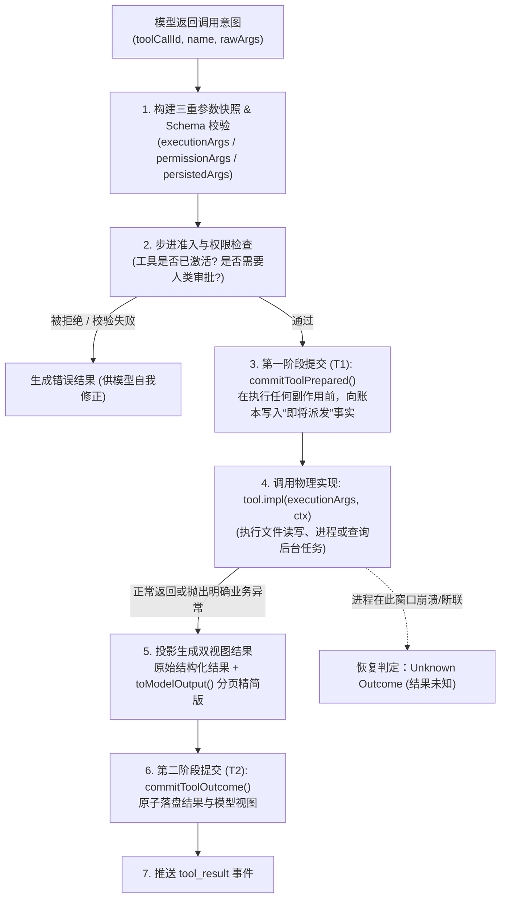

# 工具执行内核：从意图到可提交的运行事实

[返回手册目录](../README.md)

在原型阶段，调用一个工具似乎只需要执行 `tools[call.name](call.args)`。但在工业级 Agent 系统中，模型发出的参数本质上是**不可信的外部输入**，且工具调用往往伴随着真实的副作用（修改磁盘文件、执行终端命令、扣费调用外部 API）。

如果工具刚把文件改写完，进程却在将结果写入数据库前崩溃了，系统重启后该如何知道刚才那次写操作是否真的发生过？如果模型读取了一段 10MB 的后台构建日志，如何在不撑爆模型上下文的前提下，让人类用户和界面依然能看到完整细节？

本章深入剖析 Maka 的工具执行内核（`ToolRuntime`），看它是如何通过**三重参数快照、两阶段原子提交以及结果双视图投影**，将模型的一句调用意图安全地转化为可审计、可恢复的运行事实的。

---

## 1. 概念先行：一次工具调用的生命周期

当 `AiSdkTurn` 从模型响应中收集到一个工具调用（例如 `Read("maka://runtime/background-tasks/shell-run-1")`），它会将接力棒交给 `ToolRuntime.settleToolCall()`。这里的 **Settle（结算）** 强调的不是简单运行函数，而是“完成校验、授权、执行、投影并落盘的完整闭环”。



---

## 2. 关键机制深度解析

### 2.1 为什么要把参数拆成“三重快照”？
在入口处，Maka 会将模型传来的原始参数加工并固化为三个不同用途的视图，后续流程严禁互相混用：
1. **`executionArgs`（执行参数）**：经过路径规范化（如相对路径解析为绝对路径）和默认值填充后，真正交给 `tool.impl()` 运行的参数。
2. **`permissionArgs`（审批参数）**：经过摘要或格式化，用于向人类用户弹窗展示“Agent 申请执行什么操作”的安全视图（避免把冗长的无意义字段或混淆字符展示给审批者）。
3. **`persistedArgs`（持久化参数）**：经过敏感信息脱敏与体积截断后，最终写入 `RuntimeEvent` 历史账本的归档视图。

### 2.2 为什么必须采用“先写 T1 准备，再执行，后写 T2 结果”的两阶段提交？
这是区分玩具 Agent 与生产级可靠系统的核心分水岭。
假设不记录 T1（派发准备），系统直接运行 `Write("config.json", ...)`，然后再把结果写进数据库。如果文件刚写完的一瞬间机器断电了：
- 重启后扫描数据库，里面**根本没有这次工具调用的任何记录**！
- 恢复引擎会误以为上次什么都没发生，可能会重新发起请求，导致外部副作用被重复执行。

通过引入通过同一个 `operationId` 串联的 **T1 + T2 两阶段提交**：
- **T1 (`commitToolPrepared`)**：在物理副作用发生之前，先把“我即将以参数 X 执行工具 Y”的事实锚定到账本中。
- **T2 (`commitToolOutcome`)**：工具执行结束后，原子写入执行结果与模型投影。
- **崩溃防护**：如果在 T1 之后、T2 之前系统崩溃，恢复扫描器就能精准识别出“存在未闭合的 T1”，明确知道该工具处于**可能已生效的未知状态（Unknown Tool Outcome）**，从而彻底杜绝盲目重跑。

### 2.3 同一次读取，为什么需要两份结果表示？
以模型通过 `Read` 工具读取一个后台任务详情（`maka://runtime/background-tasks/shell-run-1`）为例：
- **底层实现 (`Read.impl`)**：读取出包含完整标准输出、进程状态（`running`）、退出码、修订版本的完整结构化对象。这个完整对象供调用程序、前端卡片渲染或脚本后续处理使用。
- **模型投影 (`Read.toModelOutput`)**：通过分页器将冗长的输出整理成固定页大小的摘要（如 `{ content, next: "offset=200", metadata: { status: "running", revision: 3 } }`）。
- **设计价值**：模型只消费轻量、分页的文本视图，既能读懂状态继续推理，又不会被上万行无用日志撑爆上下文；同时前端界面仍能拿到完整的结构化数据进行交互式渲染。

---

## 3. 进阶路径：Code Mode 中的嵌套工具调用

在某些批量处理场景（如一次性检索并分析 50 个配置文件），让模型每调一次工具就来回往返一次网络请求效率太低。Maka 支持 **Code Mode（代码模式）**：模型通过 `exec` 工具提交一段脚本，在脚本内部直接调用 `tools.Read(...)` 批量处理数据。

**重要设计原则：嵌套调用绝不绕过安全内核！**
脚本中调用的 `tools.Read()` 在底层依然路由回同一个 `ToolRuntime.settleToolCall()`：
- 继承父调用的身份标识并附带 `parentCallId` 形成调用树；
- 依然经过完整的参数校验、权限边界检查、T1/T2 持久化提交；
- 脚本代码在内存中拿到的是完整结构化结果 `settlement.result` 以便进行逻辑过滤，而最终只把处理后的精简结论作为外层 `exec` 的返回值送回大模型。

---

## 4. 教学伪代码：`ToolRuntime` 结算契约

```text
function settleToolCall(call, turnContext, eventSink):
    // 1. 工具查找与当前步激活状态校验
    tool = turnContext.snapshotTools.get(call.name)
    if tool == null:
        return emitErrorOutcome(call.id, "Tool not found or not active in this step")

    // 2. 生成三重快照与参数 Schema 校验
    try:
        args = buildArgSnapshots(tool.schema, call.rawInput, turnContext.cwd)
    catch ValidationError err:
        // 参数格式错误属于可修复错误，直接作为错误结果返给模型自己纠正
        return emitErrorOutcome(call.id, err.message)

    // 3. 权限准入检查 (路径边界 / 客户端能力 / 人类确认门控)
    permission = await authorizer.check(tool, args.permissionArgs, turnContext)
    if not permission.granted:
        return emitErrorOutcome(call.id, "Permission denied: " + permission.reason)

    // 4. [T1] 原子提交“即将执行”事实，封堵崩溃黑洞
    operationId = generateOperationId()
    await commitSink.commitToolPrepared({
        operationId,
        toolCallId: call.id,
        args: args.persistedArgs
    })

    // 5. 真正派发执行副作用 (带取消信号与上下文身份)
    try:
        rawResult = await tool.impl(args.executionArgs, {
            sessionId: turnContext.sessionId,
            runId: turnContext.runId,
            operationId,
            cwd: turnContext.cwd,
            signal: turnContext.abortSignal
        })
        modelOutput = tool.toModelOutput(rawResult)
        outcome = { status: "success", rawResult, modelOutput }
    catch Exception err:
        outcome = classifyExecutionError(err, turnContext.abortSignal)

    // 6. [T2] 原子提交结果与模型投影，并向事件流发布
    await commitSink.commitToolOutcome(operationId, call.id, outcome)
    eventSink.push(toolResultEvent(call.id, outcome))
    
    return outcome
```

---

## 5. 对照 Pi：钩子管道 vs 持久化结算内核

| 对比维度 | Maka (`ToolRuntime.settleToolCall`) | Pi (`agent-loop.ts`) |
| :--- | :--- | :--- |
| **执行前拦截** | 校验三重参数快照、检查 `ExecutionBoundary` 与会话授权 | 依次触发 `prepareToolCall`、`beforeToolCall` 内存钩子 |
| **持久性保证** | 强制经过 T1（准备）与 T2（结果）两阶段持久化提交，显式识别崩溃窗口 | 内存直接调用执行，再触发 `afterToolCall` 将消息追加进会话 |
| **结果形态** | 严格区分面向调用方的原始结构化输出与面向模型的分页投影输出 | 允许工具返回结构化字段，供界面与扩展读取 |
| **适用定位** | 适用于需要强审计、崩溃恢复、跨端协同和严格沙箱边界的生产平台 | 适用于高度灵活、依赖插件钩子快速定制的本地编码助手 |

---

## 6. 延伸阅读

- 了解 T1 到 T2 之间发生进程崩溃后，恢复引擎如何裁决，阅读 [04.1 持久化执行与崩溃恢复](../04-state/durable-execution.md)。
- 了解系统内置的文件读写和外壳命令工具是如何在沙箱中运行的，阅读 [03.3 执行环境与操作系统沙箱](sandbox.md)。
- 了解工具来源不仅可以是内置函数，还可以来自远端 MCP 或前端浏览器，阅读 [03.2 MCP 连接与客户端能力](mcp-and-client-capabilities.md)。
