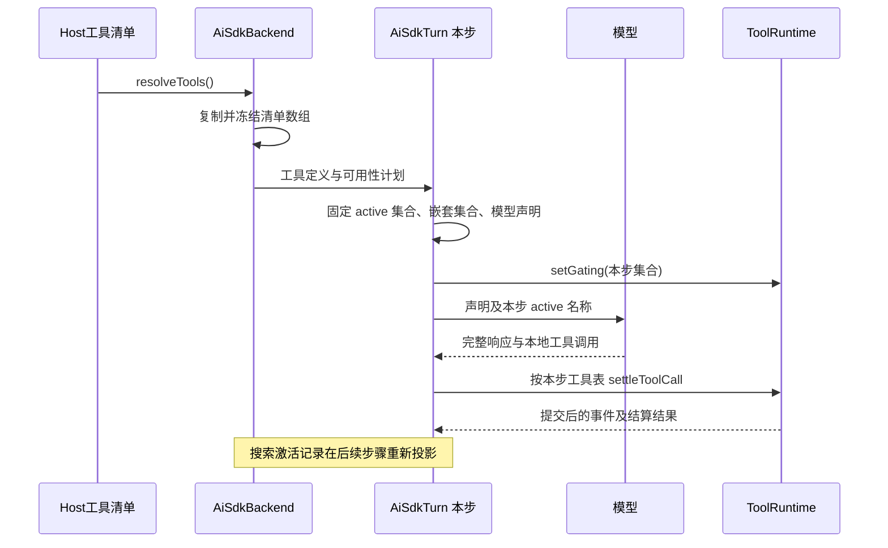
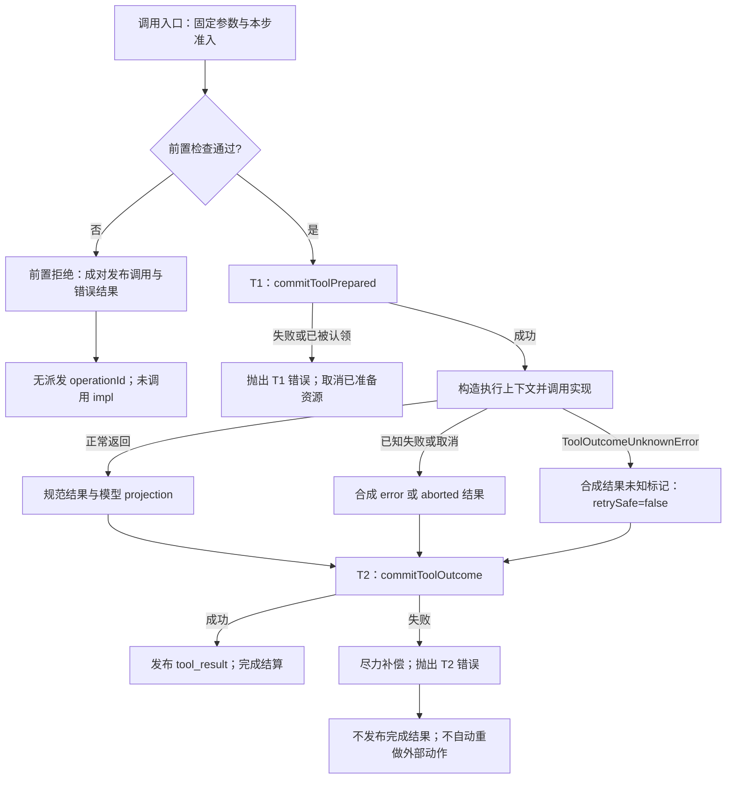
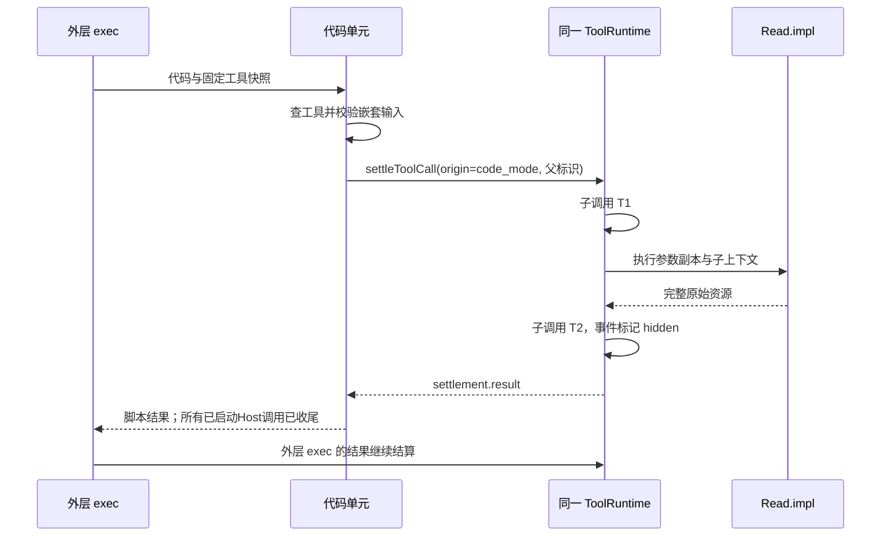

[手册目录](../README.md)

# 工具执行内核：从声明到可提交结果

假设模型调用 `Read`，参数是 `{"path":"maka://runtime/background-tasks/shell-run-1"}`。
程序调用者获得的是带 `status`、`revision`、`output` 的后台任务对象，模型看到的则是带 `content`、`next`、`metadata` 的分页结果。
如果读取已经完成但保存结果失败，系统也不能简单地声明“未读取过，重新执行一次”。
这三个现象指向同一个问题：工具执行不是调用一个函数后将返回值写回提示词。
它还必须决定谁能执行、执行属于哪次运行、什么结果可以发布，以及取消之后由谁负责收尾。

本文以 2026-10-24 的静态阅读为依据：Maka 固定在 `15d0a0dd19d39e2bc09ae35940e432c636982315`，Pi 固定在 `482c1381a00d8d00bc81697e4a980c593db6803e`。
证据来自源码和现有测试；没有安装依赖、运行测试、连接真实工具服务或调用模型。
文中的运行过程是沿源码展开的控制流，不是本次实测日志。

## 1. 工具声明与实现的分离

`MakaTool<P, R>` 是 TypeScript 接口：描述一个对象应具备哪些字段，不要求像 Java 那样继承某个工具基类。
`P` 表示参数类型，`R` 表示结果类型；这些静态类型本身不检查模型传回的 JSON。
真正的运行期检查依赖 `parameters` 所提供的 schema（参数形状与约束）及其校验能力。

下面是 `MakaTool` 中两个字段的真实摘录，中间省略其他字段：

```ts
parameters: unknown;
impl: (args: P, ctx: MakaToolContext) => Promise<R> | R;
```

`unknown` 表示使用前必须识别其结构；它不是“已经验证过”。
`Promise<R> | R` 表示实现可以立即返回，也可以返回一个将来完成的结果。
`await` 等待后者完成时会让出 JavaScript 执行机会，不等于占用一条 Java 工作线程。
这也解释了为什么执行器必须在第一个 `await` 之前完成某些登记：让出执行机会后，另一个调用就可能进入。
定义见 [MakaTool 与执行上下文](../../../../maka/packages/runtime/src/tool-runtime.ts#L178)。

工具定义的字段围绕几个不同问题协作，不能互相替代：

- `name`、`description`、`parameters` 告知模型“如何请求”；`impl` 才是实际函数。
- `discovery` 控制直接展示还是先搜索；源码明确说明它不授予权限。
- `executionSemantics` 控制同一步能否与其他调用共存；`nesting` 控制能否进入 Code Mode。
- `hostAdmission` 标记Host准入契约，`executionFacts` 携带受信任的执行器事实；它们不是模型自报的权限。
- `permissionArgs` 产生权限检查、展示与部分持久化所需的参数视图，不负责调用工具。
- `resultOutcome` 显式解释结果状态；`toModelOutput` 生成模型视图；补偿回调只处理 T2 提交失败后的特定清理（T1/T2 指工具执行前后的两次事实持久化提交，见下文 T1 小节）。

`snapshotStepTools()` 构造模型工具表时，对普通工具仅纳入 `description` 和 `inputSchema`，不纳入 `impl`。
因此模型返回一个工具名和输入，并不意味着模型供应商已经执行了本地函数。
原生工具声明另有 `providerTool` 分支；是否远端执行还要看返回事件，不能仅凭这个字段判断。
见 [模型工具声明的构造](../../../../maka/packages/runtime/src/ai-sdk-turn.ts#L1176)。

## 2. 工具视图的每步固定机制

这里的 step 是一次模型推理步骤：首先请求模型，得到完整的调用集合，再执行本地工具，随后决定是否进入下一步。
一次用户请求可以包含多个 step，而同一个 `ToolRuntime` 可以贯穿这些步骤。

假设模型在一步内同时提出“搜索工具 X”和“调用 X”。
搜索改变的是后续步骤的激活记录，不能使同一批次中原本不可用的 X 因并发执行而突然变为可用。
否则，同样的模型响应会因两个 Promise 的完成顺序不同而产生不同的权限入口。
这段因果解释是根据快照实现作出的推断；源码明确契约是执行入口使用本步的 active 集合。



Backend 的 `snapshotToolAvailability()` 每次从 `resolveTools()` 或初始工具数组取值，复制数组并 `Object.freeze`。
这是数组级冻结，不是递归冻结所有工具对象，更不是将远端连接变为永久有效。
随后创建 `ToolAvailabilityRuntime`，生成完整分发表、模型激活名称与执行入口的 gating（可用性门禁）。
见 [Host工具快照](../../../../maka/packages/runtime/src/ai-sdk-backend.ts#L446)。

可用性计划还维护“工具名 → 激活身份”的记录。
等价Host包装可以保持激活；贡献身份改变后，旧记录会被清除，不能仅因同名就继承已加载状态。
`tool_search` 修改共享激活记录，但本步 `step.active` 不被原地修改。
未启用搜索配置时采用直接工具计划，因此“所有 Maka 工具都必须先搜索”同样不成立。
见 [计划与激活快照](../../../../maka/packages/runtime/src/tool-availability.ts#L328)。

模型响应完成后，Turn 从当前快照建立 `toolsByName`，调用 `settleToolCall()`。
同批调用可以并发，但通过 `Promise.allSettled` 等待全部结算：它收集成功和失败，而不是遇到第一个失败就放弃等待其他工具。
工具事件消费完成后，下一步从持久化历史重建模型输入，不将这一批的原始返回对象直接拼接进提示词。
见 [本地调用批次与历史重建](../../../../maka/packages/runtime/src/ai-sdk-turn.ts#L2212)。

Backend 的 `send()` 返回 `AsyncIterable`，即“异步地逐个提供事件”的对象。
它不同于只代表一个最终结果的 Promise；调用方用 `for await` 逐个接收事件。
`queue.push()` 只表示事件入队，不能据此推断事件已被上层消费或落盘。
Turn 的 drain 在 `yield` 之后才确认消费，这也是执行、事件发布、历史持久化不能混称为“返回”的原因。
见 [send 生命周期](../../../../maka/packages/runtime/src/ai-sdk-backend.ts#L585)与 [drain 的消费确认](../../../../maka/packages/runtime/src/ai-sdk-turn.ts#L3070)。

## 3. settleToolCall 与 execute 的差异

入口接收已经解析出工具对象的 `ResolvedMakaToolCall`：包含工具、输入、`turnId`、可选 `stepId`、`toolCallId`、取消信号和事件出口。
嵌套调用还带 `origin`、父调用标识、父操作标识以及结果大小限制。
`toolCallId` 关联模型或嵌套调用；`operationId` 则关联运行时持久化操作，两者不应混用。

`settleToolCall()` 首先调用 `performToolSettlement()`，把其 Promise 加入 `activeToolSettlements`。
无论成功还是拒绝，都会移除该 Promise；但只有实际结算之后才移除。
`performToolSettlement()` 调用真正的 `executeTool()`，最后返回 `{ result, providerError? }`。
普通工具错误可以转化为返回值；持久化边界错误与部分交互控制错误仍然向上抛出。
见 [结算入口](../../../../maka/packages/runtime/src/tool-runtime.ts#L795)。

在理解以下流程之前，首先定义 T1、T2：它们是源码使用的两处持久化边界。
T1 记录调用及“允许开始派发”的事实；T2 记录执行结果和模型视图。
它们不是把文件系统、网络服务和数据库纳入同一个事务，也不承诺外部动作恰好执行一次。
下图假设已经注入 `RuntimeCommitSink`，展示常规结果收束；交互状态不变量等控制错误仍会直接向上抛出。



### 固定输入：三类参数对象的分离

`executeTool()` 第一行就调用 `snapshotToolArgs(args)`，递归建立冻结快照。
这一步在首次 `await` 前完成，防止调用者在校验等待期间修改输入。
它不是任意 JavaScript 对象的序列化器；访问器、循环引用等不符合快照约束的输入可能直接抛错，不能将所有异常都理解为后续的合成工具结果。
见 [入口与同步准入](../../../../maka/packages/runtime/src/tool-runtime.ts#L1087)。

`buildToolCallArgs()` 按顺序建立三个视图：

| 视图 | 产生方式 | 使用方 |
| --- | --- | --- |
| `executionArgs` | 入口参数的冻结快照 | 执行实现、结果映射的输入依据 |
| `permissionArgs` | `permissionArgs` 钩子收到独立可变副本；输出重新快照 | 权限相关策略、签名与展示 |
| `persistedArgs` | 通常采用权限视图；Computer Use 有专门的字段投影 | `tool_start` 与持久化 `function_call` |

因此修改权限展示参数，并不等同于修改实际执行参数。
Computer Use 的特例是为了让回放继续使用工具自己的参数字段名，同时缩减敏感值；不应将Host审批摘要直接视为模型曾经发出的调用。
这是源码注释明确解释的问题，见 [三个参数视图及构造顺序](../../../../maka/packages/runtime/src/tool-call-snapshot.ts#L147)。

此处存在一个容易由 Java 校验库经验引入的误读：校验通过，不代表采用解析器生成的新对象。
`validateDeclaredToolArgs()` 尝试 `safeParseAsync`、`safeParse`、`validate` 或 Standard Schema 的校验函数，但成功时只返回，不取 `parsed.data` 或 `parsed.value` 替换参数。
因此不能依赖这个入口把字符串自动转成数字、填入默认值或应用转换规则。
如果传入的 schema 只是没有这些方法的普通对象，这个函数也不会自行启动通用 JSON Schema 校验器。
见 [运行期校验实现](../../../../maka/packages/runtime/src/tool-call-snapshot.ts#L58)。

### 前置拒绝：配对调用事实的保留

`admitToolForStep()` 在首个等待前登记本步调用数量及独占工具名。
若独占工具已经登记，后续兄弟调用被拒绝；若普通调用已登记，后来到达的独占调用被拒绝。
它不是先检查整批再回滚所有兄弟调用；没有 `stepId` 时也不提供这项约束。
Code Mode 的 `direct_only` 拒绝更早成立，并跳过参数校验和权限参数投影。
见 [独占准入规则](../../../../maka/packages/runtime/src/tool-runtime.ts#L2148)。

接下来检查参数错误、重复失败门禁、尚未激活的延迟工具等条件。
一般失败门禁依据调用签名和连续失败次数，不是简单按工具名全局禁用。
拒绝统一进入 `refuseBeforeDispatch()`：发布 `tool_start`，再写入合成错误结果，二者均走普通事件路径，不冒用 T1 派发身份。
“没有 operationId”不等于“没有记录”；此处恰恰需要记录一对未执行的调用与响应。
见 [前置拒绝为何不能提前标记派发身份](../../../../maka/packages/runtime/src/tool-runtime.ts#L1172)。

### 执行准备与 permission：审批回调的按工具差异

`permissionArgs` 只是数据投影，不会因生成了摘要就自动批准调用。
运行时从注入的 `readExecutionBoundary` 与 `readPermissionMode` 读取执行边界和权限模式，再把这些事实交给执行链。
一般工具在 T1 后构造执行上下文时读取它们；具体执行器如何拒绝路径或发起审批，并不由此处统一负责。
因此“所有权限拒绝都发生在 T1 前”是错误概括。

特殊分支是 `hostAdmission === 'client_capability'`：它在 T1 前读取边界，且必须提供 `prepareExecution`。
源码条件是：边界为 `bypass`，或者当前权限模式为 `ask`，才可继续准备；不是只有 bypass 才能使用客户端能力。
即便 bypass 也必须准备，不能借此恢复一个 T1 前直接派发客户端操作的旁路。
准备返回 `{ execute, cancel }`：先取得可执行安排，T1 后才调用 `execute(context)`。
见 [客户端能力准入与准备](../../../../maka/packages/runtime/src/tool-runtime.ts#L1415)。

准备失败则进入前置拒绝；准备成功但随后子代理容量不足或 T1 失败，则调用 `cancel()` 释放准备占用。
这不是通用事务回滚接口，也不是每个 `impl` 都会自动拥有的取消方法。
准备期间暂停相关 watchdog（检测长时间无流量的计时器），结束后恢复。
完整客户端 accepted、approval、admitted 协议属于独立的 [MCP 与客户端能力专题](mcp-and-client-capabilities.md)。

### T1：提交接口的运行时注入

`prepareDurableToolAttempt()` 从构造参数取得 `runtimeCommitSink`；未注入时返回 `undefined`，执行链不获得 T1/T2 保证。
注入后要求 `runId`、`invocationId` 和操作标识完整，并在提交前检查取消信号。
`operationId` 由 `invocationId` 与 `toolCallId` 确定；调用参数另外计算散列，用来表达调用内容身份。
T1 提交包含模型可回放的 `function_call` 与单独的派发事实。
见 [提交接口与操作标识](../../../../maka/packages/runtime/src/runtime-commit-sink.ts#L26)。

`commitToolPrepared()` 返回 `created: false` 时，运行时认为该操作已被认领，抛出 T1 错误，不再执行。
只有 T1 成功才发布派发路径的开始事件，并把本次 attempt 纳入 `durableToolAttempts`。
这里的 attempt 是携带操作身份和结果提交闭包的一次尝试，不是后台重试线程。
`recoveryMode` 仅决定如何表达结果未知；源码明确不授权自动重试。
见 [T1 的构造与认领检查](../../../../maka/packages/runtime/src/tool-runtime.ts#L1937)。

### 调用实现：执行资源的上下文传递

`MakaToolContext` 带入会话、运行、回合、调用、操作标识，以及工作目录、执行边界、权限模式、取消信号。
`emitOutput(stream, chunk)` 发送增量输出，`emitProgress` 发送有界的即时进度；它们都不等于最终结果。
需要子会话、用户问题或边界扩展的工具，通过上下文中的可选能力调用Host，而不是隐式地自行创建第二套运行时。

实际派发路径只有两条：有准备对象就调用 `preparedExecution.execute(toolContext)`；否则向 `impl` 提供执行参数的独立副本。
整个工具执行期间暂停模型流空闲检测，因为上一段模型流已经结束，下一段请求尚未开始，此时供应商安静属于正常现象。
这不等于工具无限时：具体工具及外层运行仍可有自己的时限；此处没有一个替代全部工具时限的统一超时。
见 [上下文和实际调用](../../../../maka/packages/runtime/src/tool-runtime.ts#L1533)。

## 4. Read 测试数据的字段流转

现有测试 `Read treats runtime background task refs as whole resources` 给运行资源读取器注入了一个假实现。
`Read.impl` 解析地址后调用 `readRuntimeResource(sessionId, path, abortSignal)`，直接返回整个资源；并未在这个分支提前截成文本页。
测试记录并断言 `sessionId` 为 `session-1`、`ref` 为该资源地址；调用还传入取消信号，原始结果的 `kind` 是 `shell_run`、`status` 是 `running`。
见 [Read 的资源分派](../../../../maka/packages/runtime/src/builtin-tools.ts#L355)与 [该测试](../../../../maka/packages/runtime/src/__tests__/builtin-tools.test.ts#L1537)。

以下是测试返回对象的数据展开：`ref` 已替换为测试输入，其余字段值保持原样；不是本次真实命令输出。

```json
{
  "kind": "shell_run",
  "ref": "maka://runtime/background-tasks/shell-run-1",
  "mode": "pipes",
  "status": "running",
  "cwd": "/workspace",
  "cmd": "sleep 60",
  "startedAt": 1,
  "updatedAt": 2,
  "revision": 2,
  "output": {
    "mode": "pipes",
    "stdout": "background task detail",
    "stderr": "",
    "stdoutTruncated": false,
    "stderrTruncated": false,
    "redacted": false
  }
}
```

这次 Read 已经成功，后台 shell 仍在 running，二者并不矛盾：读取任务状态不是等待任务结束。
执行器用 `resultOutcome` 或结果分类函数判断的是本次工具调用状态，不能仅凭业务字段 `status` 就替其下结论。
普通 JSON 中的 `{ "ok": false }` 也不会被通用规则一律判定为调用失败；需要显式结果契约。
见 [结果状态推导](../../../../maka/packages/runtime/src/tool-runtime.ts#L3428)。

`Read.toModelOutput()` 对这种运行时资源把完整对象交给 `readToolResultPage()`。
后者提取 stdout/stderr 为正文，把执行状态及截断标志放入 metadata，再生成页。
下面是根据映射源码展开的模型输出对象；测试直接断言 `type: 'json'` 和正文，完整 metadata 来自静态推导。

```json
{
  "type": "json",
  "value": {
    "content": "background task detail",
    "offset": 0,
    "returnedLines": 1,
    "totalLines": 1,
    "next": null,
    "metadata": {
      "kind": "shell_run",
      "mode": "pipes",
      "status": "running",
      "revision": 2,
      "stdoutTruncated": false,
      "stderrTruncated": false,
      "redacted": false
    }
  }
}
```

这里没有 `cmd`、`cwd` 和时间戳，不是原始资源遗失，而是模型视图选择了另一种表示。
它也不把空 stderr 拼接为额外空行；非空输出才参与换行拼接。
这条具体规则见 [可读正文提取与 metadata](../../../../maka/packages/runtime/src/read-page.ts#L240)。

将该测试数据关联到已注入持久化接口的执行链上，得到以下教学状态追踪；这并不宣称一个测试覆盖了全部层次。

| 时点 | 数据与身份 | 此时可断言的内容 |
| --- | --- | --- |
| 收到调用 | `input.path`，`toolCallId` | 仅为请求，尚未读取 |
| 固定参数 | 三个参数视图；Read 无自定义权限参数投影 | 执行输入不会被等待期间的外部修改替换 |
| T1 完成 | `function_call.args` 和派发事实共享 `operationId` | 本次操作获准开始；尚无读取结果 |
| `impl` 完成 | 上面的完整 `shell_run` 对象 | 本次观察完成，不代表后台进程完成 |
| 规范化与映射 | 规范 `content` 保留合法 shell 结果；另生成分页视图 | 程序结果和模型结果开始进入不同通道 |
| T2 完成 | `function_response.result`、`outcome`、`modelProjection` | 结果事实及模型表示已经提交 |
| 发布与返回 | `tool_result.content` 是规范结果；`settlement.result` 是原始对象 | 事件消费与程序返回各有明确用途 |
| 下一模型步骤 | 重建历史，使用有效模型投影 | 模型获得分页对象，不自动获得完整原始资源 |

`coerceResultContent()` 接受合法的规范结果；不符合规范的对象会退回 JSON 包装。
因此不应将所有 `settlement.result` 与 `tool_result.content` 视为同一数据形状。
例如普通文件 Read 从文件执行器的 `read` 结果中移除 `kind`，返回页对象；持久化规范结果会是 `{kind:'json', value:页对象}`。
见 [结果规范化](../../../../maka/packages/runtime/src/tool-runtime.ts#L3273)。

### 分页：模型表示限制与底层读取

普通文件由文件执行器接受 `offset`、`limit` 或 continuation；运行时资源分支则先取得整个资源，再为模型分页。
`offset` 从零计行，`limit` 是正整数；默认页预算为 7500 字节，预算计算包括序列化后的页结构，不只是正文。
长行允许分段，`partialLine` 表示行被切开；分页实现避免把 UTF-16 的代理对拆开。
续读地址保存位置和正文摘要；位置是字符串位置，不是文件字节偏移，摘要用于拒绝内容变化后的旧续读请求。
见 [Read 页参数与分页算法](../../../../maka/packages/runtime/src/read-page.ts#L25)。

例如只请求三行文本中的第二行，`next: null` 可以表示请求范围已读完，不保证整个文件已到 EOF。
后台任务继续追加输出也可能使旧续读地址失效，需要重新读取原地址；不应将续读地址视为永久有效的文件句柄。
`maka://runtime/tool-results/` 由其专门路径处理，Read 映射器返回 `undefined`，不再重复应用这种资源分页。
图片同样跳过文本分页，普通文件图片读取要求 `snapshotImage` 和有效 `operationId`，以操作身份拥有快照。
见 [Read 的映射例外与图片路径](../../../../maka/packages/runtime/src/builtin-tools.ts#L304)。

## 5. toModelOutput 之后的结果提交边界

`toModelOutput` 收到原始 `result`，不是 `coerceResultContent` 的规范包装；其 `input` 是执行参数视图。
这允许程序保留结构丰富的结果，模型仅获得适合推理的表示。
但它必须同步返回：返回 Promise 不会被当作合法异步映射来等待，而是得到固定的投影失败结果。
抛出异常也采用同一失败结果；返回 `undefined` 才表示使用默认映射。
源码明确把这称作同步且总能收束的映射边界，避免已经完成的动作阻塞在 T2 之前。
见 [投影错误处理](../../../../maka/packages/runtime/src/tool-runtime.ts#L829)。

同步要求针对工具提供的映射函数；随后由运行时负责的附件编码仍可能异步保存资源。
`ToolResultOutput` 的 `{type:'json', value:...}` 会编码为持久化的 `{version:1, kind:'json', value:...}`。
投影失败不自动改写原始执行结果，也不必然把本次工具 outcome 从 success 改成 error。
因此“动作是否完成”与“模型表示是否生成成功”需要分别确认，不能只查看一个布尔值。
见 [持久化模型投影编码](../../../../maka/packages/runtime/src/durable-tool-result-projection.ts#L58)。

`commitAndPublishToolResult()` 先等待 attempt 的 `commitOutcome`，成功后才把结果事件入队。
T2 中同时保存规范结果、模型投影、结果状态和调用关联；成功提交后才缓存提交结果并移除 attempt。
下一步读取投影时，损坏的已有投影会变成明确失败表示，而不是隐式地返回完整原始结果。
见 [提交后发布](../../../../maka/packages/runtime/src/tool-runtime.ts#L1052)与 [有效投影解码](../../../../maka/packages/runtime/src/durable-tool-result-projection.ts#L252)。

## 6. 三类失败的区分

前置拒绝意味着未派发实现；工具执行后的已知失败意味着已经进入执行链，只是结果为 error 或 aborted。
第三类是未知副作用：例如客户端动作可能已完成，但确认丢失，执行器抛出 `ToolOutcomeUnknownError`。
这时合成的规范文本结果带 `uncertainOutcome: {code:'outcome_unknown', retrySafe:false}`，仍可以通过 T2 记录下来。
“未知”优先于普通取消分类：同时收到取消，也不能把可能发生的动作改述为“确定未发生”。
见 [异常分类与合成结果](../../../../maka/packages/runtime/src/tool-runtime.ts#L1765)。

另一个不同问题是 T2 本身失败：实现可能成功，但执行记录没有完成提交。
运行时保留持久化边界错误向上抛出，不伪造一个已提交的成功结果，也不自动再调用 `impl`。
补偿回调可以清理特定资源，但只能尽力而为；补偿失败不能覆盖原来的 T2 错误。
注意它收到的是提交用的规范 `content`，不是任意原始返回对象。
见 [T2 与补偿闭包](../../../../maka/packages/runtime/src/tool-runtime.ts#L2101)。

Read 的补偿就是一个有边界的例子：仅释放当前会话的 `session_context` 图片快照，不任意删除其他资源。
这说明补偿是“知道自己拥有哪个资源后进行清理”，而不是将文件、客户端动作和网络请求自动倒放。
现有 SQLite 边界测试进一步断言：T2 注入失败后再次提交同一调用，执行次数与投影附件写入次数仍是一次，且不发布 `tool_result`。
它验证具体重复调用路径不会重做效果，不证明所有外部系统都具备恰好一次语义。
见 [T2 失败后的重复调用测试](../../../../maka/packages/runtime/src/__tests__/tool-runtime-sqlite-boundary.test.ts#L516)。

## 7. ToolRuntime 的资源持有与取消等待

Backend 为每次 `send()` 创建一个 ToolRuntime，并固定该次 turn/run 身份及 watchdog、trace 的访问范围。
这避免了旧工具缓慢结束时，将结果误写入新一轮请求的运行身份。
它拥有的是该回合的协调状态，不拥有整个会话全部资源的实现。
见 [每次 send 的运行时作用域](../../../../maka/packages/runtime/src/ai-sdk-backend.ts#L488)。

关键字段应结合关闭顺序理解，而不是仅记忆字段表：

- `activeToolSettlements` 保存尚未结算的调用，包括嵌套调用；终止时必须等待其收尾。
- `durableToolAttempts` 保存操作身份和提交闭包；映射清空后，执行函数局部仍持有本次 attempt。
- 问题、表单、边界请求的等待注册表保存尚未得到决定的 Promise；关闭时应使这些等待得到结论。
- `stepAdmissions`、失败签名、边界失败状态与子调用限额约束本回合；它们不是跨进程持久化锁。

`endTurn()` 关闭相应的交互等待，重置本回合状态，再用 `Promise.allSettled` 等待在途结算收尾。
这段等待是必要的：被关闭的问题会在稍后的异步执行中生成 aborted 结果，它仍须沿原 operationId 写 T2，之后才能把运行标记终结。
已有回归测试明确断言 `endTurn()` 返回时 outcome 已提交，且标识与 T1 一致。
见 [关闭顺序](../../../../maka/packages/runtime/src/tool-runtime.ts#L582)与 [回合关闭结果身份测试](../../../../maka/packages/runtime/src/__tests__/tool-runtime-turn-close-outcome.test.ts#L120)。

`AbortSignal` 是协作取消：调用者通知“请停止”，实现负责观察并尽快完成或拒绝。
它不同于强制终止线程；如果扩展实现不响应信号，等待其结算也可能长时间不结束。
源码对 `impl` 的明确契约是观察信号、及时结算，不允许运行时拥有的嵌套副作用脱离父调用继续漂移。
这是一项实现者义务，不能仅靠类型系统保证。

## 8. Code Mode：嵌套调用与原始结果返回

Code Mode 的 `exec` 让模型提交代码，由代码调用 `tools.Read(...)` 等Host工具。
它本身是独占 step、禁止再嵌套的工具；进入单元时复制可嵌套工具表，不随脚本执行实时扩大集合。
原生供应商工具通常不进入该表；ApplyPatch 有转换为可移植工具的专门处理。
见 [可嵌套集合](../../../../maka/packages/runtime/src/ai-sdk-turn.ts#L455)与 [exec 定义](../../../../maka/packages/runtime/src/ai-sdk-turn.ts#L831)。



嵌套调用 ID 使用外层 ID 加 `:nested:` 和新 ID；本单元子调用共享一个嵌套 step ID。
事件标记 `origin:'code_mode'`、`modelVisibility:'hidden'`，并关联 `parentToolCallId` 与可用的 `parentOperationId`。
hidden 表示不直接作为普通顶层模型历史展示，不表示没有记录、不校验或不提交。
执行完毕后返回脚本的是 `settlement.result`，因此脚本可读取完整 `shell_run.output`；不是上文分页后的模型 projection。
见 [Code Mode 的实际分派](../../../../maka/packages/runtime/src/ai-sdk-turn.ts#L2688)。

这里还有一层独立输入校验：`validateCodeModeToolInput()` 会采用解析后的值，并为普通 JSON Schema 提供校验路径。
它发生在进入 `settleToolCall()` 之前；这类查表或校验失败，不应期待出现子调用自己的 T1/T2。
这与普通入口“校验但不替换解析结果”不同，阅读时不应将其合并为“所有工具统一解析参数”的表述。
见 [嵌套输入校验](../../../../maka/packages/runtime/src/ai-sdk-turn.ts#L490)。

代码单元跟踪所有已启动的Host Promise，在成功和失败路径上都等待它们收尾。
持久化边界错误被指定为致命错误：即使脚本用 try/catch 捕获了子调用异常，外层仍保留首个致命错误并中止其他调用。
单元的执行预算与Host等待时间分开；结果字节检查发生在工具实现返回后，超限不意味着此前没有副作用。
因此 Code Mode 提供受控编排，不把多个子工具合成可整体回滚的事务。
见 [代码单元的跟踪与 drain](../../../../maka/packages/runtime/src/code-mode.ts#L119)。

## 9. provider-executed 工具的执行路径

`origin:'provider'` 在本地 ToolRuntime 中表示调用来自模型，并不等于工具由供应商执行。
真正的 provider-executed 分支由模型流事件中的 `providerExecuted` 标记驱动。
Turn 直接把相应 tool-call/result 映射为事件，保留 `providerOutput`，不会再交给本地 `settleToolCall()` 派发一次。
因此不应将本地 T1/T2 对外部动作的控制能力套用到供应商内部搜索上。
见 [远端执行事件分支](../../../../maka/packages/runtime/src/ai-sdk-turn.ts#L1871)。

供应商只要已经发出这种工具输入活动，就可能已经启动外部工作；Turn 会记录工具活动，限制后续自动重试。
相反，`providerTool` 为原生 ApplyPatch 声明时仍可能由本地实现执行，继续走 ToolRuntime。
判断边界应同时检查声明类型与实际流事件，而不是按工具名称推断。
MCP 连接如何产生本地工具、客户端能力如何准备和派发，分别在 [连接与客户端能力](mcp-and-client-capabilities.md) 展开。

## 10. 与 Pi 对照：执行边界的比较

Pi 默认链应拆分为 `coding-agent` 的工具集成、`agent` 的执行循环、`ai` 的模型协议与参数处理来阅读。
`coding-agent` 的扩展包装把工具定义转成 `AgentTool`，并注入 runner 创建的工具上下文；调用拦截由 AgentSession 接到 agent-core 钩子。
见 [扩展包装](../../../packages/coding-agent/src/core/extensions/wrapper.ts#L1)和 [定义适配](../../../packages/coding-agent/src/core/tools/tool-definition-wrapper.ts#L8)。

`agent` 已有准备参数、校验、`beforeToolCall`、执行、`afterToolCall` 的完整链。
`runToolCall()` 供工具间调用复用同一链，但不自行发事件或追加消息；这不是缺少嵌套调用能力。
并发模式先顺序准备，再并发执行，结果消息按源调用顺序输出；有 sequential 工具时整批转成顺序执行。
见 [Pi 批次执行](../../../packages/agent/src/agent-loop.ts#L508)与 [嵌套调用入口](../../../packages/agent/src/agent-loop.ts#L802)。

| 具体问题 | Maka 本文路径 | Pi 默认 agent/ai 路径 |
| --- | --- | --- |
| schema 校验后用什么输入 | 普通 ToolRuntime 保留 execution 快照，不采用解析产物 | ai 校验函数复制输入并处理转换，agent 使用返回的 validatedArgs |
| 程序与模型能否看不同结果 | 原始 result、规范 content、持久化 modelProjection 分开 | `content` 给模型，`details` 给展示，`structuredContent` 给程序 |
| 调用前后能否拦截 | 各准入分支及执行上下文能力 | `beforeToolCall` 可阻止，`afterToolCall` 可替换结果字段 |
| 执行后是否自动产生本文的 T2 | 注入 sink 后先提交再发布 | 此处低层循环完成结果、发事件并追加消息，不自行实现 Maka 的提交接口 |

Pi 的结构化结果并非推测：`AgentToolResult` 明确声明 `structuredContent` 不发送给模型。
如果后置钩子替换 `content` 却不提供新的 `structuredContent`，循环会舍弃旧的结构化内容，防止两份表示不一致。
见 [结果契约](../../../packages/agent/src/types.ts#L424)、[后置合并规则](../../../packages/agent/src/agent-loop.ts#L859)和 [ai 参数校验](../../../packages/ai/src/utils/validation.ts#L317)。

Pi 的实验 `packages/durable` 必须单独考察，不能以默认循环代替整个仓库下结论。
其 `resolveAgent()` 从保存的 agent 状态及注册快照组合工具，区分模型可见 `tools`、延迟集合 `deferred` 与供工具间调用的 `callable`。
`callers` 和 `modelTools` 过滤也说明“能注册、能被模型看见、能被其他工具调用”是不同问题。
本节只核实这些实际边界，不据此宣称它与 Maka T1/T2 的恢复语义完全等价。
见 [durable 的工具解析](../../../packages/durable/src/harness/agent.ts#L222)。

## 11. 用现有测试验证理解

阅读测试时应首先确定断言的边界，不应将 fake 的返回值视为真实服务保证。
下面均为静态阅读到的断言，本次未执行：

- [参数所有权测试](../../../../maka/packages/runtime/src/__tests__/tool-runtime-argument-ownership.test.ts#L1)：实现、事件消费者等修改副本，不应改变入口参数；对应“快照不是普通引用”。
- [结算与准备测试](../../../../maka/packages/runtime/src/__tests__/tool-runtime-settlement.test.ts#L37)：缺少 prepare 的客户端工具在 managed/bypass 都不执行；有效路径检验 prepare → T1 → admit，T1 失败则 cancel。
- [前置拒绝账本测试](../../../../maka/packages/runtime/src/__tests__/pre-dispatch-refusal-ledger.test.ts#L328)：拒绝有配对调用与响应，不留下孤立响应，也不生成派发身份。
- [持久化边界测试](../../../../maka/packages/runtime/src/__tests__/tool-runtime-durable-boundary.test.ts#L273)：顺序是 T1 → impl → T2 → 发布；同文件还覆盖同步映射异常、错误异步映射、T2 补偿和未知结果标记。
- [分页测试](../../../../maka/packages/runtime/src/__tests__/read-page.test.ts#L44)：限制范围、Unicode 长行续读和正文变化拒绝，能反驳“next 只是下一行号”的理解。
- [Code Mode 收尾测试](../../../../maka/packages/runtime/src/__tests__/code-mode.test.ts#L516)：取消仍等待Host调用收尾，脚本捕获不能掩盖指定的致命错误。

明确契约包括：执行参数隔离、客户端先准备后派发、T2 成功后发布、同步模型映射、取消后等待在途结算。
“这些边界减少并发时序差异、避免模型结果与执行事实混淆”是基于实现的解释，不冒充作者对整个系统的设计宣言。
本文未验证真实文件执行器的操作系统行为、远端工具副作用、实际数据库崩溃恢复或不合作扩展的退出时限；这些不能由假实现测试推出。

## 相关专题

- [MCP 与客户端能力](mcp-and-client-capabilities.md)：进一步说明工具如何从连接快照变成定义，以及 accepted、approval、admitted 如何衔接至本文准备边界。
- [持久化执行](../04-state/durable-execution.md)：进一步说明 T1/T2 的存储协议与恢复，不应将执行器接口误当作数据库实现。
- [历史与模型投影](../02-context/history-and-projection.md)：进一步说明提交结果如何进入下一步模型历史，以及 hidden、providerOutput 和 projection 的优先关系。
- [权限与秘密](permissions-and-secrets.md)：进一步区分 schema 可见性、Host审批和实际执行权限，避免把“搜索到了工具”理解为“已经授权”。
