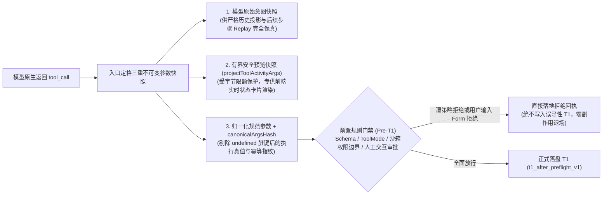
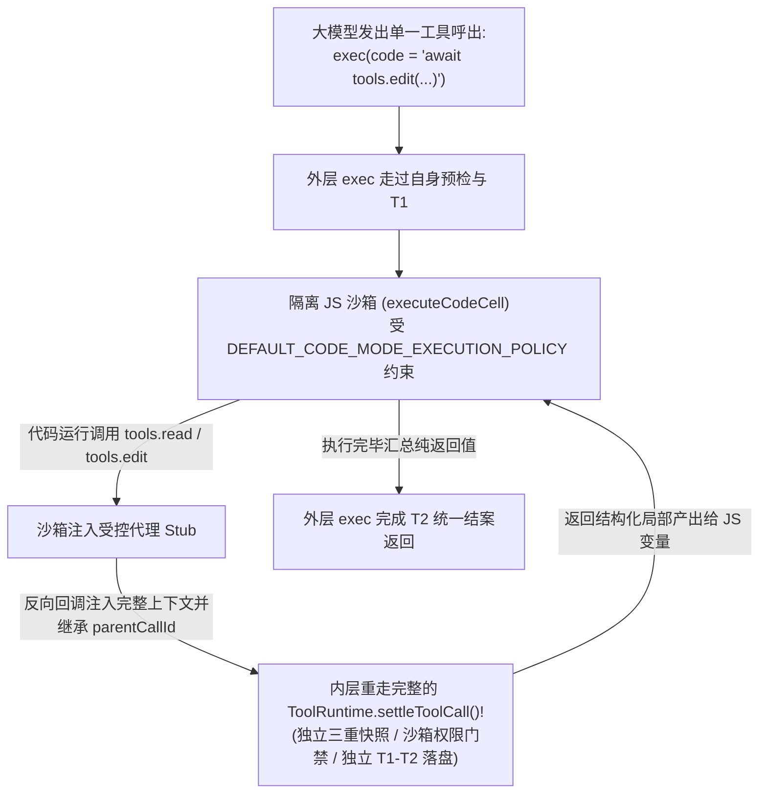

# ToolRuntime 结算内核：三重参数快照、T1/T2 提交与 Code Mode 嵌套调用树

## 1. 为什么在生产环境里“调用工具”绝不只是执行一个 Async Function？

当原型框架执行 `tools[call.name](call.args)` 时，写出来只需要三行异步代码。但在面向真实研发电脑与企业环境的高可靠基础设施里，这个简化模型会在三个意想不到的脆弱缝隙里当场撕裂：

1. **同一笔调用的审计、展示和参数突变扯皮**：假如模型发出参数 `{ path: " a.ts ", content: "..." }`，规范化修剪后的参数和传给插件的参数之间差了一个空格或默认值字段，等到后续要按参数哈希对账防重跑、或者界面想还原当年“模型原本到底吐了什么参数”时，原地改写对象会导致所有校验链全部崩盘。
2. **工具跑出结果瞬间宿主崩溃造成幽灵副作用**：`WriteFile` 或者远端 HTTP 写接口刚把东西改好，还没来得及写回账本就断电了。如果缺乏一个**预检之后、实际触碰外部世界之前**的不可逆边际界标，恢复引擎根本无从分辨刚才这笔调用“究竟处于绝对安全可重跑阶段，还是已经产生副作用只待封存阶段”。
3. **批量高频脚本编排下的嵌套越权**：开启 **Code Mode（`exec`）** 让模型写连续 JavaScript 逻辑编排十几次文件检索和编辑工具调用时，如果沙箱里的 `tools.write(...)` 直接偷偷走后门调用原生文件接口而不经过主运行时审批和持久化结算，整个系统的安全防火墙与崩溃恢复账本就形同虚设！

Maka TypeScript 版将 `packages/runtime/src/tool-runtime.ts` 打造成一座名副其实的**事务级工具结算内核（Settlement Engine）**：用三重不可变快照隔离每一步视图需求，用 `Pre-T1 → T1 → 副作用 → T2` 切出严丝合缝的故障边界，更用同权继承树将 Code Mode 的每一次内部子调用都纳入这套严谨流程。

---

## 2. 入口防线：三重参数快照与预检不变量

当 `AiSdkTurn` 解析并收齐本步发出的模型调用意图后，每笔工具在 `ToolRuntime.settleToolCall()` 入口即刻被固化出彼此正交的**三重不可变参数快照**，防止后续任何一个消费环节互相篡改：



这“入口前置快照 + Pre-T1 审批过滤”设计彻底消除了两类经典 Bug：
- 哪怕某个插件工具需要用户输入表单补充字段（`InteractionFormRequest`）或者遇上高危拦截要求点击同意，只要还卡在审批环节没点同意，系统绝不打 `T1` 印记——因此这期间进程无论崩几次，重启后都可以洁净重来且毫发无伤；
- 一旦进入正式可执行窗口，绑定的 `canonicalArgsHash` 将作为这笔操作唯一不二的签名，确保哪怕遭遇重启对账也能精确识别“这次参变没有被暗中改换”。

---

## 3. T1 / T2 两阶段边界与结果双视图落盘

走完一切准入审批之后，`ToolRuntime` 并不直接跑实现函数，而是严格执行两阶段账本落盘契约：

```typescript
// 教学化提炼：ToolRuntime 的两阶段提交与双视图分流收敛
async function settleToolCall(call: PreparedToolCall): Promise<SettledToolResult> {
  // 1. 先写入非模型可见的持久化边际锚点 T1（携带确定性 operationId 与参数哈希）
  await eventStore.appendT1Dispatch({
    protocol: 't1_after_preflight_v1',
    operationId: deriveDeterministicOperationId(call.invocationId, call.providerToolCallId),
    canonicalArgsHash: call.canonicalArgsHash,
    recoveryMode: call.policy.recoveryMode, // 'never_auto_retry' | 'outcome_unknown'
  });

  // 2. 在受控沙箱或连接池边界内真正执行外部物理操作
  const rawOutcome = await executeBoundedImplementation(call);

  // 3. 结果双视图拆分（有界展示 + 按需全量卸载归档）
  const { modelPreview, archiveUri } = await partitionOutputViews(rawOutcome, {
    inlineByteLimit: BOUNDED_OUTPUT_LIMIT,
    archiveStore: toolResultArchive,
  });

  // 4. 在 T2 单一原子事务中同步推进结算记录与规范 function_response
  await eventStore.commitT2Settlement({
    outcome: requireToolCallOutcome(rawOutcome),
    content: modelPreview,
    archiveUri,
  });

  return { modelPreview, archiveUri };
}
```

审视这段核心结算骨架里的两项高精设计：
1. **确定性 `operationId` 与恢复边界封死**：在跳进 `executeBoundedImplementation` 之前那一刻，库里已经躺好了一笔标有确定性 `operationId` 的 `T1` 事件！如果下游文件写完或远端 API 刚刚回传数据时宿主机电源线被拔掉，重启时的恢复引擎只要扫描到“已过 `T1` 而未及 `T2`”，即可立刻锁定它为不确定终态 `outcome_unknown`（触发 `ToolUncertainOutcomeSignal`），再也不靠虚幻假设蒙混重跑。
2. **结果双视图与有界输出（`bounded-response`）**：面对返回了几十万字测试日志的结果，结算内核利用 `partitionOutputViews` 与 `tool-result-output` 自动将超过阈值的载荷直接分流写入 `Tool Result Archive` 换回 `maka://` URI，仅把安全裁剪并附带分页指导的头部结构留在规范 `function_response` 与前端卡片（`ToolResultPreviewContent`）中。单步结算永远不会被巨量工具输出撑爆内存或 IPC 通道！

---

## 4. 进阶机制：Code Mode（`exec`）嵌套调用树的同权穿透治理

在引入 **Code Mode** 能力（`packages/runtime/src/code-mode.ts`）之后，大模型可以在一个受限脚本隔离单元（Code Cell）中直接用标准的异步 JavaScript 逻辑调度多种内建和第三方工具，比如“批量扫描 `src/` 下百个 TS 文件，过滤包含特定符号的行并用正则改写”。

很多简单系统在实现 Code Mode 时图省事，只让最外层 `exec` 这一个外壳工具走审批和历史落盘，把沙箱内运行的所有 `tools.readFile()`、`tools.edit()` 当成完全不管的小函数直接透传掉！这会导致三大失控隐患：
- 用户勾选了“写入文件必须经过人工确认”规则，模型在 `exec` 代码里偷偷调一下 `tools.writeFile()` 就全绕过去了；
- 脚本连续成功修改了 18 个文件，改到第 19 个文件时触发系统断电或用户按下纠偏（`CodeModeSteeringInterruption`），恢复重开时系统账本里什么细粒度记录都没有，模型完全不知道到底哪些文件已经被改过！

Maka 在 `code-mode.ts` 与 `tool-runtime.ts` 中采用**同权委托代理（Transparent Settlement Delegation）**彻底填平了这个漏洞：



正因每一枚内部的 `tools.*` 调用都被绑定了精确的 **`parentCallId`** 且全路径重走 **`ToolRuntime.settleToolCall()`**：
- 即便跑在代码沙箱里，每修改一个受保护文件照样会乖乖停下来弹出沙箱/审批请求（`SandboxBoundaryRequest`）让宿主裁决，没有任何后门；
- 哪怕脚本中途被打断（Steering 或断电），哪些子调用已经完成了 `T2` 结算、哪一笔停在 `T1` 变成 `outcome_unknown`，整棵嵌套因果调用树全部历历在目，安全审计与恢复精度一分不减！

---

## 5. 总结

`ToolRuntime` 的价值在于它彻底扭转了“模型只是调个函数”的轻率工程观念：
- **三重参数快照**：彻底隔离开原始审计真实度、界面预览简洁度和系统校验唯一性；
- **`Pre-T1 → T1 → T2` 分治契约**：以最小存储事务开销标定出不可逆副作用的精确物理红线；
- **Code Mode 挂接 `parentCallId` 同权穿透**：让开发者和模型同时享受到代码批处理降低 10 倍延迟的极客效率，却在安全性、隔离权限和崩溃溯源账本上做到毫发无损的零妥协。

当然，光靠纯 TypeScript 层面的审批拦截与参数快照还远远不够——如果被调用的工具跑的是一条充满花样重定向、环境变量劫持与符号链接欺骗的 `Bash` 命令，或者一个看似无害的 `WriteFile` 工具碰巧遇上竞态篡改路径呢？下一篇下潜到操作系统的系统调用边界，看 Maka 如何构造“Bash 禁网隔离 + 文件独立二次收窄 Worker + fd 级句柄锁定”的硬核双路防线：[操作系统双路沙箱与 Worker 隔离：Bash 受限出网、文件二次收窄与 TOCTOU 防护](./sandbox.md)。
