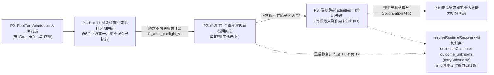

# P0–P4 崩溃窗口治理与原子续接：T1/T2 密封、`outcome_unknown` 与账本自愈

## 1. 为什么在本地 SQLite 开启 ACID 事务依然防不住“重启重复执行”灾难？

哪怕底层的 `SqliteRuntimeStore` 把每条写入都死死关进了数据库事务，真实运行时的崩溃却偏偏发生在 **“数据库事务之外的物理动作与事务之间的裂缝”** 里（对应 Maka 定义的 `P0–P4` 五个崩溃窗口）：

1. **窗口分裂导致隐形双重副作用**：工具通过校验后刚修改了用户磁盘文件，或端侧代理刚刚跨越宿主下发的 `admitted` 准入切点，系统就在写回结果前的零点几毫秒断电。重启之后，恢复引擎如果只因为数据库里“找不到这个工具的结果行”就草率重新跑一遍，就会导致重复修改文件、重复调外部扣费接口甚至产生幻影提交。
2. **盲目修复引入语义分叉**：为了收拾烂尾现场，如果后台随意在旧记录之上直接 `UPDATE` 改掉事件终态，或者跳过检查让下一轮自动续跑（Continuation）假装刚才那次调用从未发生，规范日志和真实世界状态就再也无法对齐。
3. **残缺尾事件无法归因**：进程意外断气时，最后一行写入伴生账本 `AgentRunStore` 的记录究竟停在“流刚吐完但来不及写 Run 终态（`model_stream_completed`）”还是“刚卡死在等待人工批准（`permission_requested`）”？如果笼统全打一个 `"crashed"`，人类排查和下游自动评估策略全数失明。

Maka TypeScript 版借助 **`Pre-T1 / T1 / T2` 两阶段密封契约**、**`classifyAgentRunRecovery` 确定性归因**、**单事务认领接力（`ContinuationClaimV1`）**以及 **自愈账本投影（`RuntimeLedgerRepair`）**，在根本上拒绝虚假保证，建立起诚实可追账的灾难恢复链条。

---

## 2. 两阶段物理围栏与 `P0–P4` 故障地图

要让崩溃后能准确判定“可重放”还是“绝不可重放”，系统必须在真正产生副作用的那条鸿沟前打下一枚持久化锚桩：



### 各阶段故障窗的冷酷裁决规则

- **Pre-T1 安全域（P0 / P1）**：涵盖 `RootTurnAdmission` 入库前、`ToolRuntime` 三重参数快照构筑期、模型预检以及人工审批表单等待期。只要没有触发真正改变外部世界的实现函数，哪怕进程原地重启十次，恢复器都确信无副作用发生，直接结案或洁净重放。
- **危险鸿沟跨越（P2 / P3）**：一旦写下 **`t1_after_preflight_v1`**（携带基于 `(invocationId, providerToolCallId)` 确定的 `operationId` 与 `canonicalArgsHash`）或者端侧能力代理拿到了宿主 **`admitted`** 授权通行证，任何半途掉线都在法律语义上被永久冻结——**绝不假定没发生过！**

---

## 3. 确定性死因判别与 `outcome_unknown` 封印：`classifyAgentRunRecovery`

Host 重启并进入六阶段恢复的 Stage 3（`executions` 恢复窗）时，`packages/runtime/src/agent-run-recovery.ts` 联合 `resolveRuntimeRecovery` 对每一条在规范事件脊柱中**“有开头 `invocation_opened` 而无闭合终态事件”**的遗孤 `Invocation` 进行验尸判别。

注意 `classifyAgentRunRecovery` 的极简铁律——它绝不去猜测“如果重跑会不会成功”，而是顺着只读的 `AgentRunEvent` 伴生操作账本倒推断气前最后一瞬到底卡在哪个动作上：

```typescript
// 真实恢复死因分类器逻辑（源自 packages/runtime/src/agent-run-recovery.ts）
function classifyAgentRunRecovery(invocation: RuntimeInvocationRecord, events: readonly AgentRunEvent[]): AgentRunRecoveryDecision {
  const lastEvent = lastNonCorruptEvent(events);
  const lastType = lastEvent?.type;

  // 绝不依赖模糊猜测：完全依据操作账本停摆前最后一枚有效事件类型精确定性
  const reason =
    lastType === 'model_stream_completed' ? 'model_stream_completed_without_runtime_terminal'
    : (lastType === 'permission_requested' || lastType === 'permission_failed') ? 'stale_user_wait'
    : lastType === 'tool_started' ? 'tool_interrupted'
    : checkSandboxBoundaryRestart(events) ? SANDBOX_BOUNDARY_RESTART_CLOSURE_CLASS
    : 'host_restart_incomplete';

  return {
    runId: invocation.runId,
    turnId: invocation.turnId,
    status: 'failed',
    failureClass: reason,
    lineage: extractInvocationLineage(invocation),
  };
}
```

对于落入 `P2`/`P3` 期间失联的工具，恢复引擎不仅打上 **`uncertainOutcome: { code: 'outcome_unknown', retrySafe: false }`** 封存标签：
1. **阻断危险无监督自动续跑**：除非显式放开特殊策略 `allowPriorUnknownToolOutcomes`，所有自动化的后台计划与 Goal 接力立即止步等待人类或安全审计接管，绝不盲目替用户重下第二次高危写指令；
2. **允许安全压实跨过死结（`#6254`）**：与此同时，一旦恢复器正式写入这套包含 `failed`、`endInvocation`、`failureClass: 'outcome_unknown'` 和 `recovered` 标识的封存事件，后续的历史投影重放规划器与 `selectSafeCompactionPrefix` 即可据此证明该 `function_call` 跨度已永久封箱结案（参见 [02.2](../02-context/compaction.md)），既保住安全底线又避免账本陷入死锁。

---

## 4. 安全边界续接（Continuation）与单事务防重认领

如果某次停止属于受控挂起（例如 `EventWait` 等待外部回调、触及安全压缩前沿接力、或人工显式同意恢复），系统会通过 `runtime-kernel.ts` 发起一次全新的物理接力 `Invocation` 来继承同一个逻辑 `Run`（保持前端 `runId` 连续稳定）。

为防止多个并行恢复协程在重启间隙把同一处历史前缘认领出两份分裂的子树：
- **单事务互斥认领（`ContinuationClaimV1` + `ImmutableRuntimePrefixV1`）**：新代次在起步瞬间必须先验证光标 `RuntimeBoundaryCursor` 确凿处于可安全接力位置，随后在**同一个底层 SQLite 存储事务之内**，一次性写下不可替代的 `ContinuationClaimV1` 声明与新任 `invocation_opened`（其中锚定前任 `RuntimeInvocationLineage` 链路坐标）。先到先得、后到抛出 `ContinuationStartCommitError` 立即退出。

---

## 5. 账本自愈机制：`RuntimeLedgerRepair`

现实磁盘环境难免经历操作系统页面写入半途截断、或者早期旧版本运行期遗漏了某条辅助汇总记录的残局（例如触发 `event_corrupt`）。

`packages/runtime` 配合 `packages/storage` 提供的账本自愈路径（`RuntimeLedgerRepair`）遵守极其稳重的非破坏修正原则：
- **绝不静默删改原始事件正文**：当发现运营侧投影视图（例如 `latestContext` 或检索索引）同底层的规范事件脊柱（`RuntimeEvent`）发生偏差时，通过带乐观修订版本 `ifLedgerRevision` CAS 检验的增量修复路径重算派生物化视图，并利用与在线路径完全相同的纯决胜算子完成对齐（参见 [06.2](../06-operations/observability.md)）；
- **坏行降噪而非全库崩溃**：面对极端损坏尾记录时精准隔离成可审计诊断标记并闭合该受污染跨度，确保整套历史档案中的其余完好会话不受连累，照常挂载激活。

---

## 6. 总结

Maka TypeScript 版用一套严密而不掩耳盗铃的状态恢复模型应对本地不可避免的意外断电：
1. **`Pre-T1 → T1 → T2` 物理分水岭**：未过 `T1` 和 `admitted` 一概从容重算，一旦越线半途崩盘一律封死为 `outcome_unknown` (`retrySafe: false`)；
2. **`classifyAgentRunRecovery` 确定性归因**：通过伴生操作账本死后倒查精确还原死因，拒绝千篇一律的黑盒报错；
3. **`ContinuationClaimV1` 单事务认领 & `RuntimeLedgerRepair` CAS 修复**：让接力和自我修复在并发加压下依然不产生分叉时间线。

确保了事件账本在任何时刻都不丢失状态、不盲目重跑之后，还有另一份与对话历史同等重要的易损资产——**开发者硬盘上的源代码仓库工作区（Workspace File Tree）**。如果 Agent 用 JS 调外部 `git` CLI 管理检查点不仅慢而且极易被用户的局部修改搅乱，该怎么办？下一篇深入原生 Rust 数据面支撑的工作区版本权威设计：[Gitoxide 原生数据面与乐观锁：OAuth/Capability 分离与确定性 Worktree 演进](./gitoxide-and-workspace-versioning.md)。
