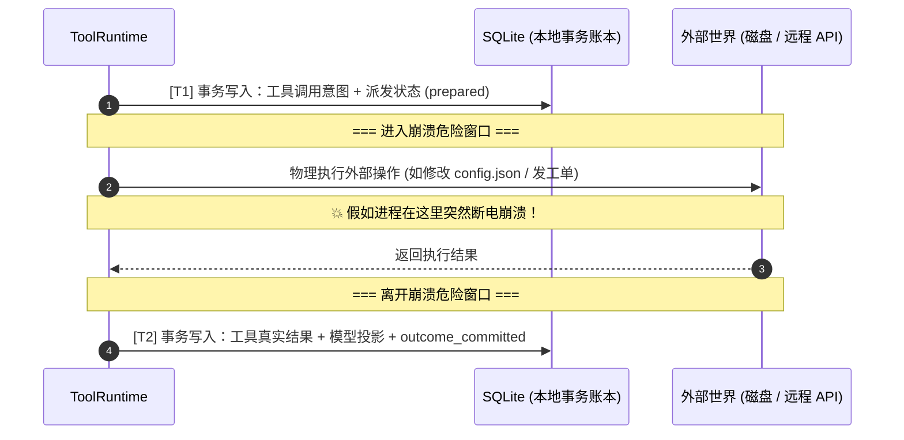

# 持久化与恢复：崩溃窗口识别与安全续接

[返回手册目录](../README.md)

许多开发框架声称自己支持“断点续传”，但实际上只是把聊天记录存进了数据库，重启后重新加载对话而已。如果 Agent 正在执行一个带有副作用的操作——比如“向外部工单系统创建一条缺陷记录”，或者“执行脚本修改 `config.json`”——就在操作刚发出的那一秒，服务器突然断电重启。

重新启动后，系统必须回答一个极其严肃的分布式一致性问题：**“刚才那个外部操作到底有没有生效？如果没看到结果，我可以重新执行一遍吗？”**

本章深入剖析 Maka 是如何通过 **T1/T2 两阶段提交、恢复分类裁决（Resolver）以及原子续接（Continuation）** 来守护这一崩溃窗口的。

---

## 1. 概念先行：本地事务管不了外部世界

SQLite 等关系型数据库可以保证本地多张表同时写入的 ACID 原子性，但它**无法把本地数据库与外部文件系统、远程 HTTP 接口、或者子进程纳入同一个分布式事务**。

这导致每次工具执行必然存在一段无法消除的**崩溃危险窗口（Crash Window）**：



**Maka 的工程铁律**：绝不掩盖危险窗口里的不确定性。如果系统在 `[T1]` 和 `[T2]` 之间崩溃，重启后的恢复引擎必须承认“我不知道外部操作是否已经生效”，绝不允许为了省事而悄悄重新执行一遍。

---

## 2. 两阶段提交：`operationId` 串联的前后边界

在 Maka 的存储模型中，每一次工具调用都会基于 `(invocationId, toolCallId)` 生成唯一的操作主键 `operationId`。持久化引擎（`SqliteRuntimeStore`）围绕它执行两笔独立事务：

1. **第一阶段提交（`commitToolPrepared`, T1）**：
   - 发生时机：**在任何物理外部操作发生之前**。
   - 写入内容：在一个 SQLite 事务内，同步写入工具调用记录、派发声明事件以及操作状态索引表（状态置为 `prepared`）。
2. **第二阶段提交（`commitToolOutcome`, T2）**：
   - 发生时机：物理工具执行返回正常结果或明确异常之后。
   - 写入内容：利用同一个 `operationId`，在一个 SQLite 事务内原子写入工具原始结果、面向模型的投影视图，并将操作索引更新为 `outcome_committed`。随后才向界面发布 `tool_result` 事件。

---

## 3. 崩溃恢复判定矩阵（Recovery Resolver）

当进程重启并重新打开会话时，恢复解析器（`resolveRuntimeRecovery()`）会扫描未闭合的运行记录，根据不可变日志中留下的事实痕迹，将每条工具调用精准划入以下三类裁决结果：

| 账本留存痕迹 | 恢复裁决分类 | 含义与系统后续动作 |
| :--- | :--- | :--- |
| **T1 与 T2 均完整存在** | `completed` | 该工具已经安全结算完毕，结果真实可靠。**恢复动作**：直接将已记录的结果带入下一次模型请求，无需重跑。 |
| **仅存在意图记录，无 T1 派发记录** | `definitely_not_dispatched` | 在新派发协议下，表明进程是在刚规划完参数、尚未真正下发执行前崩溃的。**恢复动作**：确认外部副作用零发生，可安全重跑或交由模型重新决策。 |
| **仅有 T1，缺失 T2** | `indeterminate` (结果未知) | 进程正死在危险窗口里！外部操作可能已经成功、可能部分完成、也可能根本没连上。**恢复动作**：**严禁自动重跑！** 将其显式标记为 `Unknown Tool Outcome` 注入上下文，由模型或人类用户先执行只读核查。 |

---

## 4. 续接规划与原子防重（Continuation）

当崩溃现场被清理并判定为“可以继续推进未竟的逻辑轮次（Turn）”时，系统并不是直接把旧的 `AgentRun` 内存对象复活，而是执行**源边界接续（Continuation）**：

```mermaid
flowchart LR
    Old["Invocation 1 (意外中断)<br/>已提交前缀: 读 config.json 成功"] -->|1. 扫描不可变前缀| Plan["Continuation 规划器<br/>验证源边界与合法重放上下文"]
    Plan -->|2. 原子认领 claimContinuation()| Claim["写入接续控制表 (防止多恢复者并发启动)"]
    Claim -->|3. commitContinuationStart()| New["Invocation 2 (全新物理实例)<br/>携带同一 turnId, source=continuation"]
```

### 为什么需要 `claimContinuation()` 原子认领？
假设系统重启时有两个恢复入口几乎同时扫描到了同一个未完成的 Turn。通过 `claimContinuation()` 在数据库控制表中持久化声明源执行边界与新执行身份的映射，并用单事务 `commitContinuationStart()` 写入新执行的开篇事件并锁定状态，可以保证**同一份断点绝对不会被重复接续出两个平行的幽灵执行**。

---

## 5. 教学伪代码：崩溃扫描与安全接续契约

```text
function recoverInterruptedSession(sessionId):
    // 1. 扫描事件账本，找出所有未记录终态的 Invocation
    openInvocations = rebuildInvocationInventory(store.loadEvents(sessionId))
        .filter(inv => inv.terminalOutcome == null)

    for inv in openInvocations:
        // 2. 检查该执行下的工具操作状态
        ops = store.loadOperationsByInvocation(inv.id)
        for op in ops:
            if op.state == "outcome_committed":
                op.recoveryStatus = "completed"
            else if op.state == "prepared":
                // 核心安全底线：只要进了 T1 没出 T2，一律视为结果未知
                op.recoveryStatus = "indeterminate"
            else:
                op.recoveryStatus = "definitely_not_dispatched"

        // 3. 构造安全的接续重放历史 (为 indeterminate 工具注入明确提示)
        replayMessages = continuationPlanner.buildSafeReplay(inv, ops)

        // 4. 原子认领接续权，防重跑
        newInvocationId = generateUUID()
        claimed = store.claimContinuation({
            sourceInvocationId: inv.id,
            targetInvocationId: newInvocationId,
            turnId: inv.turnId
        })
        
        if claimed:
            // 5. 单事务提交新执行开篇事件并拉起运行
            store.commitContinuationStart(newInvocationId, inv.turnId, replayMessages)
            runtimeKernel.resumeInvocation(sessionId, newInvocationId)
```

---

## 6. 对照 Pi：会话文本重放 vs 实验性 Durable Harness

- **Pi 默认模式**：重启后从 JSONL 会话文件读取已保存的消息文本，重新构造内存 `Agent` 实例即可继续对话。它定位于人类在旁监督的本地 CLI，若中途被 `Ctrl+C` 或崩溃打断，未写完的工具依赖用户重新触发。
- **Pi 实验性 `durable` 模式**：引入了 `ToolTask` 概念，在工具执行前另存带有参数和重放策略的 `execute` checkpoint；重启 Harness 时依据工具自身声明的重放策略决定是重跑、跳过还是标为未知，与 Maka 的 T1/T2 分层思想高度一致。

---

## 7. 延伸阅读

- 了解在多进程环境下，Host 是如何通过租约锁保证只有自己有权扫描并恢复 State Root 的，阅读 [04.2 Host 所有权与客户端状态同步](host-ownership-and-sync.md)。
- 了解工具内核中 T1 与 T2 的具体调用细节，阅读 [03.1 工具执行内核](../03-tools/tool-runtime.md)。
