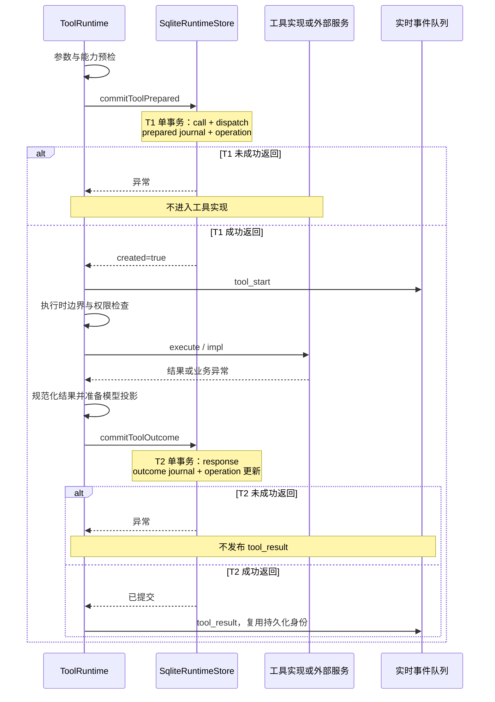
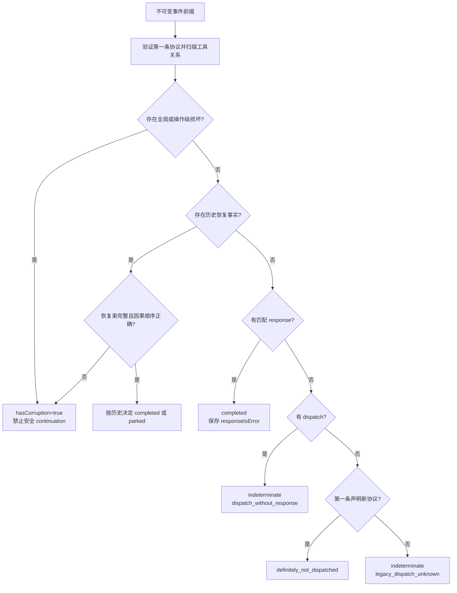

[手册目录](../README.md)

# 持久化与恢复：崩溃后可信任的事实

假设模型要求一个工具向外部系统提交变更。工具已返回成功，Maka 正准备保存结果时，进程即退出。
重新打开会话后，聊天记录中仅有工具调用，没有工具结果。此时重新执行可能重复提交；直接补记成功又可能掩盖真实的失败。
问题不在于“怎样将对象序列化到磁盘”，而在于：**重启后的程序依据何种事实区分尚未执行、执行结果未知、已有可信结果。**

本文以该窗口为主线，沿 `ToolRuntime → RuntimeCommitSink → SqliteRuntimeStore → recovery resolver → continuation` 路径展开分析。
此处的持久化执行不是保存 JavaScript 调用栈，而是先保存足以判断下一步是否合法的事实，再允许程序跨越执行边界。

阅读基线：2026-10-24；Maka 固定提交 `15d0a0dd19d39e2bc09ae35940e432c636982315`；Pi 固定 HEAD `482c1381a00d8d00bc81697e4a980c593db6803e`。
这是源码与现有测试的静态阅读，没有运行测试、模型或故障注入。Pi 对照选用未被工作区既有修改改动的文件。
文中“契约”指接口、校验或测试明确规定的行为；“实现推断”只解释这种安排解决了什么问题，不代言作者动机。

## 1. 四种记录：日志与恢复能力的区分

假设用户提交“修改配置并验证”，其中一次工具调用名为 `Read`，模型为其分配的调用 ID 为 `call-7`。
该操作会留下不同层次的记录。这些记录可能位于同一数据库，但回答的问题各不相同。

| 记录 | 真实形状与职责 | 不能据此得出的结论 |
| --- | --- | --- |
| `RuntimeEvent` | 带 `sessionId / invocationId / runId / turnId` 的执行事实；`content` 可为调用或结果，`actions` 可为派发、终态等控制事实 | 不应将任意文本、流式片段视为已完成执行 |
| `AgentRunEvent` | `{ type, id, runId, sessionId, turnId, ts, message?, data? }`；保存模型请求、计量、诊断等运行记录 | “模型流结束”不等于整个 run 已成功终结 |
| 消息准入与根 turn 准入 | 前者保存提交内容、摘要、放置位置和原始意图；后者保存根工作被接纳的事实与来源消息证明 | 用户消息已保存，不等于相应执行已经开始 |
| 工具 journal 与 operation 投影 | journal 是工具状态变化行；operation 是按工具操作查找当前状态的索引 | 不应脱离对应 RuntimeEvent 而自行宣布工具成功 |

`invocation` 表示一次物理执行尝试；`turn` 表示用户工作的逻辑轮次。当前 continuation 创建点将新 `runId` 与新 `invocationId` 设为同一值，但协议校验仍分别携带二者。
`providerToolCallId` 是模型供应方分配的调用编号，不是数据库事件 ID，也不是外部业务的幂等键。
幂等指同一请求重复提交不会重复产生业务效果；稳定的本地 ID 本身并不能使远程服务具备该性质。

`AgentRunEvent` 的读取类型允许历史 `type` 字符串，当前写入则受已知事件目录约束。
它具有独立的诊断事实价值，不应一概称为“可丢弃缓存”；但 invocation 的 opening、路由、配置与终态属于 RuntimeEvent 主线。
`classifyAgentRunRecovery` 的前提同样是调用方已确认没有终态，之后才用最后一条诊断解释中断原因。[事件类型][agent-run]、[恢复分类器][run-recovery]

准入数据中存在一个易被忽略的字段：`PendingMessageAdmission.submittedIntent`。
接口注释明确要求在“消息提交成功、根准入尚未完成”之间的崩溃中保留完整意图；否则一次显式图工作请求可能在重启后被降格为普通聊天。
同一结构还保存 `submittedContentDigest`、`submittedPlacement`、当前 `placement`、`disposition` 和 `skillInvocation`。
这不是重复保存聊天文本，而是保存“当时实际接纳了何种请求”。[准入契约][admission]

### SQLite 中的实际存储内容

工作区的操作数据库名为 `runtime.sqlite`。`openRuntimeEventPersistence` 将同一个 `SqliteRuntimeStore` 同时作为事件 store 和工具 commit store 返回。
工作区工厂通过共享数据库 lease 获取连接；此处 lease 仅指连接的借用与生命周期管理，不展开主机所有权协议。[连接组合][persistence]、[共享连接][operational]

| 表 | 关键列、约束与读取方式 |
| --- | --- |
| `runtime_events` | `event_id` 主键；session/invocation/run/turn；`event_seq`、`event_kind`、`payload_json`、`committed_at`；`(invocation_id,event_seq)` 唯一 |
| `tool_journal_events` | 自增 `journal_seq`；唯一 `journal_event_id`；operation 与执行身份；`state`、`runtime_event_id` 外键、参数 hash、恢复模式、时间及可选元数据 |
| `tool_operations` | `operation_id` 主键；`(invocation_id,provider_tool_call_id)` 唯一；工具名、参数 hash、恢复模式、当前状态、call/dispatch/result 事件引用、`version` |
| `runtime_continuation_claims` | 源执行与高水位、不可变前缀摘要、边界 JSON/摘要、模型重放摘要、目标执行身份/opening，以及启动事件引用 |
| `core_agent_run_events` | 以 session/run/sequence 定位的诊断记录；另有 `core_agent_run_projections` 保存特定读模型 |
| `core_root_turn_admissions` | session/turn 主键、准入时间、`record_json`；`core_root_source_message_proofs` 把来源消息关联到已准入 turn |

“投影”是从事实整理出的便于查询的视图，可以物化为表；这不意味着同库的所有表都能任意删除后重建。
工具两张投影表可以由规范事件重建；准入证明、continuation claim 等则有各自独立的事实职责。
表结构见 [runtime schema][schema] 与 [core execution schema][core-schema]，不应依据表名推断它们都是 run 状态副本。

`event_seq` 仅在一个 invocation 内递增，不是全会话的统一时间轴；跨 invocation 的会话排列另有独立 ordinal。
普通 `readRuntimeEvents` 会合并不可变事件与可变 partial 快照。partial 是流式过程的当前片段，不是可用于恢复证明的最终事实。
恢复边界读取不可变前缀，并携带高水位——本次读取截止的事件序号——及内容摘要，避免计划制定后被隐式替换为另一段历史。[读取与前缀][prefix]

历史数据也存在例外：旧 invocation opening 保留在 `runtime_legacy_invocation_openings` 中，库存查询可能需要读取该旁存记录。
因此“当前执行事实以 RuntimeEvent 为中心”不能被扩大为“任何版本的所有信息都只存在于 runtime_events”。[历史 opening 读取][inventory]

## 2. 事务范围：同库原子提交

`SqliteRuntimeStore` 的重要字段包括同步 SQLite 连接 `db`、可选共享 `databaseLease`、关闭状态，以及待通知 session 的集合和提交监听器集合。
前两者决定 SQL 在哪个事务中执行；后两者决定何时可以通知读者“有新事实”。
直接持有连接时，`transaction` 执行 `BEGIN IMMEDIATE → operation() → COMMIT`；发生异常即回滚，并清除本次待发布的提交通知。
共享连接时则委托 lease；嵌套调用复用外层事务，不另建 savepoint，通知在外层结算后发出。[事务实现][transaction]、[共享事务][lease-transaction]

此处的回调是同步 `() => T`，不是在 SQL 事务中 `await` 一个远程工具。
对熟悉 Java 的读者，可将 `Promise<T>` 理解为“将来产生一个 T 或异常”的对象；`await` 暂停当前异步函数，不会自动扩展数据库事务。
函数返回 Promise 仅描述调用接口；SQLite 内部仍在同步代码段中一次性完成多个 SQL 写入。

数据库配置要求 WAL 与 `synchronous = FULL`，并启用外键；内存数据库允许使用自身的 journal 模式。
WAL 是 SQLite 的预写日志机制，解决数据库页的提交恢复，不会将 HTTP、文件系统或客户端动作一并纳入事务。[数据库配置][sqlite-config]

实现推断：将工具执行置于 T1 与 T2 两次短事务之间（两者定义见下节），既避免等待外部系统期间持续占用写事务，又保留崩溃后的判断证据。
代价是两次提交之间必然存在“外部可能已完成、本地尚不知情”的窗口；后文的 `indeterminate` 正是对该窗口的承认。

## 3. 工具调用的两段事务：T1 与 T2

T1、T2 是两个工具持久化边界，不是分布式两阶段提交协议。
T1 表示预检后保存派发事实；T2 表示保存工具结果及其投影。它们之间没有能够回滚远程服务的全局事务协调器。



### T1 的输入构成

`prepareDurableToolAttempt` 先要求 run、invocation、operation 身份齐全。
operation ID 由 invocation ID 与供应方调用 ID 计算稳定 hash；调用参数另行计算 `canonicalArgsHash`，store 会从调用内容重新计算并核对。
由此，相同工具操作不能在重试时隐式更换一组参数，也不能借另一轮的供应方调用编号冒充同一次执行。[ID 构造与接口][commit-sink]、[边界校验][validation]

传入 T1 的 `ToolPreparedCommit` 同时包含两条 RuntimeEvent：

- call：`content.kind = function_call`，保存工具名、供应方调用 ID、持久化参数；`refs` 关联 operation、工具调用，必要时关联父工具与 step。
- dispatch：无 `content`，在 `actions.toolDispatch` 保存协议 `t1_after_preflight_v1`、`resultProjectionVersion: 1`、operation、调用 ID、工具名、参数 hash、恢复模式。

两条事件都有执行身份、时间与 `partial: false`。dispatch 是独立的系统事实，不能与 call 合并为同一行。
它不构成一条模型工具消息，但也不能简单地认定其 `modelVisibility` 永远是 hidden；构造器会继承执行来源的可见性。
scanner 通过语义通道校验，禁止一条事件同时扮演调用、派发、结果或历史恢复事实。[事件构造][prepare]、[通道校验][scanner]

`commitToolPrepared` 在一个事务中按以下控制流工作：[T1 实现][t1]

1. 规范化输入、校验身份与参数 hash，并检查把候选事件加入现有账本后是否合法。
2. 如果已有 operation，必须连同两条事件严格一致，才返回 `created: false`；这只是提交去重，不是授权再执行。
3. 新操作写入 call 和 dispatch。call 如果已由上游以完全相同内容保存，可以复用；dispatch 不允许出现第二份。
4. 写 `${operationId}_prepared` journal，状态 `prepared`，其中 `runtime_event_id` 指向 dispatch。
5. 插入 operation：执行身份、调用身份、工具名、hash、恢复模式、call/dispatch 引用，`current_state = prepared`、`version = 1`。
6. 对需要受管工作区变更的特定路径，还可在该事务中建立变更预留；随后提交事务。

必须原子提交的原因在于：只有 dispatch 而没有 operation，在线查询会遗漏未结算工具；只有 operation 而没有规范 dispatch，重建也无法解释其来源。
事务使新协议下这几项对恢复者同时可见，或同时不可见。不能将源码中的多个 `INSERT` 表示为多个独立的崩溃提交点。

T1 成功后，`ToolRuntime` 才发布开始事件并进入工具实现；部分执行时的权限/边界检查仍在 T1 之后。
因此 dispatch 的含义是“已跨越持久化派发边界”，不是“外部系统已收到请求”。这是恢复阶段保守判断的关键。
如果预检已拒绝调用，可保存未绑定 operation 的 call 与合成错误 response，不必建立 T1；两者仍需合法配对。[执行主线][execute]

### T2 的结果与版本记录

工具返回后，runtime 先规范化内容，生成 `modelProjection`，即向模型提供的稳定结果表示。
图片等投影准备可能先写入独立 artifact；它不是工具 SQL 事务的一部分。
response 保存 `result`、可选 `isError / outcome`、`modelProjection`，并通过 refs 关联同一 operation；耗时记录于 `actions.stateDelta.durationMs`。[投影与结果][projection]

`commitToolOutcome` 的事务先查 operation 和 dispatch，验证身份及结果通道，再处理精确重复提交。
新结果路径插入 response、插入 `${operationId}_outcome` journal，最后更新 operation 为 `outcome_committed`，设置 `result_event_id` 并增加 `version`。
更新条件要求旧状态仍为 `prepared` 且 result 为空；受影响行数必须为一，否则整体回滚。
如果 dispatch 声明 `resultProjectionVersion: 1`，结果缺少模型投影即不能提交。[T2 实现][t2]

以下为真实源码摘录，省略的部分是后续队列事件构造，并非另一种 API：[先提交后发布][publish]

```ts
const durableOutcome = await input.durableAttempt?.commitOutcome(
  input.content,
  input.isError,
  input.modelProjection,
  input.durationMs,
  input.outcome,
);
```

紧随其后的 `input.queue.push({ type: 'tool_result', ... })` 才向实时消费者发布结果，并复用已提交结果的 ID、时间与 operation ID。
可选链 `?.` 表示未配置 durable sink 时跳过提交；本文的保证限定于配置规范 SQLite sink 的路径，不能泛化到任意内存运行方式。

T2 异常会被包装为 `RuntimeCommitBoundaryError('T2', ...)`；外层捕获到此类错误立即重抛，不会再将其当作普通工具错误补记一条结果。
可选的提交失败补偿是尽力而为：补偿异常被忽略，原有持久化异常仍向上传递。它不是远程回滚保证。
普通工具业务异常则可被规范化为错误 response，并正常通过 T2 保存。[错误边界][prepare]、[异常分流][execute-errors]

另有两个顺序细节：`endTurn` 等待正在收尾的工具 Promise，避免先封闭 run 后才出现迟到的 T2；事件提交监听器仅在事务确认提交后收到通知。
但“调用方收到异常”并不总等于“磁盘上没有记录”：例如 COMMIT 后监听器再抛错时，持久化事实已经存在。
因此重启须重读事实；当前执行遇到提交边界异常时仍停止发布，不能用一次读回擅自将失败的屏障改判为成功。[收尾等待][end-turn]、[持久化失败契约][store-contract]

## 4. 崩溃时间线演算

以下用 O 表示有效 opening/协议标记，C 表示 call，D 表示 dispatch，R 表示 response，F 表示 run 终态。
这些是教学记号，不是数据库的额外字段。假设不存在历史 reconcile bundle，且事件身份合法。

| 崩溃位置 | 重启可读的事实 | operation 投影 | 能确定什么；不能确定什么 |
| --- | --- | --- | --- |
| 工具调用尚未持久化 | O | 无 | 没有本次调用的持久化证据；不能依据 UI 曾显示过文本而补记调用 |
| 新协议已保存 C，但尚未 T1 | O,C | 无 | resolver 可判 `definitely_not_dispatched`；不代表应在旧 run 中直接执行 |
| T1 事务写了一部分但未提交 | O，或原先已有的 O,C | 没有本次新 operation | 未提交的 D、journal、索引一并回滚；不存在“半条 T1” |
| T1 已提交，尚未调用实现 | O,C,D | prepared | 恢复者只能看到已派发边界，不能看到进程最后一条指令 |
| 远程已生效，但结果还在内存 | O,C,D | prepared | 与上一行完全同形；结果必须判未知 |
| T2 插入 response 后事务失败 | O,C,D | prepared | response 与 outcome journal 不可见；远程效果不会因此撤销 |
| T2 已提交，尚未推送队列 | O,C,D,R | outcome_committed | 工具已有持久化结算；UI 未收到不构成重新执行的理由 |
| 工具结算后，run 尚未终结 | O,C,D,R | outcome_committed | 工具完成与 run 完成是两个独立事实；终态需单独判断 |
| 对未知工具完成中断修复 | O,C,D,F | interrupted_unknown，特例可为 abandoned | run 被封闭；缺失的 R 仍然缺失，不能把未知改为工具成功 |

表中最重要的观察是两种不同的现实共享 `O,C,D`：工具可能尚未开始，也可能已完成远程写入。
仅凭 SQLite 无法区分二者。这不是 resolver 能力不足，而是数据库从未收到足以区分二者的信息。
若要消除这种不确定性，外部系统必须另有幂等键、可查询回执或业务核验机制；这些不是普通 T1/T2 自动提供的能力。

## 5. resolver：证据分类而非自动重试

`resolveRuntimeRecovery(events)` 输入按账本顺序读取的 RuntimeEvent 数组，输出协议、逐工具 decisions、issues 和 `hasCorruption`。
它不执行工具，也不写数据库。decision 中保留 call/dispatch/response 事件 ID、工具身份、原因与结果是否错误，便于上层解释判断。[resolver][resolver]

控制流可按四步阅读：先验证协议位置；再用 scanner 聚合同一次调用；优先判定坏账；最后解释已有结果与历史恢复束。
`runtimeProtocol.toolBoundary` 必须位于第一条事件。未知协议或后续才出现的标记都会形成 issue，不能通过为旧历史补加标记而套用新规则。
scanner 按 invocation 与工具调用 ID 建索引，核对 hash、执行身份、先后顺序以及父工具依赖；重复、孤立响应、依赖环都可能阻止安全恢复。



图中的损坏门是整体消费规则：某些问题记录在顶层 `issues`，不一定把每一个 decision 都改为 corruption。
上层不能只筛选若干看似正常的 completed，而忽略 `hasCorruption`。

有 response 时的 `completed` 只表示工具调用已有结算，不承诺业务成功；`responseIsError` 仍可为 true。
如果有 dispatch，`settlementOrigin` 为 `normal_t2`；没有 dispatch 但 call/response 合法配对，则是 `pre_t1_synthetic`。
这使预检拒绝能作为已知结果交给模型，同时避免虚构“工具实现曾运行”。

### outcome_unknown 的两种语境

第一种是运行中的工具明确报告结果不确定：`ToolOutcomeUnknownError` 被转换为 `code: 'outcome_unknown', retrySafe: false` 信号。
如果该错误结果成功经过 T2，账本中有 response，resolver 仍会判 completed；此处完成的是“记录未知结果”的动作，不是外部业务成功。[未知结果信号][uncertain]

第二种是进程失联，仅留下 dispatch 而没有 response。恢复可以将 run 封闭为失败、原因标记为 outcome_unknown，但不为工具编造 response。
此时工具事实分类仍为 indeterminate。run 终止、工具结果已知、允许安全地继续执行是三个独立判断。
现有 resolver 测试专门断言：添加失败终态不会结算一个缺失 response 的工具。[resolver 测试][resolver-test]

当前通用 `ToolRuntime` 对新 dispatch 的恢复模式只保留 `outcome_unknown`，其他工具声明归一为 `never_auto_retry`。
因此不能因在旧类型中看到 `reconcile`，就宣称当前通用工具在重启后会自动核验并重放。[当前模式选择][prepare]

### legacy 读取的兼容语义

旧账本没有第一条协议声明时，缺 dispatch 不能证明从未执行；resolver 返回 `legacy_dispatch_unknown`。
历史 reconcile/decision 事实仍被读取，但需通过 `interpretScannedToolRecovery` 验证完整的证据束。
completed 必须有成功 outcome、匹配预期状态的观察、正确引用及因果顺序；parked 不允许夹带 outcome，也必须与观察原因一致。[历史恢复束][legacy-bundle]

当前普通写入器拒绝新增历史 tool recovery 事实。读取兼容是为了不曲解已经存在的历史，不是对旧自动恢复能力的重新承诺。[写入校验][validation]
工具投影重建也使用相同解释器；旧 schema 遗留的无 dispatch 投影会被保留并隔离，不被冒充为新协议的已派发工具。
此外，受管 Write/Edit 有专用工作区 successor 提交路径，可在同库事务内一并提交结果、接受事件、工作区 head 和预留释放。
该特殊事务不能被忽略，也不能反过来证明任意工具或文件系统修改都与 SQLite 原子提交。[重建实现][rebuild]、[受管变更提交][managed]

## 6. repair 与 continuation 的分工

### 旧执行的收尾而非调用栈复活

`commitTerminalRunWithRuntimeFact` 以 RuntimeEvent 终态为提交目标，不再维护另一份独立 run 状态头来决定结局。
一般终态写入不能越过尚未结算的工具；未知工具收尾走专用 `ensureRecoveredTerminalRuntimeEventDurable`。[终态提交][terminal]、[未知工具收尾][recovered-terminal]

专用方法要求失败终态、`stateDelta.recovered = true`、`recoveryReason = outcome_unknown`，以及精确的待结算 operation ID 集合。
在一个事务中，它核对当前未结算集合与调用方预期完全一致，写入终态，再逐项更新 journal 与 operation 投影。
此处的原子性防止“run 已终结但工具索引仍显示运行中”，也防止修复者因过时列表而遗漏另一个工具。
重复调用必须匹配同一终态与同一已结算集合；并非只要发现 run 已失败即可任意返回成功。

一般未完成工具投影变为 `interrupted_unknown`；`AskUserQuestion` 且恢复模式为 `never_auto_retry` 时是 `abandoned`。
journal 的新状态引用终态事件，`result_event_id` 仍可为空：这是停止等待，不是补写工具答案。
冷重启测试明确断言 AskUserQuestion 的 run 失败且归类 outcome_unknown、journal 为 prepared→abandoned，同时不可变事件中没有任何 function_response。[冷重启断言][restart-test]

还需区分另一种 repair：`RuntimeLedgerRepair` 将旧 transcript 转换为事件账本，而不是处理远程副作用。
它按 session 串行排队、使用确定性 ID，跳过已有原生 run 所属的 turn；没有可靠终态时标记 `missing_terminal_event`，不能因为最后有助手文本就认定成功。[旧记录转换][ledger-repair]
其中 `async *readTurnsInPages` 是异步生成器：如同 Java Iterator 一样逐批产出，但获取下一批时可以等待存储读取。
消费者通过 `for await` 拉取，既不是一次性将全部历史装入内存，也不是恢复旧线程；实现先固定高水位、扫描每轮最后序号，再分批聚合交错的 turn。

### 失败终态与续跑条件

continuation 指在一个经过验证的历史边界后启动新执行，而不是在旧 invocation 中追加“重试工具”。
planner 读取源 invocation 和祖先链的不可变前缀，验证身份、摘要及终态边界，然后构造可给模型重放的历史。
重放在这里是“重新组织模型输入”，不是“重新执行历史工具”。[续跑 planner][resume]

`buildContinuationReplayPlan` 先运行工具 resolver，连模型不可见的嵌套操作也检查；存在 corruption、indeterminate 或 parked 即拒绝。
之后才进行模型投影，必要时裁剪安全的未完成尾部，例如确定未派发的尾部 call；不能通过删除中间缺口来伪装完整历史。
被裁剪的仅是本次模型输入，原始不可变账本不被改写。因此“模型消息已配对”不是充分的继续执行准入证明。[重放构造][replay]

planner 还核对工作区身份、后台/子操作结算、必要 checkpoint、可用工具与模型输入形状。
工作目录变化可作为诊断信息，工作区身份冲突则会阻止；不应将“cwd 一致”视为外部状态已经恢复。
这些检查产出计划与 safety snapshot，但计划本身不取得启动权；真正的防重复启动依靠持久化 claim。[安全检查][resume-safety]

### 新身份、claim 与 handoff 的关系

普通 continuation 创建新的 invocation/run、turn 和 claim ID；源执行保留原身份与终态。
handoff 是已经写入暂停封口事实的执行交接：使用 pause 中预先指定的 successor invocation/run 和 claim，保留同一个逻辑 turn；与任务图中作为上游结论包的 graph handoff 同名不同义。
因此不能写成“所有恢复都新建 turn”，也不能写成“handoff 继续使用原 run”。[身份创建][resume-ids]

`claimContinuation` 输入包含经过认证的源边界与目标 opening，在事务内验证源前缀高水位/摘要、祖先边、目标身份和空目标状态。
同一边界已有完全一致的 claim 时返回 existing；claim ID、目标身份或源边界占用冲突则拒绝，不再生成另一条 continuation。
claim 提交后，源边界被封闭，目标的第一条事件为 continuation-start 保留。[claim 提交][claim]

`commitContinuationStart` 与 `commitContinuationRepairStart` 共用事务核心，但分别记录 `runtime_admission` 和 `claim_repair`。
事务同时插入目标的首条事件——必须为 seq 1——并更新 claim 的 `start_event_id / start_kind`。
这避免“目标已开始但 claim 仍显示未开始”；随后执行产生终态属于另一阶段，不能视为与 claim/start 一次提交。[start 提交][continuation-start]

| 崩溃后留下的前缀 | 再次规划 | 修复行为与禁止事项 |
| --- | --- | --- |
| 仅 claim；目标 invocation 不存在 | `continuation_claim_repair_required` | 修复被占用但未启动的尝试；崩溃测试观察到补齐后仅有一个终态，不另行启动模型 continuation |
| claim + 有效 start；无目标终态 | `continuation_started_indeterminate` | 已跨越启动边界；不能当作“尚未开始”重新发送，也不能统一补记失败 |
| claim + start + 有效末尾终态 | `continuation_already_exists` | 返回已有尝试事实，不为同一源边界重复创建执行 |
| claim、start、目标身份或终态排列不一致 | `continuation_claim_repair_required` | 进入修复/拒绝路径；不能猜测一条可继续运行的历史 |

`classifyExistingClaim` 的判断依据是读取到的 claim、首事件、目标 opening 和终态，而非仅查询一个 status 字段。[已有 claim 分类][claim-classification]
真实子进程崩溃测试分别停在 claim、start、terminal 提交后，再重开 SQLite。
它特别断言 start-only 在 `recoverInterruptedSessions` 后仍无终态、outcome 仍为空，再规划仍为 started_indeterminate。
该示例直接否定“应用重启就把所有 running 一律改为失败”的简化说法。[续跑崩溃测试][continuation-test]

## 7. 真实失败测试的逐条解读

选用 `tool-runtime-sqlite-boundary.test.ts` 中 “does not repeat tool or projection side effects after an atomic T2 failure”。
它使用临时真实 SQLite、模拟的 Read 实现和模拟的投影 artifact 持久化器；本文仅阅读该测试，未执行它。[测试正文][t2-test]

测试在 `after_runtime_event_insert` 处计数，第二次触发时抛错。
注意这不是“第二行事件 INSERT”：T1 写入 call 与 dispatch 后触发一次该 hook，T2 写入 response 后再次触发，因而故障落在 T2 事务内。
若将该计数误读为物理行数，就会将故障窗口错误地定位在 T1 中间。

| 断言 | 它证明的具体行为 |
| --- | --- |
| 第一次 `settle()` rejects，匹配 failpoint 错误 | T2 持久化失败没有被静默忽略，也没有被转换为普通工具成功 |
| `implCalls === 1` | 工具实现确实已执行；事务回滚不能被解释为工具从未运行 |
| `artifactWrites === 1` | 结果投影的外部准备也已发生；SQL 回滚未将其消除 |
| 关闭故障后再次 `settle()` 仍 rejects，匹配 `duplicate_event_id` | 同一调用的再次进入未获准重复执行；新构造事件不能覆盖既有身份 |
| 两个计数仍为 1 | 第二次进入没有再次调用工具，也没有再次生成投影副作用 |
| 发布的 `tool_result` 数量为 0，`tool_start` 为 1 | 开始事件已经公开，但未提交结果没有交给实时消费者 |
| transcript 的 tool_call 只有一条 | 失败重入没有重复追加同一个调用 |
| 读回事件内容为 call、undefined，operation 仍 prepared | undefined 对应无 content 的 dispatch；T2 response 整体回滚，T1 仍在 |

第二次调用不是“以完全相同的 commit payload 重试”：runtime 会重新构造包含时间的事件；store 拒绝同一 ID 的不同内容。
该测试证明特定失败重入不会重复产生副作用，不证明任意进程重启或任意远程服务都满足 exactly-once——即业务效果恰好发生一次。

对照相邻的成功测试，可再核查三项内容：实现执行一次；事件依次为 call、无 content 的 dispatch、response；journal 为 prepared→outcome_committed。
它还逐项比较实时 start/result 映射后的内容与持久化 call/response，并断言 JSON 模型投影为 `{version: 1, kind: 'json', value: {ok: true, text: 'contents'}}`。
这说明实时路径与恢复路径并非各自构造一份内容近似的工具结果。[成功路径断言][success-test]

## 8. 与 Pi 对照：默认会话恢复与实验 durable

Pi 默认 `coding-agent` 的 `createAgentSession` 先调用 `sessionManager.buildSessionContext()`，然后创建一个新的 `Agent`，将已有 messages 放入 initialState。
默认层次中，coding-agent 负责会话装配，agent 负责运行循环，ai 提供模型流与工具消息等能力；这一装配入口没有接入 Maka 式工具 T1/T2 sink。
这支持的结论是“该恢复入口重建对话上下文”，不是“Pi 没有任何持久化执行能力”。[Pi 会话装配](https://github.com/earendil-works/pi/blob/482c1381a00d8d00bc81697e4a980c593db6803e/packages/coding-agent/src/core/sdk.ts#L191)

加载条目的测试还验证分支、叶子、标签和压缩引用能恢复：例如恢复后追加的 message，其 parentId 必须等于已加载的最后叶子 ID。
这解释了用户为何能继续原对话，也说明“上下文连续”与“中断工具是否可重新运行”是不同维度。[Pi 会话加载测试](https://github.com/earendil-works/pi/blob/482c1381a00d8d00bc81697e4a980c593db6803e/packages/coding-agent/test/session-manager/load-entries.test.ts#L30)

Pi 的实验 `packages/durable` 则有真正的工具执行意图。`ToolTaskCheckpoint` 分为 call 与 execute；execute 保存最终 arguments 和 replay 策略。
call 阶段解析工具、校验参数、执行 beforeTool hook，再提交 execute checkpoint，之后才调用工具。
恢复进入 execute 时，只有“已保存策略”和“当前工具策略”都为 safe 才重新执行；否则用持久化的部分输出结算 interrupted。[Pi ToolTask](https://github.com/earendil-works/pi/blob/482c1381a00d8d00bc81697e4a980c593db6803e/packages/durable/src/harness/tool.ts#L74)

这与 Maka 当前通用工具遇到未知结果时不自动重放的选择不同，但双方都承认：执行意图存在，不代表工具结果已知。
Pi 的 unsafe 测试重开 SQLite 后断言 checkpoint 仍为 execute/unsafe、实现运行次数仍为 1、错误结果保留 `run 1` 输出和 details。
另一个表驱动测试覆盖 safe/safe、safe/unsafe、unsafe/safe，只有第一种把运行次数变为 2。[Pi 恢复断言](https://github.com/earendil-works/pi/blob/482c1381a00d8d00bc81697e4a980c593db6803e/packages/durable/test/harness-tools-recovery.test.ts#L109)

Pi durable 的 `settle` 还把工具结果条目、展示 slot 收尾与任务终态置于同一提交中；嵌套工具改写调用者的结果文档。
因此两者的比较应落在“哪些事实原子提交、何种条件允许重放”上，而不是以功能有无做二选一。
`replay: safe` 是工具及调用方承担的安全契约，单凭这个标志也不能证明远程副作用恰好一次。[Pi 结果提交](https://github.com/earendil-works/pi/blob/482c1381a00d8d00bc81697e4a980c593db6803e/packages/durable/src/harness/tool.ts#L625)

## 9. 阅读边界与验证方向

本文核对了普通工具成功、T2 失败、未知工具封口、历史事实读取，以及 continuation 三个已提交前缀的恢复行为。
未实际验证断电后的存储设备行为、具体远程服务的去重契约、生产 Host 的自动继续执行策略，也未全面审计受管工作区变更协议。
代码保证的是受约束事实之间的顺序和一致性；远程业务是否完成，必须有相应业务证据，不能从本地事务成功或失败反推。

## 相关专题

- [工具运行时](../03-tools/tool-runtime.md)：说明参数、权限与结果投影如何将一次调用送至 T1/T2 边界。
- [重试、超时与幂等](../06-operations/retry-timeout-idempotency.md)：说明为什么未知结果不能等同于失败，以及重试需要何种外部证据。
- [主机所有权与同步](host-ownership-and-sync.md)：说明谁有权修复和启动已认领的执行；本文仅解释 claim 的事实语义。

[agent-run]: https://github.com/apache/maka/blob/15d0a0dd19d39e2bc09ae35940e432c636982315/packages/core/src/agent-run.ts#L187
[run-recovery]: https://github.com/apache/maka/blob/15d0a0dd19d39e2bc09ae35940e432c636982315/packages/runtime/src/agent-run-recovery.ts#L49
[admission]: https://github.com/apache/maka/blob/15d0a0dd19d39e2bc09ae35940e432c636982315/packages/storage/src/message-admission-store.ts#L42
[persistence]: https://github.com/apache/maka/blob/15d0a0dd19d39e2bc09ae35940e432c636982315/packages/storage/src/runtime-event-persistence.ts#L49
[operational]: https://github.com/apache/maka/blob/15d0a0dd19d39e2bc09ae35940e432c636982315/packages/storage/src/operational-state-store.ts#L62
[schema]: https://github.com/apache/maka/blob/15d0a0dd19d39e2bc09ae35940e432c636982315/packages/storage/src/sqlite-runtime-schema.ts#L51
[core-schema]: https://github.com/apache/maka/blob/15d0a0dd19d39e2bc09ae35940e432c636982315/packages/storage/src/sqlite-core-execution-schema.ts#L28
[prefix]: https://github.com/apache/maka/blob/15d0a0dd19d39e2bc09ae35940e432c636982315/packages/storage/src/sqlite-runtime-store.ts#L1455
[inventory]: https://github.com/apache/maka/blob/15d0a0dd19d39e2bc09ae35940e432c636982315/packages/storage/src/sqlite-runtime-store.ts#L779
[transaction]: https://github.com/apache/maka/blob/15d0a0dd19d39e2bc09ae35940e432c636982315/packages/storage/src/sqlite-runtime-store.ts#L4055
[lease-transaction]: https://github.com/apache/maka/blob/15d0a0dd19d39e2bc09ae35940e432c636982315/packages/storage/src/operational-state-store.ts#L295
[sqlite-config]: https://github.com/apache/maka/blob/15d0a0dd19d39e2bc09ae35940e432c636982315/packages/storage/src/sqlite-runtime-schema.ts#L947
[commit-sink]: https://github.com/apache/maka/blob/15d0a0dd19d39e2bc09ae35940e432c636982315/packages/runtime/src/runtime-commit-sink.ts#L22
[validation]: https://github.com/apache/maka/blob/15d0a0dd19d39e2bc09ae35940e432c636982315/packages/storage/src/tool-commit-validation.ts#L29
[prepare]: https://github.com/apache/maka/blob/15d0a0dd19d39e2bc09ae35940e432c636982315/packages/runtime/src/tool-runtime.ts#L1937
[scanner]: https://github.com/apache/maka/blob/15d0a0dd19d39e2bc09ae35940e432c636982315/packages/core/src/tool-ledger-scanner.ts#L173
[t1]: https://github.com/apache/maka/blob/15d0a0dd19d39e2bc09ae35940e432c636982315/packages/storage/src/sqlite-runtime-store.ts#L3381
[execute]: https://github.com/apache/maka/blob/15d0a0dd19d39e2bc09ae35940e432c636982315/packages/runtime/src/tool-runtime.ts#L1092
[projection]: https://github.com/apache/maka/blob/15d0a0dd19d39e2bc09ae35940e432c636982315/packages/runtime/src/tool-runtime.ts#L833
[t2]: https://github.com/apache/maka/blob/15d0a0dd19d39e2bc09ae35940e432c636982315/packages/storage/src/sqlite-runtime-store.ts#L3957
[publish]: https://github.com/apache/maka/blob/15d0a0dd19d39e2bc09ae35940e432c636982315/packages/runtime/src/tool-runtime.ts#L1052
[execute-errors]: https://github.com/apache/maka/blob/15d0a0dd19d39e2bc09ae35940e432c636982315/packages/runtime/src/tool-runtime.ts#L1766
[end-turn]: https://github.com/apache/maka/blob/15d0a0dd19d39e2bc09ae35940e432c636982315/packages/runtime/src/tool-runtime.ts#L582
[store-contract]: https://github.com/apache/maka/blob/15d0a0dd19d39e2bc09ae35940e432c636982315/packages/core/src/runtime-event-store.ts#L22
[resolver]: https://github.com/apache/maka/blob/15d0a0dd19d39e2bc09ae35940e432c636982315/packages/runtime/src/recovery-resolver.ts#L87
[uncertain]: https://github.com/apache/maka/blob/15d0a0dd19d39e2bc09ae35940e432c636982315/packages/runtime/src/tool-runtime.ts#L3265
[resolver-test]: https://github.com/apache/maka/blob/15d0a0dd19d39e2bc09ae35940e432c636982315/packages/runtime/src/__tests__/recovery-resolver.test.ts#L119
[legacy-bundle]: https://github.com/apache/maka/blob/15d0a0dd19d39e2bc09ae35940e432c636982315/packages/core/src/tool-recovery-bundle.ts#L262
[rebuild]: https://github.com/apache/maka/blob/15d0a0dd19d39e2bc09ae35940e432c636982315/packages/storage/src/sqlite-runtime-store.ts#L3737
[managed]: https://github.com/apache/maka/blob/15d0a0dd19d39e2bc09ae35940e432c636982315/packages/storage/src/sqlite-runtime-store.ts#L2382
[terminal]: https://github.com/apache/maka/blob/15d0a0dd19d39e2bc09ae35940e432c636982315/packages/runtime/src/terminal-run-commit.ts#L104
[recovered-terminal]: https://github.com/apache/maka/blob/15d0a0dd19d39e2bc09ae35940e432c636982315/packages/storage/src/sqlite-runtime-store.ts#L460
[restart-test]: https://github.com/apache/maka/blob/15d0a0dd19d39e2bc09ae35940e432c636982315/packages/runtime/src/__tests__/sandbox-boundary-restart-recovery.test.ts#L50
[ledger-repair]: https://github.com/apache/maka/blob/15d0a0dd19d39e2bc09ae35940e432c636982315/packages/runtime/src/runtime-ledger-repair.ts#L74
[resume]: https://github.com/apache/maka/blob/15d0a0dd19d39e2bc09ae35940e432c636982315/packages/runtime/src/runtime-resume.ts#L443
[replay]: https://github.com/apache/maka/blob/15d0a0dd19d39e2bc09ae35940e432c636982315/packages/runtime/src/continuation-replay.ts#L142
[resume-safety]: https://github.com/apache/maka/blob/15d0a0dd19d39e2bc09ae35940e432c636982315/packages/runtime/src/runtime-resume.ts#L1063
[resume-ids]: https://github.com/apache/maka/blob/15d0a0dd19d39e2bc09ae35940e432c636982315/packages/runtime/src/runtime-resume.ts#L595
[claim]: https://github.com/apache/maka/blob/15d0a0dd19d39e2bc09ae35940e432c636982315/packages/storage/src/sqlite-runtime-store.ts#L1697
[continuation-start]: https://github.com/apache/maka/blob/15d0a0dd19d39e2bc09ae35940e432c636982315/packages/storage/src/sqlite-runtime-store.ts#L1920
[claim-classification]: https://github.com/apache/maka/blob/15d0a0dd19d39e2bc09ae35940e432c636982315/packages/runtime/src/runtime-resume.ts#L617
[continuation-test]: https://github.com/apache/maka/blob/15d0a0dd19d39e2bc09ae35940e432c636982315/packages/runtime/src/__tests__/runtime-continuation-crash.test.ts#L58
[t2-test]: https://github.com/apache/maka/blob/15d0a0dd19d39e2bc09ae35940e432c636982315/packages/runtime/src/__tests__/tool-runtime-sqlite-boundary.test.ts#L516
[success-test]: https://github.com/apache/maka/blob/15d0a0dd19d39e2bc09ae35940e432c636982315/packages/runtime/src/__tests__/tool-runtime-sqlite-boundary.test.ts#L415
