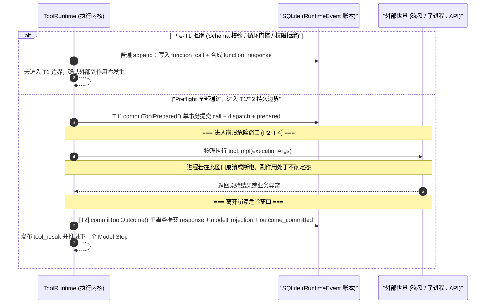
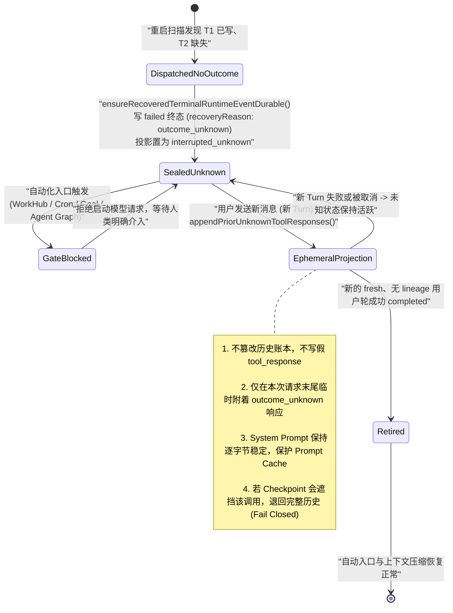
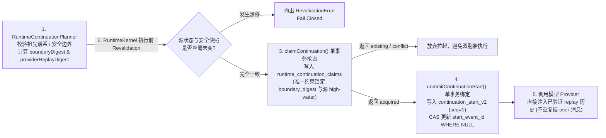

# 持久化执行与崩溃恢复：T1/T2 边界、三态裁决与原子续接

[返回手册目录](../README.md)

许多开发框架声称自己支持“断点续传”，但本质上只是把历史消息存进了数据库，重启后再加载对话继续发请求。然而在真实的工程环境里，Agent 往往需要执行带外部副作用的工具调用——比如调用 `Write` 修改核心配置文件、运行带有数据库变更的构建脚本，或者通过远程 API 创建工单。如果外部操作刚发出去，进程就在把结果写入账本前崩溃了，重启后的系统必须回答一个极其严肃的分布式一致性问题：

> **刚才那个外部操作到底有没有生效？如果账本里没有看到工具结果，我可以悄悄再跑一遍吗？**

Maka 的回答是坚定的 **Fail Closed（故障封闭）**：**本地数据库事务管不了外部世界，系统绝不允许通过“盲目重试”或“伪造成功”来掩盖崩溃窗口里的不确定性。** 本章深入剖析 Maka 如何通过 `SqliteRuntimeStore` 的 T1/T2 两阶段提交、`resolveRuntimeRecovery` 三态裁决、`outcome_unknown` 封存与退役机制、`claimContinuation` / `commitContinuationStart` 单事务防重接续，以及 `RuntimeLedgerRepair` 账本自愈，构建出一套可审计、抗进程崩溃的持久化执行体系。

---

## 1. 概念先行：本地事务管不了外部世界

SQLite 等关系型数据库虽然能够在单机内提供多张表同时写入的 ACID 原子性，但它**无法把本地数据库与外部文件系统、操作系统子进程、远程 HTTP 接口或前端浏览器纳入同一个分布式事务**。

这导致每一次工具执行必然存在一段物理上无法消除的**崩溃危险窗口（Crash Window）**：如果在未留下任何准备记录前直接调用工具，工具写完文件后进程突然崩溃，重启后账本里将没有任何调用痕迹，恢复引擎便可能误判“什么都没发生”而重复触发副作用；反之，如果把 SQLite 写事务一直拖到工具执行结束再提交，耗时数分钟的编译或网络请求就会长时间锁死数据库。



### 1.1 五重身份标识与事实/投影分离

为了精准锚定每一个崩溃现场，Maka 严格区分了五类不可互换的执行身份，并将存储层划分为**不可变权威事实**与**可重建查询投影**：

| 抽象实体 | 身份标识 | 职责与不可变边界 |
| :--- | :--- | :--- |
| **Session（会话）** | `sessionId` | 长期交互容器，承载多轮对话、历史归档与作用域隔离。 |
| **Turn（逻辑轮次）** | `turnId` | 逻辑工作单元（例如用户提交的一条任务）；通过协作交接（Handoff）可跨越多个物理 Run，但普通安全边界续接会分配新的 `turnId`。 |
| **Run（运行记录）** | `runId` | 一次具体的持久化执行尝试及其操作审计边界（`AgentRun`）。 |
| **Invocation（执行实例）** | `invocationId` | 一次有明确开篇事实（`invocation_opened` / `continuation_start`）与终态事件的模型-工具流调用边界。当前阶段一个 Invocation 对应一个 Run。 |
| **Operation（工具操作）** | `operationId` | 单个工具副作用尝试的唯一主键，由 `(invocationId, providerToolCallId)` 确定性哈希生成：`toolop_<sha256前32位>`。 |

在存储模型上，`SqliteRuntimeStore`（Schema v20，开启 `WAL` 日志、`PRAGMA synchronous = FULL` 与新建库 `auto_vacuum = INCREMENTAL`）坚持一条铁律：**`runtime_events` 表中的不可变 `RuntimeEvent` 是系统的唯一事实源（Single Source of Truth）**。而 `tool_operations` 与 `tool_journal_events` 表虽然在同一个 SQLite 事务中同步更新以加速查询，但它们在架构定位上只是**可随时丢弃并重建的投影（Disposable Projections）**：

- 通用追加接口（`appendRuntimeEvent`）被显式禁止写入 `toolDispatch`、带操作归属的 `outcome` 或恢复裁决事实；
- 所有投影行必须通过外键引用产生它的 `RuntimeEvent`；
- 任何时候清空 `tool_operations` 和 `tool_journal_events`，调用 `rebuildToolProjectionsFromRuntimeEvents()` 都能从 `runtime_events` 推导出字节级等价的状态；一旦投影与原始事件冲突，直接判定为账本损坏（`corruption`）并 Fail Closed。

---

## 2. 两阶段事务边界：Pre-T1 隔离与 T1/T2 契约

在 `ToolRuntime` 中，一次工具调用在真正跨过物理执行门槛之前，会先经历参数三重快照构建、Schema 校验、激活门控、循环防呆（Loop Gate）以及人类审批等 Preflight 检查。**决定该次调用属于哪条持久化通道（Lane）的时机，不是在收到模型流片段的瞬间，而是在检查真正落地的那一刻。**

### 2.1 为什么 Pre-T1 拒绝绝不能打上 T1 协议标记？

如果一次调用在参数校验或权限审批阶段就被拦截（例如工具尚未通过 `tool_search` 加载、参数违反 Schema，或用户点击了拒绝），`tool.impl()` 根本没有机会运行。如果此时错误地提前给 `function_call` 标上了 T1 协议身份，而后续又没有调用 `commitToolPrepared()`，那么同步写入的合成拒绝响应就会变成一条没有前置准备记录的 `orphan_response`，直接导致整条账本校验失败。

因此，Maka 采用**推送时判定通道（Lane Decision at Push Time）**的设计：
- **Pre-T1 拒绝通道**：由 `refuseBeforeDispatch` 统一收口，将 `function_call` 与合成错误响应同时写在普通通用通道（Generic Lane）上，**不生成 `operationId`，不写 `toolDispatch` 事件**。
- **T1/T2 持久通道**：只有当全部 Preflight 放行并进入 `prepareDurableToolAttempt` 时，才会使用确定性 `operationId` 构造 `<operationId>_call` 与 `<operationId>_dispatch` 事件并迈入 T1。

### 2.2 `operationId` 与规范化参数指纹（`canonicalArgsHash`）

为了确保重启或重试时的精确幂等校验，Maka 在进入 T1 前会计算两项关键身份指纹：
1. **`operationId`**：基于 `JSON.stringify([invocationId, providerToolCallId])` 计算 SHA-256 摘要并截取前 32 个十六进制字符，拼接为 `toolop_<digest>`。同一物理执行中同一个模型工具调用 ID 永远对应同一个操作主键。
2. **`canonicalArgsHash`**：通过 `canonicalToolArgsHash(toolName, args)` 对工具名与参数执行严格 JSON 规范化序列化后计算 SHA-256。序列化器会显式拒绝 `undefined`、稀疏数组（数组空洞）、`NaN`/`Infinity`、自定义原型以及访问器属性，并将 `__proto__` 置于 `Object.create(null)` 中作为纯数据键处理（或按 v1 兼容规则剥离原型 setter 影响），防止攻击者或 SDK 畸形对象利用原型链与类型强转制造参数哈希碰撞。

### 2.3 T1 与 T2 的单事务解剖

`SqliteRuntimeStore` 使用 `BEGIN IMMEDIATE ... COMMIT` 短事务分别锁定工具执行的入口与出口：

| 提交阶段 | 入口方法 | 事务内原子写入与校验内容 | 失败/中断语义 |
| :--- | :--- | :--- | :--- |
| **T1（派发准备）** | `commitToolPrepared()` | 1. 校验 `t1_prepare` 账本状态转换合法性。<br/>2. 若 `operationId` 已存在，校验事件字节级一致（Exact Retry 返回 `created=false`，任何漂移直接抛错）。<br/>3. 写入 `<opId>_call`（若审批等待期尚未落盘）与非模型可见的 `<opId>_dispatch`（携带 `toolBoundary: "t1_after_preflight_v1"`、`resultProjectionVersion: 1`、`canonicalArgsHash`、`recoveryMode`）。<br/>4. 插入 `tool_journal_events`（`state = 'prepared'`）与 `tool_operations`（`current_state = 'prepared', version = 1`）。<br/>5. 若为托管工作区变更，同时抢占 `runtime_managed_mutation_reservations` 排他行。 | **T1 提交失败时，`tool.impl()` 调用次数严格为零。** 事务回滚后不留任何残留准备状态。 |
| **T2（结果结算）** | `commitToolOutcome()` | 1. 校验 `operationId` 已存在且具备 `dispatch_event_id`；核对 `t2_outcome` 身份一致。<br/>2. 若已提交过相同事件 ID，验证字节一致性后幂等返回 `created=false`；若 ID 冲突则拒绝。<br/>3. 当 `resultProjectionVersion === 1` 时，强制要求 `function_response` 必须携带持久化 `modelProjection`。<br/>4. 写入 `<opId>_response` 事件与 `tool_journal_events`（`state = 'outcome_committed'`）。<br/>5. 使用乐观 CAS 更新 `tool_operations`（`WHERE operation_id = ? AND current_state = 'prepared' AND result_event_id IS NULL`，`version = version + 1`）。 | **T2 成功前，结果绝不允许提交给下一个 Model Step。** 若外部工具已返回但 T2 落盘失败，内核仅触发 best-effort 补偿钩子并抛出 `RuntimeCommitBoundaryError('T2')`，绝不伪装成功。 |

---

## 3. 崩溃恢复裁决：`resolveRuntimeRecovery` 与协议隔离

当进程在任意位置崩溃并重启时，恢复引擎绝不读取易失内存态，也不轻信 UI 或投影表，而是直接由唯一的权威解析器 **`resolveRuntimeRecovery(events)`** 对单个 Invocation 的不可变 `RuntimeEvent` 序列进行纯函数扫描。

### 3.1 为什么首事件的 Protocol Marker 是刚性分水岭？

在系统演进过程中，历史版本可能留存过没有写入 T1 派发事件的旧日志（Legacy Ledger），或者是未接入 SQLite 持久提交槽（`RuntimeCommitSink`）的执行路径。如果恢复解析器单纯看到“账本里有一条 `function_call`，但既没有 `dispatch` 也没有 `response`”，就武断地认为“工具肯定还没来得及执行”，那么面对旧版本留下的崩溃现场就会导致严重的多重副作用！

为此，Maka 规定：**只有当首条规范事件（普通运行的初始用户事件，或接续运行的 `continuation_start` 事件）明确携带 `actions.runtimeProtocol.toolBoundary === "t1_after_preflight_v1"` 时，解析器才有资格将“有 `call` 但无 `dispatch`”判定为确定未派发；若该标记缺失，则一律保守降级为未知；若标记出现在第 2 条及之后的事件中，则直接判定账本协议标记非法（`protocol_marker_invalid`）。**

### 3.2 `resolveRuntimeRecovery` 完整裁决矩阵

`resolveRuntimeRecovery` 首先调用核心包里的 `scanToolLedger(events)` 将事件按 `toolCallId` / `operationId` 归组到独立的语义通道（Call / Dispatch / Outcome / Reconcile / Decision），并产出五种封闭裁决状态：

| 账本不可变事实组合 | 裁决状态 (`status`) | 典型原因码 (`reason`) | 恢复含义与后续系统动作 |
| :--- | :--- | :--- | :--- |
| **`call` + `dispatch` + 匹配 `response`** | `completed` | `matching_response` (`normal_t2`) | 正常跨过 T1 并完成 T2 结算。结果真实可靠，直接参与下一次模型上下文重放，**严禁重跑**。 |
| **`call` + 匹配 `response`（无 `dispatch`）** | `completed` | `matching_response` (`pre_t1_synthetic`) | T1 前的合成拒绝结果（如权限拒绝），或旧协议已完结调用。可安全重放。 |
| **`call`（无 `dispatch`、无 `response`），且首事件含 `t1_after_preflight_v1`** | `definitely_not_dispatched` | `new_protocol_before_dispatch` | 物理上可证明进程在进入 T1 之前就已经崩溃，外部副作用确定未发生。 |
| **`call` + `dispatch`，但缺失 `response`** | `indeterminate` | `dispatch_without_response` | **进程死在 T1–T2 危险窗口内！** 副作用可能已发生、部分完成或未发生。**严禁自动重跑**，必须由 Host 封存为 `outcome_unknown`。 |
| **`call`（无 `dispatch`、无 `response`），但缺失新协议标记** | `indeterminate` | `legacy_dispatch_unknown` | 旧版本或非持久通道崩溃现场，无法证明未执行，保守按未知处理。 |
| **存在历史 `recovery_bundle` 裁决事实** | `completed` / `parked` | `recovery_bundle_completed` / `reconcile_*` | 兼容读取历史遗留恢复包（注意：当前版本已退役通用工具专属 Reconciler 写入路径，仅保留只读解码与投影重建兼容）。 |
| **孤儿事件、重复身份、参数哈希冲突、时序倒错或半截损坏** | `corruption` | `orphan_dispatch` / `orphan_response` / `duplicate_*` / `canonical_args_hash_conflict` / `event_order_conflict` | 不可变账本遭到破坏或语义通道偷渡。立即 **Fail Closed**，阻断所有自动续接与重放。 |

### 3.3 Phase 0 崩溃边界契约（`P0–P11` Failpoints）

为了用真实进程崩溃（`SIGKILL`）验证上述裁决在字节前缀截断下的确定性，Maka 定义了 12 个标准崩溃注入点（`RUNTIME_RESUME_FAILPOINTS`，`P0`–`P11`），它们映射为四类已提交前缀（`committedPrefix`）：

1. **`before_function_call`（`P0`：进入 T1 前崩溃）**：无未闭合工具操作，`buildResumePlanFromRuntimeEvents()` 判定 `safe_replay`。
2. **`after_function_call`（`P1`–`P4`：从调用落盘、T1 写入后、工具执行中到副作用完成但 T2 未提交前崩溃）**：判定 `blocked`（拒绝原因 `dangling_tool_state`），工具状态为 `indeterminate`（或新协议 T1 前的 `not_dispatched`），且**未配对的 `function_call` 会被严格剥离出模型重放历史**，绝不允许把半截调用喂给大模型“自行补全”。
3. **`after_function_response`（`P5`–`P8`：T2 已提交或正在提交终态事件前崩溃）**：结果已经安全落盘，判定 `safe_replay`，`call` 与 `response` 成对保留在重放历史中。
4. **`after_terminal_event`（`P9`–`P11`：终态事件落盘后在 Run header 或接续创建时崩溃）**：保持前置前缀的工具裁决，终态事件不可撤销地留存在账本中。

---

## 4. `outcome_unknown` 封存、请求期投影与退役闭环

当 Host 启动执行 `recoverInterruptedSessionsStrict()` 时，若扫描发现某次未闭合的 Invocation 存在 `dispatch_without_response` 的未决工具调用，Maka 不会停留在“挂起等待”的僵死状态，而是执行一套**“诚实封存 + 请求期临时提示 + 事后显式退役”**的三步闭环：



### 4.1 单事务封存（`ensureRecoveredTerminalRuntimeEventDurable`）

恢复引擎在单个 SQLite 事务中完成封存：
1. 校验待封存的未决 `operationId` 集合与数据库当前 `listUnsettledToolOperationsSync` 完全匹配；
2. 写入一条不可变的终态事件：`status: 'failed'`，`actions.stateDelta: { recovered: true, recoveryReason: 'outcome_unknown', unresolvedToolCalls: [...] }`；
3. 将对应操作推进到 `tool_operations.current_state = 'interrupted_unknown'`（若为等待用户输入且无需重试的 `AskUserQuestion` 则标为 `'abandoned'`），并写入对应 `tool_journal_events` 审计记录。

注意：**这里绝对不写入一条伪造的 `function_response` 到 `runtime_events` 中！** 原始账本必须忠实反映“工具曾被派发，但从未提交结果”。

### 4.2 请求期临时投影与系统提示词缓存稳定性

封存之后，旧 Run 已经彻底停止。系统的后续行为取决于触发来源：
- **自动化门禁阻断**：如果是定时任务、WorkHub 委派、Goal 调度或 Agent Graph 唤醒试图在该 Session 上开启新 Turn，Runtime 会在调用模型前直接拦截，因为后台程序无法代替人类承担未知外部副作用的核查风险。
- **人类显式消息放行与临时投影**：当用户在界面主动发出一条新消息时，`inspectPriorUnknownToolOutcomes()` 会扫描历史上的 `outcome_unknown` 封存记录，并通过 `appendPriorUnknownToolResponses()` **仅在发给模型的那份内存请求投影中**，在缺失响应的 `function_call` 后面临时插上一条 `isError: true` 的 `function_response`（携带文本提示与 `uncertainOutcome: { code: 'outcome_unknown', retrySafe: false }`）。
- **两项精妙的工程细节**：
  1. **System Prompt 逐字节不变**：Maka 刻意不在 System Prompt 中拼接警告文本，而是把不确定性信息放进与具体 `toolCallId` 配对的临时 `function_response` 中，从而避免每次遇到未决工具都破坏大模型的提示词前缀缓存（Prompt Cache）。
  2. **防压缩掩盖回退**：如果此前的历史压缩检查点（Compaction Checkpoint）或预算裁剪恰好把这条被封存的 T1 调用隐藏在了摘要之后，Runtime 会主动放弃压缩视图、退回到包含该 T1 调用的完整有效历史（如果超出上下文窗口则直接暴露 Provider 真实错误），绝不让压缩机制悄悄吞掉一条尚未解决的外部副作用证据。

### 4.3 未知状态的“退役（Retirement）”条件

模型看到这条临时响应后，通常会按指令先调用只读工具（如 `Read` 或状态查询命令）核实磁盘或远端现状。什么时候这段“历史阴影”才能解除，让自动化任务和历史压缩（Compaction）重新越过这笔被封存的调用呢？

`unknownOutcomeRetired()` 完全基于账本中的客观 `invocation` 序列做纯函数推导（不写入任何额外标记）：**当且仅当在被封存的 `invocation` 之后，存在至少一轮“用户直接发起（`fresh`、无 `continuation`/`handoff`/子代理 `lineage`、非重试/重新生成/分支）”的新 Invocation 真正运行到了 `completed` 终态时**，说明模型已经在完全知情的情况下引导对话向前迈进了一步，旧的 `outcome_unknown` 随即便自动退役；若那一轮人类核查失败或被取消，未知阴影将继续保持活跃，直到下一轮明确完成为止。

---

## 5. 安全边界续接（Continuation）与单事务防重认领

当崩溃并未发生在 T1–T2 危险窗口内（例如进程在模型推理中途、结果已提交后或正常安全边界上中断），或者发生跨宿主协作式交接（Cooperative Handoff）时，系统可以执行 **Safe-Boundary Continuation**。

Maka 的核心原则是：**Continuation 从不试图复活旧进程的 JavaScript 栈、Promise 或网络流，而是从不可变前缀中提炼出经过多重安全核验的上下文，创建一个拥有全新执行身份的新 Invocation 来接力推进。**

### 5.1 Phase 1 安全边界门控与双层核验（Plan ≠ Lease）

在真正发起续接前，`RuntimeContinuationPlanner` 必须同时拉取不可变账本（`ImmutableRuntimePrefixV1`）与本地安全观测（`createLocalContinuationSafetyInspector`），逐项核查三道正交边界：

1. **祖先谱系与重放切片（`readLineagePrefixes` & `buildContinuationReplayPlan`）**：
   - 沿 `opening.source` 逆向追溯祖先 Run（最大深度限制 `64`，带环路检测），逐段核验 `source_prefix_digest` 与持久化 `continuation_claim` 是否一致。
   - **重要设计**：`prefixDigest` 计算的是**原始不可变 `RuntimeEvent` 字节序列的规范化摘要**，而不是计算模型的重放消息列表（`providerItems`），从而保证重放投影算法随版本迭代升级时，历史账本边界依然可验证！
   - 对每一段前缀执行裁剪对齐：剥离尚未闭合的尾部模型输出（`findLastStableProviderItem` 回退到最后一个 `tool_result` 或 `user` 文本），确保最终交给模型的历史**严格以 `user` 边界开头，并以 `user` 或 `tool` 边界结尾**，同时按 `providerStateIdentity` 与 `modelId` 过滤可兼容跨路由重放的推理块（`compatibleProviderReasoningReplayEventIds`）。
2. **工具、权限与后台收敛门控**：
   - Phase 0 解析必须为 `safe_replay`（无任何 `indeterminate`、`parked` 或 `corruption`）；
   - 不存在尚未落盘审批结论的 `pending_permission`；
   - 不存在尚未收敛的后台 Shell 或子运行（`backgroundOperationsSettled === true`）；
   - 历史中使用过的所有工具名称仍在当前工具目录（`availableToolNames`）中可用。
3. **工作区逻辑身份一致性**：
   - 对当前工作目录执行 `realpath` 与平台路径规范化，核对 `.maka-workspace.json` 中的持久化身份 `workspace:v1:<uuid>`（工作区合法移动只产生路径变更诊断，不会触发硬拒绝；唯有 UUID marker 变化才硬拦截为 `workspace_identity_mismatch`）。

**规划结果（`continue`）绝不等于执行租约！** 当 `SessionManager` 将规划好的 `RuntimeContinuation` 交给 `RuntimeKernel` 准备拉起物理执行时，`RuntimeKernel` 会在启动前夕立刻执行一次 **Execution Revalidation（执行前重验）**：再次读取账本 high-water、重算重放摘要、复核工作区身份、工具目录与后台状态，并在任何字段发生变化时抛出稳定的 `RuntimeContinuationRevalidationError` 拒绝启动。

### 5.2 `claimContinuation` 与 `commitContinuationStart` 单事务防重

假设系统恢复时，桌面端手动点击恢复按钮与启动自愈任务几乎同时瞄准了同一个中断点，如何绝对防止同一个断点分裂出两个“幽灵接续”？Maka 通过 SQLite `runtime_continuation_claims` 表实现了硬件级的原子互斥：



- **多重数据库唯一约束护航**：`runtime_continuation_claims` 表不仅对 `boundary_digest`、`target_invocation_id`、`target_run_id` 设了 `UNIQUE` 约束，还对 `(source_session_id, source_run_id, source_event_high_water, source_prefix_digest)` 建了联合唯一索引——**同一份源执行前缀最多只能被成功认领一次**。此外，Schema v17 利用局部唯一索引 `runtime_continuation_fresh_turn`（`WHERE json_extract(target_opening_json, '$.source.kind') <> 'handoff'`）锁定 `(target_session_id, target_turn_id)`，既防止普通续接复用 Turn，又为保留原 `turnId` 的协作式 Handoff 留出了唯一通道。
- **先 Claim 后 Start，CAS 绑定**：`commitContinuationStart()` 必须在同一个写事务中校验已认领的 claim 与传入 claim 完全一致，将系统级且模型不可见的 `continuation_start_v2` 写入目标 Run 的 `event_seq = 1` 位置，然后执行原子 CAS 更新（`UPDATE runtime_continuation_claims SET start_event_id = ?, start_kind = ? WHERE claim_id = ? AND start_event_id IS NULL`）。只有拿到这枚持久化“启动凭证”之后，`RuntimeKernel` 才被允许真正发出大模型网络请求；并且新 Run **不会复制一条重复的 `user` 消息**，从而杜绝模型看到两遍相同的指令或重复调用已完成工具。

---

## 6. 账本自愈：`RuntimeLedgerRepair` 与外部历史物化

在多产品形态演进过程中，除了当前运行时的直接崩溃外，还存在两类历史恢复难题：一是早期仅记录了对话消息、尚未构建 `RuntimeEvent` 脊柱（Spine）的遗留会话；二是从 Claude Code、Codex 等外部系统导入的会话快照。`RuntimeLedgerRepair.materializeTranscriptLedger()` 负责以**零重复、可中断续导、不伪造权威**的方式为它们补齐运行时账本：

1. **只补无主轮次，绝不抢夺原生权威**：首先扫描 `runtime_events` 中已存在的原生 Invocation；对于已经有原生运行记录（或已完结导入轮次）的 `turnId`，哪怕它中途崩溃了，也完全交由 `resolveRuntimeRecovery` 按原生事实结算，修复器绝不另起炉灶制造第二套执行记录。
2. **双遍有界分页扫描（Two-Pass Paged Scan）**：由于历史对话可能极大且不同 Turn 的行在遗留日志中可能交错，修复器按每页最多 `256` 条消息 / `4 MiB` 的有界内存预算执行两遍分页读取——第一遍仅记录每个 `turnId` 出现的最后序号位置，第二遍按页收集并在到达末序号时立刻成批吐出闭合 Turn 进行转换，防止内存溢出。
3. **确定性身份派生与逐行断点续导**：
   - 为每个导入 Turn 派生确定性运行身份 `transcriptRunId(sessionId, turnId)`（格式 `tr_<sha256前48位>`）以及逐事件确定性编号 `${runId}-e${seq}`；
   - 统计已落盘事件中每个 `refs.storedMessageId` 的已转换条数，若上一次导入在某条消息拆分成多个事件的中途崩溃，本次重跑会精准跳过已落盘前缀、仅补齐缺失后缀事件。
4. **严格隔离外部历史与缺失终态**：
   - 若会话来自外部工具（`header.externalOrigin`），以 `modelHistory: 'conversation_text'` 模式转换，绝不把外部模型的工具调用冒充为当前宿主可重放的本地工具；
   - 开篇 `invocation_opened` 的路由来源强制标为 `provenance: 'unknown'`，防止下游将其误认为经过本机认证的模型路由；
   - 如果遗留记录本身未明确登记终态（`turn.statusSource !== 'recorded'`），修复器诚实写入 `status: 'failed', failureClass: 'missing_terminal_event'`，绝不替历史编造 `'completed'`；
   - 所有 Turn 转换完成后，调用 `resequenceSessionEventOrdinals(sessionId)` 按时间重新对齐会话全局事件序号，确保在已产生新运行记录的导入会话中，补全的老 Turn 依然排在正确的时间线位置。

---

## 7. 教学伪代码：从崩溃扫描到安全续接全链路

```text
// 1. 工具结算：Pre-T1 通道分流 + T1/T2 原子包裹
function settleToolCall(call, turnCtx, commitSink):
    args = buildTripleSnapshots(call.rawInput)
    if not validateAndAuthorize(call, args):
        // Pre-T1 拒绝：绝不打上 t1_after_preflight_v1 标记，直接写通用通道合成错误
        appendGenericEvents([callEvent('preflight', call), syntheticErrorResponse(call)])
        return

    operationId = "toolop_" + sha256([turnCtx.invocationId, call.id])[0..32]
    argsHash = canonicalToolArgsHash(call.name, args.persistedArgs)

    // [T1] 跨过此原子事务后，系统再也不能假设外部副作用没有发生
    commitSink.commitToolPrepared({
        operationId,
        runtimeEvent: callEvent('dispatch', operationId, call),
        dispatchRuntimeEvent: dispatchEvent(operationId, argsHash, 't1_after_preflight_v1')
    })

    result = await tool.impl(args.executionArgs, turnCtx.signal)
    modelProjection = tool.toModelOutput(result)

    // [T2] 结果与模型投影必须同事务落盘，在此之前模型不可见
    commitSink.commitToolOutcome({
        operationId,
        runtimeEvent: responseEvent(operationId, result, modelProjection)
    })

// 2. Host 启动恢复：先严格裁决，再决定封存还是放行续接
function recoverOnHostStartup(sessionId, store):
    openInvocations = store.listUnfinishedInvocations(sessionId)
    for inv in openInvocations:
        events = store.readImmutableRuntimeEvents(sessionId, inv.runId)
        resolution = resolveRuntimeRecovery(events)

        if resolution.hasCorruption:
            markSessionQuarantined(sessionId, resolution.issues)
            continue

        dispatchedUnknown = resolution.decisions.filter(
            d => d.status == 'indeterminate' and d.reason == 'dispatch_without_response'
        )
        if dispatchedUnknown.length > 0:
            // 存在 T1 无 T2 悬空调用：单事务封存为 outcome_unknown，绝不重跑
            store.ensureRecoveredTerminalRuntimeEventDurable(
                sessionId, inv.runId,
                failedTerminalEvent(inv, failureClass: 'outcome_unknown'),
                dispatchedUnknown.map(d => d.operationId)
            )
        else:
            // 无未知外部派发：按普通中断收尾并对齐 Turn 状态
            store.ensureTerminalRuntimeEventDurable(sessionId, inv.runId, abortedTerminalEvent(inv))

// 3. 显式安全续接：规划 -> 重验 -> 原子 Claim -> 单事务 Start
function executeSafeContinuation(sessionId, sourceRunId, kernel, store):
    plan = continuationPlanner.plan(sessionId, sourceRunId, safetyInspector.observe(sessionId))
    if plan.disposition == 'park':
        return { parked: true, reasons: plan.rejectionReasons }

    // Plan 不是 Lease：启动前再次重读账本与工作区快照，防止间隙漂移
    kernel.revalidateContinuationBoundary(plan.continuation)
    kernel.revalidateContinuationSafety(plan.continuation)

    claim = buildContinuationClaim(plan.continuation)
    claimResult = store.claimContinuation({ claim })
    if claimResult.kind != 'acquired':
        throw RevalidationError('continuation_claim_conflict')

    // 单事务写入 seq=1 的 continuation_start_v2 并 CAS 绑定 start_event_id
    store.commitContinuationStart({
        claim,
        event: buildContinuationStartV2Event(claim)
    })

    // 不重复插入 user 消息，直接把经验证的 replayRuntimeEvents 交给 Provider
    kernel.launchProviderWithValidatedReplay(claim.target, plan.continuation.runtimeContext)
```

---

## 8. 对照 Pi 与工程选型权衡

| 对比维度 | Maka (`SqliteRuntimeStore` + `RecoveryResolver`) | Pi (`AgentSession` + 实验性 `durable` Harness) | 工程权衡分析 |
| :--- | :--- | :--- | :--- |
| **持久化主账本** | 单一 SQLite WAL (`PRAGMA synchronous = FULL`) 承载不可变 `RuntimeEvent`、投影表与 Continuation Claims。 | 默认为进程内状态驱动、按行追加 JSONL 会话文件；`durable` 实验模式引入独立存储与任务表。 | Maka 牺牲了文件直读的极简性，换取了跨多表外键强约束、并发事务互斥与零投影漂移。 |
| **崩溃窗口处理** | 强制经过 T1/T2 双短事务；缺 T2 必判 `indeterminate` 并封存 `outcome_unknown`，靠新轮人类核实与显式退役收敛。 | 默认依赖用户 `Ctrl+C`/重启后人工重新发起；`durable` 模式通过 `ToolTask` 检查点与工具声明的重放策略处理。 | Maka 对外部副作用采取最严格的保守默认（`never_auto_retry`），杜绝幻象恢复与隐蔽重复执行。 |
| **断后续接形态** | 绝不复活旧运行实例；通过谱系摘要验证、安全边界门控、`claimContinuation` 抢占与 `commitContinuationStart` 诞生全新 Run。 | 默认通过重放 JSONL 文本重建内存 `Agent` 会话；`durable` 依赖调度器恢复挂起的 `ToolTask` DAG。 | Maka 的原子认领表可彻底防止多个恢复入口或重复指令同时拉起两条平行执行链。 |
| **历史修复与兼容** | `RuntimeLedgerRepair` 按双遍有界分页幂等补全运行时脊柱，并严格隔离外源工具历史与未知路由。 | 基于统一消息树分支结构直接解析旧版 JSONL 记录。 | Maka 为多端审计、跨工具导入与长期向后兼容付出了更高的协议复杂性，但换来了严谨的溯源边界。 |

---

## 延伸阅读

- 当工具执行涉及工作区文件改写时，Maka 如何用原生 Rust 数据面防止脏树与并发覆盖？继续阅读 [04.2 原生 Rust Git 数据面与工作区版本权威](gitoxide-and-workspace-versioning.md)。
- 在多端接入场景下，Host 如何通过 OS 排他锁独占 State Root 并执行重启恢复阶段序列？继续阅读 [04.3 Host 所有权、追帧同步与 Peer Mesh 跨主机互联](host-ownership-and-sync.md)。
- 回顾工具运行内核在调用前的三重快照与权限检查机制，阅读 [03.1 工具执行内核](../03-tools/tool-runtime.md)。
- 了解历史压缩如何与已封存的 `outcome_unknown` 调用协同防呆，阅读 [02.2 历史压缩与检查点](../02-context/compaction.md)。
