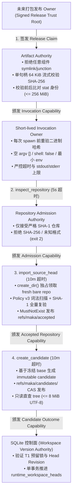
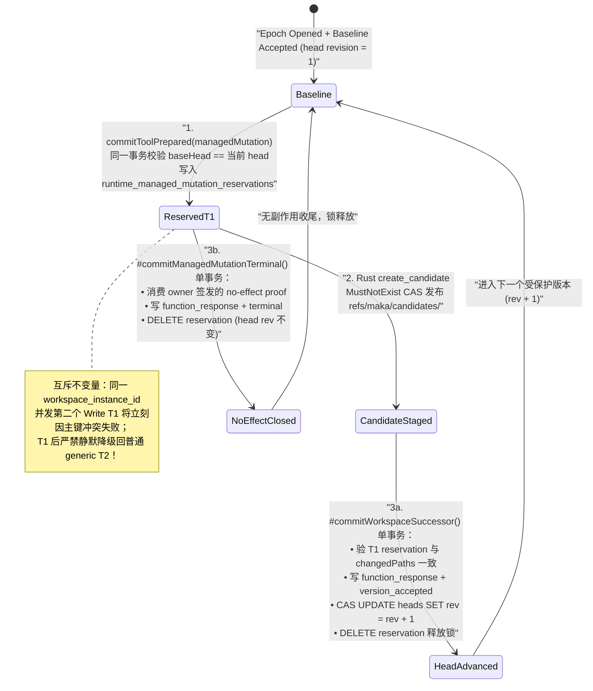

# 原生 Rust Git 数据面与工作区版本权威：Gitoxide Helper 与确定性版本演进

[返回手册目录](../README.md)

在上一章中，我们看到 `RuntimeContinuationPlanner` 会检查 `.maka-workspace.json` 中的逻辑工作区身份（`workspace:v1:<uuid>`）。但这枚标记只回答了一个身份问题：**“当前目录还是之前那个逻辑工作区吗？”** 它绝对无法回答一个更核心的一致性问题：**“磁盘上的文件树是否还对应历史上的某个 `RuntimeEvent` 边界？如果多个进程或多次工具调用并发写入工作区，如何防止互相覆盖或污染用户的 Git 分支与脏工作树？”**

为了彻底解决工作区状态治理与并发版本演进难题，Maka 在 TypeScript 运行时之下构建了一套鲜为人知却极其严密的底层架构：**以原生 Rust `gitoxide-helper` 作为不可变 Git 对象数据面，配合 Host 四级 Opaque Capability 信任链与 SQLite 工作区版本权威（`Workspace Version Authority`）形成双面闭环。** 本章将从第一性原理出发，拆解这套机制的每一道防线。

> **架构定位说明**：当前仓库中，Rust `gitoxide-helper` 数据面、四级内部 Capability 授权链以及 SQLite Schema v20 的基线/后继版本控制表已作为**使能基础设施（Enabling Infrastructure）**完整落地；而面向上层 Desktop/CLI 的默认托管模式（Managed Mode）接线则仍受限于安装包签名信任根与物理文件系统投影配置（`FilesystemMaterializationProfileV1`）的准入门槛，尚未对终端用户默认放开，日常 Write/Edit 仍运行在既有工具路径上。理解这套底层设计，是掌握工业级 Agent 工作区并发治理的关键。

---

## 1. 概念先行：为什么 TS 进程不直接调用 `git` CLI？

如果让 Node.js 进程直接通过 `child_process.spawn("git", ...)` 来操作工作区快照或生成版本提交，在生产级安全与一致性面前会瞬间暴露出五大致命漏洞：

1. **`PATH` 劫持与隐式配置污染**：系统 `git` CLI 会自动搜索 `PATH` 环境变量，并隐式读取宿主机器上的 `~/.gitconfig`、系统级配置以及仓库内不可信的 `.git/config`。恶意仓库只需埋入 `core.fsmonitor`、`filter`（如 LFS smudge/clean）或自定义 hook，就能在只读检查时触发任意代码执行。
2. **外部对象库逃逸（`alternates`）与内存爆炸**：恶意构造的 `.git/objects/info/alternates` 可以诱导 `git` 跨目录递归读取宿主任意私有仓库；而畸形超深树对象或超大单一 Tree/Blob 则可能瞬间撑爆进程内存。
3. **非确定性元数据与脏工作树污染**：`git commit` 默认依赖环境变量与系统时间生成提交哈希，且传统 `git add` / `git checkout` 会搅动用户正在编辑的 `HEAD`、Staging Index 与工作树文件，导致用户手动修改与 Agent 变更互相踩踏。
4. **跨平台路径碰撞与保留设备名风险**：一个在 Linux 上完全合法的仓库树，可能同时包含 `Foo.txt` 与 `foo.txt`、Unicode 组合形式不同的同名路径（`é.txt` vs `e\u{301}.txt`）、尾部空格/点号，或 Windows 保留设备名（`CON`、`NUL`、`COM¹`）。若不通过统一的词法策略在进入对象库前拦截，一旦检出到 Windows/macOS 文件系统就会悄然互相覆盖甚至引发设备读写异常。
5. **Git Ref 与业务账本撕裂**：如果仅靠移动 Git 分支指针来记录“当前接受的工作区版本”，一旦发生崩溃或双进程竞争，就会出现“SQLite 账本认为工具失败回滚了，但 Git ref 却已经前进了”的双重真相危机。

**Maka 的工程答案**：彻底封杀 Node 侧直接运行 `git` CLI 的路径，将一切 Git 对象校验、Tree 编辑与 Ref 原子发布下沉至无状态、短生命周期的 **原生 Rust `gitoxide-helper` 进程**；同时在控制面建立 **`maka_workspace_authority` 专用账本流**，用 **Gitoxide 数据面（存不可变对象与 CAS 凭证） + SQLite 控制面（裁决 Head 演进与并发排他锁）** 取代脆弱的磁盘工作树直写。

---

## 2. 信任架构：四级 Opaque Capability 与控制/数据分离

在 TS 与 Rust 的边界上，Maka 贯彻一条极严格的零信任原则：**任何调用方（包括上层协调器或 UI）都无权通过传入裸路径字符串、裸 `commitOid` 或自报 `{ verified: true }` 来换取写入权限。** 整个调用链条被封装为四级由模块私有 `WeakMap` 与调用方 `ownerToken` 绑定的 **Opaque Capability（不透明能力凭证）**：



### 2.1 Artifact 与 Invocation 安全隔离

- **防篡改校验与 TOCTOU 收窄（`gitoxide-helper-artifact-authority-internal.ts`）**：发布声明（`GitoxideHelperReleaseArtifactClaim`）必须绑定目标平台、架构、协议版本 `1`、支持的操作白名单、精确字节数（上限 `256 MiB`）与预期 SHA-256。每次校验不仅拒绝路径任意一级出现符号链接或 Windows Junction，还在**同一个打开的文件句柄上**以 `64 KiB` 分块计算流式 SHA-256，并在读取前后交叉核对句柄与路径的 `dev`/`ino`/`size`/时间戳。虽然由于 Node 只能按路径而非文件描述符执行 `spawn`，单用户恶意同权替换窗口在最终发布签名根落地前仍需受保护安装目录来封口，但这种前验后核已将常规篡改风险压至最低。
- **最小特权子进程边界（`gitoxide-helper-invocation-internal.ts`）**：每次启动 Rust `gitoxide-helper` 都是一次性短生命周期调用，禁止常驻与派生子孙进程：
  - `argv` 固定为空，`shell: false`，不经任何 Shell 解析；
  - 清空子进程 `PATH`，仅保留 Windows 加载器与临时目录所需的最少环境变量；
  - 请求通过 `stdin` 发送严格禁止未知字段（`#[serde(deny_unknown_fields)]`）的 JSON，响应通过 `stdout` 返回封闭枚举，且根据退出码实施硬隔离：**`exit 0` 仅接受成功结果、`exit 1` 仅接受白名单错误码（`HELPER_ERROR_REASONS_V1`）、`exit 2` 仅接受策略拒绝（如 SHA-256 格式）、`exit 3` 仅接受 `base_commit_mismatch`**；任何退出码与响应体错位均立即 Fail Closed。

---

## 3. 原生 Rust `gitoxide-helper` 数据面深度剖析

原生二进制 `native/gitoxide-helper` 直接集成纯粹的 Rust Git 实现 `gitoxide`（`gix`），在“打开仓库 → 词法校验 → Candidate 生成 → 只读直读”四个环节构筑了滴水不漏的数据面防线。

### 3.1 打开前预算审查（`RepositoryMetadataBudget`）与隔离打开

在调用 `gix::open` 之前，Rust 会率先对候选仓库的元数据结构执行有界预检：
- **严禁 `alternates`**：一旦发现 `objects/info/alternates` 或 `http-alternates` 存在，立刻以 `repository_alternates_unsupported` 拒绝，绝不跟随指向外部对象库的指针。
- **元数据结构防炸弹配额**：遍历 `HEAD`、`gitdir`、`commondir`、`config`、`packed-refs`、`shallow`、`refs` 目录树以及 `objects/pack` 目录时，拒绝任何符号链接，并将总元数据限制在 **1 MiB**、**16,384 个条目**、**最大深度 64**，且主 `objects/pack` 目录不超过 **1,024 个条目**。
- **隔离配置打开（`managed_open_options`）**：通过 `gix::open::Options::isolated().lossy_config(true).strict_config(true)` 完全屏蔽系统与用户全局 Git 配置，并硬编码对象存储槽位数 `object_store_slots = 1024` 与内存分配上限 `gitoxide.objects.allocLimit=67108864`（**64 MiB**），防止畸形磁盘状态诱导内存失控。

### 3.2 `MANAGED_TREE_POLICY_V3`：跨平台词法与属性准入策略

当执行 `import_source_head` 将源仓库快照导入全新的托管裸仓库（Bare Repository）时，Rust 会以单遍/双遍有界校验遍历（`walk_verified_source_tree`）对每一个对象和路径执行 **Policy v3** 审计：

| 检查维度 | Policy v3 刚性限制 | 拦截的潜在故障或攻击面 |
| :--- | :--- | :--- |
| **树规模与对象体积** | 深度 `<= 64`，Tree 访问 `<= 250,000`，总条目 `<= 400,000`，文件 `<= 200,000`，单文件 `<= 64 MiB`，总字节 `<= 2 GiB`；单 Commit `<= 1 MiB`，单 Tree `<= 8 MiB`，累计 Tree 对象 `<= 64 MiB`。 | 拒绝超大仓库、深层嵌套目录炸弹与 OOM 风险。 |
| **规范 Git Tree 结构** | 仅允许原始 Mode Token `40000`（目录）、`100644`（普通文件）、`100755`（可执行文件）；严格验证 Tree 条目遵循 Git 目录 `/` 后缀排序规则。 | 拒绝符号链接（Symlink）、Gitlink 子模块（Submodule）、非规范八进制 Mode 别名以及未排序畸形 Tree。 |
| **跨平台路径合法性** | 组件 `<= 255 B`，相对路径 `<= 4096 B`；拒绝控制字符、`<>:"\|?*`、尾部 `.` 或空格、`.git` 及其折叠变形，以及 Windows 保留设备名（`CON`/`PRN`/`AUX`/`NUL`/`COM1~9`/`LPT1~9` 甚至上标变形 `COM¹`/`LPT²`）。 | 防止检出到 Windows/macOS 时产生无法删除的保留设备文件或路径劫持。 |
| **版本化大小写与 Unicode 碰撞键** | 先剥离 Git HFS 可忽略字符（如零宽连接符、`U+FEFF`），再执行 `Unicode NFC → Default Full Case Folding (Non-Turkic) → Unicode NFC`，独立检查折叠后路径长度（`<= 4096 B`）与集合唯一性。 | 精准拦截 `Σ.txt` 与 `ς.txt`、`STRASSE.txt` 与 `Straße.txt`、`é.txt` 与 `e\u{301}.txt` 在大小写不敏感磁盘上的静默覆盖冲突。 |
| **封闭 `.gitattributes` v2 子集** | 仅允许规范小写 `.gitattributes`（`<= 64 KiB`，单行 `< 2048 B`，纯 LF）；内容除空行和无控制字符 `#` 注释外，只接受 `* text=auto eol=lf` 与 `/<portable-literal-path> export-ignore`。 | 禁止 `filter=lfs`、外部编码转换、`ident`、通配符 glob、CRLF 与属性换序，杜绝不可预测的检出过滤副作用。 |

同时，在目标仓库目录创建阶段，`import_source_head` 会校验父路径链中不存在符号链接与 Windows 重解析点（`FILE_ATTRIBUTE_REPARSE_POINT`），随后以原子 `fs::create_dir()` 独占领取此前完全不存在的空目录，并将源树和 Blob **在全量 SHA-1 校验重新计算确认无误后**写入目标裸库，最后以固定签名（`Maka Workspace Service <workspace@maka.invalid>`，时间戳 `946684800 +0000`）创建零父节点的确定性基线提交，并用 `PreviousValue::MustNotExist` 发布到 `refs/maka/accepted`。

### 3.3 Candidate 生成、`MustNotExist` CAS 与 64 MiB Result Blob 自检

在托管工作区演进中，工具对文件的修改并不会直接覆盖 `refs/maka/accepted` 或搅动用户的本地分支，而是先在孤立的 Candidate 命名空间生成不可变证明：

```mermaid
sequenceDiagram
    autonumber
    participant Host as "Runtime Host (Accepted Capability)"
    participant Rust as "gitoxide-helper (create_candidate)"
    participant ODB as "Managed Bare Repo (ODB & Refs)"

    Host->>Rust: create_candidate(accepted_ref, base_commit, base_tree, candidate_ref, path, content_b64)
    Rust->>Rust: 1. 校验 Policy v3 路径 & 内容 <= 64 MiB UTF-8<br/>计算确定性 request_digest_sha256
    Rust->>ODB: 2. 校验 base_commit/base_tree SHA-1 校验和
    Rust->>ODB: 3. 首次检查 accepted_ref (必须为 direct commit ref)
    alt "accepted_ref != expected_base_commit_oid"
        Rust-->>Host: exit 3: CandidateRejected (base_commit_mismatch)
    end

    alt "candidate_ref 已存在 (Exact Retry 检查)"
        Rust->>ODB: 4a. verify_existing_candidate_receipt():<br/>• 核对 commit message 中的 request_digest_sha256<br/>• 纯内存计算 expected_candidate_tree (不写对象)<br/>• 重新加载并校验 <= 64 MiB result_blob SHA-1!
        Rust-->>Host: 一致则返回原结果; 不一致则返回 conflict / target_invalid
    else "candidate_ref 尚不存在 (首次发布)"
        Rust->>ODB: 4b. 写入 result_blob (若变化)<br/>通过 VerifiedTreeFinder 构造新 Tree (每读子树重验 SHA-1)
        Rust->>ODB: 5. 写入确定性 candidate commit 并做自身全量复验
        Rust->>ODB: 6. 二次检查 accepted_ref 是否仍为 expected_base_commit_oid
        Rust->>ODB: 7. 线性化点: reference(candidate_ref, commit, MustNotExist)
        alt "CAS 竞争失败"
            Rust->>ODB: 重读 candidate_ref：commit OID 相同视为 Exact Retry；不同报 conflict
        else "CAS 成功"
            Rust-->>Host: exit 0: CandidatePublished / CandidateNoChange
        end
    end
```

这段数据面流程中隐藏着四项极其精妙的安全与一致性工程设计：

1. **禁止符号引用与标签剥离欺骗（Direct Ref Only）**：`accepted_ref`（固定在 `refs/maka/` 下，如 `refs/maka/accepted`）与 `candidate_ref`（固定在 `refs/maka/candidates/<sha256(operationId)>` 下）都必须直接指向一个经 SHA-1 校验过的 Commit 对象，拒绝 Symbolic Ref 与 Annotated Tag，防止通过 Ref 剥离（Peel）制造伪造收据。
2. **编辑器抗松散对象替换（`VerifiedTreeFinder`）**：在完整遍历验证过基线树之后、运行 `gix::objs::tree::Editor` 修改目标路径的瞬间，如果磁盘上的松散子树对象在遍历后遭到并发替换，普通缓存可能会直接信任 OID 边。Maka 特意实现了一个 `VerifiedTreeFinder`，在 Tree Editor 加载每一层 Owned Subtree 时**强制再次计算并校验 SHA-1 校验和**。
3. **无变更也发确定性收据（`CandidateNoChange`）**：即使写入的内容与原树 Blob 完全一致，只要未违规，Rust 依然会创建一个树 OID 不变但携带 `request-sha256 <digest>` 的确定性 Candidate Commit，并用 `MustNotExist` CAS 锁定 `candidate_ref`。这样做确保了同一 `operationId` 之后若被误传了不同参数，一定能触发 `candidate_request_conflict`，绝不会因为“没改内容没留痕迹”而失去幂等边界。
4. **Exact Retry 的 64 MiB Result Blob 实物校验与纯计算树对比**：当检测到 `candidate_ref` 已存在时，为了防止有人伪造了一个“只改了别的文件、或者只偷换了 `100644 ↔ 100755` 可执行位、或者其指向的 Result Blob 早已损坏”的假收据，Rust 不仅核对 Commit Message 里的请求摘要（含领域分隔符 `maka.gitoxide.candidate-request.v1\0`），还会从已验证基线树出发**纯内存计算唯一的 `expected_candidate_tree`**（不向 ODB 写入任何新对象），要求收据树与之逐字节相等，并且**实际把目标文件 Blob（上限 64 MiB）从 ODB 加载出来核验类型与 SHA-1 校验和**！

---

## 4. 控制面：Workspace Version Authority 与单实例变更排他锁

光有 Rust 数据面生成的 `CandidatePublished` 凭证还不够——**Candidate 路径永远无权自己推进 `refs/maka/accepted`**。究竟哪一个版本才是工作区在某个纪元（Epoch）里正式生效的权威 Head，必须由 SQLite 控制面 **`Workspace Version Authority`**（Schema v20）与 `RuntimeEvent` 账本一锤定音。

### 4.1 专用权威账本流：`maka_workspace_authority`

工作区版本控制事实绝不能混入普通用户的对话历史中——否则用户复制会话、导出归档或清理过期对话时，就会顺手删掉或复制工作区的物理版本演进史，甚至让大模型在 Prompt 里看到控制面事件。因此，Maka 在 `RuntimeEvent` 账本中开辟了一条确定性的存储级控制流脊柱：

```text
sessionId    = "maka_workspace_authority"
invocationId = "workspace_inv_<epoch_suffix>"
runId        = "workspace_run_<epoch_suffix>"
turnId       = "workspace_turn_<epoch_suffix>"
event_seq    = 1 (maka.workspace.epoch_opened)
             2 (maka.workspace.baseline_accepted)
             3..N (maka.workspace.version_accepted)
```

- 通用写入器（`appendRuntimeEvent`、T1/T2、`claimContinuation`、会话导入/拷贝）均被 `assertNoReservedWorkspaceAuthorityAppend()` 严格禁止向该保留流或使用 `workspaceFact` 通道写入任何事件；
- `workspaceFact` 事件采用完全隔离的语义通道（`role = 'system'`，`partial = false`，无 `content/status/branch/refs`，`actions` 有且仅有 `workspaceFact` 一个键），绝不与模型消息或工具调用混杂。

### 4.2 五张核心控制表与“读时交叉验证”

围绕 `maka_workspace_authority` 的不可变事实，SQLite Schema v20 维护了五张高度耦合的控制与投影表：

| 表名 | 核心主键与唯一约束 | 角色定位与一致性保障 |
| :--- | :--- | :--- |
| **`runtime_workspace_epochs`** | `PRIMARY KEY (workspace_id, workspace_epoch_id)`；`workspace_instance_id UNIQUE` | 记录 Epoch 身份、来源 Commit/Tree、Policy Hash 与物化语义（`git_tree_materialized_with_fixed_config_v1`）。 |
| **`runtime_workspace_versions`** | `PRIMARY KEY (workspace_version_id)`；`accepted_event_id UNIQUE` | 记录基线（`origin_kind = 'baseline'`）与后继变更（`origin_kind = 'tool_mutation'`），用 `CHECK` 约束死死绑定 `operation_id`、`dispatch_event_id`、`outcome_event_id` 与 `base_head_revision`。 |
| **`runtime_workspace_heads`** | `PRIMARY KEY (workspace_id, workspace_epoch_id)` | 记录当前 Epoch 最新权威 Head 指针与单调递增的 `revision`（基线为 1，每次接受后继变更 +1）。 |
| **`runtime_managed_mutation_reservations`** | `PRIMARY KEY (workspace_instance_id)`；`operation_id UNIQUE` | **工作区实例级并发排他锁**：保证任意时刻（包括多进程竞争），同一个 `workspace_instance_id` 最多只有一个活跃的托管变更操作处于 T1–T2 窗口内。 |
| **`runtime_storage_root_binding`** | `singleton = 1`；`root_id` (64位十六进制) | 将 SQLite 数据库永久绑定到所属 State Root 的 `rootId`；单独把 `runtime.sqlite` 拷贝到另一个目录强行打开会直接 Fail Closed。 |

与工具投影一样，`runtime_workspace_epochs`、`runtime_workspace_versions`、`runtime_workspace_heads` 和 `runtime_managed_mutation_reservations` 同样被定义为**可丢弃投影**。每次公开读取或写入前，`SqliteRuntimeStore` 都会在一个**统一的 SQLite 读/写事务快照内**重新扫描 `maka_workspace_authority` 下的全部不可变事件与托管变更 T1/终态事实，并与四张投影表逐行比对——避免并发写入造成跨快照拼接误报，也绝不容忍任何篡改或投影丢失。

### 4.3 托管变更的原子生命周期：T1 预留与 Terminal CAS

当一次托管文件变更（如托管模式下的 `Write` / `Edit`）发生时，存储层与数据面按照**“T1 抢占唯一预留 → Rust 生成 Candidate CAS → SQLite 单事务推进 Head 并释放预留”**的三步曲严密咬合：



在 `#commitWorkspaceSuccessor()` 事务中，以下七个动作必须在**同一个 `BEGIN IMMEDIATE ... COMMIT` 事务**内全成或全滚：
1. 校验 T1 预留行的 `base_workspace_version_id`、`base_head_revision`、`base_commit_oid`、`base_tree_oid` 与 `expected_paths_json` 与本次提交完全一致；
2. 消费经过校验的 Candidate 结果凭证（且结果必须是无错误的 `function_response`）；
3. 写入工具结算 `function_response`（以 `'workspace_successor'` 身份绕过对普通写入者的禁止栏）；
4. 向 `maka_workspace_authority` 流追加 `maka.workspace.version_accepted` 事件（其 `event_seq` 必须严格等于 `currentHead.revision + 2`）；
5. 插入 `runtime_workspace_versions` 投影；
6. 执行乐观 CAS 更新 `runtime_workspace_heads`（`WHERE workspace_id = ? AND workspace_epoch_id = ? AND workspace_version_id = ? AND accepted_event_id = ? AND revision = ?`）；
7. 删除 `runtime_managed_mutation_reservations` 释放排他锁。

**如果变更没有产生文件差异或执行失败未造成外部变更**，普通 `commitToolOutcome` 依然无权释放 `runtime_managed_mutation_reservations`！系统必须通过专用的 `#commitManagedMutationTerminal()` 路径，消费变更 Owner 签发的 `ManagedMutationNoEffectClaimV1`（`no_workspace_change` 或 `operation_failed_no_effect`），在同一事务内落盘终态标记并释放预留锁，同时保持 `runtime_workspace_heads` 原地不动。

---

## 5. 教学伪代码：从仓库准入到版本原子推进

```text
// 1. 仓库准入与基线导入（原生 Rust 数据面）
function initializeManagedWorkspaceEpoch(releaseClaim, sourceRepoPath, destBareRepoPath):
    // 验证 Rust helper 二进制签名与哈希，颁发短生命周期调用凭证
    invCap = admitGitoxideHelperArtifact(releaseOwnerToken, invOwnerToken, releaseClaim)

    // 检查源仓库（必须为严格 SHA-1，且通过 1 MiB / 16,384 条目元信息预检）
    admResult = admitGitoxideRepository(invOwnerToken, invCap, admOwnerToken, sourceRepoPath)
    if admResult.kind == 'repository_rejected':
        return failClosed(admResult.reason) // 如 SHA-256 拒绝，不回退 git CLI

    // 原子创建全新裸库目录，按 Policy v3 校验词法/Unicode碰撞/.gitattributes，发布 refs/maka/accepted
    imported = importAdmittedGitoxideRepository(
        admOwnerToken, admResult.capability, acceptedOwnerToken, destBareRepoPath
    )

    // 在 SQLite 控制面单事务绑定 rootId、epoch_opened、baseline_accepted 及三张投影表
    sqliteStore.commitWorkspaceBaseline({
        commitOid: imported.baselineCommitOid,
        treeOid: imported.baselineTreeOid,
        policyHash: POLICY_V3_HASH
    })
    return imported.acceptedRepositoryCapability

// 2. 一次受控文件修改的完整闭环
function executeManagedFileWrite(acceptedCap, sqliteStore, operationId, targetPath, newUtf8Content):
    head = sqliteStore.readWorkspaceHead(workspaceId, epochId) // 扫描全量 authority 事件交叉核验

    // [Phase A: T1] 在任何数据面或文件变更前，单事务锁定 workspace_instance_id 排他预留
    sqliteStore.commitToolPrepared({
        operationId,
        toolName: 'Write',
        recoveryMode: 'reconcile',
        managedMutation: {
            workspaceInstanceId, baseWorkspaceVersionId: head.workspaceVersionId,
            baseHeadRevision: head.revision, baseCommitOid: head.commitOid,
            baseTreeOid: head.treeOid, expectedPath: targetPath
        }
    })

    // [Phase B: Rust Data Plane] 生成不可变 Candidate 并以 MustNotExist CAS 发布
    // 注意：Rust helper 绝对不推进 refs/maka/accepted，也不读工作区脏文件
    candidate = createGitoxideCandidate(acceptedOwnerToken, acceptedCap, candidateOwnerToken, {
        operationId, path: targetPath, content: newUtf8Content
    })

    if candidate.kind == 'candidate_no_change':
        // 无变更收尾：消费 no-effect 证明释放 reservation，head revision 保持不变
        proof = issueNoEffectClaim(operationId, 'no_workspace_change')
        return sqliteStore.commitManagedMutationTerminal(proof, successResponse)

    // [Phase C: SQLite Control Plane] 消费 Candidate 凭证，单事务推进 Head + 释放锁
    return sqliteStore.commitWorkspaceSuccessor({
        successor: {
            parentWorkspaceVersionId: head.workspaceVersionId,
            baseHeadRevision: head.revision,
            commitOid: candidate.candidateCommitOid,
            treeOid: candidate.candidateTreeOid,
            changedPaths: [targetPath]
        },
        toolOutcome: successResponse
    })
```

---

## 6. 对照 Pi 与工程选型权衡

| 对比维度 | Maka (`gitoxide-helper` + `Workspace Version Authority`) | Pi (`coding-agent` 默认工作区工具) | 工程权衡分析 |
| :--- | :--- | :--- | :--- |
| **工作区版本真相来源** | 原生 Rust `gitoxide` 管理不可变裸库对象与 `refs/maka/*` CAS，SQLite `maka_workspace_authority` 裁决法定 Head 演进。 | 直接操作本地磁盘工作树；版本控制依赖开发者自行使用 Git 或上层脚本。 | Maka 以独立裸库对象存储与严格能力凭证换取了“多工具并发绝对隔离”与“零脏工作树污染”；Pi 则是轻量直观、零额外存储开销。 |
| **Git 引擎集成方式** | 无状态短生命周期 Rust 二进制（`gix`），隔离全局配置、拒绝 `alternates`、硬限制内存分配（`64 MiB`）与元信息预算。 | 如有 Git 操作通常通过通用 Bash/Shell 调用系统 `git` CLI。 | Maka 彻底避免了 `git` CLI 的 `PATH` 劫持、Hook/Filter 逃逸与跨平台差异；代价是需要维护跨三平台的原生 Rust 二进制构建与签名信任链。 |
| **跨平台路径与编码安全** | Policy v3 强制执行 Unicode NFC + Full Case Fold 碰撞检查、Windows 保留设备名拦截以及封闭 `.gitattributes` v2 校验。 | 依赖操作系统底层文件系统报错或提示模型规避。 | Maka 在进入持久化对象库之前就提前消灭了“Linux 正常、Windows/macOS 覆盖崩溃”的跨平台暗雷。 |
| **多端/并发变更防踩踏** | `runtime_managed_mutation_reservations` 以 `workspace_instance_id` 强排他锁住 T1–T2，配合 Candidate `MustNotExist` 与 Head 乐观 CAS。 | 单进程内由工具执行顺序或外部工作树隔离控制。 | Maka 为未来支持“多 Agent 在同一逻辑基线上隔离试错、只由控制面择优合入”奠定了密码学与事务级地基。 |

---

## 延伸阅读

- 了解 `commitToolPrepared` 与 `commitToolOutcome` 通用工具两阶段提交及崩溃恢复裁决，阅读 [04.1 持久化执行与崩溃恢复](durable-execution.md)。
- 了解多个宿主进程是如何通过 OS 排他锁抢占同一个 State Root（含工作区存储根绑定）并服务多端订阅的，阅读 [04.3 Host 所有权、追帧同步与 Peer Mesh 跨主机互联](host-ownership-and-sync.md)。
- 了解当前普通模式下文件读写工具是如何在受限 Worker 与 OS 沙箱中执行的，阅读 [03.3 执行环境与操作系统沙箱](../03-tools/sandbox.md)。
