# Gitoxide 原生数据面与乐观锁：OAuth/Capability 分离与确定性 Worktree 演进

## 1. 为什么在 TypeScript 内核里频繁调用系统 `git` CLI 是一场可靠性和性能双输？

当编码 Agent 需要把项目目录的某一步改动留存为工作区检查点、或者给并行的多个子智能体分支各自切出独立的 Worktree 并在收尾后严谨合回主线时，绝大多数基于 Node.js 的工具都会下意识写 `execa('git', ['add', '-A'])`。在实际工程压测里，这立刻会踩进四座泥潭：

1. **污染用户的日常 Git 状态**：调用宿主的 `.git` 索引区不仅会在用户眼皮底下频频制造垃圾 `stash` 或临时分支，甚至会误触发开发团队配在 `.git/hooks/pre-commit` 上的巨型检查脚本把后台秒级快照直接卡死！
2. **外部环境耦合与脆弱解析**：用户电脑装的 `git` 版本五花八门，加上不同系统下的 `core.autocrlf`、`i18n` 本地化输出文本和环境变量（`GIT_DIR` / `GIT_WORK_TREE`）干扰，靠正则解析 `git status` 输出极易翻车。
3. **非原子并发覆写与权限膨胀**：若允许一个负责执行文件写入的工具句柄自行去操作整个历史版本仓库指针，多协程并发回写检查点就很容易发生互相覆盖回退，或者无意把仓库操作权限越界偷渡给低权限组件。
4. **Node.js 进程池调度大规模文件树的性能悬崖**：当项目带有上万文件及大量非文本构建资产时，在 JS 堆里逐个编码组装 Git Tree 对象的 CPU 与内存 GC 抖动极为剧烈。

Maka TypeScript 版给出了一套截然不同的高内聚分治架构：**让控制面留在 `packages/storage`（Workspace Version Authority），把纯粹高频且对字节完整性极度苛刻的数据面沉降到用纯 Rust `gix` 实现的短生命周期助手 `native/gitoxide-helper`**。

---

## 2. 信任切分：四级不透明凭据（`Opaque Capability`）与双面解耦

在看具体指令之前，必须先看懂 Maka 如何把“**干树扫描和对象写盘的数据苦力**”与“**决定今天项目头指针归谁的控制仲裁官**”彻底分开：

```mermaid
flowchart LR
    Coord["工具与协同调度层<br/>(ToolRuntime / Agent Graph)"] -->|"1. 申请单实例工作区变更门锁"| Auth["Workspace Version Authority<br/>(workspace-version-authority-internal.ts)"]
    Auth -->|"签发不透明能力凭证 Opaque Capability<br/>(仅限单次受限动作，绝非万能权限 Token)"| Helper["native/gitoxide-helper<br/>短命纯 Rust gix 进程 (仅读受限边界路径树)"]
    Helper -->|"计算校验 Blob / Tree / Commit<br/>按 CAS refs/maka/accepted & MustNotExist 提交"| Receipt["返回密封凭证:<br/>candidateOutcome 或 noEffectOutcome"]
    Receipt -->|"2. 带凭证回到 Authority 单事务提交!"| AuthCommit["WorkspaceSuccessorCommitInput /<br/>ManagedMutationTerminalCommitInput<br/>同步原子落盘新 Head 与 RuntimeEvent"]
```

这一来一回的“**去中心数据面 -> 带回密封不透明凭证 -> 控制权威单事务确认（Control/Data Plane Split）**”构筑起极其坚固的安全防线：
- **助手（`gitoxide-helper`）无业务裁决权，不认识 Session 也不握锁**：就像一名严格执行清单的银行金库机械臂，它不保留长期驻留进程、不保存业务历史，甚至根本不管这笔动作的 `runId` 是谁——它唯一认准控制层签发的那一笔 `Opaque Capability`，算完树哈希与边界字节限制后交回封口收据就立刻退出销毁；
- **权威（Authority）靠闭环凭证校验才推进状态**：`packages/storage/src/workspace-version-authority-internal.ts` 中的 **`WorkspaceSuccessorCommitInput`**（工作区版本成功推进）和 **`ManagedMutationTerminalCommitInput`**（明确无变更或失败撤退结算，`ManagedMutationNoEffectClaimV1` 区分 `'no_workspace_change' | 'operation_failed_no_effect'`）全都硬性要求调用方交出那枚不可伪造的 **`candidateOutcome` / `noEffectOutcome` 不透明凭据对象**，确保任何协程都绝无可能跳过真正的数据验证阶段在存储层虚空伪造出一个检查点版本号！

---

## 3. 深入 `native/gitoxide-helper`：面向字节预算的确定性数据平面

查看 `native/gitoxide-helper/src/main.rs` 的源码配置，可以看到纯粹用 Rust `gitoxide` (`gix`) 构建的数据面如何在物理细节上防呆防爆：

| 硬性边界维度 | `gitoxide-helper` 的物理防爆限额与机制 | 解决的高风险隐患 |
| :--- | :--- | :--- |
| **路径与文件夹深度限额** | `max_component_bytes: 255`、`max_relative_path_bytes: 4096`、`max_total_folded_path_bytes: 256 MiB` | 防止恶意嵌套深层怪异目录或超长畸形文件名撑爆缓冲区或绕过跨 OS 路径比对 |
| **单文件与单仓体量限制** | 明确绑定 `MAX_IMPORT_FILES`、`MAX_IMPORT_FILE_BYTES`、`MAX_IMPORT_BYTES` 预算 | 在未正式落盘前即拦截把数 GB 视频资产或意外落入的巨型镜像错误打进版本树，保护本地磁盘 |
| **树与提交对象安全阈值** | 锁定 `max_commit_object_bytes`、`max_single_tree_object_bytes` 与 `max_total_tree_object_bytes` | 对异常构造的超深 Git 树爆炸攻击形成天然免疫 |
| **原语级 CAS 防覆写发布** | 采用底层 `MustNotExist` 前提及独立专属引用命名空间 **`refs/maka/accepted`** | 既做到**百分百零触碰开发者主工程 `.git` 的分支与 `HEAD`**，又能靠原语级原子 CAS 拒绝平行进程的冲突覆写 |
| **标准错误诊断收口** | 基于枚举列表（`HELPER_ERROR_REASONS_V1`）向上回传确定性错误码 | 摆脱人类不可靠的字符串模糊提示解析，让 TS 控制层按明确错误码路由重试或失败阻断 |

---

## 4. 控制面演化：`WorkspaceHeadRecordV1` 与单实例变更排他锁

当协同图（Swarm / Agent Graph）或者单步大型工具修改工作区完毕后，控制层并不放任每个子代理自由往公有仓库直接 push 补丁，而是由 **Workspace Version Authority** 接管所有变更的最终落地顺序：

1. **受控单实例突变窗口**：同一个物理工作区在同一时刻最多允许一个托管变更流取得写入晋升权；多智能体工作流中的其余并行开发者被隔离分配至各自独立挂接出来的 Git Worktree 中各写各的代码（详见 [05.2](../05-coordination/agent-graph.md)）。
2. **基线（Baseline）与后继（Successor）的显式 CAS 链条**：每次工作区检查点的演进均基于当前的 `WorkspaceBaselineAuthorityInput` 生成唯一不可篡改的 `WorkspaceHeadRecordV1`；在 **`WorkspaceSuccessorCommitInput`** 最终落库时，同时核对前置操作号、基线状态及由 `toolOutcome` 关联的 `RuntimeEvent`，将“**物理磁盘树的版本号前进**”与“**对话事件流中对应工具结果的 `T2` 结算**”绑定在同一个持久化事务提交内原子完成！

---

## 5. 总结

Maka TypeScript 版利用 `gitoxide-helper` 示范了极其健康的混合语言边界分工法：
- **高频、大吞吐、要求绝对 CAS 语义与字节防爆的树运算**：沉入零常驻垃圾的 Rust 原生可执行组件 `native/gitoxide-helper`，借助隔离命名空间 `refs/maka/accepted` 彻底脱离对用户本地 `.git` 工具链状态的侵入；
- **带有业务状态约束的唯一裁决权威**：留在 TypeScript 存储侧 `Workspace Version Authority`，用基于 `candidateOutcome` / `noEffectOutcome` 的不透明凭据机制，实现“工作区快照版本”与“对话事实脊柱”的死死咬合与单原子提交。

把工作区源代码树、事件脊柱和两阶段工具结果全部稳固之后，系统边界就只剩最后一片最核心、也最复杂的基础设施支撑了：**宿主机自身怎样靠 OS 锁与六阶段启停守护唯一的 State Root？客户端怎么用零丢帧追平所有事件？移动或异地控制台切网重连时，原生 Rust Peer Mesh 又是怎样无缝接续字节流的？** 下一篇全盘剖析宿主生命周期与跨主机直连传输底座：[State Root 排他租约、六阶段冷启与 Peer Mesh 可恢复字节流](./host-ownership-and-sync.md)。
