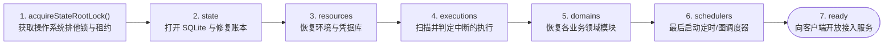
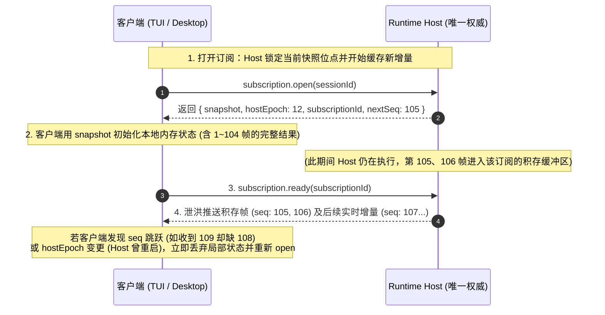

# Host 所有权与客户端状态同步

[返回手册目录](../README.md)

用户先在桌面端应用里发送“修改 `config.json`”，接着又在旁边的命令行终端里打开 TUI 查看同一项目的会话。此时，两个独立的产品进程正在并发访问同一份工作区状态。

如果允许桌面端和终端各自运行一个 Agent 内核去直连本地数据库，不仅会因为竞态条件导致文件写坏，还会出现“桌面端正在运行工具，终端却认为会话空闲而允许用户输入新任务”的状态撕裂。

Maka 通过**“State Root 单一写入权威 + 基于 Epoch 与序号的订阅追帧协议”**彻底解决这一多端协同难题。

---

## 1. 概念先行：什么是 State Root 所有权？

**State Root（状态根）** 是 Host 存储所有会话、事件账本与控制面状态的物理目录（一个状态根可同时管理多个项目工作区）。

Maka 规定：**在任意时刻，一个 State Root 只能由唯一一个存活的 Runtime Host 进程持有写入资格。** 桌面端、TUI、CLI、机器人乃至离线评测引擎，全都降级为通过协议接入的“客户端”。

### Host 启动时的抢锁与阶段性恢复
当一个 Host 进程启动并试图接管某个 State Root 时，它绝不会一上来就对外开放 RPC 端口，而是必须严格走完以下六步启动管线：



**为什么要把 `schedulers`（调度器）放在恢复的最后一步，且在 `ready` 之前完成执行扫描？**
- 如果在中断恢复（`executions`）尚未判清哪些工具结果未知前，就提前启动了调度器或放行客户端新请求，新任务就会与残缺的旧状态发生撞车。
- 同时，Host 内部的每一次关键存储写操作都在租约保护（`runWithStorageRootLease()`）下运行：一旦底层发现 OS 锁意外丢失（例如目录被异常卸载或出现极端双主冲突），Host 立即熔断写入，保卫账本不被污染。

---

## 2. 客户端追帧同步协议：快照 + 增量（`open → ready`）

解决了写入端的唯一性后，下一个难题是：**当第二个客户端（如 TUI）在任务执行到一半时半路打开，或者因为网络闪断重连，它如何保证界面一字不差、不错乱地追上当前进度？**

如果直接把实时流广播给新连接，客户端会漏掉连接建立之前已经吐出的前半段文本；如果先拉取快照，再打开实时流，在拉取和建流的毫秒间隙里产生的事件又会丢失（经典的“并发追帧空洞”问题）。

Maka 通过严密的 **`open → ready` 握手与 `(hostEpoch, seq)` 双重定序机制** 完美消除了这一空洞：



### 双重定序字段的作用
1. **`hostEpoch`（宿主纪元）**：Host 每次启动时递增或随机生成的唯一纪元号。如果 Host 发生过崩溃重启，客户端收到的消息会带有新的 `hostEpoch`，立刻得知服务端内存态已重置，从而触发一次干净的全量重拉。
2. **`seq`（单调递增帧序号）**：同一订阅通道内严格递增的序号。客户端在接收增量时（`ClientSessionSubscription.accept()`）严格校验连续性。一旦发现断号或版本不匹配，拒绝盲目拼接文本，而是直接重走 `open` 流程自愈。

---

## 3. 跨主机互联：Peer Mesh 的边界定位

当用户在笔记本电脑上开发，但希望使用远端高性能服务器上的算力和文件工作区时，Maka 提供了 **Peer Mesh** 能力：
- Peer Mesh 负责节点发现、成员身份交换以及网络通道选择，让笔记本上的客户端能连接到远端服务器上的 Host。
- **核心原则：Peer Mesh 仅提供传输路由，绝不合并执行权威。** 远端的 State Root 依然由远端服务器上的 Host 独占写入，笔记本客户端只是作为一个远端订阅者接收投影与提交指令，不存在多主数据库同步冲突。

---

## 4. 教学伪代码：客户端无损追帧状态机

```text
class ClientSessionSubscription:
    currentEpoch = null
    expectedSeq = 0
    localState = null

    async function connectAndSync(sessionId):
        while true:
            // 1. 发起 open，拿到基准快照与起始序号
            res = await hostRpc.call("subscription.open", { sessionId })
            this.currentEpoch = res.hostEpoch
            this.expectedSeq = res.nextSeq
            this.localState = buildUIStateFromSnapshot(res.snapshot)
            
            // 2. 通知 Host 我已就绪，请下发积存及后续增量帧
            stream = hostRpc.stream("subscription.ready", { subscriptionId: res.subscriptionId })
            
            try:
                for await frame in stream:
                    // 3. 严格校验纪元与序列号连续性
                    if frame.hostEpoch != this.currentEpoch or frame.seq != this.expectedSeq:
                        throw new SyncGapDetectedError("Epoch changed or sequence gap")
                    
                    this.applyIncrementalFrame(frame)
                    this.expectedSeq += 1
                break // 正常关闭流
            catch SyncGapDetectedError:
                // 发现任何不一致，直接跳回循环顶部重新获取权威快照自愈
                continue
```

---

## 5. 对照 Pi：本地事件监听 vs Chord 远端状态发布

- **Pi 默认模式 (`AgentSession`)**：运行在单机单进程内部，UI 直接在内存中监听 `Agent` 发出的同步事件，不存在跨进程锁与网络断线补帧问题。
- **Pi 的 Chord 状态同步**：Pi 生态中面向远程对象的 `Chord` 组件同样采用了“初始快照 + 增量更新推送”的模式向远程观察者同步数据；这与 Maka Host 的 `open → ready` 订阅协议在分布式系统设计思想上完全一致。

---

## 6. 延伸阅读

- 了解在 Host 持有写入权的前提下，多个并发输入请求如何通过准入控制排队执行，阅读 [05.1 输入队列与执行准入](../05-coordination/queues-and-admission.md)。
- 了解 Host 启动恢复阶段（`executions`）内部是如何判定未闭合工具状态的，阅读 [04.1 持久化执行与崩溃恢复](durable-execution.md)。
