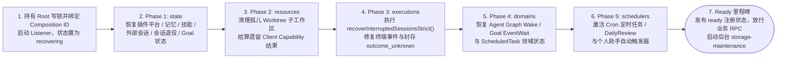
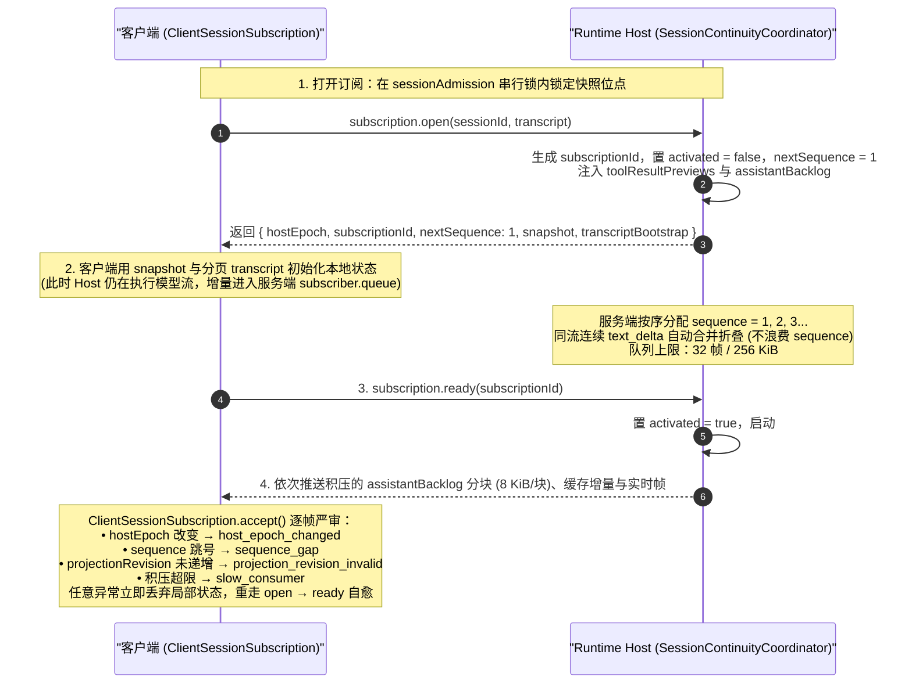
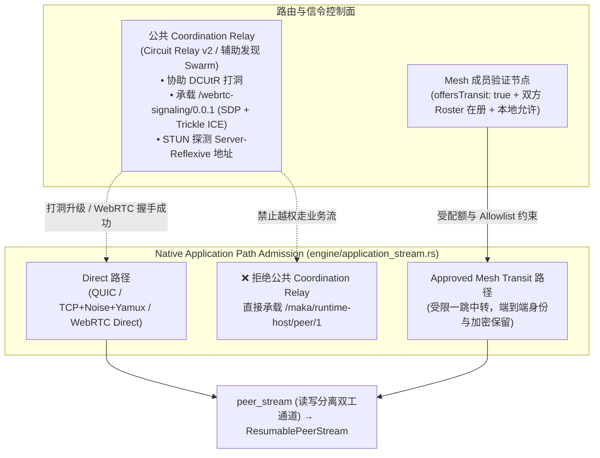

# Host 所有权、追帧同步与 Peer Mesh 跨主机互联

[返回手册目录](../README.md)

想象这样一个日常研发场景：用户在桌面端应用（Desktop）里发起了“修改 `config.json` 并运行测试”的任务，接着顺手在命令行里打开 TUI 观察同一项目的实时进展；几分钟后，他又合上笔记本带着电脑走到会议室，通过无线网络继续连接远端服务器上的同一份工作区。

如果没有严密的所有权与同步边界，这个场景会立刻演变成三场灾难：
1. **双写脑裂**：桌面端与终端各自拉起一套内核直连 SQLite，并发写入直接损坏账本或造成“桌面端正在跑命令、终端却显示空闲”的状态撕裂；
2. **并发追帧空洞**：TUI 在任务半路接入时，在“拉取快照”和“订阅实时流”之间的毫秒缝隙里漏掉关键事件，导致界面少字或状态卡死；
3. **跨机断流重传**：笔记本在办公网与热点之间切换、IP 发生变更时，传输连接中断或跨公网 NAT 失联，上层请求被迫全部中断。

Maka 通过**“State Root 单写权威 + 六阶段有序恢复 + `open → ready` 双定序追帧 + 原生 Rust Peer Mesh 与可恢复字节流”**四层架构彻底破解了上述难题。

---

## 1. 概念先行：单一 State Root 权威与正交身份体系

**State Root（状态根）** 是 Runtime Host 管理会话元数据、`RuntimeEvent` 权威账本以及控制面状态表的持久化物理目录（一个状态根下可以管理多个工程工作区）。

Maka 确立了一条不可逾越的系统红线：**在任意时刻，一个 State Root 最多只能由唯一一个存活的 Runtime Host 进程持有写入资格。** Desktop、TUI、CLI、Bot 乃至 `@maka/eval` 评测引擎，全都退居为通过标准协议接入的客户端。同时，Host 严禁混淆五类生命周期各异的正交身份标识：

| 身份标识 | 归属层级 | 变化边界与不可互换铁律 |
| :--- | :--- | :--- |
| **`rootId`** | State Root 物理存储根 | 64 位十六进制持久化根身份；不随路径别名改变，不能因直接复制目录而自动继承。 |
| **`HostEpoch`** | 当前 Host 进程实例 | 每次 Host 进程重启都会生成全新 UUID；客户端靠它识别服务端内存状态是否已重置。 |
| **`Composition ID`** | Host 程序组合契约 | 持久化绑定于 `.maka-host-composition.json`，决定允许哪套领域模块集合解释该状态根。 |
| **`PeerId`** | Peer Mesh 网络端点 | libp2p 密码学网络身份；它不绑定物理机器，更**不等于** `rootId`、`HostEpoch` 或业务授权。 |
| **`Session / Turn / Run ID`** | 业务工作单元 | 产品层会话身份是 `(rootId, sessionId)` 组合；跨 State Root 同名 `sessionId` 不代表同一份工作。 |

---

## 2. State Root OS 排他锁与租约守护

许多简单服务会通过写一个 `host.pid` 文件来充当单实例锁——但进程被 `SIGKILL` 强杀后 `pid` 文件会残留，或者另一个进程删除发现文件就能制造“双主并发写入”。Maka 在 `root-authority.ts` 与 `state-root-composition.ts` 中用**文件系统物理身份验证 + 操作系统级排他锁 + 操作级租约护栏**封死了所有绕过路径。

### 2.1 根身份锚定与防目录拷贝劫持

在申请写锁前，`resolveStorageRoot()` 必须先获取 `StorageRootCapability`：
1. 通过 `realpath` 规范化目标目录路径，读取目录的底层文件系统身份 `(dev, ino)`；
2. 读取并校验根目录下的 `.maka-storage-root.json`（Schema v1），确认其中的 `rootId` 与当前磁盘 `(dev, ino)` 完全匹配；
3. **关键防篡改（`confirmRootSnapshot`）**：在读取与创建标记的前后两次复核目录 `(dev, ino)` 未发生符号链接替换或挂载点漂移。如果管理员将目录完整打包复制到新磁盘（`ino` 改变），系统不会静默把原权限送给副本，而必须经过显式的 `adoptStorageRootOnImport()`（档案导入）或 `repairStorageRootAfterRemount()`（同 `ino` 重挂载修复）流程。

### 2.2 双锁仲裁（`acquireStateRootLock`）与租约排水（`runWithStorageRootLease`）

获得根能力凭证后，Host 调用 `acquireStateRootLock(capability, 'write')` 抢占写入所有权：
- **主锁与兼容锁双保险**：系统基于 `fs-native-extensions` 的 `tryLock`（OS 级非阻塞文件锁），同时对账号局部命名空间 `<account-local-state-root-owners>/<rootId>.lock` 以及控制目录 `<controlDirectory>/owner.lock` 申请排他锁。两处锁文件均通过 `lstat` 拒绝符号链接，并强制设为 `0o600` 权限且在加锁前后校验打开句柄与路径身份一致。
- **发现文件只是提示**：注册表（Registration）、PID、Unix Socket 与健康探测均只作为客户端寻址提示；删除或篡改这些文件绝不可能伪造出第二个写入租约。
- **租约护栏与优雅释放**：一旦拿锁成功，State Root 的所有关键写入操作与 Composition 绑定（`bindStateRootComposition()`）都必须在 `runWithStorageRootLease(lease, 'interactive', 'write', ...)` 保护下执行。每次进入操作前，`activeOperations` 引用计数递增并再次复核磁盘 `(dev, ino)` 与 `rootId`；当宿主关闭调用 `owner.close()` 时，租约立刻标记 `active = false` 拒绝新操作，并阻塞等待所有正在进行的 `activeOperations` 彻底排水完毕（`operationDrainWaiters`），**最后才释放 OS 排他锁句柄**——绝不允许“锁先放了、后台数据库写事务还在收尾”的竞争漏洞。

---

## 3. Host 六阶段启动与五阶段领域恢复顺序

拿到 State Root 排他锁并绑定 `compositionId` 后，`RuntimeHostKernel` 不会急于对外放行业务请求，而是严格按照“先启动受限监听 → 五阶段领域恢复 → 发布 Ready”的六步序列推进：



### 3.1 为什么必须严守这五个恢复阶段（`HOST_RECOVERY_PHASES`）？

在 `host-composition.ts` 中，所有领域模块（`RuntimeHostDomainModule`）必须在监听恢复前以固定拓扑装配完毕（Ready 之后严禁动态注册模块），并由 `recoverRuntimeHostDomainModules()` 严格按序穿透五个阶段：

1. **`state`（控制与持久状态基座）**：先行唤醒技能目录、长期记忆、会话退役记录等基础控制状态，保证后续资源与执行扫描具备可读的元数据上下文。
2. **`resources`（外部资源与遗留进程对齐）**：恢复隔离的子工作区并调用 `recoverClientCapabilityOutcomes()` 结算遗留反向调用状态。此时尚未进入会话执行修复，防止未结算的外部资源身份扰乱工具账本。
3. **`executions`（执行边界修复与中断裁决）**：由 `execution` 模块驱动 `RootTurnCoordinator.prepareRecovery()`、`recoverInterruptedSessionsStrict()`（触发上一章剖析的 `resolveRuntimeRecovery` 与 `outcome_unknown` 单事务封存）、未决消息准入恢复等。在此时刻之前，所有业务写接口均处于 `recovering` 拦截态（客户端请求会稳定收到 `host_not_ready`）。
4. **`domains`（跨会话业务编排恢复）**：恢复 `AgentGraph` 的父子唤醒、协调器，以及 `Goal` 的 `EventWait` 外部信号观察者。由于它们强依赖底层执行是否已经收敛，必须排在 `executions` 之后。
5. **`schedulers`（定时与后台触发器启动）**：**这是全链条最晚启动的阶段！** 只有当账本、工具未知态、任务图与等待条件全部对账完毕，才允许 `ScheduledTask`、`DailyReview` 和 `PersonalAssistant` 触发器开始生成新任务。如果把调度器提前放行，极易导致新定时任务与未封存的崩溃现场撞车，甚至在 `outcome_unknown` 门禁生效前偷偷跑出重复副作用。
6. **`ready` 与优雅关闭逆序**：五阶段全部无错通过后，Kernel 将状态切换为 `ready`，发布最新注册信息并异步开启非阻塞的 `storage-maintenance` 物理存储维护。而在退出时，所有领域模块必须严格按**构造逆序（`[...modules].reverse()`）**先广播 `beginDrain()`（含取消所有等待中 I/O），再执行 `close()`（聚合全部错误而不跳过任何模块），确保**所有 SQLite 连接关闭先于 OS 排他锁释放**。

---

## 4. 客户端无损追帧：`open → ready` 与 `(hostEpoch, sequence)` 双定序

解决了写入端唯一性后，多端协同的第二个核心难题是：**当第二个客户端（如 TUI）在任务执行到一半时半路打开，或者因网络闪断重新连接，如何在不丢帧、不错乱、不重复的前提下追上进度？**

如果先通过 RPC 拉取快照、再打开实时事件流，拉取与建流之间的毫秒时间窗里产生的流式文本就会永久丢失；如果建流后直接推流，客户端又尚未完成初始快照初始化，实时增量就无法落地，甚至大段历史积压会瞬间撑爆客户端缓冲区。Maka 的 `SessionContinuityCoordinator` 与 `ClientSessionSubscription` 通过严密的 **`open → ready` 两步握手 + `(hostEpoch, sequence)` 双重定序** 彻底消除了这一并发追帧空洞：



### 4.1 追帧协议中的四大工程巧思

1. **大流防爆与增量折叠（`assistantBacklog` & `mergeableAssistantDeltaText`）**：当客户端在模型长篇吐字中途加入时，Host 不会一次性把几百 KB 的已生成文本直接塞入有限队列，而是将其记入 `assistantBacklog`，在 `ready` 激活后按每块最多 **`8 KiB`**（`8 * 1024` 字符）随队列排空逐步分期支付，并将随后新到达的指令排队挂在 `deferred` 之后保证绝对时序。同时，对于在 `queue` 尾部尚未发送的同一路 `text_delta` / `thinking_delta`，Host 会直接把连续文本合并进队尾帧（`mergeableAssistantDeltaText`），既大幅压缩网络帧数，又**不额外消耗 `sequence` 序号**。
2. **慢消费者熔断与双端有界队列**：服务端对单个订阅维护 `32 帧 / 256 KiB` 队列上限，客户端 `ClientSessionSubscription` 本地也维护 `32 帧 / 256 KiB` 积压上限；一旦超出上限，直接关闭或报错 `slow_consumer`，强制客户端通过重开 `open` 获取最新压缩快照自愈，避免慢客户端拖垮 Host 内存。
3. **PTY 终端旁路隔离（Backpressure Isolation）**：终端字符流（`subscription.runtime_resource_pty_data`）高频且体量大，Host 刻意将其剥离出 `sequence` 编号体系，使用独立的 `ptyQueue`（上限 `8 帧 / 128 KiB`）。一旦终端输出淹没，只向有 `ptyInterests` 的客户端发一条 `{ data: '', reset: true }` 标记让其重新拉取屏幕快照，**绝不阻塞或污染会话主消息流的序列号连续性**。
4. **严格水线与单调性校验**：`ClientSessionSubscription.accept()` 不仅校验 `frame.hostEpoch === this.hostEpoch` 与 `frame.sequence === this.#expectedSequence`，还校验 `projectionRevision` 必须严格单调递增、`transcriptWatermark`（`throughSequence`）不得倒退。同时，协议严格区分**只读查询重试**与**写入命令恢复**：断线重连后客户端可通过 `open` 无损重建视图，但绝不允许由传输层悄悄重放未知结果的业务修改命令。

---

## 5. 跨主机互联：原生 Rust `runtime-host-peer` 驱动的 Peer Mesh

当用户的桌面端位于本地笔记本、而算力与工作区驻留在远端高性能工作站或云主机时，如何在地址频繁变化、存在 NAT 穿透阻碍的环境中建立可验证且不断流的远程连接？Maka 在 `native/runtime-host-peer` 与 `packages/runtime-host/src/peer-*` 中构建了 **Peer Mesh** 体系。

首先必须明确它的**权限红线**：**Peer Mesh 只是一个受密码学验证的成员发现、路由候选解析与可靠字节传输层；它绝不是通用 VPN、不是多写分布式 State Root、更不自动授予任何 Host Session 权限。** 远端 State Root 仍由远端 Host 独占写入，P2P 层哪怕连通了，上层连接仍须逐级通过 `Host credential → Root/Composition 校验 → Principal/Operation Grants → Session Grant` 的完整准入链路。

### 5.1 三种密码学签名事实与抗时钟回拨 Receipt

Peer Mesh 的控制平面完全建立在三种由 Ed25519 私钥签名、规范化序列化的可验证事实之上（不轻信任何中继或 IP 观测上报）：

| 签名事实 | 签发者与核心载荷 | 证明边界与核心约束 |
| :--- | :--- | :--- |
| **Mesh Roster（成员名册）** | Mesh Authority Ed25519 私钥签发；含 `meshId`（`mesh_<sha256(pubKey)>`）、`authorityPeerId`、单调 `revision`、有序 `members`、是否 `closed`。 | **唯一证明“谁属于这个私有 Mesh”**。每 Mesh 上限 `64` 成员，本地最多加入 `16` 个 Mesh；离线成员重连后不能用旧 `revision` 覆盖已收敛的新决策。 |
| **Member Advertisement（成员通告）** | 成员自身 Peer 身份签发；含 `meshId`、`peerId`、`revision`、`endpointKind`（`client`/`host`）、`displayName` 与 `offersTransit`。 | 声明成员的角色显示信息与转发意愿（上限 `2 KiB`）。**注意**：`endpointKind: 'host'` 不是 Host 操作授权，`offersTransit: true` 也不是允许任意人白嫖中转的 bearer token。 |
| **Reachability Lease（可达租约）** | 对应 Peer 身份签发；含 `peerId`、`revision`、`issuedAt`/`expiresAt`、`directRoutes` 与 `coordinationRoutes`（两类地址严格互斥，每类上限 `16` 条）。 | 证明某组网络地址确由目标 Peer 在特定时间窗口内声明。**默认 TTL `5 分钟`，最大接受生命周期 `10 分钟`，允许时钟偏差 `2 分钟`，过期线索保留 `24 小时` Recovery Horizon**。 |

**抗时钟回拨与重放设计（`peerReachabilityLeaseReceipt`）**：为了防止攻击者把系统挂钟往回拨，或者反复重播同一张旧签名租约让过期地址“永生”，节点收到签名 Lease 后会立即将其剩余挂钟寿命折算为**基于本地单调时钟（`monotonicNow`）的过期凭证**：
$$\text{currentUntil} = \text{monotonicNow} + \min(\text{expiresAt} - \text{issuedAt},\ \max(0,\ \text{expiresAt} - \text{wallNow}))$$
且该 Receipt 按 `(peerId, revision, signature)` 去重缓存——**重复收到相同签名的 Lease 绝对不会刷新或延长 `currentUntil`**！

### 5.2 原生 Rust libp2p Swarm、WebRTC Direct 与路径准入隔离

`native/runtime-host-peer/src/engine.rs` 将底层 P2P 网络栈封装在独立的 Tokio 线程中，基于 Rust `libp2p` `NetworkBehaviour` 统一调度八大行为组件：`connection_limits`、`relay::client`、`relay::Behaviour`（Transit 服务端）、`dcutr`（直连打洞）、`identify`、`ping`（每 `2s` 探测、`3s` 超时、连续 `3` 次失败断链）、`application_stream`（`/maka/runtime-host/peer/1`）、`mesh_control`（`/maka/runtime-host/mesh-control/1`），以及按需开启的 `Toggle` 信令协议 `/webrtc-signaling/0.0.1`。



这套原生传输引擎具备四项关键的分布式工程防护：
1. **公共协调节点与私有中转严格隔离**：公共 Circuit Relay 仅被允许协助发现、DCUtR 打洞与交换 WebRTC SDP/ICE 信令；`application_stream.rs` 在建立业务流处理器时会核验连接路径——**凡是经过未授权公共中继的连接，禁止挂载 `/maka/runtime-host/peer/1` 处理器**，只允许直连（Direct）或符合本地转发策略（`AllowedPeerLimiter`）的成员提供**单跳 Approved Transit**（且受严格配额约束：最多 `32` 个 reservation、`8` 条并发 circuit、每 Peer 最多 `2` 条，单条 circuit 最长 `2 小时` 且累计流量封顶 `256 MiB`）。
2. **WebRTC Direct 完整直连路径**：当传统 TCP/QUIC 穿透受限时，只要配置了 WebRTC 参数，节点会通过已认证的协调连接走 `/webrtc-signaling/0.0.1` 交换 SDP 与 Trickle ICE，利用可选 STUN 探测公网反射地址并在 ICE 连通后运行 `upgrade_connection` 核验预期 `PeerId` 握手身份，最终晋升为同等地位的直连通道（注意：当前架构不提供通用 TURN 中继兜底）。
3. **有界竞争拨号（Bounded Hedging）**：一次逻辑建连尝试（`PendingConnect`）优先发起直连；若 `250 ms`（`TRANSIT_FALLBACK_DELAY`）未果，才把受认可的 Transit 路径加入竞争；打开流时亦采用 `250 ms`（`STREAM_OPEN_HEDGE_DELAY`）的最多 `2` 路并行 Hedge。一旦胜出者就绪，立刻取消并关闭其余竞争尝试——**竞争严格止步于传输建连层，绝不并行发送业务层变更请求**。
4. **路由状态机与外层重连退避解耦**：`RuntimeHostPeerRouteResolution` 的状态分为 `available`、`recovering` 与 `exhausted`（触发 `peer_reachability_needs_repair`）。外层重连协调器刻意过滤掉“从无候选变成无候选”以及 `recovering ↔ exhausted` 的空转通知，只响应“出现了新候选或连接真正恢复”的信号，防止一次失败的路检循环自我唤醒而跳过指数退避。

### 5.3 `ResumablePeerStream`：路径切换、Generation Fencing 与 30 秒字节恢复窗口

P2P 网络中，Wi-Fi 切 4G 或从 Approved Transit 升级为 Direct（内核每 `5s` 主动尝试一次升级！）都会导致底层物理流瞬间替换。为了让上层 Host RPC 与 `open → ready` 订阅毫无察觉，Maka 在 `resumable-peer-stream.ts` 与 `peer-listener.ts` 之间实现了进程内可靠的 **`ResumablePeerStream`**：

- **紧凑二进制帧格式与滑动窗口**：每帧携带 **13 字节定长帧头**（`type [1B] | offset [u64BE] | size [u32BE]`），支持 `DATA(1)`、`ACK(2)`、`FIN(3)`、`PING(4)`、`PONG(5)`、`FIN_ACK(6)` 六种控制与数据帧；按 **`64 KiB` 分块**写入，维护 **`2 MiB` 滑动发送/接收窗口**（应用写入积压上限为 `4 × 2 MiB = 8 MiB`）与 **`30 秒` 断线恢复窗口（`PEER_RECOVERY_TIMEOUT_MS`）**，并配以 `2s` 心跳、`6s` 往返超时探测器。
- **Generation Fencing 防旧连接夺权（`reserve` → Auth ACK → `attach`）**：
  当客户端发起路径切换或断线重连时，调用 `nextAttachment()` 递增 `generation` 并携带 `(sessionId, generation, receivedOffset)` 发起重连。服务端 `RuntimeHostPeerListener` 在放行恢复前执行严格校验：
  1. 复核 `peerId`、`credentialId`、`principalKind` 与 `principalId` 必须与原逻辑流完全一致，且凭据未被撤销（Host 收到撤销通知后会直接强行中断受影响流）；
  2. **先调 `reserve(resume)` 抢占代次并校验对方声明的 ACK 偏移合法性，然后才回发认证成功响应**——确保网络上迟到的旧代次连接绝对无法覆盖已经建立的新代次（`Stale peer stream attachment`）；
  3. 再调 `attach(generation, ...)` 将底层物理流替换为新连接、主动 `abort()` 旧物理流、推进滑动窗口释放已确认数据（`#acknowledge`），并将未确认分块按偏移续传给对端！
- **严格进程边界**：`ResumablePeerStream` 仅保存在双端仍存活的进程内存中。一旦任一端进程重启、或超过 `30 秒` 恢复窗口、或原 `sessionId` 在服务端已找不到（Host 严禁悄悄新建第二个连接来冒充旧流恢复），逻辑流立即终结；上层恢复交回给新建 Host 连接 + `open → ready` 重拉快照与领域层幂等对账——**字节级去重绝不越界承诺跨进程 Exactly-Once RPC**。

---

## 6. 教学伪代码：Host 启动序列、订阅追帧与 P2P 流恢复

```text
// 1. State Root 加锁 + 六阶段启动顺序
async function bootRuntimeHost(rootPath, composition):
    capability = await resolveStorageRoot({ path: rootPath, kind: 'interactive' })
    owner = await tryAcquireInteractiveRootOwner(capability) // 抢占双 OS 排他锁
    if not owner: throw Error("Another Host owns this State Root")

    await runWithStorageRootLease(owner.lease, 'interactive', 'write', async () => {
        await bindStateRootComposition(owner.lease, composition.id)
        hostKernel.startListeners({ isReady: () => state == 'ready' }) // state = 'recovering'

        // 严格串行穿透五阶段领域恢复，任何异常直接 Abort 启动
        for phase in ['state', 'resources', 'executions', 'domains', 'schedulers']:
            for mod in composition.domainModules:
                await mod.recover(phase)

        state = 'ready'
        publishRegistration({ state: 'ready', hostEpoch: hostKernel.hostEpoch })
        composition.startMaintenance()
    })

// 2. 客户端无损追帧状态机 (open -> ready)
async function syncSessionWithHost(hostClient, sessionId):
    while true:
        // Step A: open 锁定权威快照位点，Host 开始在 activated=false 下积攒增量并折叠同流 delta
        sub = await hostClient.openSubscription(sessionId)
        ui.hydrateSnapshot(sub.snapshot, sub.transcriptBootstrap)

        // Step B: 通知 Host 我已就绪，放行积压与实时流
        await sub.ready()
        try:
            for await frame in sub:
                // accept() 内部已严格校验 hostEpoch、sequence 连续性与 projectionRevision 单调性
                ui.applyIncrementalFrame(frame)
            break
        catch RuntimeHostSubscriptionError err:
            // 一旦出现 sequence_gap / host_epoch_changed / slow_consumer，丢弃局部状态重来
            await sub.close()
            continue

// 3. ResumablePeerStream 路径切换与 Generation Fencing
async function handlePeerResumeOnListener(physicalStream, authPacket):
    authority = accessAuthority.authenticate(authPacket.credential)
    existing = activeSessions.get(authPacket.resume.sessionId)

    // 校验实体身份未变且凭据未撤销；若原流已失联则绝不新建连接冒充恢复
    assert(existing != null)
    assert(existing.stream.peerId == physicalStream.peerId)
    assert(existing.authority.credentialId == authority.credentialId)

    // 关键顺序：先在返回 ACK 前原子锁定更高 generation，封杀迟到旧连接
    existing.stream.reserve(authPacket.resume)
    await writeAuthSuccessAck(physicalStream, { received: existing.stream.received })

    // 二次确认准入未撤销后正式切换底层物理流，并从未确认偏移继续泵写
    assert(accessAuthority.authenticate(authPacket.credential) != null)
    existing.stream.attach(authPacket.resume.generation, {
        stream: physicalStream,
        remainder: authPacket.remainder,
        received: authPacket.resume.received
    })
```

---

## 7. 对照 Pi 与工程选型权衡

| 对比维度 | Maka (`Runtime Host` + `Peer Mesh`) | Pi (`AgentSession` + `Chord`) | 工程权衡分析 |
| :--- | :--- | :--- | :--- |
| **进程与状态根所有权** | 单 State Root 由唯一 Host 持有双 OS 锁与 `runWithStorageRootLease`；全端通过协议接入。 | 默认为进程内嵌入式库（`AgentSession`），直接占用当前进程内存与文件系统。 | Maka 彻底根除了桌面端/终端/Bot 多进程并发读写 SQLite 的脑裂问题，代价是更高的宿主生命周期管理复杂性。 |
| **多端同步与追帧** | 基于 `open → ready` 双步握手、`(hostEpoch, sequence)` 校验、同流增量折叠与独立 PTY 旁路。 | 单机内存直接监听事件；远程同步组件 `Chord` 同样采用“初始快照 + 增量更新”模型。 | 两者在“快照 + 增量”的抽象上殊途同归，但 Maka 针对长流高并发补充了 `assistantBacklog` 分块、慢消费者熔断与 `hostEpoch` 重启感知。 |
| **跨主机 NAT 互联** | 集成原生 Rust `libp2p` / `WebRTC Direct` / `DCUtR` / 签名 `Roster + Lease` 与 `ResumablePeerStream` 30s 字节级切换。 | 不内置去中心化 P2P 成员网与多路径流迁移，远端接入通常依赖标准网络服务或隧道。 | Maka 的 Peer Mesh 让用户在无公网 IP、多网卡频繁切换下仍能保持顺滑低延迟直连，同时用 `256 MiB/2h` Transit 配额与单向准入守住了安全底线。 |

---

## 延伸阅读

- 了解在 `executions` 恢复阶段内部，Host 是如何基于 `RecoveryResolver` 裁决 T1/T2 工具现场并封存 `outcome_unknown` 的，阅读 [04.1 持久化执行与崩溃恢复](durable-execution.md)。
- 了解工作区文件修改是如何通过原生 Rust `gitoxide-helper` 与 `workspace-version-authority` 防止并发踩踏的，阅读 [04.2 原生 Rust Git 数据面与工作区版本权威](gitoxide-and-workspace-versioning.md)。
- 了解当多个客户端同时向同一个已获得租约的 Host 提交任务时，输入队列与准入控制如何串行化协调，阅读 [05.1 输入队列与执行准入](../05-coordination/queues-and-admission.md)。
