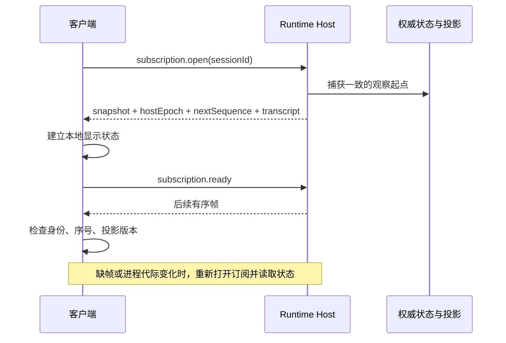

# Host 所有权与客户端状态同步

[手册目录](../README.md)

本章回答两个问题：多个客户端同时连接时，谁有权推进同一项任务；客户端断线后，怎样重新取得可信状态。依据 Maka `15d0a0dd19d39e2bc09ae35940e432c636982315` 与 Pi `482c1381a00d8d00bc81697e4a980c593db6803e`，讨论当前的单 State Root 写入者和客户端观察协议，不把 Peer Mesh 当作多主数据库。

## 1. 问题：多界面的单任务执行权

用户在 Desktop 中要求修改配置，随后又从 TUI 打开同一个会话。如果两个入口各自加载历史、创建循环、写回结果，可能出现：

```text
Desktop 读到“还没修改” → 写配置 → 保存工具结果 A
TUI     读到“还没修改” → 再写一次 → 保存工具结果 B
```

数据库能够顺序保存 A、B，也不能证明第二次修改是必要的。需要先确定执行权，再允许模型和工具运行。

另一个问题是观察：TUI 断线十秒，期间发生了多少次变化并不可知。重新连接后，仅收到“当前运行完成”这条通知，无法补齐此前的工具结果。

这两件事分别需要执行所有权与可重新读取的状态。网络连接只负责传送请求和结果，不能代替其中任何一个。

## 2. 三种数据与三种身份

| 数据 | 用途 | 不能据此推断什么 |
| --- | --- | --- |
| 已提交的 RuntimeEvent、准入记录和业务控制状态 | 证明工作已经被接受、执行到哪里、结果是什么 | 不能证明某个未知外部副作用没有发生 |
| 从上述事实生成的会话快照、消息投影 | 展示或读取当前状态 | 投影本身不是另一个执行写入者 |
| live delta、通知、连接状态 | 快速更新界面、提示重新读取 | 通知丢失不等于事实丢失；连接消失不等于任务取消 |

| 身份 | 含义 | 例子 |
| --- | --- | --- |
| `rootId` | 持久 State Root 的身份 | 同一路径重新初始化，不应被当作原来的数据根 |
| `hostEpoch` | 当前 Host 进程实例的身份 | 进程重启后，旧订阅帧不能混入新订阅 |
| `subscriptionId`、`sequence` | 一条观察订阅及其有序传输位置 | 期望第 8 帧却收到第 10 帧，需要重新建立观察 |

State Root 是保存一组运行状态的数据根。它不是工作目录：一个保存运行记录的根，可以管理多个 Session 和各自的工作目录。

身份检查也不等于授权检查。知道 `rootId`，不代表获得读取会话、修改设置或执行工具的权限，授权见[分层授权与凭据生命周期](../03-tools/permissions-and-secrets.md)。

## 3. 参考实现：一个 State Root 由一个 Host 写入

Maka 的 `root-authority.ts` 不将“某个 PID 还存在”作为最终的写入凭证，而是取得操作系统文件锁，再发放当前进程内有效的 lease。此处的 lease 是带生命周期的存储访问资格，不是依靠周期心跳续期的分布式租约。

主干如下：

```text
resolveStorageRoot()
  → realpath 规范化路径
  → 检查目录的设备/文件身份与持久 rootId 标记
tryAcquireStateRootOwner()
  → acquireStateRootLock()
      → 对持久 ownership namespace 中的稳定文件取得 OS 锁
      → 保留兼容锁边界
      → createStateRootLock() 返回 owner 和 write lease
存储操作
  → runWithStorageRootLease()
      → 验证 lease、登记活动操作、检查 root 身份、执行、结束登记
```

两条路径指向同一真实目录时，不能产生两个所有者；将已初始化的目录直接复制到另一处，也不会自动获得同一数据根的身份。导入、重新挂载和身份修复有明确的入口，不能通过修改路径绕过。

锁的主位置与可清理的连接发现缓存相互分离。否则用户删除缓存后，旧 Host 仍在运行，新 Host 却可能重新取得一个新锁文件，形成两个写入者。

关闭时，owner 先转为非活动状态，拒绝新操作，等待已登记的操作结束，最后释放锁句柄。由此可以避免“锁已释放而旧存储仍在写入”的窗口。

这些约束依赖受支持的本地文件系统与操作系统锁语义。不能据此假定任意共享网络文件系统上的多机写入也安全。

## 4. 启动恢复与所有权

取得锁之后，尚不能立即接受所有业务请求。Host 会绑定可解释该 State Root 的 Composition，再按照固定阶段恢复：

```text
state → resources → executions → domains → schedulers → 对外 ready
```

这些阶段分别建立可解释的业务状态、资源身份、执行一致性、业务结果和调度条件。`recoverRuntimeHostDomainModules()` 按阶段遍历模块，因此调度器不会仅因进程启动，就抢先产生新的工作。

正常关闭则逆序清理模块；一个模块关闭失败，不应跳过其他模块的释放。`closeRuntimeHostDomainModules()` 收集错误后统一报告。

State Root 写锁和 Session 的运行准入不是同一层限制：前者阻止另一 Host 写同一根，后者控制同一 Host 内的竞争。不同 Session 可以并发，同一 Session 的根执行仍需统一准入，见[输入队列与执行准入](../05-coordination/queues-and-admission.md)。

## 5. 快照与实时变化的衔接

打开订阅不只是添加一个回调。协议返回当前快照、订阅身份、下一帧序号、活动 assistant 流，以及按请求选择的有限历史尾部。客户端准备好状态后调用 `ready()`，Host 才放行该订阅积存的帧。



这里的图描述协议交接，不表示打开订阅时会把整个会话历史一次性装入网络响应。历史可以分页，正文过大时还可以分片，并验证完整性。

`ClientSessionSubscription.accept()` 会检查 Host 实例、订阅身份、Session 身份和连续的 live sequence。收到会话投影时，还检查 `projectionRevision` 是否前进。

需要注意两个序号：实时帧的 `sequence` 要连续；历史分页中的持久消息位置可能稀疏。不能因为历史消息编号不是逐个加一，就断言存在遗漏的消息。

PTY 终端字节使用独立的序号和监听通道，不占用普通 Session 迭代器的序号。终端刷屏不应挤占会话状态协议。

## 6. 慢客户端与断线的处理

当前客户端普通订阅队列同时限制帧数和编码字节数：最多 32 个待消费帧、256 KiB。超过边界报告 `slow_consumer`，不会无限保留增量。具体值是该提交的实现参数，不是应用应当永久依赖的常量。

失去一条订阅，不必将整个 Host 或全部连接判定为故障。已有测试专门检查缺帧和慢消费后，原连接仍能响应其他合法请求。

断线后应分别处理查询和命令：

- 查询可以按只读契约重读，恢复界面所需的权威状态。
- 已发出但未收到答复的修改命令，结果可能未知，应依据确切的请求身份、准入记录或结果记录核对。
- 不能为“恢复界面显示”而自动重新执行改文件、发消息或启动任务的命令。

普通连接丢失也不自动等同于取消已准入的工作。但能否在关闭应用后继续，还受 Host 的部署和进程生命周期影响，不能笼统承诺“关闭任何客户端任务都继续”。

## 7. Peer Mesh：连接共享与执行权分离

Maka 的架构把多个 Host 连接起来，同时仍要求每个 Host 各自拥有 State Root。Peer Mesh 提供成员信息、可验证的可达性和连接候选；它不把各个根合成一个数据库，也不因加入网络就自动取得其他 Host 的会话权限。

例如笔记本和服务器各有一个 Host：笔记本客户端可以连接服务器执行任务，服务器的结果仍由服务器 Host 保存。不能从“两个节点连通”推导出“任一节点都可以接管另一节点尚未结束的工具调用”。

跨 Host 的任务调度、状态迁移与外部副作用交接，需要另行定义协议。本章讨论的文件锁、观察序号和断线重读，不构成跨机器共识算法。

## 8. 与 Pi 的区别

| 问题 | Maka 当前路径 | Pi 默认 coding-agent | Pi 的其他组件 |
| --- | --- | --- | --- |
| 多入口共享执行 | 通过同一根的 Runtime Host | SDK 通常在调用进程内组合 AgentSession；RPC 是可选入口 | Chord 可提供跨进程对象和远程引用 |
| 谁保证存储唯一所有者 | State Root OS 锁、owner 与 lease | `Agent.activeRun` 防止一个 Agent 对象同时启动两次，不是根级跨进程写锁 | durable 文档明确要求单进程拥有存储，库不提供跨进程锁 |
| 状态观察 | 会话快照、传输序号、历史分页、ready 门控 | Agent / AgentSession 事件订阅 | Chord 有快照、delta 和 observable state；durable 使用状态发布能力 |
| 客户端缺帧 | 检测并重新建立订阅、读取权威投影 | 进程内监听接口本身没有 HostEpoch 与重连契约 | 不能把通用 Chord 能力直接当作默认 CLI 已组装好的 Host 协议 |
| 网络成员关系 | Peer Mesh 不改变各 Host 的执行所有权 | 不是默认 agent-loop 的职责 | 远程对象、执行恢复和多机共识仍是不同问题 |

Pi 并不是“没有状态同步”。区别在于 Maka 把共享执行、存储所有权和观察协议组成了产品入口的共同边界；Pi 中相关能力分布在默认会话路径与独立组件，接入方式和默认保证不同。

## 9. 源码定位

| 入口 | 核对内容 |
| --- | --- |
| [resolveStorageRoot](../../../../maka/packages/storage/src/root-authority.ts#L210) | 路径、标记和目录身份 |
| [resolveRootOwnershipNamespace](../../../../maka/packages/storage/src/root-authority.ts#L568) | 持久锁位置与缓存分离 |
| [acquireStateRootLock](../../../../maka/packages/storage/src/root-authority.ts#L806) | OS 锁、活动操作、关闭顺序 |
| [runWithStorageRootLease](../../../../maka/packages/storage/src/root-authority.ts#L735) | 存储操作的资格和身份检查 |
| [bindStateRootComposition](../../../../maka/packages/storage/src/state-root-composition.ts#L54) | 数据根与程序组合绑定 |
| [Host 模块恢复与关闭](../../../../maka/packages/runtime-host/src/server/host-composition.ts#L122) | 分阶段恢复，逆序释放 |
| [订阅协议与 ready](../../../../maka/packages/runtime-host/src/protocol/session-continuity.ts#L107) | 快照、序号和门控的数据契约 |
| [ClientSessionSubscription.accept](../../../../maka/packages/runtime-host/src/client/session-subscription.ts#L431) | 拒绝代际、序号和关联错误 |
| [客户端队列边界](../../../../maka/packages/runtime-host/src/client/session-subscription.ts#L566) | 慢消费的处理 |
| [Host 架构当前契约](../../../../maka/docs/architecture/runtime-host-architecture.md) | 观察、命令结果未知和进程生命周期 |
| [Peer Mesh 边界](../../../../maka/docs/architecture/peer-mesh-architecture.md#L37) | 网络成员不等于执行权 |
| [Pi Agent 的 activeRun](../../../packages/agent/src/agent.ts#L507)、[durable 存储约束](../../../packages/durable/README.md#L772)、[Chord](../../../packages/chord/README.md) | 对照不同层次的运行与状态能力 |

## 10. 本章术语

| 术语 | 本章含义 |
| --- | --- |
| Authority / 权威来源 | 对某类事实有最终写入或判定责任的组件 |
| Epoch / 代际 | 区分某个对象的不同生命周期，例如两次 Host 启动 |
| Snapshot / 快照 | 某个明确边界上的完整可读状态 |
| Delta / 增量 | 这个边界之后新增的变化；使用前需确认与当前状态衔接 |
| Drain / 排空 | 拒绝新增工作，等待已接收工作和资源完成清理 |

## 11. 源码练习

1. 客户端期望第 5 帧，却收到第 7 帧。需判断应当重新运行原任务，还是重新读取状态。沿[缺帧测试](../../../../maka/packages/runtime-host/src/__tests__/session-subscription-client.test.ts#L233)核对。
2. 修改配置的命令返回前连接断开。说明为什么不能用“超时”证明它没有执行。列出需要查询的身份和持久记录，不发起真实写入。
3. 比较 Maka 的 32 帧/256 KiB 限制与 [Chord 公共状态订阅](../../../packages/chord/README.md#L127)的完整值合并规则：说明为何不能把跳过完整快照的通知，等同于丢失不可独立应用的增量。

## 相关专题

- [整体架构](../00-foundations/architecture.md)：理解 Host 为何成为共同执行入口。
- [恢复机制](durable-execution.md)：区分客户端重新读取与进程重启后继续执行。
- [执行准入](../05-coordination/queues-and-admission.md)：查看同一 Host 内如何处理 Session 竞争。
