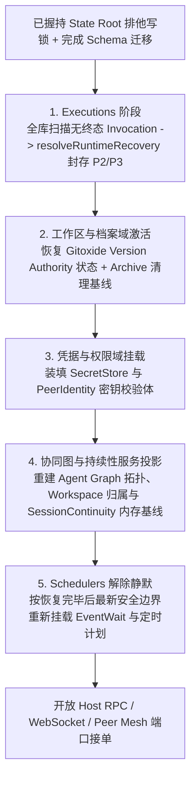
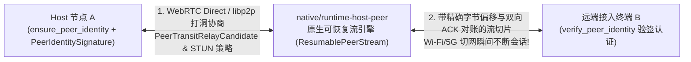

# State Root 排他租约、六阶段冷启与 Peer Mesh 可恢复字节流

## 1. 多设备接入同一工作区时的三大基础设施困境

当一个 Agent 平台不再局限于命令行跑一次性任务，而是进化为桌面应用常驻后台托管多个长程会话、同时允许本地 TUI 终端甚至远端笔记本接入控制同一份 State Root 时，系统的“底座稳固性”将直接面对三场严峻考验：

1. **老进程还没断气、新宿主实例强行写库**：用户关掉桌面窗口后不到半秒立刻重开新版本，或者 CLI 无意在同一个根目录起了第二个 Host 服务——如果缺少操作系统级的进程排他锁和实时租约退场防线，两个进程就会一起往 SQLite 里疯狂写覆盖并彻底毁库。
2. **网络闪断后丢失“刚好在断网那秒吐出来的增量数据”**：用户拿着平板或通过远程开发控制台接上桌面 Host 看直播推流，走到电梯口切了趟 Wi-Fi，底层连接断开了两秒。重新握手后究竟该怎么精准断点续传，而不必每次重连都从头倒出几十兆历史从零重绘？
3. **穿透 NAT 直连与节点身份伪造风险**：如果提供跨主机 P2P 接入远程协同控制面，怎样在无复杂中心中继代理的环境下完成端点可达性协商、密码学防冒充验签，并保证哪怕长流切线传输中途也不丢包错位？

Maka TypeScript 版利用 **`ProcessLifetimeOwner` OS 排他租约**、**宿主六阶段冷启五步域恢复**、`Session Continuity` `(hostEpoch, sequence)` 双坐标推送以及原生 Rust 构建的 **`native/runtime-host-peer` Peer Mesh 可恢复通道**，逐一封堵了这些分布式与本地协同裂缝。

---

## 2. State Root OS 排他锁与进程身份唯一识别

`packages/storage/src/process-lifetime-owner.ts` 与 `root-authority.ts` 在所有逻辑初始化前率先占据物理磁盘高地：
- **OS 原语级排他占用锁（Process Lifetime Lock）**：任何进程想以写入权威身份挂载某个 State Root，必须先对根目录下的唯一锁锚点申请操作系统级互斥锁（配合 `process_identity` 验证真实的进程创建时间戳与 PID 身份指纹，彻底排除 OS 重用旧 PID 导致的死锁误判！）。
- **租约心跳与防重入**：一旦持有权受损或者收到高优迁移接管请求，原进程强制暂停接受任何新写入并执行安全退场清空；新实例在老锁句柄未完整释放落地前绝不会以写入模式越界插足。

---

## 3. 五步域级恢复顺序：让重连与冷启彻底无缝隙

在 [00.1 整体架构篇](../00-foundations/architecture.md) 中我们俯瞰过 Host 的六阶段启停总纲（`state → resources → executions → domains → schedulers → ready`）。现在聚焦最容易踩雷的 Stage 3 与 Stage 4 内部——**Domain 领域究竟按什么拓扑顺序从磁盘上按序复苏**？

正因为这个严密的链式前驱恢复序：
- 任何定时唤醒的后台计划（`Schedulers`）绝对不可能在“断电前卡死的旧任务还没完成封存清理”之前提前插队抢跑；
- 当端口（`ready`）打开迎接第一个连接进来的客户端时，内存里的 **`CanonicalSessionProjection`** 早已由已落盘且修复干净的最新事实精准组装完毕，前端一眼看见的就是 100% 真实且已妥善结清事故的干净现状。

---

## 4. 客户端零丢帧追平：`open → ready` 闭环与 `(hostEpoch, sequence)` 双定序

在宿主机之上连着 Electron Desktop、本地 CLI 与甚至第三方控制台等多方客户端时，`SessionContinuityCoordinator` 确保没有任何一个端会因为网络瞬断而错失事件：

1. **三元组对齐投影**：每个订阅实例开启时均拿到携带当前 **`hostEpoch`**（进程唯一纪元）、全局高水位序 **`sequence`** 与基线压缩分页窗口的确定性快照（此时传输阀门保持挂起 `activated = false`）；
2. **断点增量追平**：当短时断连重新握手时，客户端上送自己手里停留在同一 `hostEpoch` 下的最后已知序列号；服务端直接从缓冲窗口精确补发差异 Delta 与 `assistantBacklog`；如果检测到 `hostEpoch` 已然跃迁（代表宿主发生过重启），协议自动引导客户端清掉内存中的过期临时帧并用最新权威快照无缝重构状态；
3. **无静默漏消息契约**：如果某段中断时间实在过长超出了服务端内存队列保留窗口，协调器宁可显式返出重置信号强制客户端重新翻页拉取规范历史，也绝不悄悄跳过中间几个事件假装一切连贯。

---

## 5. 跨主机直连互联：纯 Rust `native/runtime-host-peer` 驱动的 Peer Mesh

当协同工作越过单机物理边界——比如团队成员的另一台机器，或手机/便携终端需要穿越内网与办公室电脑上常驻的 Maka Host 建立低延迟长流连接时，靠脆弱的上层 JS WebSocket 手工重连非常吃力。

Maka 在 `native/runtime-host-peer/src/lib.rs` 中将完整的跨设备直连节点下沉为用 Rust 构建的 **Peer Mesh 引擎**（结合 `libp2p`、`WebRTC Direct` 以及 `packages/runtime-host/src/server/peer-mesh`）：

观察 `native/runtime-host-peer/src/lib.rs` 导出的原语集合，可以看到它精悍却极具针对性地解决跨机直连的三道难题：
1. **原生密码学节点身份防假冒**：通过 **`ensure_peer_identity`**、**`sign_peer_identity`** 与 **`verify_peer_identity`** 建立高强度的节点公私钥签名体系（`PeerIdentitySignature`），并在结合 `access-authority` 准入层核验后，彻底阻断中间人冒充合法远端对端接入。
2. **可恢复字节流切片传输（`ResumablePeerStream`）**：不同于普通 TLS/WS 一旦底层 IP 切换即连接撕碎的脆弱特性，内置引擎维护底层发送与接收确认字节偏移量及多中继探测快照（`PeerTransitRelayCandidate`、`PeerConnectivitySnapshot`、`PeerReachabilitySnapshot`）——哪怕客户端电脑离开 Wi-Fi 切换进手机热点，新建立的底层通道瞬间互换偏移量并无损耗续传刚才半路断掉的那一个文件切片！
3. **受控中继与 STUN 策略合规（`webrtc-stun-policy`）**：由宿主机策略中心明确托管穿透候选清单与允许的拓扑出口，既拿到 P2P 直连带来的毫秒级高吞吐实时体验，又不向未知节点乱泄本机内网探测地址。

---

## 6. 总结

把 `04-state` 这一整块底层基础支柱合拢来看，Maka TypeScript 版已经远远超出了一个“调调 API、存存历史”的外壳工程：
- 在本地持久边界，凭借 **OS 排他锁 + `process_identity` 防 PID 复用** 与 **六阶段有序恢复序列**，彻底保住了多实例共存与重启动态下的 State Root 完整权威；
- 在代码版本资产侧，借助 **纯 Rust `gitoxide-helper` 数据面 + 控制权威不透明凭据 CAS**，令检查点建立和工作区恢复做到高速且毫无本地污染；
- 在通信连续性与跨主机直连侧，依靠 **`open → ready` `(hostEpoch, sequence)` 双坐标** 加上 **原生 Rust `runtime-host-peer` 可恢复字节流与签名防伪**，使“跨端不掉帧、断线能接上、切换不断流”成为了底盘级的硬性能力。

当单台宿主内部与远端通信管道都如此可靠之后，接下来的核心议题自然切换为**高并发协同编排**：在同一会话里消息乱飞时如何既防止死锁又保住队列序不漏一条 Steering？多个编码子智能体同时改项目文件时如何做到零冲突互审？以及如何彻底取消烧 Token 轮询而实现基于事件的优雅休眠？请看下一篇：**05 排队准入、图协同与长程自治篇**——[短时准入闸门与双阶段 Steering：Lease 交付结算、Follow-up 折叠与背压](../05-coordination/queues-and-admission.md)。
