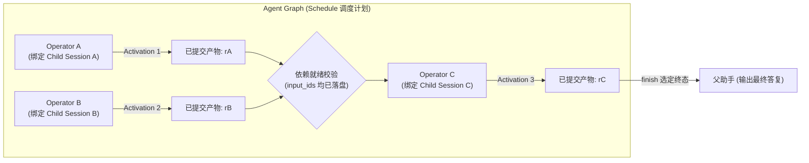

# 任务图与多 Agent 协作

[返回手册目录](../README.md)

当任务复杂度超出单个上下文窗口的承载能力时，常见的工程解法是将大任务拆解并委派给多个子智能体（Subagents）。

以一个典型场景为例：用户要求核对项目中 `timeout` 配置的默认值是否一致。父助手规划出如下协作拓扑：
1. **子助手 A**：阅读核心实现代码，产出结论记录 `rA`；
2. **子助手 B**：阅读单元测试用例，产出结论记录 `rB`（与 A 并行推进）；
3. **子助手 C**：必须等 A 和 B **都完成并持久化后**，同时读取 `rA` 和 `rB` 进行交叉比对，产出最终核对记录 `rC`；
4. **父助手**：依据 `rC` 向用户汇报最终结论。

如果用简单的 `Promise.all` 在内存里直接调起三个子进程，一旦中途父进程重启，所有依赖关系就会瞬间瓦解；此外，父助手在干等子任务跑完的几分钟里一直挂着执行，不仅浪费资源，还容易触发超时看门狗。

Maka 引入了声明式的 **Agent Graph（工作图控制平面）**，将多智能体协作转化为可持久化、可唤醒、可审计的任务依赖图。

---

## 1. 概念先行：Schedule、Operator 与 Activation

在 Maka 的工作图模型中，任务依赖与物理执行被拆分为三个清晰的概念：



| 概念 | 核心职责 | 与普通运行的关联 |
| :--- | :--- | :--- |
| **Schedule（调度计划）** | 描述整个多 Agent 协作图的声明式蓝图，记录各节点的任务描述与上下游依赖。 | 由父助手通过 `update_agent_graph` 工具写入存储。 |
| **Operator（图执行角色）** | 图中承担特定职责的持续角色（如“代码阅读员”）。 | **每个 Operator 绑定一个独立的子会话（Child Session）**，拥有隔离的上下文历史。 |
| **Activation（图激活）** | Operator 为执行某一项具体安排而触发的一次物理运行。 | 每次 Activation 对应标准 Runtime 里的一次 `runId`，经过标准的准入、沙箱与事件落盘。 |

---

## 2. 关键协作机制

### 2.1 让出与唤醒（`yield_agent_graph`）：不占用昂贵的常驻挂起
在传统父子架构中，父助手发完子任务后就进入死等。但在 Maka 中：
- 父助手利用 `update_agent_graph` 提交任务安排后，可以主动调用 `yield_agent_graph` **优雅让出本轮执行权**（发出暂停交接，释放内存中的 `AiSdkTurn` 与模型连接）。
- 后台的 Host 图协调器（`AgentGraphCoordinator`）接管了观察职责。
- 每当子执行推进到关键里程碑（例如 A 和 B 双双完成并结算），协调器就会依据图状态自动向父会话发起一次 **唤醒接续（Continuation）**，父助手带着最新的图进展恢复执行！

### 2.2 调和器（Reconciler）与已提交产物引用（`input_ids`）
子助手 C 凭什么能安全地拿到 A 和 B 的结论？Maka 不允许节点之间在内存里私下传字符串，而是严格遵循**产物指针传递**：
1. 当 A 和 B 执行完毕后，其结论被固化为不可变的运行产物，各自获得唯一凭证 `resultRecordId`（即 `rA` 与 `rB`）。
2. 父助手通过 `agent_output` 读取结果后（或直接编排依赖），将 `[rA, rB]` 填入 C 的 `input_ids` 列表中。
3. **强制落盘校验**：图调和器（`reconcileAgentGraphSchedule()`）在认领并派发 C 之前，必须验证 `rA` 和 `rB` **都已经进入权威已提交记录的投影中**。随后通过专门的 Handoff 装入机制将两份结论注入 C 的初始上下文。这彻底杜绝了“上游刚在内存吐出几个字，下游就读到残缺状态启动”的并发 Bug。

### 2.3 收尾与清理（`finish`）
当 C 顺利产出结论 `rC` 后，父助手调用 `finish` 工具显式选定 `rC` 作为本图的采信结果并关闭这份 Schedule。此时，协调器安全结清所有子会话的调度状态，不再响应后续的无效激活。

---

## 3. 教学伪代码：图调和器（Reconciler）的核心调度循环

以下伪代码展示了 `AgentGraphCoordinator` 如何在事件驱动下扫描调度表、核验依赖并驱动下游激活：

```text
function reconcileAgentGraphSchedule(scheduleId):
    schedule = graphStore.loadSchedule(scheduleId)
    if schedule.isClosed():
        return

    // 1. 从权威事实账本投影出当前各节点的最新状态与已提交产物
    graphProjection = projectGraphStateFromEvents(scheduleId)

    for task in schedule.pendingTasks:
        // 2. 核验前置依赖：所有声明的 input_ids 必须已确认提交落盘
        allInputsReady = task.inputIds.every(id => graphProjection.isCommittedArtifact(id))
        if not allInputsReady:
            continue // 上游尚未就绪，跳过本次派发

        // 3. 原子认领该任务的派发权，防止重复激活
        if not graphStore.tryClaimTaskDispatch(scheduleId, task.id):
            continue

        // 4. 为目标 Operator 查找或创建独立的子会话，装入上游产物作为输入
        childSessionId = ensureOperatorChildSession(scheduleId, task.operatorId)
        handoffPrompt = buildGraphHandoffInput(task.instruction, graphProjection.loadArtifacts(task.inputIds))

        // 5. 通过标准 Runtime 发起 Activation (受 AdmissionLimiter 并发配额约束)
        activationRunId = runtimeKernel.dispatchActivation(childSessionId, handoffPrompt, {
            parentScheduleId: scheduleId,
            taskId: task.id
        })
        
        graphStore.recordActivationStarted(scheduleId, task.id, activationRunId)

    // 6. 检查是否达成父会话设定的唤醒条件 (如所有关键前置节点已完成)
    if schedule.parentYielded and shouldWakeParent(graphProjection):
        hostCoordinator.wakeParentSessionContinuation(schedule.parentSessionId, graphProjection)
```

---

## 4. 对照 Pi：轻量进程派生 vs 控制平面任务图

- **Pi 的做法**：
  - 在标准的 `subagent` 扩展示例中，Pi 直接通过脚本以 `single`、`parallel` 或 `chain` 模式启动独立的 CLI 子进程，在内存中直接收集子进程的标准输出，极为简单直接。
  - 在实验性的 `durable` 路径中，前台子助手会在存储中查找或创建 `child conversation`，提交请求并阻塞等待结果返回。
- **Maka 的做法**：将多 Agent 编排升级为持久化、异步可挂起的 **Agent Graph 控制平面**。每个子助手的运行都保留完整的事件溯源账本和沙箱边界，支持跨崩溃恢复的依赖调和以及父会话的挂起唤醒，更适合超长耗时、高可靠性的复杂任务编排。

---

## 5. 延伸阅读

- 深入了解多个子任务同时激活时，系统如何限制并发数防止过载，阅读 [05.1 输入队列与执行准入](queues-and-admission.md)。
- 深入对比 Maka 的 Agent Graph 与其他主流多智能体框架的设计取舍，阅读 [07.3 子智能体执行、调度与生命周期管理对比](../07-comparison/subagent-design.md)。
