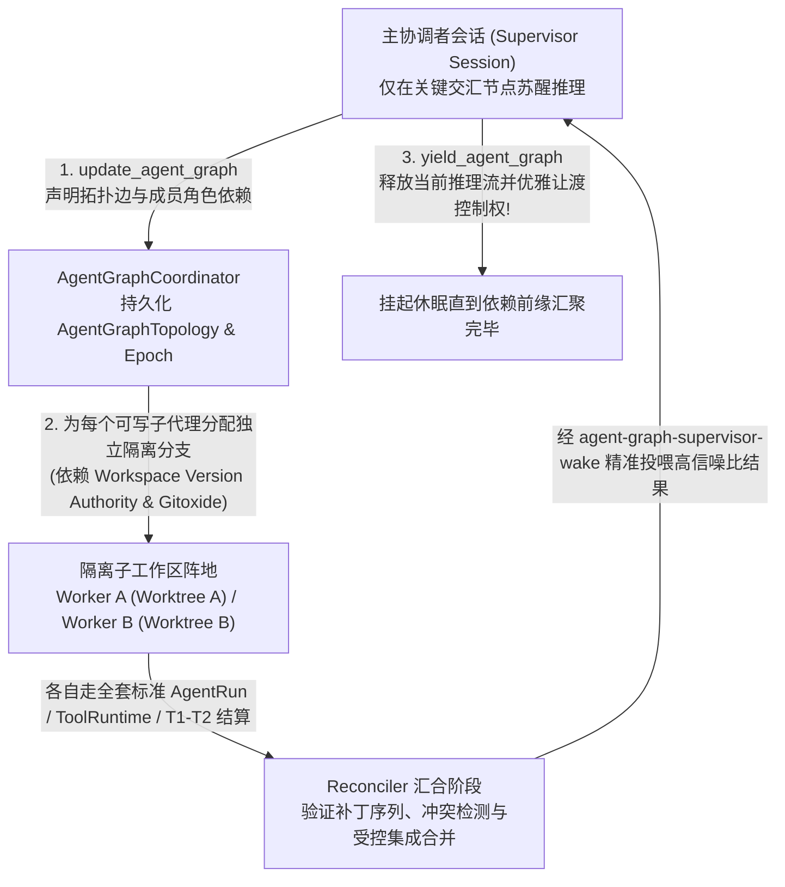

# Agent Graph 调度平面与 Swarm：角色 Worktree 隔离、Yield 收敛与 WorkHub 投影

## 1. 为什么在独立 Runtime 之上“另起炉灶搞一套 Multi-Agent 编排框架”一定会腐烂？

当开发团队试图让主协调者同时调度四名专业子代理（如架构分析、模块 A 编码、模块 B 编码、回归验证）并发协作时，最常见的一条错路是在既有引擎旁边再从头拼一套专用的 `WorkflowEngine`：子代理拥有单独一套未经统一持久化的内存消息数组、各自直接写同一个项目工作目录文件、甚至自己内部搞一套轮询等待锁去等子任务返回。

这种“两张皮协同框架”上线一跑就会遇到三记绝杀：
1. **并发写本地代码目录互相覆写撕裂**：编码子代理 A 和 B 同时在项目根目录跑 `Edit` 工具改同一个公共类型定义、又各自跑 `npm test` 改坏临时构建缓存，两条分支的工作成果当场搅拌成一团不可回滚的烂摊子！
2. **宿主重启即团灭（Ephemeral Orchestration）**：如果协调拓扑图只存在主调度器进程的一个内存 `Promise.all` 里，只要主机重连或桌面端崩溃一次，刚才四个子代理辛辛苦苦干了 20 分钟的状态瞬间与主会话脱节失联。
3. **无效等待与信噪比污染**：监督者（Supervisor）不仅死占着模型推理流在后台每秒刷屏打转等待所有子任务跑完，子代理吐出的一万字探索啰嗦全直接反灌进协调者的上下文窗口里，三回合就把它自己彻底灌醉冲爆。

Maka TypeScript 版在 `packages/core/src/agent-graph-*.ts`、`packages/runtime/src/swarm-mode.ts` 与 `packages/runtime-host/src/server/agent-graph-coordinator.ts` 中给出了一条极其干练统一的架构信条：**`Agent Graph` 仅仅是构筑在统一事件脊柱与单 Host 调度之上的一层“显式控制与拓扑平面”，绝不是第二套平行 Runtime**！

---

## 2. 一切归于统一基石：调度平面、工作区隔离与 Reconciler 收敛

为了做到并行不踩踏、掉电可恢复，Maka 将多智能体编排牢牢焊死在三个核心原语的三角形结构上：

### 2.1 `update_agent_graph` 与 `yield_agent_graph`：零空转的挂起唤醒

仔细查看 `packages/core/src/agent-graph-control.ts` 与 `packages/runtime/src/agent-graph-supervisor-wake.ts`，会发现协调者从不靠阻塞协程或循环轮询工具干等手下干完活：
- **拓扑显式变更（`update_agent_graph`）**：协调者通过标准化声明指令在持久化账本内增删协作节点（Worker）、配置角色输入以及设定有向唤醒边；整个拓扑结构与代次版本（`agent-graph-epoch`）同步刻入底层可重建历史之中，**即便中途整机重开机，所有活跃图拓扑结构依然毫发无损地并入六阶段唤醒序列恢复**。
- **优雅主动让渡挂起（`yield_agent_graph`）**：一旦协调者把当前这批并行子代理全数发配出去，立刻显式发出让渡信号退出当前活跃消耗轮次！正如 `agent-run.ts` 审计日志记录的专有事件 `graph_supervisor_yielded` 所示，主推理协程随即退场释放系统资源；唯有当下游特定聚合条件（例如某一批前置开发子节点均进入结算终态，或某个节点报错阻断需要决策）满足时，**`agent-graph-supervisor-wake`** 才精准向主队列投送高信噪比汇聚报告重唤协调者进场裁决！

---

## 3. 按角色隔离 Git Worktree：物理绝断并开发互踩

面对多编码代理并发编辑同一代码库的最大难关，Maka 没有去冒险做虚无缥缈的“文件锁微调”，而是直接借助 **`gitoxide-helper` + Workspace Version Authority** 为每一位被赋予写权限的子工作者动态派发物理上完全独立的 **Git Worktree**：

1. **物理独立工作树空间**：Worker A 在属于自己的隔离临时 Worktree 分支上随心改代码、跑测试、回退重试；Worker B 在另一座互不见面的 Worktree 里全速改写另一半模块。两者的 `node_modules` 临时产物与文件改动在磁盘上物理正交，**永远不会撞坏彼此编译现场**！
2. **原子补丁回写与冲突明确上浮**：当独立角色运行完结交卷时，它提交给协调平面的不是一段虚无飘渺的口头“我改好了”，而是经过 `gitoxide-helper` 精确核算并带有基线指纹校验的**确定性补丁差异序列（Candidate Diff & Receipt）**。控制面沿着拓扑顺序在集成 Reconciler 内尝试逐批原子合流回主干 Worktree；一旦捕获哪怕行级合并冲突，立刻作为高明确性错误中断回报上层解决，绝不悄无声息覆盖任一方辛勤产出！

---

## 4. Swarm 模式与 WorkHub 三表面统一投影

当协同任务不仅需要精准按图按表连线，还需要面向更简洁的高阶群智分工协作或人类跨会话统一看板监督时，Maka 向上生长出了两项上层产品化机制：

| 协同视图与模式 | 底层复用底座 | 核心工程亮点 |
| :--- | :--- | :--- |
| **Swarm 模式 (`packages/runtime/src/swarm-mode.ts` & `agent-swarm-status-tool.ts`)** | 直接压铸在 Agent Graph 与 Worktree 隔离底座之上，无独立运行循环 | **把复杂有向图调度藏于无形**：协调者仅面向“简明角色派单、状态看板查询与统一聚合检查点”三大极简动作，而每个手下生成的中间杂音全数留在各子分支账本中，只将提炼后的高信噪比最终结论封箱投回（`projectAgentSwarmResult`） |
| **WorkHub 协调总线 (`WORKHUB_COORDINATION_SESSION_ID` & `agent-graph-client-projection.ts`)** | `packages/storage/src/work-board-store.ts` 与规范 `RuntimeEvent` 联动（`WorkHubActionReceipt` / `WorkHubRoutingDecision`） | 打通跨越单会话限制的全局协同指挥台：在桌面端把**拓扑状态、Worktree 改动进度与长对话时间线（`agent-graph-timeline`）三表面合一同步实时渲染投影**，人类可以在任意节点直接点检任何一只子智能体的实时推演细节并随时接管纠偏 |

---

## 5. 总结

Maka TypeScript 版的多智能体编排设计给出了一堂极克制的分层课——**强大的团队协同能力不是拼命发明花哨新运行时，而是把单一高质量内核的恢复能力与隔离能力成倍复制给每一个并发子节点**：
- **`Agent Graph` 控制面不另起灶**：全程走 `RuntimeEvent`、单写锁准入与 `Workspace Version Authority`，享受同等级别的崩溃恢复与 `Host` 监督保护；
- **`yield_agent_graph` + 独立 Worktree**：一个解决主大脑空转烧 Token 和记忆干扰，一个从硬盘目录层物理绝断并发写入互踩；
- **Swarm & WorkHub**：向大模型隐藏底层拓扑繁琐机制只给高信噪比检查点，向人类通过统一三表面实时投影提供清澈见底的系统掌控感。

并发多智能体能稳定跑通大型工作图之后，时间维度上的另一个挑战紧接而来：如果一个任务不是靠多个人同时干，而是需要单人“跨过几十分钟等待远端 CI 跑完、跨过好几天分期推进长远目标、并在写代码前严密隔离方案设计期和物理执行期”——系统又如何做到既不白烧大模型空转轮询、又不锁死预算开关？下一篇揭晓：**[持久 Goal、Plan Mode 与 EventWait 挂起：彻底消灭长周期轮询空转](./goals-plans-and-event-waits.md)**。
