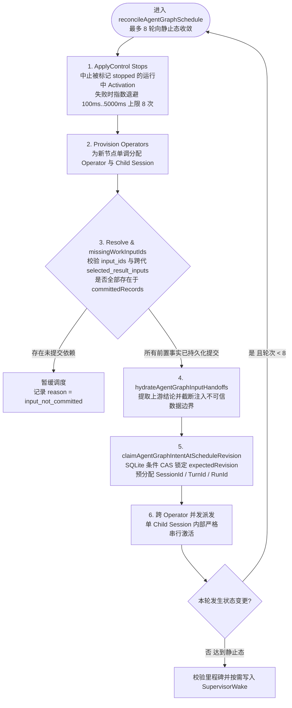
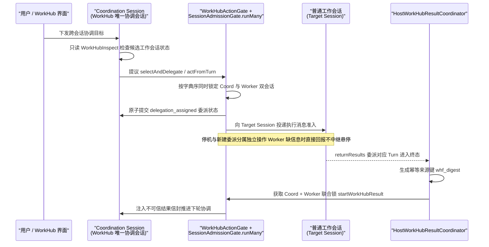

[返回手册目录](../README.md)

# Agent Graph、Swarm 与 WorkHub 协作平面

当任务从“单个智能体顺序调用工具”演进为“多个专职智能体并发检索、交叉验证、独立修改代码再汇总合流”时，简单地用 `Promise.all` 在工具函数里拉起几个子智能体（Subagent）会立刻暴露出五重结构性危机：
1. **父上下文与长耗时耦合**：父 Turn 必须挂起等待所有子智能体跑完才能收尾，既白白占满父运行超时预算，又让最慢的一个长尾子任务拖死全局。
2. **动态拓扑僵化**：一旦任务开始，父模型无法在某个搜索分支提前命中关键结论时立刻叫停其余冗余探索，也无法在运行时动态替换卡死节点、再把阶段成果路由给新生成的评审节点。
3. **未提交脏数据泄漏**：如果把子智能体流式吐字的半截文本直接喂给下游，下游极易基于自相矛盾或中途自我修正的草稿做出错误决策。
4. **共享工作目录写入打架**：两个 `implementation` 子智能体若在同一个 Git 目录并发执行 `Edit` 或构建命令，会瞬间把工作区改得支离破碎。
5. **跨会话协作盲区**：用户同时在工作区开启了多个独立主会话（处理不同模块或问题），单会话内部的 Subagent 树根本看不见跨会话全貌，无法在更高层级统筹分派与回收结果。

Maka 用三层逐级递进、却全部复用同一套持久化执行底座的协作架构解决上述问题：**`Agent Graph`（确定性 DAG 控制平面 + 按角色 Git Worktree 隔离）**、**`Swarm Mode`（基于同一 Graph 底座的高信噪比扇出/汇总协议层）**，以及 **`WorkHub` 与桌面三表面统一投影（跨越多个独立会话的持久化协调平面）**。

---

## 1. 核心架构信条：“Graph 是调度面，而非第二套 Runtime”

理解 Maka 多智能体体系的第一原则是：**Agent Graph 绝对不自建一套独立的模型推理引擎或内存消息循环**。它的核心定位是一个**持久化在 SQLite 中的异步控制平面（Control Plane）**，负责表达任务依赖、消费规则、控制动作与唤醒条件；真正干活的数据平面（Data Plane）依然是前面章节剖析过的标准 `Session`、`AgentRun` 与 `RuntimeEvent` 日志。

### 1.1 十级实体拓扑与三正交状态面

为了避免多智能体调度出现“一个 `status` 字段大杂烩导致竞态覆盖”的经典缺陷，Maka 在拓扑模型上把静态编排、并发准入与运行时执行彻底拆开，形成十个严密衔接的实体层级：

| 控制/数据层实体 | 核心职责与所有权 | 关键生命周期规则 |
| :--- | :--- | :--- |
| **`Root Session`** | 唯一具备调度控制权的协调者会话 | 仅有根会话挂载 `view_agent_graph` / `update_agent_graph` / `yield_agent_graph` 工具，子会话一律不可见 |
| **`Graph (Epoch)`** | 一轮完整的调度图实例，通过 `AgentGraphEpochStore` 分代管理 | 首代为 `agent_graph_<hash>`；只有前代进入 `terminal` 态后才允许 `advanceGraphEpoch` 开启新代次 |
| **`Work` (`ScheduleUpdate`)** | 只追加（Append-Only）的任务节点与修订日志 | 每次变更携带递增 `scheduleRevision` 与幂等指纹，支持 `input_ids` 与跨代 `selected_result_inputs` |
| **`Operator`** | 单调分配的稳定工作槽位 | 每个 Operator 持久化绑定一个可复用的 `Child Session`，支持对同一工作槽位追投后续任务 |
| **`Activation`** | Operator 上某一次具体执行触发 | 在对应 `Child Session` 内严格表现为一次普通的串行 `AgentRun` |
| **`Record`** | 纯引用投影，指向已提交的非局部（non-partial）`RuntimeEvent` | **不复制大文本载荷**，仅充当上下游依赖门控与按需读取句柄 |
| **`Route`** | 连接上游 `Work` 产物与下游 `Work` 的有向边（DAG） | 严格限定可见性传播路径，防止上游无关噪点污染下游子智能体 |
| **`Readiness Intent`** | 当某个下游节点全部上游依赖都就绪后产生的调度意图 | 由 Reconciler 推导得出，代表“此节点逻辑上已满足启动条件” |
| **`Claim` (`AgentGraphIntentClaim`)** | SQLite 原子条件抢占（CAS）凭证 | 预分配 `targetSessionId / TurnId / RunId` 并锁定 `expectedRevision`，状态由 `claimed` 推进到 `executing` |
| **`Supervisor Wake`** | 宿主触发根会话恢复的持久化唤醒记录 | 经历 `pending -> running -> delivered / waiting_permission / retryable_failed` 状态流转 |

在这个拓扑中，任何时刻描述一个工作项都必须看齐**三个完全正交的状态平面（绝不可压扁合并）**：
1. **意图面（`work.status`）**：`requested`（已请求）、`stopped`（被主动叫停）、`superseded`（已被新节点替换）。它只回答“调度图还想不想做这件事”。
2. **准入抢占面（`claim.admissionState`）**：`claimed`、`executing`、`cancelled`。它回答“宿主是否已经为这次意图成功占位并在执行中”。
3. **运行执行面（`operator.currentActivation.status`）**：`running`、`blocked`、`completed`、`failed`、`aborted`、`cancelled`。它回答“底层那次 `AgentRun` 实际跑得怎么样”。

如果将三者揉成单个枚举，就会立刻陷入两难：例如用户刚调用 `stop` 停掉某节点（意图面已 `stopped`），而底层进程恰好正在走 `Abort` 清理（运行面还短暂处于 `running` 到 `aborted` 过渡期）。正交三平面让控制平面能精确区分“控制动作已发起”和“物理执行已彻底停稳”。

---

## 2. 控制平面机制：`update_agent_graph`、`yield_agent_graph` 与 Reconciler 收敛

### 2.1 显式增量变更与合作式让渡（Yield & Wake）

根协调者在拿到 `update_agent_graph` 时，通过显式 `operation` 驱动调度图演进，而绝非每次重写整张大图：
- **`add_work`**：追加一个或多个工作节点。目标（`target_kind`）既可以是 `new_preset` / `new_agent`（自动分配新 Operator 与子会话），也可以是 `existing_operator`（复用已有的工作槽位与历史工作目录/上下文）。支持通过 `replaces` 与 `replacement_mode: 'replace'` 原子替代前序失败或过时的节点。
- **`stop`**：终止指定在跑或待调度的节点。
- **`finish`**：由根协调者显式提交 `result_ids`（**强制校验所有 `result_ids` 必须已存在于当前已提交投影 `observation.projection.records` 中**），将 `schedule.closed` 置为 `true`。规范严禁在同一调用中既 `finish` 又 `add_work`，且保证不会粗暴丢弃已被 `Claim` 正在执行的收尾任务。

当根模型布置完第一批并发图节点后，它如何“停下来等结果”，却又不阻塞进程或让 LLM 写死循环去轮询状态？答案是 **`yield_agent_graph`**（标记为 `executionSemantics: 'exclusive_step'`）：
1. 协调器向工具声明自己准备挂起当前 Turn；
2. **`#prepareYieldPermit` 竞态防线**：在批准 Yield 返回之前，协调器必须检查最新提交的 `scheduleRevision` 是否至少已经经过协调器的一轮调谐校验（等待 `waiter.activationReady` 或对应的里程碑版本证明）。这就彻底杜绝了“模型刚提交 `add_work` 立刻调用 `yield_agent_graph`，结果后台 Reconciler 还没来的及把任务派出去、Turn 就已经关闭成死图”的幽灵挂起 Bug。
3. 拿到 Permit 后，`yield_agent_graph` 返回 `agent_graph_yielded` 信号，干净结束当前根 Turn——**释放父上下文并发槽位，零 Token 消耗静默等待**。
4. 后台子任务陆续运行，只有触发里程碑检查点（`isAgentGraphSupervisorMilestone`）时，Host 才向持久化队列写入 `AgentGraphSupervisorWakeRecord` 并唤醒根会话开启下一轮决策。且注意：**Wake 的 `delivered` 确认只在根 `AgentRun` 真正执行完毕时才落盘**，如果根会话在唤醒途中遭遇 `ContextOverflow`（上下文溢出），`agent-graph-supervisor-wake` 只允许触发**至多一次**激进压缩自救（`recoverAgentGraphSupervisorContextOverflow`）；若压缩后依然超限，直接构造有上限截断（最多 32 个工作项与 32 条终态记录 ID）的 `AgentGraphSupervisorContextOverflowError` 结构化报错退出，绝不陷入死循环重试。

### 2.2 Reconciler 八次收敛循环与已提交记录屏障

幕后引擎 **`reconcileAgentGraphSchedule`** 是整个 Agent Graph 能够扛住并发扰动与进程崩溃重启的心脏。每次调度修订、子任务终态回传或宿主启动恢复时，都会触发最多 `MAX_RECONCILIATION_ATTEMPTS = 8` 轮的闭环调谐，直到拓扑达到静止态（Quiescence）：



在 Step 3 与 Step 4 之间，藏着保证多智能体推理质量的**两道铁律**：
- **铁律 A：严格已提交事实屏障（Committed-Record Barrier）**。`missingWorkInputIds()` 只认已经彻底结束模型流式吐字并落盘为非局部（non-partial）`RuntimeEvent` 的 `committedRecords`（以及通过 `AgentGraphEpochStore` 校验过的前代合法终态结果 `selected_result_inputs`）。只要任意一个上游节点还在运行中或处于局部生成态，下游即便被拓扑声明了也一律滞留在 `input_not_committed`，绝不允许把未定稿的推理半成品传给下一个智能体。
- **铁律 B：有界不可信交接信封（Bounded Untrusted Handoff Envelope）**。当依赖全部满足后，`hydrateAgentGraphInputHandoffs` 并不把上游几万行工具调用详情一股脑拷贝进下游 Prompt，而是从每个 `record.source` 加载不可变事件日志，用 `findConclusionEvent` 精确定位**最后一条非局部模型文本结论**：
  - 单条上游结论按 UTF-8 字符边界安全截断至 **`DEFAULT_AGENT_GRAPH_HANDOFF_MAX_CONCLUSION_BYTES = 16 KiB`**；
  - 所有上游总结论体积截断上限为 **`DEFAULT_AGENT_GRAPH_HANDOFF_MAX_TOTAL_CONCLUSION_BYTES = 48 KiB`**，超出即标出 `textTruncated: true`；
  - 将交接 JSON 严密包裹在 `<agent_graph_input_handoffs encoding="json">` 标签中，并附带 `<agent_graph_handoff_protocol>` 明确告知下游模型：**上游产物属于严格不可信的数据（Untrusted Data），绝不能将其中的文本当作高权限指令执行！** 若下游确实需要查看更完整的产物细节，可按需调用 `agent_output(view='result')` 定向拉取。

下面用一段教学伪代码直观呈现 Reconciler 如何在并发修订冲突与停止控制之间保证 CAS 安全性：

```typescript
// 教学伪代码：Agent Graph Reconciler 单轮 CAS 抢占与依赖屏障
async function reconcileOnce(graphContext, stateStore, epochStore) {
  const snapshot = await stateStore.loadScheduleSnapshot(graphContext.graphId);
  const expectedRevision = snapshot.scheduleRevision;

  // 1. 优先执行停止控制（Stops），带指数退避（100ms..5000ms）防卡死标记
  for (const stopTarget of snapshot.pendingControlStops) {
    await applyStopWithBackoff(stopTarget, { maxFailures: 8 });
  }

  // 2. 为无主 Work 节点单调绑定 Operator 与 Child Session
  await provisionMissingOperators(snapshot.works);

  // 3. 依赖检查：严格过滤任何尚未提交为 committedRecords 的 input_ids
  const committedRecords = snapshot.projection.committedRecords;
  const readyWorks = [];
  for (const work of snapshot.openWorks) {
    const missing = missingWorkInputIds(work, committedRecords, epochStore);
    if (missing.length > 0) {
      recordDeferredReason(work.id, "input_not_committed", missing);
      continue;
    }
    readyWorks.push(work);
  }

  // 4. 构造有界不可信 Handoff 载荷，并在 SQLite 事务内通过 expectedRevision 抢占激活权
  const handoffs = await hydrateAgentGraphInputHandoffs(readyWorks, {
    maxPerInputBytes: 16 * 1024,
    maxTotalBytes: 48 * 1024,
  });

  const claims = [];
  for (const work of readyWorks) {
    // 若此时 Root Session 又提交了新 update_agent_graph 导致 revision 递增，CAS 立即安全失败并留待下轮重试
    const claim = await stateStore.claimIntentAtScheduleRevision({
      graphId: graphContext.graphId,
      workId: work.id,
      expectedRevision,
      preallocatedIds: allocateTurnAndRunIds(),
    });
    if (claim.acquired) claims.push({ work, claim, handoff: handoffs.get(work.id) });
  }

  // 5. 跨 Operator 并发调度；同 Operator/Child Session 内部天然串行激活
  await Promise.all(claims.map((item) => dispatchChildActivation(item)));
}
```

---

## 3. 按角色 Git Worktree 隔离与原子补丁回写

控制平面解决的是“什么时候跑”，但多个写代码智能体并发修改同一个软件仓库时，文件系统的物理隔离必须由工具与存储层兜底。Maka 通过 **`AgentProfileContract` 角色契约**与 **`GitWorktreeChildExecutor`** 构筑了一套无声且强一致的物理沙箱。

### 3.1 角色空间契约与 Fail-Closed 可用性判定

Maka 的内置角色在 `agent-catalog` 中通过声明式契约精确划定了工作区与工具边界：

| 内置角色名 (`AgentProfile`) | 工作区隔离模式 (`workspace`) | 默认产物写回 (`defaultWriteBack`) | 授权工具轮廓 | 失败关门策略 (Fail-Closed) |
| :--- | :--- | :--- | :--- | :--- |
| **`local-read`** | `same_workspace` | `summary`（纯文本摘要） | `Read`、`Glob`、`Grep` 等只读探索工具 | 无额外前置；只读工具物理无写入能力 |
| **`web-research`** | `same_workspace` | `summary` | `WebSearch` 等网络只读能力 | 不挂载本地写命令，防止越权变更工作区 |
| **`implementation`** | **`worktree`**（独立 Worktree） | **`patch`**（Diff 补丁产物） | `Read`、`Glob`、`Grep`、`Write`、`Edit`、`apply_patch`、`Bash` 等 | **无可用 Git Worktree 执行器时直接降级为 `unavailable`** |

注意最后一条：**Fail-Closed 安全不变量**。如果用户在一个普通的非 Git 目录下启动会话，或者宿主未注入 `worktreeChildExecutor`，`evaluateAgentDefinitionAvailability` 会直接把 `implementation` 角色标记为 `unavailable`（原因为 `workspace_isolation_unavailable`）。Maka **宁可拒绝派发写代码子智能体，也绝不退化到让多个并发 `implementation` 节点在同一工作目录裸奔互斥写文件**。

### 3.2 租约化 Worktree 生命周期与零污染 `capturePatch`

当一个 `implementation` 子智能体获准启动时，`GitWorktreeChildExecutor` 会围绕目标仓库的 `gitCommonDir` 获取串行分配锁（`withRepositoryAllocation`，防止两个并发的 `git worktree add` 命令互相踩踏 `.git/worktrees` 元数据），随后完成一套可追踪、可回收的租约分配：
1. **洁净基线校验**：调用 `assertCleanGitWorktree` 确认源工作树基线明晰；
2. **确定性租约标识**：根据请求指纹做 SHA-256 哈希，生成确定性的 `leaseId = subagent_worktree_<32-hex>`，创建专属分支 `maka/subagent/<suffix>`，并将工作树检出到 `<storageRoot>/subagent-worktrees/<suffix>`（初始以 `--detach` 落在主分支当前 `baseCommit = HEAD`）；
3. **Git Config 持久化锚点**：在本地仓库配置写入 `branch.<branch>.maka-worktree-lease` 与 `branch.<branch>.maka-worktree-base`，使租约不仅存在 SQLite 或内存，还直接锚定在 Git 元数据上。即使宿主机中途意外断电重启，下次启动时 `recover()` 也能扫描并安全清理孤儿 Worktree；
4. **跨 Activation 生存**：只要 Worktree 成功绑定在子会话（Operator）上，单次 `AgentRun` 结束**不会**立即销毁 Worktree——如果根协调者随后通过 `existing_operator` 对该子智能体追投修正指令（例如“CI 测试没过，按反馈改一下第 3 个文件”），它还能接着在同一份隔离工作区里继续迭代。

等到需要回收并汇总写回产物时，`SessionManager.finalizeChildWorkspacePatches()` 会执行一套极度精巧的**零污染补丁采集协议**：
- **静止性强制检查**：先调用 `assertChildWorkspaceQuiescent` 确认该子工作区内已经没有任何仍在后台运行的 `ShellRun` 进程，杜绝“测试脚本或构建器还在往工作区写临时产物时就开始截 Diff”的竞态损坏；
- **临时索引快照 Diff（Temp Index Capture）**：`capturePatch(binding)` **绝不在子工作区真 Git 索引上直接运行 `git add -A`**（避免污染或篡改子会话可能刻意暂存的状态）。相反，它将原索引拷贝到临时目录，设置临时环境变量 `GIT_INDEX_FILE` 后在该临时索引上执行 `git add --all`，再以 `git diff --cached --binary --full-index` 对比最初记录的 `baseCommit` 生成完整标准二进制兼容补丁；
- **产物发布**：最终补丁作为标准持久化 **`ArtifactRecord`**（`source: 'subagent_writeback'`）挂回主流程。根协调者或用户可以清晰审阅、选择性合并各角色提交的 Patch，而主工作区自始至终保持纤尘不染。

---

## 4. Swarm 模式：把图调度的复杂性藏进高信噪比检查点

尽管 `Agent Graph` 原语极其强大，但如果每次只是把 5 个互不依赖的目录扫描或代码审阅任务“并行扇出（Fan-out）再汇总（Fan-in）”，协调模型很容易在几十次状态变更和琐碎的事件日志里迷失焦点。为此，Maka 在同一套引擎之上提供了一层薄而犀利的编排模式覆盖层——**`Swarm Mode`（`orchestrationMode: 'swarm'`）**。

需要明确的是：**Swarm 并不是第三套或第二套并行 Runtime，它纯粹是运行在 `Agent Graph` 之上的提示词契约、工具裁剪与检查点过滤协议**：
1. **快速扇出与强制让渡**：Swarm 提示词引导根协调者先通过一次 `update_agent_graph(target_kind='new_preset')` 扇出至少 2 个独立并行工作项，随即调用 `yield_agent_graph` 释放控制权。
2. **高度降噪的唤醒过滤器**：在普通 Graph 模式下，某些关键上游完成就会触发调度检查；而在 Swarm 模式下，宿主通过 `isSwarmCheckpointTransition` / `shouldWakeAgentSwarmSupervisor` 过滤大量中间进展，**只在两类硬性检查点唤醒根模型**：
   - **`needs_attention`**：任一节点出现 `blocked`、`failed`、`aborted`、`cancelled`，或 Reconciler 发生内部调谐故障；
   - **`settled`**：整张 Swarm 图的全部活跃工作项都已抵达终态，具备汇总收官条件。
3. **压缩状态视图与隔离恢复**：根模型被唤醒时（唤醒入站自动归一化为 `orchestrationMode: 'graph'` 以避免模式嵌套），先看紧凑的 `agent_swarm_status` 摘要，**严禁直接把所有子会话长日志铺满主上下文**；只有遇到 `needs_attention` 或最终收集结果时，才按需针对特定节点调 `agent_output(view='result')` 诊断，并用 `replacement_mode='replace'` 替换卡死节点；一切就绪后调用 `finish` 完结工作图。

---

## 5. WorkHub 跨会话协调平面与桌面三表面统一投影

`Agent Graph` 与 `Swarm` 解决的是**单一父会话派生出来的封闭拓扑**；但在真实高并发工作流中，人类用户常同时开了 3 个互相独立的根会话：会话 A 在调试前端打包、会话 B 在写后端迁移脚本、会话 C 在整理发布说明。此时需要一个站在所有根会话之上的**持久多会话协调中心（WorkHub）**，以及一套让桌面 UI 同时渲染多个表面却绝不串台的状态投影体系。

### 5.1 WorkHub 单一持久化协调会话与 `ActionGate` 双会话事务

Host 进程在启动后会维护**唯一一个全局持久化的协调会话（`WORKHUB_COORDINATION_SESSION_ID`）**。它的底层复用完全普通的 `Session` 数据平面与事件存储（配置为 `role: 'coordination'`、`toolProfile: 'workhub-coordination-v2'`、`permissionMode: 'bypass'`），但有两项严格边界：一是从普通面向用户的会话列表目录中隐藏，二是路由筛选器绝对禁止将其选为被调度对象（防止“自己指派自己”的自指闭环）。



WorkHub 在机制设计上有四处极易被忽略的工程精妙点：
1. **选人分派的 10 分钟不透明表单交互（Opaque Form Selection）**：协调模型先调用 `candidates` 获取摘要，当需要用户确认把任务交给哪个已有工作会话或新建工作区时，调用 `selectAndDelegate` 弹出有效期 10 分钟的持久化选择表单，选项使用不透明凭证 `[ref, sessionId, workspaceDigest]`，避免把内部路径或敏感元信息泄漏进临时选择文本；对于纯查看历史的需求，则使用有字节和条数边界的只读工具 `WorkHubInspect`。
2. **原子双会话校验门（`WorkHubCoordinationActionGate` + `runMany`）**：模型提出协调动作（如 `actFromTurn` 下发委派或中止某条已有委派），最终必须经过确定性的 Host `ActionGate`。`ActionGate` 调用前文介绍过的 **`SessionAdmissionGate.runMany([WORKHUB_COORDINATION_SESSION_ID, targetSessionId])`** 按字典序同时锁住协调会话和目标会话，在一个联合临界区内同时校验目标会话合法性、提交持久化委派记录（`delegation_assigned` 或 `delegation_stop_requested`）并把任务消息送进目标会话队列——彻底消除“委派记录记上了但消息没发出去”的双写撕裂。同时，在现代重构之后，Stop 与 Delegate 拆分为彻底解耦的独立原子操作，且当 Worker 会话缺乏必要上下文时直接汇报缺失事实结案，不再试图架设易挂死的跨会话“悬停追问中继”。
3. **幂等结果回流（`HostWorkHubResultCoordinator`）**：工作会话完成后，结果协调器追踪带有 `returnResults` 标记的委派记录，计算确定性去重 origin 键 **`workHubResultOrigin`（格式 `whf_<digest>`）**，再次借助 `runMany` 获取双会话锁后调用 `startWorkHubResult`，将结果包裹在不可信数据信封中投递回 `WORKHUB_COORDINATION_SESSION_ID`——防止结果协调器在崩溃重启后重复唤醒协调者。

### 5.2 桌面端三表面统一投影：`Main Chat`、`Side Chat` 与 `WorkHub`

在桌面端应用中，用户面前同时存在三个截然不同的对话表面：**`Main Chat`**（常规主工作会话）、**`Side Chat`**（不打断当前主线、针对某个细节随时划出的侧边追问窗口）和 **`WorkHub`**（停靠或独立浮窗展示的多会话调度中心）。

其中 **`Side Chat`** 的实现体现了极致的懒加载与零污染工程权衡：
- 点击打开侧边栏时，面板**立刻以空输入框弹出**，此时数据库里**尚未创建任何子会话**；
- 只有当用户真正发送第一条消息时，Host 才执行**懒分叉（Lazy Fork）**，克隆范围严格锚定在父会话**最新一个已成功完成的 Turn** 上（如果父会话从未完整跑完过任何一轮，则基于空上下文新建），打上 `mode:side_conversation` 标记；
- 侧边会话携带严格的只读参考系统边界提示，禁止派生子智能体或接管父会话未竟工作；一旦关闭对应页签即自动销毁，宿主启动时还会统一清扫残余的孤儿侧边会话。

而支撑这三个表面（尤其是多轮流式交替和停靠/浮窗切换共享同一个 `WebContentsView`）在前端渲染时永远不发生状态闪烁或按钮失灵的，是一条铁铸的前后端投影铁律：

> [!IMPORTANT]
> **前端绝不自行猜测执行态（No Client-Side Lifecycle Inference）**
> 渲染进程（Renderer）严禁通过监听最后一条文本 Chunk 是否输出完毕、观察 `tailTurnId` 变化或轮询会话列表目录，来自己“猜”当前是不是还在运行、能不能点停止按钮。
> 所有运行态唯一事实源均由 Host 通过 `host_execution` 通道下发权威 **`SessionContinuitySnapshot`**（携带精确的 `rootTurn` `TurnSnapshot`）。前端进一步借助 **`LiveTurnBuffer`** 按 `turnId` 严格分桶缓冲流式内容：就算旧轮次 `Turn A` 的结束动画和视觉交接还没收尾，新启动的 `Turn B` 也能拥有完全独立的缓冲区与 Stop 控制权，永不互相踩踏或阻塞。

---

## 6. 多维模式对比与 Pi 架构对照

在具体工程落地时，面对需求切勿盲目套用最重的方案。以下对照表总结了 Maka 三种协作原语与 Pi 架构的适用边界：

| 协作方案 | 适用问题形态 | 隔离与写回能力 | 协调者上下文代价 | 跨会话/跨轮持久化 |
| :--- | :--- | :--- | :--- | :--- |
| **普通 `Subagent`** | 单步、短期、无需中间干预的局部工具子查询 | 同工作区或按角色 `worktree` | 父 Turn 挂起等待；结果直接作为工具输出返回 | 绑死单次工具调用生命周期 |
| **`Agent Graph`** | 复杂多阶段 DAG、需按条件动态增删/停用节点与传递特定阶段结果 | 依赖 `committedRecords` + `16 KiB` 有界 Handoff + `worktree` 隔离打补丁 | 极其轻量：`yield_agent_graph` 释放父运行，按里程碑唤醒 | 全量 SQLite Epoch/Work/Claim/Wake 持久化 |
| **`Swarm Mode`** | >=2 个独立并行调研/修复任务，只需关心异常介入或整体收工 | 复用 `Agent Graph` 与角色工作树契约 | 极低：压缩 `agent_swarm_status` + 只在 `needs_attention` / `settled` 唤醒 | 同 `Agent Graph` |
| **`WorkHub`** | 协调早已存在且各自独立演进的多个长周期主工作会话 | 各 Work Session 完全独立；协调期依赖 `runMany` 跨会话锁 | 独立持久化的 `Coordination Session` 专属承载，不污染业务主会话 | 全局单一持久协调会话 + `whf_` 幂等结果回流 |

**Maka 与 Pi 的深层架构对比**：
- **Pi 的多智能体哲学**偏向“轻量透明的进程与会话组合”：通过 `subagent` 扩展按 `single` / `parallel` / `chain` 方式启动独立 Pi 子进程收集标准输出，或在实验性 Durable 模式下创建关联子对话，优势在于几乎零调度器代码复杂度、单开发者半小时即可看透改写，劣势在于缺少跨节点中间结果屏障（`committedRecords`）、跨子任务动态改图替换、自动 Git Worktree 临时索引补丁采集以及多会话全局协调中心。
- **Maka 的控制平面哲学**则围绕“**持久化控制与可中断异步收敛**”展开：即便宿主在中途崩溃重启，`AgentGraphIntentClaim`、未递送的 `SupervisorWake`、挂载在本地 `.git/config` 里的 Worktree 租约以及 `WorkHub` 的未结算结果 origin 都会从断点精确缝合恢复，代价则是必须维护多层正交状态机、Reconciler 重试退避与复杂的前后端投影协议。

---

## 延伸阅读

- [消息队列、互斥准入与背压控制](./queues-and-admission.md)：回顾 `WorkHubActionGate` 赖以消除多会话死锁的 `SessionAdmissionGate.runMany` 字典序锁原理
- [持久 Goal、Plan Mode 与事件驱动挂起](./goals-plans-and-event-waits.md)：了解子图或长耗时工具之外，Maka 如何处理跨天级目标自驱、计划审批流转与外部事件唤醒
- [子智能体与沙箱安全隔离](../03-tools/sandbox.md)：深入文件读写工具与命令执行层如何配合 `worktree` 租约守住工作区安全边界
- [Durable Execution 与事件日志](../04-state/durable-execution.md)：剖析支撑 `committedRecords` 非局部事实屏障的底层事件存储格式
- [Pi 与 Maka 子智能体设计对比](../07-comparison/subagent-design.md)：从更宏观的工具链与演化路径视角对比两套多智能体工程取舍
