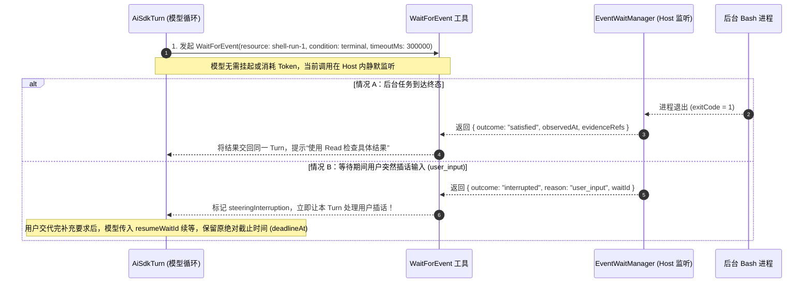
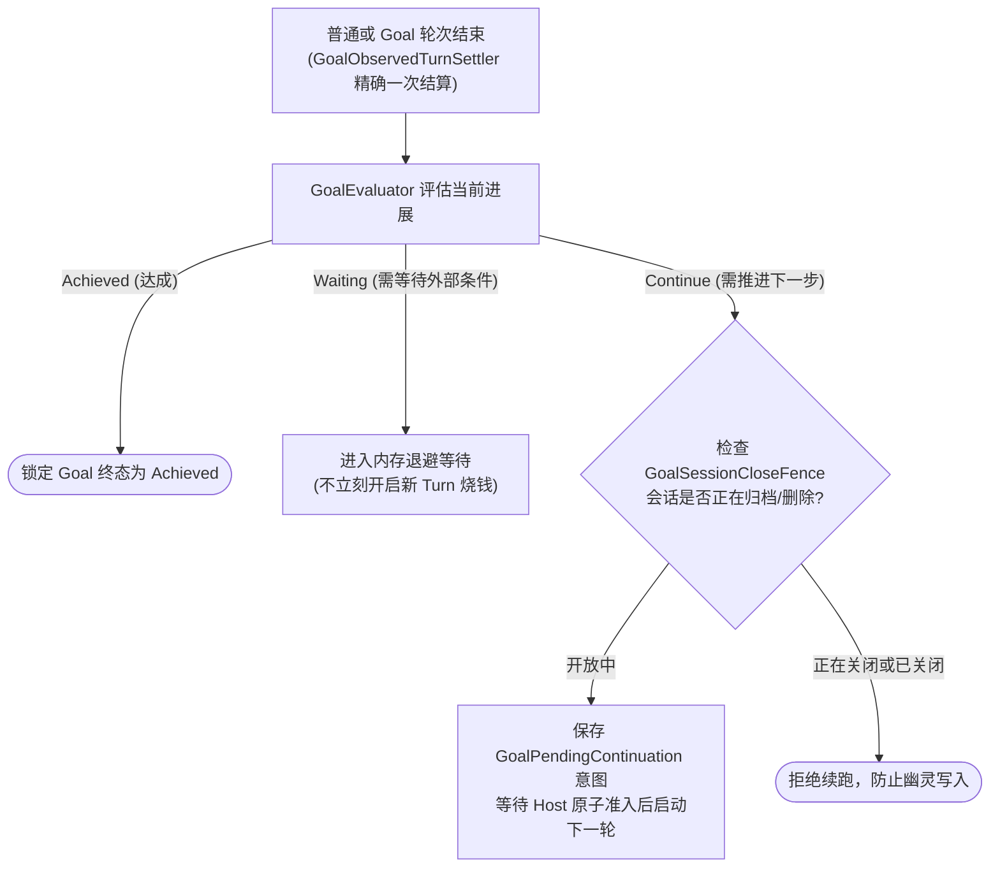

# 持久 Goal、Plan Mode 与事件驱动挂起

[返回手册目录](../README.md)

普通的问答式 Agent 只负责解决“用户发一句、我答一轮”的短期请求。但面对真实的工程研发任务——例如“持续监控重构后的集成测试，修复所有间歇性失败直到连续跑绿 3 次”，或者“先调研代码权衡并提交一份严谨方案，等我审批通过后再动手写文件”——单一轮次（Turn）的模型循环很快就会触及三个瓶颈：

1. **空转轮询烧钱**：如果后台有一个长达 10 分钟的构建脚本正在跑，让大模型每隔 30 秒自己调一次 `sleep` 或 `Read` 查询进度，不仅白白消耗数十万上下文 Token，还极易把 `maxSteps` 步数配额耗光导致任务提前流产。
2. **计划与实施混杂**：用户只想让模型“只读调研并给出改造计划”，模型却在思考过程中顺手调用 `Write` 把项目代码改乱了。
3. **长目标跨轮次失控**：跨越多个小时的持久化目标（Goal），如何在用户突然点击“归档会话”或“删除会话”时安全撤退，避免出现“会话已经被归档了，后台 Goal 评估器还在往里发新轮次”的幽灵写入？

Maka 通过三大协同原语——**`WaitForEvent` 事件驱动挂起、`Plan Mode` 协作工具门控，以及带 `GoalSessionCloseFence` 围栏的持久 Goal 与统一定时任务（`ScheduledTask`）**——完美解决了长周期自驱任务的可靠性难题。

---

## 1. 事件驱动挂起：`WaitForEvent` 彻底消灭空转轮询

设想模型通过 `Bash(..., run_in_background: true)` 启动了一个长时间编译任务，拿到了后台资源句柄 `maka://runtime/background-tasks/shell-run-1`。

在没有事件等待原语的框架里，模型被迫写进 Prompt 轮询循环：“等 10 秒 -> `Read` 状态 -> 还在 `running` -> 再等 10 秒 -> `Read` 状态”。这既慢又费钱。

Maka 为运行时提供了标准的异步阻塞工具 **`WaitForEvent`**，把等待职责从大模型身上剥离并下沉给 Runtime Host：



### 1.1 `WaitForEvent` 的六种终态与关键工程细节
- **六种明确结局（`outcome`）**：`satisfied`（条件达成）、`expired`（超时）、`invalidated`（条件失效）、`source_unavailable`（监听源已失联）、`cancelled`（被取消）以及 `interrupted`（被用户新输入等外部信号打断）。
- **“条件达成 (`satisfied`)”不等于“任务成功”**：后台任务退出（到达 `terminal` 状态）可能是失败退出（退出码非 0）。工具说明明确约束模型在拿到 `satisfied` 后使用 `Read` 查看具体 stdout/stderr，而超时或取消 `WaitForEvent` **绝不会顺手杀掉正在跑的后台任务**。
- **支持 `resumeWaitId` 无损续等**：当等待被 `user_input` 打断时，如果采用重新调一次 `WaitForEvent` 传入 `timeoutMs: 300000`，总等待期限会被无限重置欺骗！Maka 允许传入上次返回的 `waitId` 作为 `resumeWaitId`，Host 自动**继承原始绝对截止时间 `deadlineAt`**，确保预算不漂移。
- **断电不可自动重放**：标记 `recoveryMode: 'never_auto_retry'`，避免重启恢复时盲目重新挂死等待一个可能早已结束的旧进程。

---

## 2. 计划与实施隔离：`Plan Mode` 动态工具门控

当会话处于 `Plan Mode`（计划模式）时，不能仅仅在系统提示词里口头叮嘱模型“请不要修改文件”——在复杂上下文诱导下，模型依然有可能失手调用写入工具。

Maka 的 `selectCollaborationTools()` 在**物理工具声明装配阶段**实施了硬性工具过滤矩阵：

| 协作模式与权限 | 允许保留给模型的工具集合 | 物理屏蔽的工具集合 | 典型行为边界 |
| :--- | :--- | :--- | :--- |
| **`Plan Mode` (标准受限)** | 仅限 `read`、`web_read` 类只读工具 + `AskUserQuestion` + `SubmitPlan` | **彻底移除**所有写文件、写命令工具、`update_plan`、`cancel_plan`、子 Agent 与 `Goal/ScheduledTask` 自主工作流工具。 | 模型连工具声明都看不到，100% 保证调研阶段零磁盘副作用。 |
| **`Plan Mode` (`fullAccess` 开启)** | 放开通用工具（供用户明确要求时使用），保留 `SubmitPlan` / `AskUserQuestion` | 依然屏蔽 `subagent` 与自主工作流控制工具（防止计划未批准前私自外包或建定时任务）。 | 允许用户显式触发局部修改，但仍强制保留“提交计划审批”工作流直到用户放行。 |
| **`Execution` (普通执行模式)** | 所有业务读写与子智能体工具；激活执行态后开放 `update_plan` / `cancel_plan` | **彻底移除** `SubmitPlan`（避免模型在执行到一半时倒退回交计划）。 | 进入真实施工阶段，支持动态调整或撤销已批准计划。 |

同时，`SubmitPlan` 强制约束每个步骤标题不超过 30 字符且描述为纯文本，确保前端 UI 能够将其渲染为清晰可控的交互式审批清单。

---

## 3. 持久 Goal 循环与防并发关闭围栏

对于需要连续运行多轮的自主目标（Goal），Maka 在会话层之上构建了 `GoalContinuationCoordinator`：



### 3.1 `GoalSessionCloseFence`：两阶段防竞态关闭围栏
设想一个极易触发并发 Bug 的边界瞬间：
- 第 1 毫秒：后台 `GoalEvaluator` 刚刚算出“目标还没达成，准备自动发起第 5 轮推进”；
- 第 2 毫秒：用户在桌面端点击了“归档（Archive）”或“彻底删除（Remove）”该会话；
- 第 3 毫秒：万一归档操作因为磁盘锁失败回滚了，但 Goal 已经被误杀或反之——会话已经删了，第 5 轮却已经入库！

Maka 通过 **`GoalSessionCloseFence`** 建立了严密的两阶段互斥协议：
1. Host 执行归档/删除前，先调用 `fence.begin(sessionId, kind)` 挂上一把占用的内存符号令牌（`Set<symbol>`），此时 `fence.isClosed(sessionId)` 立即变为 `true`，阻断一切新的 Goal 续跑准入。
2. 若持久化归档/删除成功，调用 `op.commit()` 将持久状态锁定为 `archived` 或 `removed`。
3. 若持久化删除因意外失败，调用 `op.rollback()` 撤销本次关闭令牌；当且仅当会话上再无任何其他关闭持有者时，回调 `onReopenedAfterRollback()` 通知协调器安全恢复。

### 3.2 `GoalObservedTurnSettler` 与 `BudgetMeter`
- **非 Goal 轮次也会被 Goal 感知**：在绑定了 Goal 的会话中，哪怕用户中途手动插话发起了一次普通轮次，系统也会在启动时捕获一个“精确一次（Exactly-Once）”的观察结算句柄 `GoalObservedTurnSettler`，在轮次结束时按 FIFO 顺序公平汇总给 Goal 评估器与预算表。
- **预算计量双口径**：Goal 支持独立配置 `tokenBudget`，并将累计消耗精确拆分为 `known`（明确返回）与 `missing`（流中断未计价），超预算时自动转入 `BudgetLimited` 停机等待人类追加额度。

---

## 4. 统一定时任务：`ScheduledTask`

为了避免“桌面端有一套定时提醒表，服务端 Host 又有另一套后台定时任务表”的分裂局面，Maka 将所有周期与延迟触发收拢为唯一实体 **`ScheduledTask`**：
- **唯一调度权威**：由 Runtime Host 独占 `workflow_scheduled_tasks` 与 `workflow_scheduled_task_fires` 表管理时钟与触发；客户端（Desktop/CLI）与 Agent 工具（`ScheduledTask`）通过同一套协议查询与增删，客户端关闭后定时任务依然在 Host 后台照常触发。
- **触发幂等认领**：在跨越不可逆边界前，存储层先为当次触发持久化唯一的 `fire` 认领记录；对于 `agent_run` 类型的定时任务，Host 在真正创建会话与启动执行之前，**先冻结执行模板并持久化固定的 `Session / Turn / Run / message` 身份**。因此哪怕触发瞬间断电，恢复时也能精确对账而不分裂出第二个重复会话；对于本地通知投递若遇到未知结果，明确记为失败且绝不重复弹窗。

---

## 5. 教学伪代码：事件等待与 Goal 关闭围栏协同契约

```text
// === 1. WaitForEvent 支持用户打断与原始期限保留 ===
async function executeWaitForEvent(req, turnCtx):
    // 若传入 resumeWaitId，从存储恢复原有绝对 deadlineAt，防止无限重置超时
    deadlineAt = req.resumeWaitId != null
        ? waitStore.getOriginalDeadline(req.resumeWaitId, req.resource, req.condition)
        : (req.timeoutMs != null ? now() + req.timeoutMs : null)

    result = await eventWaitManager.awaitCondition({
        resource: req.resource,
        condition: req.condition,
        deadlineAt: deadlineAt,
        abortSignal: turnCtx.abortSignal
    })

    // 若因用户插话打断，打上 WeakSet 瞬态标记以便同一 Turn 立即排空 Steering
    if result.outcome == "interrupted" and result.reason == "user_input":
        markSteeringInterruption(result)
    return result

// === 2. GoalSessionCloseFence 护航下的安全归档与续跑 ===
async function archiveSessionSafely(sessionId, closeFence, hostStore, goalCoordinator):
    // 1. 立即挂起关闭围栏：此后任何 Goal 评估尝试自动续跑都会被立刻拦截
    closeOp = closeFence.begin(sessionId, "archive")
    try:
        // 2. 先撤回并持久化挂起的 Goal 续跑意图
        await goalCoordinator.revokePendingContinuation(sessionId)
        // 3. 在存储层原子提交会话归档状态
        await hostStore.markSessionArchived(sessionId)
        closeOp.commit()
    catch err:
        // 4. 若存盘失败，释放围栏锁，允许在安全条件下重开
        closeOp.rollback()
        throw err
```

---

## 6. 延伸阅读

- 了解在单个逻辑轮次内部，用户输入如何通过 `Steering` 与 `Follow-up` 队列与上述机制协同，阅读 [05.1 输入队列与背压准入](queues-and-admission.md)。
- 了解多个 Agent 如何通过 `Agent Graph` 和 `WorkHub` 协同分解复杂目标，阅读 [05.2 任务图与 WorkHub 协同](agent-graph.md)。
- 了解崩溃后 `resolveRuntimeRecovery` 如何防止与过期的定时触发或 Goal 状态撞车，阅读 [04.1 持久化与崩溃恢复](../04-state/durable-execution.md)。
