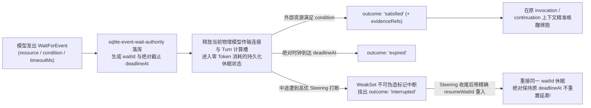

# 持久 Goal、Plan Mode 与 EventWait 挂起：彻底消灭长周期轮询空转

## 1. 为什么用 `while + sleep` 轮询长周期异步任务在工程上是场灾难？

现实工程里的 Agent 任务往往并不是在几秒钟内一口气跑完：
- 代码改完提了一个 PR，需要静静等 GitHub Actions CI 跑满 12 分钟出红绿灯；
- 一项长周期自驱目标（**Goal**）跨多个夜班轮次逐步打磨测试、修复编译报错并等待用户审阅；
- 某次定时巡检任务（`ScheduledTask`）需要在每个工作日上午自动检查构建产物的异常退化。

如果底层基础设施只懂“一条 Turn 同步跑到底”，模型想要等异步事件发生就只剩下一个笨办法——在循环里反复自己调 `sleep(30)` + `check_status()` 轮询试探。这会瞬间制造出三重浪费与隐患：
1. **白白空烧巨额上下文与 API 费用**：每隔 30 秒重新发起一次全量 LLM 推理只为了说一句“还没好，继续等”，12 分钟就能烧出 24 轮毫无意义的废话轮次把窗口填满；
2. **模型失去物理挂起耐性导致幻觉结案**：多轮空等后大模型极大概率产生上下文疲劳，自己编一句“看来差不多完成了”提前跑路；
3. **目标取消或会话归档时的并发竞态**：如果人类或管理员在后台删除归档目标会话的同时，一个刚在睡醒边缘的 Goal 迭代正准备发起下一轮触发——缺乏双阶段闭锁围栏就立刻引发“对着已销毁会话继续开新 Turn”的僵尸幽灵运行！

Maka TypeScript 版在 `packages/runtime/src/event-wait-tool.ts`、`plan-mode.ts`、`goal-*.ts` 与 `scheduled-task` 中，用**事件驱动挂起原语（`WaitForEvent`）**、**策略隔离执行窗（`Plan Mode`）**与 **两阶段闭锁围栏（`GoalSessionCloseFence`）**彻底替代了暴力轮询。

---

## 2. `WaitForEvent`：基于 `WeakSet` 防伪造与绝不重设死线的持久化休眠

查看 `packages/runtime/src/event-wait-tool.ts`，`WaitForEvent` 虽然从工具接口看起来只是个普通异步工具呼出，但它的内部契约极其犀利地化解了休眠等待中的两个死角：

留意其中两项极具防守深度的系统设计细节：
1. **`resumeWaitId` 不重设绝对死线**：如果在等待一个设了 10 分钟超时的异步任务途中，用户发来了一句临时询问（Steering Interruption），等插话处理完后模型恢复刚才的等待时只需传入原 `resumeWaitId`。内核严格沿用最初落库的物理绝对截止时间 `deadlineAt`，**绝不因为被打断过一次就重新从零倒数 10 分钟**，防止任何周期调度借打断无限延寿逃避超时熔断；
2. **基于内存 `WeakSet` 的不可伪造边际中断标记**：`isEventWaitSteeringInterruption` 文档指明：**只有真实经过 Host 工具桥签发出来的对象才能请求跨越 Code Mode 执行边界；模型自己通过纯文本或序列化 JSON 编出来的假 `{ kind: 'event_wait_result' }` 绝对无法伪造进入中断控制路径**！

---

## 3. Plan Mode：用运行时动态工具门控替代“全凭模型自觉别乱改代码”

许多工具会在 Prompt 里嘱咐一句“你现在处于规划模式，只准调查研究不准修改代码”，结果只要用户稍微催促一下或者几轮推理之后模型自己忘了初心，照样伸手一记 `apply_patch` 把仓库改了！

`packages/runtime/src/plan-mode.ts` 与 `plan-tools.ts` 直接将计划与实施在运行时权限层做了物理断路：
- **阶段动态工具门禁（Dynamic Tool Gating）**：在活跃处于 `Plan Mode` 期间，向 `AiSdkTurn` 与 `ToolRuntime` 注册的可执行边界自动降级收紧，屏蔽除纯粹调查分析、只读检索及特定受控计划草稿提交（`plan_submitted` / `plan_progress_updated`）之外的所有破坏性写工具，并在事件脊柱与审计账本上留下完整的方案变更足迹（`agent-run.ts` 内的九组 `plan_*` 事件）；
- **显式审批闸门越迁**：只有当结构化方案通过交互审批协议正式提交切换（`plan-coordinator`）至执行期后，对应的写工作区工具和隔离沙箱权限才会按配置放行启用。

---

## 4. 持久 Goal 自治循环与防并发撕裂：`GoalSessionCloseFence`

面对需要跨十数个异步唤醒轮次推进的长期目标（`Goal`），控制体系由三块精密组件联手护航：

| 协作模块 | 职责锚点 | 解决的复杂工程难题 |
| :--- | :--- | :--- |
| **`goal-state` & `goal-task-gate-policy`** | 评估当前 Goal 处于探索、等待唤醒、触及预算红线还是收敛完结；把守每一次自动派发新 Turn 的成本准入 | 确保后台无人照看的自动循环绝不会突破预设单轮或总消耗天花板 |
| **`goal-evaluator` & `goal-continuation`** | 在每轮迭代完结后客观测评目标进度是否达标、决定以何种合法边界接续推进下一阶段 | 避免大模型陷入“改完 A 改坏 B 再改回 A”的无效往复迭代空转 |
| **`GoalSessionCloseFence` (`goal-session-close-fence.ts`)** | 在 Host 决定归档（`archive`）或彻底移除（`remove`）某关联会话时启动双阶段锁定围栏 | **严防竞态僵尸苏醒**（详析见下节） |

### 为什么要为“删除一个 Goal 会话”专门写一套 `GoalSessionCloseFence`？

看一眼 `packages/runtime/src/goal-session-close-fence.ts` 的代码状态机：当管理员点击删除或归档一个仍在跑的长期目标时，底层硬盘数据库归档是个异步 I/O 动作；就在这半秒的并发窗口里，刚刚苏醒的一个后台 Goal 调度定时器极可能趁虚向那个行将就木的会话投递一轮新 Turn！

`GoalSessionCloseFence` 引入了类似数据库事务提交前的排他占用句柄集合 `holders: Set<symbol>`：
- 当 Host 开始归档/移除动作时调用 `fence.begin(sessionId, kind)` 登记一个待决占用符号，此刻 **`fence.isClosed(sessionId)` 立刻变成 `true`**，直接门外拦截一切试图向该会话派发新调度的后台请求；
- 若底层持久操作成功，调用 `operation.commit()` 将持久状态锁死为 `'archived' | 'removed'`；
- **最细腻的边界在于 `rollback()`**：如果由于磁盘锁冲突导致归档中途失败回滚，且已经没有其他挂起移除持有者时，触发 `onReopenedAfterRollback` 回调——文档注释清楚指出，**所有者此时依然必须确保任何此前已被撤销资格的 Goal 维持在真实安全的非自动偷跑态**，决不因为一次归档操作没成功就自动把一个已经被取消资格的后台定时器重新放出去乱跑！

---

## 5. 统一定时任务：`ScheduledTask`

为了彻底消除定时爬虫和周期自检各自搭一套粗糙定时器带来的管理混乱，系统依据 `docs/architecture/scheduled-task-unified.md` 与 `scheduled-task-store.ts` 统一收敛了所有定时唤醒源（包括规范化 `cron-expression` 验证与一次性延期计划）：
- 定时存储仅仅持久保存触发蓝图和校验过的授权基准；
- 到点唤醒后一律回归标准的 Host `SessionAdmissionGate` 并发准入路径发起隔离运行，全面遵守当前实时策略权限天花板及预算限额，与主对话体系共用同一套防呆设施。

---

## 6. 总结

Maka TypeScript 版让长周期后台自治真正从“高危烧钱实验室玩具”跨入可控工程级的关键，在于将**控制流从无脑轮询转换成了状态事件协同**：
1. **`WaitForEvent`**：以持久化 `waitId`、`resumeWaitId` 不重设绝对期限和不可伪造 `WeakSet` 标记，实现零空转 Token 浪费的精准休眠唤醒；
2. **`Plan Mode` 物理门控**：不靠 Prompt 说教，直接在工具运行时层锁死规划期的修改能力；
3. **`GoalSessionCloseFence` + `ScheduledTask`**：封杀后台Goal 在会话归档/撤销夹缝中的幽灵复苏，并统一并入权威准入机制。

至此，**05 排队准入、图协同与长程自治篇** 全部结束！前面我们已经搭好了运行时、上下文、沙箱、持久化与协作网络。现在进入整个教程最后一道实战护航维度——**06 可靠性、可观测与容器评测篇**：面对真实线上必然出现的网络限流抖动、三层重放冲突、并发计量对齐以及充满作弊诱惑的评测基准，系统该怎么打赢最后一公里运维与验证之战？请看第一篇：[三层故障收敛与防重放网关：看门狗、退避门控与宿主幂等准入](../06-operations/retry-timeout-idempotency.md)。
