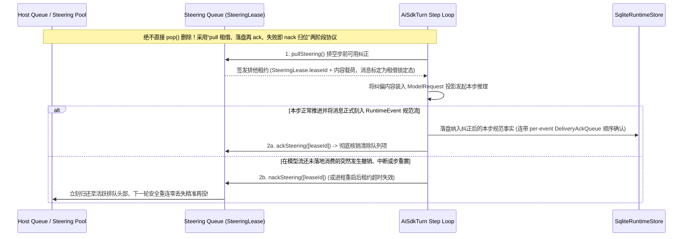

# 短时准入闸门与双阶段 Steering：Lease 交付结算、Follow-up 折叠与背压

## 1. 为什么在有并发交互的会话上，队列设计常常成为“丢消息或死锁”的隐形重灾区？

设想这样一个再普通不过的用户交互时刻：Agent 正在全速跑着一个包含 8 个连续工具步的复杂重构，用户在前端界面连发两条补充指示，几秒后因为看到方向稍微跑偏又迅速发了一条“停下来改用另一种实现（Steering）”，紧接着再点击了停机或新加了一句收尾任务（Follow-up）。

如果一个 Agent 运行时的队列只是拿内存里一个普通数组 `queue.push()` + `queue.shift()` 来回读写，很快就会接连遭遇四类极诡异的线上下毒事件：
1. **全局大锁阻塞灾难**：如果准入时直接拿互斥锁锁死会话对象直到整个 `AiSdkTurn` 跑完，那用户发任何一条 Steering 插话都会被门外死锁挡住长达数分钟，连点取消按钮都毫无反应！
2. **“出队了却没进上下文”的双重失踪（Queue Loss）**：工作协程从内存队列头 `shift()` 取出了用户的纠正消息准备在下一轮插进上下文；结果就在发请求前一毫秒撞上模型步取消或 `Attempt` 重试崩溃！内存队列已经删了它，模型历史又根本没收到它——用户打出去的那句最重要指令就这样彻底人间蒸发。
3. **停机瞬间新 Follow-up 幽灵偷跑**：用户刚刚按下 Stop 准备彻底刹停整个任务，一微秒前刚好挤进异步缝隙里的 Follow-up 队列项却又趁虚重新拉起一个新回合！
4. **无节流并发轰炸打崩容器与上游**：多个多智能体分支或高频事件同时涌入，缺少运行时入口并发限制与反压调节，瞬间把 Node 句柄或 API 配额吃光崩溃。

Maka TypeScript 版在 `packages/runtime-host/src/server/session-admission-gate.ts` 与 `packages/runtime/src/delivery-ack-queue.ts` / `admission-limiter.ts` 中构筑起了一整套**极短临界区准入闸门 + 三车道精细路由 + 基于 `leaseId` 租约的两阶段消息交付协议 + `StopFence` 停机围栏**。

---

## 2. 会话准入闸门（`SessionAdmissionGate`）与三车道明确路由

在任意写请求跨过 Host 大门踏入运行时之前，首先经过 **`SessionAdmissionGate`**。它的核心调度纪律极其克制：**锁只用来干最轻、最快的原子落盘校验，毫秒级完成准入落盘即立刻放锁，绝不拿着这把门锁去 `await` 任何哪怕 1 毫秒的大模型网络 I/O！**

为了防止前后并发乱序或者多锁互咬死锁，闸门遵循两项结构规约：
- **先持久化意后进队列**：消息一经通过合法准入，先将 `RootTurnAdmission`（或合法队列记录）原子落盘，确立唯一序位与溯源身份；如果涉及跨两个协同会话（如父与子）的边界变动，系统强制按会话 ID 字典序统一上锁先后次序，从拓扑上物理消灭互锁死结；
- **三条物理语义车道分离（`packages/core/src/message-queue-order.ts`）**：所有投递进来的交互需求绝不混成一个大杂烩队列，而是清晰归为三道：
  1. **`Immediate / Active Turn`**（空闲会话立即新开回合）；
  2. **`Steering`（运行中插话纠偏）**：专门用于插队打断或调整当前正在全速前进的执行步；
  3. **`Follow-up`（尾部追加跟进）**：礼貌排队等待当前回合及内部全套工具稳妥落地结算完毕后再按批跟进。

---

## 3. 核心防丢契约：基于 `leaseId` 的双阶段 `SteeringLease` 交付结算

这是解决“队列里已经 `shift()` 取出来了，但模型步骤刚好中途断线丢单”最精彩的一段工程抽象（对应 `packages/runtime/src/delivery-ack-queue.ts` 与 `AiSdkTurn` 的交互握手）：



只要看一眼这套 **Pull (Lease) → Commit → Ack / Nack** 机制（并与事件分发用的单消费者逐帧确认背压管道 `DeliveryAckQueue<T>` 相配合）就明白它的含金量：**从消息敲进队列直到确实刻进不可变 `RuntimeEvent` 脊柱之前的任何一微秒崩溃或取消，那条 `leaseId` 没有拿到最终的 `ackSteering` 回执，它永远稳稳留在持久化排队的队头位置，一个字都不可能悄无声息蒸发！**

```typescript
// 教学级契约提炼：短临界区跨会话排序加锁 + StopFence + SteeringLease 交付循环
async function admitAndDispatchTurn(gate: SessionAdmissionGate, sessionIds: string[], turnInput: TurnInput) {
  // 1. 涉及多会话联动时强制按 sessionId 字典序加锁，结构性消灭 AB/BA 哲学家死锁
  const orderedIds = [...new Set(sessionIds)].sort();
  return await gate.runWithOrderedLocks(orderedIds, async () => {
    if (stopFence.isFencedAfter(turnInput.targetSessionId, turnInput.clientEpoch)) {
      throw new Error('Rejected by StopFence: session was stopped prior to dispatch');
    }
    // 2. 极短持锁仅负责校验与持久入库 RootTurnAdmission，立刻释放闸门转交后台执行
    await store.appendRootTurnAdmission(turnInput);
    return scheduleBackgroundDrainTurn(turnInput);
  });
}
```

### 3.1 排队控制方案对照：全轮大锁 / 裸数组 vs 闸门 + 租约

| 机制维度 | 传统大锁或内存 `array.shift()` | Maka 短锁闸门 + `SteeringLease` + `StopFence` |
| :--- | :--- | :--- |
| **并发吞吐阻塞** | 持锁等待完整推理，用户插话或点取消直接死卡 | 闸门仅覆盖微秒级准入入库，长耗时阶段全程零持有全局锁 |
| **取消/重连防丢失** | `shift()` 出队后遇取消或崩盘即永远丢失纠正消息 | 未拿到 `ackSteering` 绝不删除，中断立刻 `nackSteering` 自动回位 |
| **停机瞬时缝隙防护** | 按下 Stop 一毫秒前挤进的异步 Follow-up 偷偷起跑 | `StopFence` 按代次/水位铁幕一键拦停边界缝隙内的偷跑跟进请求 |

---

## 4. 回合收尾折叠、`Follow-up` 批处理与 `StopFence` 幽灵拦截

当一个繁忙的长回合终于走到了没有工具调用、模型吐出完成结束语的瞬间，紧绷的并发收尾竞态才真正开始。如果不严加整理，同时涌入的三波后继请求能瞬间把收尾搞成一锅粥：

1. **Follow-up 批处理折叠（Batch Coalescing）**：假设用户在一轮 40 秒长的修改过程中接连在 Follow-up 车道上发了三条零散追加需求（“顺便补上单测” / “记得格式化” / “更新 README”）。如果在老回合结束时盲目连开三次彼此隔绝的 Turn，会浪费三倍成本且第一棒的测试跑完还没格式化！Maka 在结算收尾检查处将积压在同一车道的合法 Follow-up 请求**有序折叠归拢为同一批完整连续的输入切片**，合并开启 cleanly 的新接力回合。
2. **`StopFence` 停机铁幕防抢跑**：只要宿主通过 `RootTurnCoordinator` 发出了显式的 `StopSession` 请求，不仅立即唤醒打断在途流，还会沿着时间线竖立一道硬性的 **`StopFence`**：任何正处于边界隙缝打算刚入列或者准备触发 Follow-up 自动接力的待命任务，一撞上对应代次或高于停机水位的 `StopFence` 当场全部冻结中止，**彻底消灭“已经点下 Stop 停止了，怎么 1 秒后自己又偷偷开始跑下一个任务”的幽灵延续**。

---

## 5. 执行侧最后背压阈值：`AdmissionLimiter`

即便入队与调度全按单锁与租约管得井井有条，当后台出现多个协同 Graph 节点并肩推进、几十个模型检索工具并行启动时，宿主机物理 CPU、文件描述符与上游并发配额依然面临瞬时拥塞风险。

`packages/runtime/src/admission-limiter.ts` 充当着执行引擎物理层的统一限流闸阀（也被 `acp-executor-plugin` 与工具并行组共同遵守）：
- **显式配额与等待队列背压**：将同时能够处于活跃状态的重计算/网络模型执行实例数量与工具重负载窗口控制于确定预算槽位之内；当并行任务达到配额天花板时，后续通过 `SessionAdmissionGate` 进入的合法运行体自动进入轻量阻塞挂起队列，平稳排队等待释放槽位而不触发任何拒绝崩溃；
- **配合取消信号即刻撤梯**：挂在限流队列外等候的执行请求依然全力响应外部 `AbortSignal`，用户在等待排队窗口内反悔点停止即可无代价零成本退场，不白等、不残留占位槽。

---

## 6. 总结

`queues-and-admission` 解决的正是传统架构最不屑一顾、却最频繁出线上诡异失踪 bug 的边界：
1. **闸门与运行解耦**：`SessionAdmissionGate` 只拿几毫秒写准入事实，绝不用会话锁窒息整个推理期交互能力；
2. **绝不裸 `pop()`，只用 `SteeringLease`**：把每条插话纠偏的投递升级为完整的 **`leaseId` -> Ack/Nack 事务闭环**，保证突发取消或断流时消息安然归位零遗失；
3. **收尾 `Follow-up` 折叠 + `StopFence` + `AdmissionLimiter`**：既消除并发细碎启动的冗余消费，又用停机铁幕拦住边界偷跑、用执行并发限流护住整机系统稳健性。

理清了单个与关联队列的消息保真与拥塞调节之后，我们终于可以迈入真正壮观的多智能体并发协同世界：**当系统在同一时刻派生一个架构师、三个分别修改不同模块的子工程师和一个测试评审官组成并行流水线时，怎么组织它们之间的通信拓扑、怎么靠 Git Worktree 让它们并发改代码却绝不互相踩踏覆盖、又如何用一套状态图机制免除“另造第二套复杂 Runtime”的陷阱？** 下一篇全盘拆解多智能体协同引擎：**[Agent Graph 调度平面与 Swarm：角色 Worktree 隔离、Yield 收敛与 WorkHub 投影](./agent-graph.md)**。
