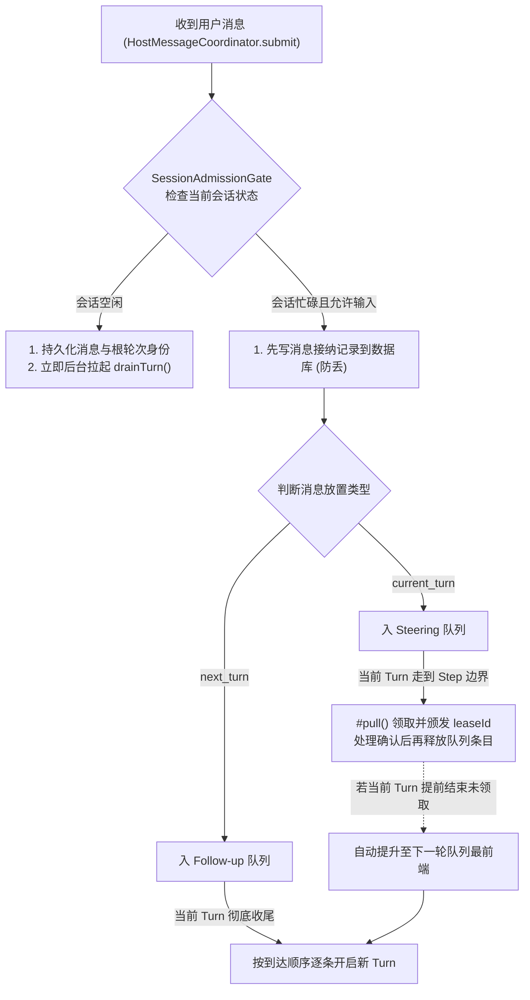

# 输入队列与执行准入

[返回手册目录](../README.md)

当 Agent 正在专心检查项目代码并准备修改配置时，用户在输入框里先后敲下了两句话：
1. 第一句：**“先别改，只读分析！”**
2. 第二句：**“分析结束后顺便检查一下构建日志。”**

如果系统不加区分地把这两句话都直接塞进当前正在请求的上下文，或者粗暴地拒绝用户在运行期间发送任何消息，交互体验会变得极其糟糕。Maka 通过**准入控制门（Admission Gate）**与**双模式输入队列（Steering / Follow-up）**，精准协调用户指令的介入时机，并利用并发配额限制后台资源过载。

---

## 1. 概念先行：Steering（引导）vs Follow-up（后继）

面对一个正在忙碌的会话，用户的补充输入其实包含两种截然不同的意图：

| 维度 | Steering (`current_turn`) | Follow-up (`next_turn`) |
| :--- | :--- | :--- |
| **典型指令** | “先别改，只读分析！” | “等这轮结束后，再去检查日志。” |
| **业务语义** | **纠偏与引导**：中途修正当前正在执行的任务方向。 | **排队追加**：预约当前任务完成后的下一项独立工作。 |
| **生效边界** | 当前 Turn 的**下一个模型 Step 边界**立刻拉取注入。 | 必须等到当前 Turn **完全收尾并结清**之后再开启新 Turn。 |
| **执行身份** | 融入当前现有的 `turnId` 与 `runId`。 | 分配全新的 `turnId` 与 `runId`，作为新轮次执行。 |

---

## 2. 准入流程与双队列调度全景

当一条消息到达 Host 时，必须通过会话准入门（`SessionAdmissionGate`）的串行保护，避免两个并发请求同时判定“会话空闲”而启动双份冲突的根循环。



### 关键设计原则：先落盘接纳记录，再进内存队列
在 Maka 中，消息准入后**首先将接纳记录写入存储层**，随后才压入内存调度队列。如果进程在消息排队期间意外崩溃，重启恢复时可以从存储中捞出所有“已接纳但未消费”的消息，保证用户发出的指令绝不凭空蒸发。

---

## 3. 投递租约（Delivery Lease）：防止引导消息丢失

设想一个微妙的并发时序：正在运行的 `AiSdkTurn` 在第 2 步边界调用 `#pull()` 拿走了 Steering 队列里的“先别改！”。就在 Turn 还没来得及把这句话写入事件账本并送给模型时，Turn 突然因为网络超时或被取消而退出了。

如果 `#pull()` 一旦被调用就直接把队列里的消息物理删除，那用户的这句关键引导就会彻底丢失！

为了解决这个问题，Host 的消息协调器引入了**投递租约（`leaseId`）机制**：
1. **领取加锁**：Turn 调用 `#pull()` 时，Host 返回待处理的 Steering 消息列表，并生成一个唯一的 `leaseId`，此时消息在队列中处于“已租出（Leased）”状态。
2. **确认核销**：只有当 Turn 将这批引导内容安全写入 `RuntimeEvent` 账本后，才向 Host 确认该 `leaseId`，Host 此时才正式释放驻留条目。
3. **兜底顺延**：如果当前 Turn 在确认前意外终止，Host 在轮次终结清理时会自动回收未核销的租约消息，**将它们优先排在所有 Follow-up 消息的最前面**，作为下一轮的首批输入。

---

## 4. 资源背压：子任务与后台 Shell 的名额配额

除了用户聊天输入的排队，Agent 在运行过程中自身也会衍生出大量并发资源消耗（如同时启动 10 个子智能体读文件，或者启动多个后台 `Bash` 编译服务）。如果不加限制，瞬间就能把宿主机内存或 API 速率限制打爆。

Maka 通过**准入限流器（`AdmissionLimiter`）**在内核层实施背压控制：

- **子任务并发配额**：当模型在同一个 Step 内并发规划多个子 Agent 任务时，每个子任务必须先向当前轮次的 `AdmissionLimiter` 申请运行许可。名额耗尽时，多余的子任务会在限流器前异步挂起排队，直到前方子任务结束释放许可。
- **后台 Shell 进程配额**：当模型调用 `Bash(..., run_in_background: true)` 时，进程管理器（`ShellRunProcessManager`）会在真正派生操作系统进程前抢占一个 Shell 名额。注意：**虽然工具本身可以立即返回一个后台任务引用让模型继续往下思考，但该 Shell 名额会一直被占用，直到后台进程真正物理退出、资源收尾完成时才归还。**

---

## 5. 教学伪代码：会话准入与带租约的队列消费

```text
class SessionMessageQueueCoordinator:
    steeringQueue = []
    followUpQueue = []
    leasedItems = new Map() // leaseId -> items

    // 1. 消息准入入口
    function submitMessage(sessionId, msg, placementMode):
        // 在会话准入互斥门内执行，消除“同时判空”竞态
        withLock(admissionGate.forSession(sessionId)):
            // 无论忙闲，先持久化接纳记录确保消息不丢
            record = store.commitAdmittedMessage(sessionId, msg, placementMode)

            if not runtimeKernel.isSessionBusy(sessionId):
                // 会话空闲：直接异步开启新的根 Turn
                return rootCoordinator.startFromMessage(sessionId, record)

            // 会话忙碌：按放置模式分类入队
            if placementMode == "current_turn":
                this.steeringQueue.push(record)
            else:
                this.followUpQueue.push(record)

    // 2. Step 边界带租约拉取 Steering
    function pullSteeringWithLease():
        if this.steeringQueue.isEmpty():
            return null
        
        items = this.steeringQueue.drainAll()
        leaseId = generateUUID()
        this.leasedItems.set(leaseId, items)
        return { leaseId, items }

    // 3. Turn 持久化成功后核销租约
    function ackSteeringLease(leaseId):
        this.leasedItems.delete(leaseId)

    // 4. 轮次结束时的兜底顺延与后继调度
    function onTurnTerminated(sessionId):
        // 任何未核销的 Steering 消息，优先推入下一轮启动队列前端
        unacked = flatten(this.leasedItems.values()) + this.steeringQueue.drainAll()
        this.leasedItems.clear()

        if unacked.length > 0:
            return rootCoordinator.startFromBatch(sessionId, unacked)
        
        if not this.followUpQueue.isEmpty():
            nextMsg = this.followUpQueue.shift()
            return rootCoordinator.startFromMessage(sessionId, nextMsg)
```

---

## 6. 对照 Pi：内存双队列 vs 持久准入网关

- **Pi 的做法**：`Agent` 类内部直接维护了 `steer()` 和 `followUp()` 两个内存队列。外层循环在工具批次完成后检查 `steering` 队列，在准备退出循环前检查 `followUp` 队列。在单机本地交互中极为顺畅；其实验性 `durable` 模式则额外增加了持久化的 `inbox` 与 `applyBoundary()`。
- **Maka 的做法**：由于必须服务多客户端并发输入与崩溃恢复，Maka 将排队逻辑上移到了 Host 层的准入网关中，配合持久化接纳记录、投递租约（`leaseId`）以及子任务/后台进程的背压配额（`AdmissionLimiter`），构建了全方位的流量与并发护栏。

---

## 7. 延伸阅读

- 了解 `AdmissionLimiter` 限流下，多个子 Agent 是如何组成任务依赖图协作的，阅读 [05.2 任务图与多 Agent 协作](agent-graph.md)。
- 了解 `startFromMessage()` 开启一个新轮次后的全链路时序，阅读 [01.1 从输入到回答](../01-runtime/request-to-response.md)。
